# Pro-Act application logic guide

**Who it is for:** the product owner. It teaches what Pro-Act does, the vocabulary it uses, and the exact rules behind every number and every button.

**How it is written:** each topic follows the same pattern:
- **How it works**: the idea in plain language.
- **The rule from the code**: the formula or rule, with the file it lives in.
- **Example**: a worked example with numbers.
- **Where you see it**: the screen.

All backend paths are relative to `server/pro-act-backend/src/`, and frontend paths to the repo root. Sources are the code as of 2026-10-12 and the decision register `plans/DECISIONS.md`. Where older documents disagree with the code, the code wins (see §23).

**Companion:** [PERSONA_USER_FLOWS.md](PERSONA_USER_FLOWS.md) gives the click paths for each persona.

> **Intended end state.** These changes were landing on 2026-10-12 and are described as done:
> - capability-based hiding of write buttons;
> - separation of duties on plan, profile, rate, valuation-rate and FX approvals;
> - the v2 RCA knowledge base (server search, votes, publish, similar past RCAs, server quality score);
> - the showcase demo dataset ([DEMO_SHOWCASE_DATA.md](DEMO_SHOWCASE_DATA.md)).

---

## Contents

1. [Purpose: the loop Pro-Act runs](#1-purpose-the-loop-pro-act-runs)
2. [The plant model and vocabulary](#2-the-plant-model-and-vocabulary)
3. [Time, units and numbers](#3-time-units-and-numbers)
4. [Calendars, shifts, schedule classes, crews](#4-calendars-shifts-schedule-classes-crews)
5. [Production profiles and rates](#5-production-profiles-and-rates)
6. [Plans and period generation](#6-plans-and-period-generation)
7. [Events: the interval model, axes, states, revisions](#7-events-the-interval-model-axes-states-revisions)
8. [Code libraries and declarative rules](#8-code-libraries-and-declarative-rules)
9. [Production periods, actuals and adjustments](#9-production-periods-actuals-and-adjustments)
10. [Loss accounting: two ledgers, the waterfall, attribution and residual](#10-loss-accounting-two-ledgers-the-waterfall-attribution-and-residual)
11. [Reconciliation workflow and separation of duties](#11-reconciliation-workflow-and-separation-of-duties)
12. [Valuation: rates, policy, FX, IRR and USD](#12-valuation-rates-policy-fx-irr-and-usd)
13. [KPIs: OEE, downtime, MTBF and MTTR, Pareto](#13-kpis-oee-downtime-mtbf-and-mttr-pareto)
14. [RCA: triggers, cases, actions, verification, knowledge base](#14-rca-triggers-cases-actions-verification-knowledge-base)
15. [Data intake: PI, MQTT, raw store, normalization, quarantine, replay](#15-data-intake-pi-mqtt-raw-store-normalization-quarantine-replay)
16. [Feature flags, v1 and v2, cutover](#16-feature-flags-v1-and-v2-cutover)
17. [Multi-tenancy, roles and the role × capability matrix](#17-multi-tenancy-roles-and-the-role--capability-matrix)
18. [Audit](#18-audit)
19. [Exports and downstream events](#19-exports-and-downstream-events)
20. [API conventions you will see in messages](#20-api-conventions-you-will-see-in-messages)
21. [Glossary](#21-glossary)
22. [FAQ: why does the app do X?](#22-faq-why-does-the-app-do-x)
23. [Where code and older documents disagree](#23-where-code-and-older-documents-disagree)

---

## 1. Purpose: the loop Pro-Act runs

Pro-Act answers four questions for a process plant:
- **What did we lose?**
- **Why?**
- **What is it worth?**
- **Did our fix work?**

It replaces spreadsheets with a governed loop. Every number traces back to a source record, and every approved number is frozen.

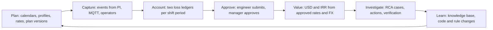

**Design principles**, from the specification (`plans/SPEC_ANALYSIS.md`) and `CLAUDE.md`:

1. **The server computes every business number.** The browser never computes OEE, losses or values, and never writes on page load.
2. **Sources are preserved.** Raw messages are kept unchanged. A source update never wipes a user's coding.
3. **Nothing is fabricated.**
   - A missing price is "not valued", not 0.
   - Missing data gives "null with a reason", not 87 % or 100 %.
4. **Approved means immutable.** Corrections create new revisions or change proposals; they never overwrite.
5. **Two people for every approval** (separation of duties).
6. **Each plant is isolated.** The tenant comes from your identity, never from a parameter you send.

---

## 2. The plant model and vocabulary

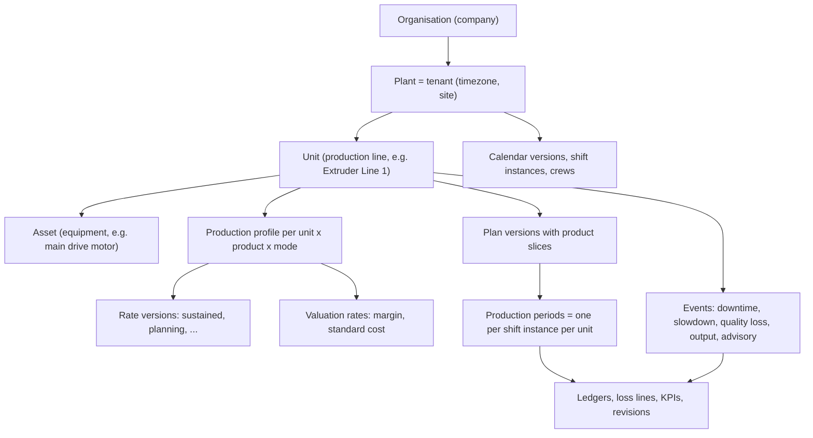

| Term | Meaning in Pro-Act |
|---|---|
| **Organisation** | A company. It owns plants. Products belong to the organisation. |
| **Plant / tenant** | One site, with its timezone (Demo Plant uses Asia/Tehran per D03). Almost every record carries its tenant id. "Tenant" and "plant" mean the same thing. |
| **Unit** | A production line or major machine whose output is accounted for, e.g. Extruder Line 1. Loss accounting is per unit. |
| **Asset** | Equipment inside a unit (motor, gearbox, die plate). Used for bad-actor analysis, failures and RCA, not for output. |
| **Product** | What a unit makes (e.g. HDPE PE100 pipe grade). A unit can make several products, one after the other (sequential campaigns, D14). |
| **Profile** | "Unit X making product P in mode M", with a quantity unit (t) and a rate timebase (h). It carries rates. |
| **Plan version** | A target for a unit over a window, split into product slices and then into per-shift targets. |
| **Production period** | One shift of one unit, the accounting leaf (D03). Days and months are roll-ups. |
| **Event** | Something that happened on a unit over an interval: a stop, a slowdown, a quality loss, an output count or an advisory alarm. |
| **Revision** | A frozen version of something: an event revision, an accounting revision, a code version, a rule version. |
| **Ledger** | The explanation of a period's numbers. **Capacity ledger** (vs what the line could make) and **plan ledger** (vs what we planned). |
| **Loss line** | One explained piece of a gap: kind, quantity, cause, evidence. |

---

## 3. Time, units and numbers

**How it works**
- All instants are stored in UTC (`timestamptz`).
- Intervals are **half-open** `[start, end)`. The end instant is not inside. So 06:00–14:00 and 14:00–22:00 touch but do not overlap.
- Durations are **seconds**.
- Screens show plant time with the offset, e.g. `06:00 (+03:30 Asia/Tehran)`.
- Duration display: "90 min" in lists, "1:30" in KPI tiles, "1 h 30 min" in text (decision C1).

**The rule from the code**
- `domain/time/interval-algebra.ts`:
  - `durationSeconds(interval, asOf)`: an open event (`end = null`) is measured up to "as of" now.
  - `clip()`: cuts an interval to a window.
  - `union()`: merges overlapping pieces.
- Quantities and money use exact decimals (`decimal.js`), stored with 8 decimals.
- KPI ratios keep 10 decimals (`domain/kpi/kpi-values.ts`).
- Floats are never used for money.

**Example (fixtures T01, T03, T29)**
- 06:00–07:30 is 5,400 s.
- Two overlapping stops on one unit, 10:00–11:00 and 10:30–11:30, are 5,400 s of unit downtime, not 7,200 s. The unit is down once.
- A stop 05:50–06:20 across the 06:00 shift change gives 600 s to the night shift and 1,200 s to shift A. It is still **one occurrence**.

**Where you see it:** every time column, and the "Plant time (…)" hint in forms.

---

## 4. Calendars, shifts, schedule classes, crews

### 4.1 How it works

A **calendar version** describes the plant's working pattern:
- IANA timezone;
- operational day start (06:00 at Demo Plant);
- shift templates (A 06–14, B 14–22, C 22–06);
- holidays;
- schedule exclusions (planned shutdown, turnaround, no demand);
- optional working intervals.

**Publishing** generates **shift instances**: real UTC intervals, one per shift per day, from up to 366 days back to 90 days ahead. An hourly worker keeps the 90-day horizon topped up.

**Published versions are immutable.** A change is a new version.

### 4.2 The rules from the code

- **Validation** (`domain/calendar/calendar-definition.ts: assertCalendarDefinition`): refusal codes `INVALID_TIMEZONE`, `NO_SHIFT_TEMPLATES`, `DUPLICATE_SHIFT_NAME`, `OVERLAPPING_SHIFTS`, `INVALID_LOCAL_TIME`, …
- **DST** (`shift-generator.ts`):
  - A spring-forward gap shortens a shift (`dst_gap`).
  - The fall-back hour counts twice (`dst_repeat`).
  - Tehran has had no DST since 2022, but the generator is tested on Berlin, New York, Dubai, Lord Howe and Tehran.
- **Operational day:** a shift that starts before 06:00 belongs to the previous production date, so shift C of the 12th runs 22:00 on the 12th to 06:00 on the 13th.
- **Holidays:**
  - `excluded` removes all shifts of that date from scheduled time.
  - `reduced` only warns.
- **Exclusions** split the instances they cut and are marked `planned_shutdown`, `turnaround` or `no_demand`.
- **Working intervals:** shift time outside them becomes `non_working`.
- **Time classification of a window** (`schedule-metrics.ts: scheduleBreakdown`):
  - `scheduledSeconds` (S): non-excluded shift time. This is the denominator of OEE.
  - `scheduleExclusionSeconds`: excluded time, by kind.
  - `unscheduledSeconds`: time covered by no shift.
- **Which calendar applies** (`calendar-resolution.ts`): the unit's own published override if one exists, else the site calendar, else no shifts.
- **Crews** (`crew-rotation.ts`):
  - On date d, the crew works `cycle[(d − anchor) mod length]`; `-` (null) = day off.
  - Two crews matching one shift → `crew_conflict` warning.
  - Crews never change time denominators.

### 4.3 Schedule classes

Every stop carries one schedule class (`domain/events/event-classification.ts`):

| Class | Meaning | Effect |
|---|---|---|
| `planned` | Maintenance, grade changeover, cleaning, inside scheduled time | **Reduces availability** (D04, ISO 22400 default). Never triggers an RCA. Not an "exclusion" unless it was put in the calendar. |
| `unplanned` | Breakdowns, trips | Availability loss. Triggers RCA at ≥ 60 min. |
| `external` | Utilities, grid dip, no trucks, upstream unit down | Availability loss, reported separately. |
| `unknown` | Nobody knows yet | Shown as "Unknown time", which makes known downtime a **lower bound**. |

The difference between a **calendar exclusion** and a **planned stop**:
- An exclusion (turnaround in the calendar) takes the time **out of scheduled time S**. The capacity ledger shows it as `schedule_exclusion`.
- A planned stop is **inside S** and costs availability.
- An engine switch (`plannedStopsInsideScheduleReduceAvailability`, default true) could move planned stops to exclusion. D04 kept the default.

### 4.4 Example

Calendar: Asia/Tehran, day start 06:00, three 8-hour shifts, a turnaround exclusion 1 Nov 06:00 – 3 Nov 06:00.

The two days of turnaround produce shift instances marked excluded (kind `turnaround`). Their 172,800 s count as exclusion, not as downtime, so the turnaround does not lower availability.

**Where you see it:** Plans, Profiles & Calendars → **Calendars & crews**, including **Preview** with DST warnings. Periods show an "Excluded" badge.

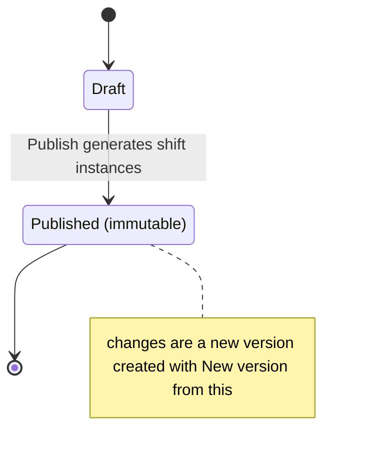

---

## 5. Production profiles and rates

### 5.1 How it works

A profile says "Extruder Line 1 making HDPE PE100 in normal mode, measured in t, rates per h". It carries effective-dated **rate versions** of several kinds.

There is deliberately **no single "ideal rate"**:

| Rate kind | Used for |
|---|---|
| `sustained` (also "MPC"; an MPC import becomes sustained) | **Capacity ledger and OEE ideal rate** |
| `planning` | **Plan targets and plan ledger** |
| `nameplate`, `demonstrated` | Reference |
| `budget`, `forecast` | Imported documents (corrections replace by document id); may be 0 |

Nameplate, demonstrated, sustained and planning must be **> 0**, because quantities are divided by them.

### 5.2 Versioning rules (shared by profiles, rates, valuation rates and FX rates)

Code: `profiles/versioning.ts`, `domain/profiles/version-window.ts`.

- **States:** `draft` → `approved` → `retired`. Drafts are edited; approved rows are never edited.
- **Validity** is half-open `[from, to)`. Approved versions of one key never overlap. A database exclusion constraint enforces this too.
- **Approving an overlapping version** gives **409 `VERSION_OVERLAP`**, which names the conflicts.
- **Supersede:** with "Supersede the approved predecessor" ticked, the one predecessor that starts earlier is closed exactly at the new version's `from`. It never shortens anything else.
- **Separation of duties** (owner decision 2026-10-12): the author of a draft cannot approve it (403 `SEPARATION_OF_DUTIES`). Rows created by the system or by migration have no author and are exempt.
- **Roles:**
  - Drafts: `master_data_admin` or `manager_approver`.
  - Approve, retire, import: `manager_approver`.
  - Unit-limited users get 403 `TENANT_SCOPE_REQUIRED` on plant-wide items.

### 5.3 Rate arithmetic (`domain/profiles/rate-math.ts`)

```
ratePerSecond          = rate / timebaseSeconds
idealProductionSeconds = quantity / ratePerSecond
quantityOver(seconds)  = ratePerSecond × seconds
```

**Example (showcase Extruder Line 1):**
- Sustained rate 32 t/h = 0.0088889 t/s, so an 8 h shift has a capacity of 256 t.
- Planning rate 29.44 t/h (92 % of sustained, as seeded), so planning capacity = 235.52 t.
- A rate change inside a stop is valued per version (T30): 30 min at 100 t/h + 30 min at 120 t/h = 110 t lost.

**Where you see it:** `/planning?tab=profiles` → the profile's page (`/planning/profiles/:profileId`), in its "Rates" table, which includes a "Per second (server)" column.

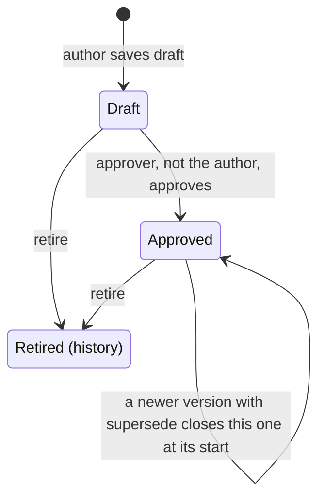

---

## 6. Plans and period generation

### 6.1 How it works

A plan has versions. Each version has:
- a scenario (default: the accounting baseline);
- a unit;
- a window `[validFrom, validTo)` (up to 400 days);
- a **basis**;
- product slices (sequential campaigns).

**Generating periods** turns the version into one target per shift instance. Preview first; nothing is stored until **Generate periods**.

### 6.2 Lifecycle (`domain/plans/plan.types.ts`, `plans/plan-approval.service.ts`)

- There is at most one open version (draft or submitted) per plan.
- **Approve** requires all of the following:
  - the periods have been generated, else 409 `PERIODS_NOT_GENERATED`;
  - no approved slice of another plan in the same scenario with the same unit and product overlaps in time, else 409 `PLAN_OVERLAP`;
  - a manager approver who is **not the author** (SoD).
- **On approval:**
  - the previous approved version becomes `superseded` and its periods stay frozen;
  - the outbox emits `PlanVersionApproved`;
  - already-reconciled periods of the old baseline receive a `plan_change` **change proposal** (§11.5).

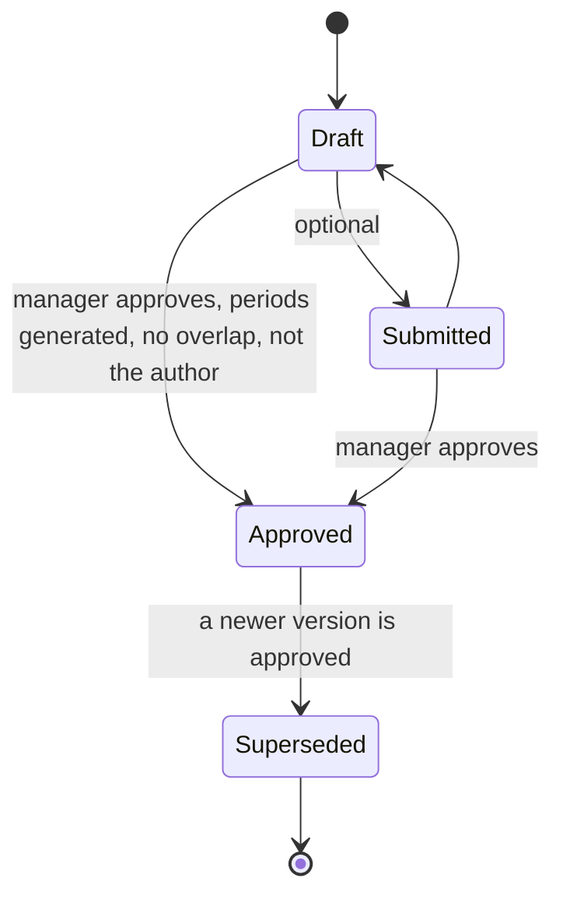

### 6.3 Targets (`domain/plans/target-rules.ts`, `target-distribution.ts`)

**Leaves** are the unit's stored shift instances, clipped to the plan window. An excluded leaf has 0 scheduled seconds. For each leaf:

```
planningCapacity(leaf) = scheduledSeconds × ratePerSecond(planning rate in force at the leaf start)
```

The target depends on the basis:

| Basis | Target per leaf |
|---|---|
| `time` | = planning capacity of the leaf |
| `quantity` | the header target is distributed: `scheduled_capacity` (default, weights = planning capacity), `equal`, or `explicit_weights` |
| `manual` | per-leaf entries, which must add up to the header (`TARGET_SUM_MISMATCH`) |

**Distribution rule:** each share is `total × w / Σw`, truncated to 8 decimals. **The last eligible leaf takes the remainder**, so Σ = target exactly.

Example: 100 t over three equal leaves gives 33.33333333 + 33.33333333 + 33.33333334.

**Refusals:**
- `NO_ELIGIBLE_TIME`: a positive target but no scheduled time.
- `MIXED_UOM`, `WEIGHTS_REQUIRED`, `TARGET_REQUIRED`.

**Warnings:**
- `missing_planning_rate`, `missing_sustained_rate`, `excluded_leaf`, `dst_leaf`.
- `rate_change_inside_leaf`: the rate at the leaf start applies to the whole leaf.

**Example:**
- Header 5,000 t, quantity basis, scheduled-capacity distribution, over 30 days × 3 shifts of Extruder Line 1 with no exclusions.
- Every shift has the same planning capacity of 235.52 t, so each gets 55.5555… t truncated, and the last shift takes the remainder.
- With a turnaround, its excluded shifts get 0 and the others share the 5,000 t.

**Where you see it:** `/planning?tab=plans` → the plan's page (`/planning/plans/:planId`) → **Preview periods** (columns Target, Planning cap., Sustained cap.; Σ badge "= header").

---

## 7. Events: the interval model, axes, states, revisions

### 7.1 The interval model

An event is `[start, end)` on one unit (optionally one asset). Rules (`domain/events/event-interval.validation.ts: resolveInterval`):

| Input | Result |
|---|---|
| start + end | interval |
| start + duration | end = start + duration |
| end and duration both | must agree within 1 s, else 422 `DURATION_CONFLICT` |
| end ≤ start | `END_BEFORE_START`; a downtime with end = start is `ZERO_DURATION_DOWNTIME` |
| neither | **open event**: still running; elapsed is computed by the server "as of" now |

An open event is never given a fake end. The old PI "9999-12-31" sentinel is converted to "open".

### 7.2 Four independent classification axes

| Axis | Values | Decides |
|---|---|---|
| Physical type | downtime, slowdown, quality_loss, production_output, advisory | what happened |
| Schedule class | planned, unplanned, external, unknown | §4.3 |
| OEE component | availability, performance, quality, idle, none | which OEE factor it hits |
| Impact mode | none, full_stop, fractional (with a 0–1 fraction), measured | how much capacity it removes |

Plus the **cause code** (reason → impact code, §8).

**Advisory events** (old IOW, SOL, APM and work-order alerts) **never create a loss on their own** (T42). They can only recommend an RCA.

### 7.3 Three state dimensions (DT11)

| Dimension | Values | Moves when |
|---|---|---|
| Physical | open → closed; superseded; retracted | the end is set or removed; split or merge (superseded); a source deletion (retracted, a tombstone, never deleted) |
| Coding | uncoded → coded → reviewed | a reason code is set; `reviewed` only from the v1 labels Closed / Completed. **Never moves backwards.** |
| RCA | none → required → linked → completed | a v1 auto-create sets required; linking to a case sets linked; closing the case sets completed (sticky) |

The old v1 status label is derived from the three states (`domain/events/legacy-status.ts`), in this order of precedence:
1. retracted or superseded → Cancelled
2. RCA required → RCA Required
3. RCA linked → Investigating
4. RCA completed → Completed
5. reviewed → Closed
6. coded → Coded
7. otherwise → Open

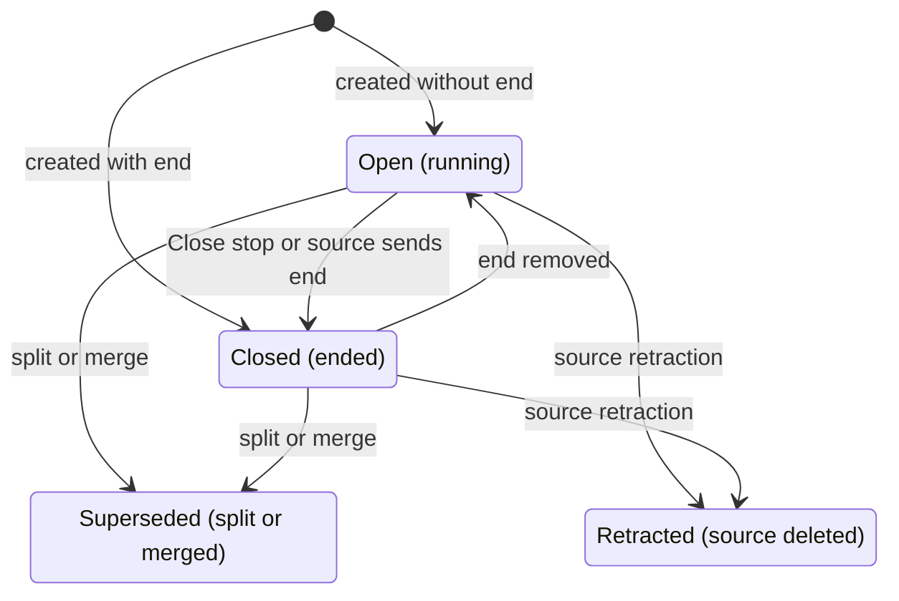

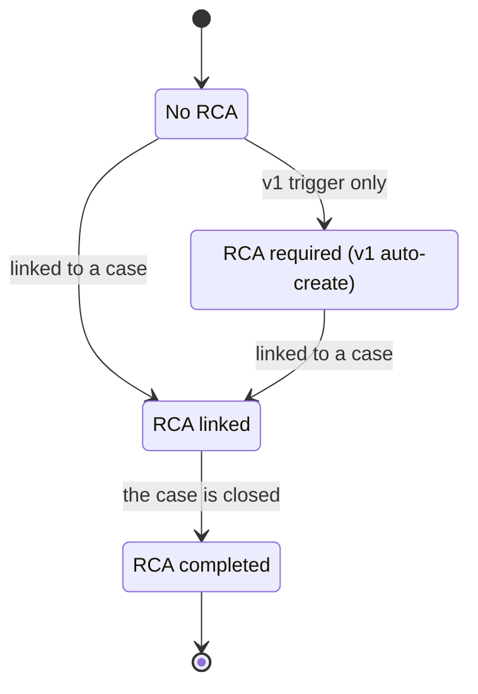

A v2 **recommendation** ("RCA recommended: …") does **not** change the RCA state. Only linking does.

**"Open" (running) means no end time and not superseded or retracted** (`domain/events/open-event.ts`). A split parent keeps the interval it had, possibly without an end, but it is never a running stop: `isOpen=true` leaves it out and its view says `isOpen: false`.

### 7.4 Revisions and source ownership (plan 1.2)

Every change writes an immutable **event revision** (kinds: source, user, system, retraction). It holds both the *source facts* and the *effective facts*.

**Field ownership** (`production-event/revisions/event-facts.ts`):

| Owned by the source (PI, MQTT) | Owned by the user (coding layer) |
|---|---|
| start, end, description, quantity, severity, asset, … | reason, impact and OEE codes, schedule class, OEE component, impact mode and fraction |

**When a source re-delivers** (`source-revision.ts: applySourceIn`):
1. **Identical content:** counted as a duplicate. No new revision, nothing changes.
2. **Changed field the user did not override:** updated.
3. **Changed field the user overrode:** the user value stays, and a review item `source_vs_override_conflict` opens. The user chooses **Keep my value** or **Accept source**.
4. **The source now sends exactly the user's value:** the override is dropped and the item auto-resolves.
5. **The event was already split or merged:** a `late_correction` review item.
6. **Coding, RCA and workflow state are never reset by a source.** This was bug B5 in the old system, where a PI re-sync reset the status to Open.

**Editing times of a source event** in v2 is refused with 409 `SOURCE_OWNED`. To end a running source stop, use **Close stop**: the end becomes a user override and opens `pending_source_confirmation`, which resolves when the source sends the same end.

### 7.5 Operations (plan 1.4)

| Operation | Rule | Effect |
|---|---|---|
| **Split** at t | start < t < end (before now if open) | Two children keep the coding and the **occurrence id**. Quantity and cost are prorated by duration (Σ conserved). The parent becomes superseded. |
| **Merge** 2–50 events | One unit; same physical type and schedule class unless overridden; gap ≤ "Largest gap to bridge" (default 0); no conflicting non-null coding (`MERGE_CODING_CONFLICT`) | One event spans the union, quantities are summed, the earliest occurrence is kept, contributors become superseded |
| **Close** | end after start and not in the future | "Closing is not approving": it only sets the end |
| **Bulk code** | Preview first. ≤ 500 events: atomic, refused whole if any is excluded. > 500 (max 10,000): background job in chunks of 200, possibly `partial` | Sets reason, schedule class and OEE component. Reason defaults apply. |

Nothing is ever deleted. Split and merge children keep the occurrence, so **a split stop still counts as one stop** for KPIs.

### 7.6 Example

A stop on Extruder Line 1, 09:10–10:25 (4,500 s), is split at 09:40:
- child 1: 1,800 s;
- child 2: 2,700 s;
- one occurrence.

If it had a quantity of 30 t, the children get 12 t and 18 t.

**Where you see it:** **Event Hub**: state badges, the event page (`/events/:eventId`) with tabs "Values", "History", "Review", "Evidence", "Periods", and the Split, Merge, Close stop and Bulk code dialogs.

---

## 8. Code libraries and declarative rules

### 8.1 Code libraries (`code-library/`)

**Libraries** are per plant: **reason** (tree), **impact**, **OEE**, **failure** (class → problem → cause → remedy), **loss category** (tree).

- **Codes** are unique per plant and library: letters, digits and `. _ : -`.
- **Every edit is a new version.** Versions are immutable, so a past coding points to the exact version it used.
- **Tree:**
  - Moving a code re-paths its subtree.
  - Moving a code under its own descendant gives 422 `CODE_CYCLE`.
- **Retire** ends validity and keeps all history. It is refused only while **active child codes** exist (409 `CODE_HAS_CHILDREN`). Events and mapping rules that use the code do not block it.
- **Writes:** `master_data_admin` or `manager_approver`, with a plant-wide grant.

### 8.2 How a code turns raw text into a code (`code-matching.ts`)

A value delivered by PI or MQTT ("MECH-01", "Bearing failure") is matched **exactly**, case-insensitive, on id, code or name, among codes valid at the event time:
- One hit → coded.
- Two hits → **ambiguous**: left uncoded, never guessed.
- None → left uncoded, with up to three suggestions.

There is no substring matching, and the event is never quarantined because of a code.

### 8.3 Default classification precedence

When an event is created, each axis (schedule class, OEE component, impact code) is filled by the first of these that has a value (`code-defaults.service.ts`):

1. the user's explicit value;
2. the **default-mapping rule** version in force at the event start (Codes & Rules → Default mappings);
3. the reason code's own default columns;
4. active **declarative `coding_default` rules** (priority ascending, then name; the first rule to set an axis wins);
5. the event-type default.

Each axis records where its value came from (`classification_basis`), so you can always see why an event is "unplanned".

**Example:** reason MECH-BRG (default unplanned / availability / IC001), with no mapping rule and no user value, gives an unplanned availability event with impact IC001. If a user sets "planned", it is flagged `overridesDefault`.

### 8.4 Declarative rules (`rules/`)

A rule is JSON:

```
when: { all: [...], any: [...] }
then: [ set field value | flag code ]
```

- **Fields** are allowlisted: physicalType, scheduleClass, oeeComponent, impactMode, sourceKind, eventType, source, durationSeconds, reasonCodeId, impactCodeId, unitId, assetId.
- **Operators:** eq, neq, in, gt, gte, lt, lte, exists, matches.
- **Limits:** 20 conditions, depth 2, 10 actions, and a step budget. When the budget runs out, the rule simply does not match.
- **The interpreter is pure.** No browser code runs, which replaces the old `new Function` rules (B15).

| Kind | Applied today? | What it does |
|---|---|---|
| `coding_default` | **Yes**, on v2 event create | fills axes nobody set (step 4 in §8.3) |
| `rca_trigger_hint` | **Yes**, by the RCA trigger service | an extra RCA trigger (recommend only for advisory events) |
| `status_derivation`, `validation` | stored, validated and simulated only | for the future state engine |

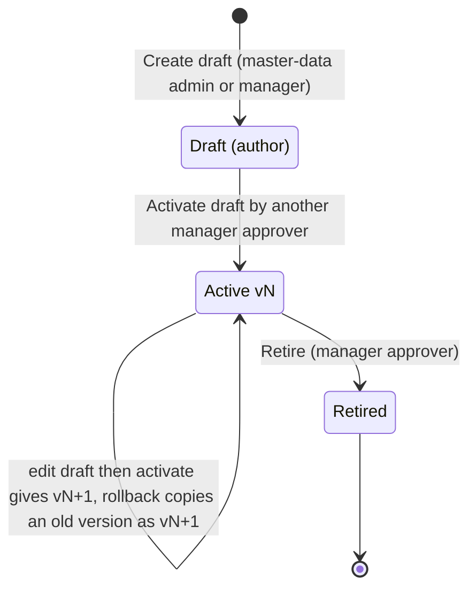

Rule SoD:
- The **draft author cannot activate**: 403 `SEPARATION_OF_DUTIES`.
- Rollback and retire need a manager approver but have no SoD check, because the definition was approved before.

**Simulation** runs the rule over up to 92 days and up to 5,000 events and shows before / after, without changing anything.

**Where you see it:** **Codes & Rules** → library tabs, **Default mappings** and **Rules** (with the Simulation and Versions tabs).

---

## 9. Production periods, actuals and adjustments

### 9.1 Periods

- **One production period per unit per shift instance**, created only for units with an approved profile.
- Each period has **product slices**:
  - from the accounting-baseline plan; otherwise
  - from the unit's single approved profile in force.
- Readiness: `open` → `complete_inputs` → `reconciled`. This is a label only; the workflow is §11.

### 9.2 Actuals: how "what we made" is measured (`domain/actuals/`)

| Method | Source | Rule |
|---|---|---|
| `output_events` | PI Production Output event frames (D05 primary) | Σ increments, each source identity once. Frames spanning the period edge are split by time and marked estimated. |
| `counter_delta` | totaliser tag | Σ non-negative deltas. Rollover: `M − a + b` when the implied rate is credible (T26: 995 → 5 with M = 1000 gives 10). An unknown reset gives "incomplete", never guessed (T27). |
| `rate_integration` | flow-rate tag | `Σ value × Δt / timebase` (T25: 120 t/h × 30 min = 60 t) |
| `external_report` | Maximo-style daily report (COMPLETED / RELEASED) | certified records |
| `manual` / `mixed` | approved adjustments | separate component |

**Source authority** (`period/authority.ts`): one source per slice.
- Primary: PI output event frames.
- The fallback (counter) is used only when the primary is missing, stale or of bad quality.
- If both disagree beyond tolerance, the result is a `source_conflict` finding (which blocks submission).
- Values are **never averaged or added**.

**Good vs gross:**

```
good = gross − reject + accepted rework
```

- Rejects not measured → good = gross, flagged `rejects_not_measured`. No quality factor is invented.
- Only good known → gross is null.

**Coverage** = accepted seconds ÷ period seconds. The default gate needs **100 %** coverage (D05).

A new immutable **actuals run** is written only when the inputs change.

### 9.3 Adjustments

An **adjustment** corrects actuals without touching raw data. Example: "weighbridge recount, good −5 t, measured".

- It is proposed with slice, kind (gross / good / reject / rework), signed non-zero quantity, basis (measured / estimated), reason and evidence.
- **It is approved or rejected by someone other than its author** (403 `SEPARATION_OF_DUTIES`, also enforced by a database check).
- Approval triggers a recalculation. The adjustment appears in "Actuals provenance" as a separate component.
- An adjustment that would make the actuals impossible is refused when proposed and again when approved (422): `ADJUSTMENT_GOOD_EXCEEDS_GROSS` (negative quality loss), `ADJUSTMENT_NEGATIVE_GOOD`, `ADJUSTMENT_NEGATIVE_GROSS`, `ADJUSTMENT_NEGATIVE_REJECT`. The check uses the latest actuals plus the approved adjustments not yet in them. A weighbridge recount of output belongs on `gross`, not `good`.
- Roles:
  - propose: `production_engineer` or `manager_approver`;
  - decide: `manager_approver`.

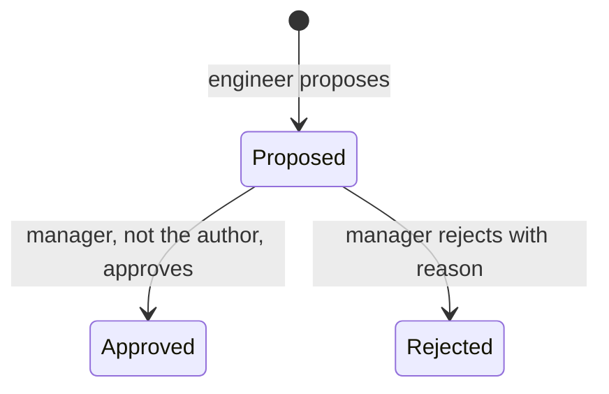

**Where you see it:** the period page (`/plans/:planId/periods/:periodId`) → "Actuals provenance" (method, coverage, source segments, exceptions, adjustments) and the "Actuals adjustments" section, where manager approvers approve or reject. Engineers and manager approvers propose at `/plans/:planId/periods/:periodId/adjustments/new`.

---

## 10. Loss accounting: two ledgers, the waterfall, attribution and residual

### 10.1 Why two ledgers (D04)

| | Capacity ledger | Plan ledger (default view) |
|---|---|---|
| Question | "What could the line have made at its sustained rate, and where did it go?" | "What did we plan, and why didn't we make it?" |
| Reference | sustained rate × scheduled time | approved plan target |
| Rate used for time losses | sustained | planning |
| Use | OEE, engineering truth | management variance, approval |

### 10.2 Segmentation and attribution (`domain/accounting/segmentation.ts`)

Each period slice is cut into **atomic segments** at every boundary:
- schedule and exclusion edges;
- the start and end of every event;
- rate-version changes.

Inside a segment the state is constant.

- A stop **< 60 s** is a **micro-stop** and counts as **performance**. A stop ≥ 60 s is an availability stop. This is the D04 micro-stop threshold.
- A `fractional` slowdown is a **derate**, which counts as performance.
- **Attribution:** each stop occurrence has one cause, its earliest active event. If several occurrences overlap a segment, they **share it equally** (`shares.ts`). Shares are truncated to 8 decimals and the remainder goes to the last share, so Σ = 1 exactly.
- **Declared quantities** on events are prorated by the fraction of the event inside the window (`claims.ts: quantityInside`).
- **Product runs** (`claim-pooling.ts`, engine 2.5.1): when a period is cut into several slices of the same product only by plan periods (two month plans meeting inside a shift), the slices' actuals are apportioned by time while causes are located in time. Performance and quality causes are therefore pooled over the run and allocated to its slices in proportion to each slice's component total (lines flagged `product_run_share`). Slice totals do not change; a claim beyond the whole run still fails.

### 10.3 Capacity ledger (`capacity-ledger.ts`)

```
capacity   = Σ segment seconds × sustained rate
exclusion  = capacity of calendar-excluded segments
A (avail.) = capacity of stopped segments × share
effective  = capacity − exclusion − A
P (perf.)  = max(0, effective − gross)       allocated to micro-stops / derates, rest "no cause"
gain       = max(0, gross − effective)       running faster than the reference
Q (qual.)  = gross − good                    allocated to quality-loss events
residual   = capacity − exclusion − A − P − Q − good + gain   (signed, never clamped)
```

**Identity:** `capacity = exclusion + A + P + Q + good − gain + residual`.

When gross and good are known, the residual is 0 by construction. A non-zero residual means a data problem.

A claim larger than its component fails the run (`IMPOSSIBLE_CLAIM`). It is never scaled down.

### 10.4 Plan ledger (`plan-ledger.ts`, `plan-totals.ts`)

```
target     = plan-period target
actual     = good
gap        = target − good                          (signed)
candidates : A = stop seconds × planning rate × share
             P = max(0, planningCapacity − A − gross)
             Q = gross − good
attributed = Σ active lines (after the engineer's decisions)
residual   = gap − attributed                       (signed, never clamped)
```

| Flag | Condition |
|---|---|
| `unaccounted` | residual > ε (ε = 0.000001) |
| `over_accounted` | residual < −ε: more loss explained than there is a gap |
| `overproduction` | gap < −ε: made more than the plan |
| `conflict` | overproduction **and** losses attributed |
| `plan_allocation_required` | no planning rate, so no automatic candidates; residual = gap |
| `bridge_required` | candidates exceed the gap; never scaled, an explicit bridge line is needed |

### 10.5 The waterfall (`domain/reconciliation/waterfall.ts`)

The waterfall is the picture of a ledger. It always **closes to actual**:

```
opening (target or capacity) + Σ signed steps = closing (good)
```

- **Capacity order:** capacity → schedule exclusion → availability → performance → quality → gain → residual → good.
- **Plan order:** target → availability → performance → quality → bridge → unaccounted (classified) → gain → tolerance adjustment → unaccounted → over-accounted → overproduction → conflict offset → actual.

"Closes" is checked exactly in decimals. A badge "Does not close — check the excluded slices" appears only when slices are left out (for example, mixed units).

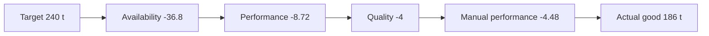

### 10.6 Worked example: one shift of Extruder Line 1

**Inputs:**
- Shift A, 06:00–14:00 = 28,800 s scheduled.
- Sustained 32 t/h; planning 29.44 t/h.
- One unplanned stop (bearing failure) of 75 min = 4,500 s = 1.25 h.
- Gross 190 t, good 186 t (4 t off-spec).
- Plan target for the shift (quantity basis) 240 t.

**Capacity ledger**

| Line | Computation | t |
|---|---|---|
| Capacity | 8 h × 32 | 256.00 |
| Exclusion | none | 0.00 |
| Availability | 1.25 h × 32 | 40.00 |
| Effective | 256 − 40 | 216.00 |
| Performance | 216 − 190 | 26.00 |
| Quality | 190 − 186 | 4.00 |
| Good | | 186.00 |
| Residual | 256 − 0 − 40 − 26 − 4 − 186 | **0.00** |

**Plan ledger**

| Line | Computation | t |
|---|---|---|
| Target | | 240.00 |
| Gap | 240 − 186 | 54.00 |
| Availability candidate | 1.25 h × 29.44 | 36.80 |
| Performance candidate | max(0, 235.52 − 36.80 − 190) | 8.72 |
| Quality candidate | 190 − 186 | 4.00 |
| Attributed (all accepted) | | 49.52 |
| Residual | 54 − 49.52 | **4.48 → "Unaccounted"** |

**Why is the residual not 0?** The plan (240 t) is above the shift's planning capacity (235.52 t). The automatic candidates only explain losses against planning capacity.

**What the engineer does:** adds a manual line of 4.48 t (Performance, reason "Reduced throughput (rate cut)", evidence the stop). The residual becomes 0, the row reads "Balanced", and the period can be submitted.

**A counter-example:** if the target had been 235.52 t (time basis) and gross 200 t, the P candidate would be max(0, 235.52 − 36.8 − 200) = 0. Attributed would be 36.8 + 0 + 4 = 40.8 against a gap of 39.52, so the residual would be −1.28: **over-accounted**, and submission blocked (`OVER_ACCOUNTED`). The engineer adjusts a candidate (for example availability to 35.52 t, with a reason) until the residual is within tolerance.

**Fixtures from the specification** (`plans/SPEC_ANALYSIS.md` §5):

| Fixture | Inputs | Outcome |
|---|---|---|
| T15 | target 1000, good 850, lines 90 + 40 + 10 | residual 10; submit fails at zero tolerance |
| T16 | — | residual −10, over-accounted |
| T17 | — | overproduction 50 with loss attributed, giving `conflict` |
| T28 | — | 800 = 100 + 100 + 30 + 20 + 550 (capacity identity) |

### 10.7 Calculation runs

Every recalculation is an immutable **calculation run**.
- It records its exact inputs: event revisions, actuals run, plan version, rate versions, calendar, policies and a hash. An identical input hash makes no new run.
- A failed validation keeps the previous run current.
- Runs are serialized per period.
- **What triggers a recalculation:** an event change, an adjustment approval, a report import, a plan approval, or **Recompute**.

**Where you see it:** the period page (`/plans/:planId/periods/:periodId`) → "Reconciliation summary", "Run ledgers (plan vs capacity)", "Loss lines (plan ledger)" and the waterfall. Production Loss Analysis → Waterfall (whole window).

---

## 11. Reconciliation workflow and separation of duties

### 11.1 Accounting revisions

Each period has a chain of **accounting revisions**:
- At most one is open: `draft` or `in_review`.
- Approved revisions are immutable, enforced by a database trigger. The latest approved one is **published**.

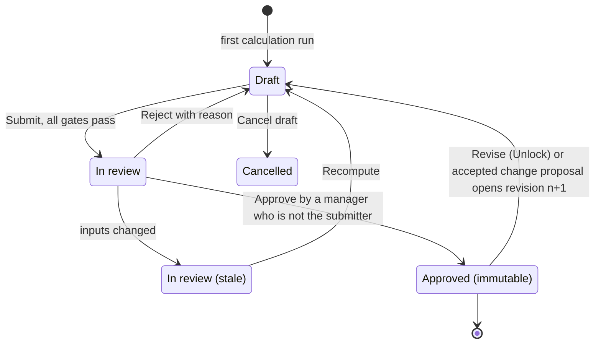

### 11.2 Draft decisions (`domain/reconciliation/reconcile.ts`)

| Decision | Effect on a candidate |
|---|---|
| accept | keep the quantity |
| adjust | new quantity, with a reason |
| replace | 0 on the candidate plus a replacement line of another kind, with a reason |
| reject | 0, with a reason |
| manual line | a new line with kind, quantity, and either evidence events or an explicit "no event" + reason code (or "reason code missing", which blocks submission) |

- **Saving** replaces the whole draft as one immutable line set (atomic: all or nothing, T33).
- The save carries the run id the editor saw. A newer run gives 409 `RUN_CHANGED` with a diff and **Rebase on the latest**.
- **Budget rule:** the sum of lines cannot exceed gap + tolerance (`allocation-budget.ts`).
- **Identity per slice:** `target − actual = attributed + toleranceAdjustment + residual`.

### 11.3 Tolerance (`tolerance.ts`)

The `reconciliation_tolerance` policy has three modes:

| Mode | Tolerance |
|---|---|
| `zero` (D06 default) | 0 |
| `absolute` | the value |
| `percent` | target × value / 100 (0 for a zero target) |

At submit, a residual with ε < |residual| ≤ tolerance is turned into an explicit, labelled `tolerance_adjustment` line (T32). It is never hidden.

### 11.4 Submission gates (`submission-gates.ts`, `submission-environment.ts`)

Submit is refused with a list of reasons:

| Gate | Meaning |
|---|---|
| `NO_CALCULATION_RUN`, `RUN_NOT_VALIDATED`, `RECALCULATION_PENDING` | numbers not ready |
| `SOURCE_CONFLICT` | primary and fallback actuals disagree |
| `ACTUALS_INCOMPLETE` | coverage below 100 % |
| `OPEN_REVIEW_ITEMS` | source vs user conflicts are open on the events |
| `RESIDUAL_UNEXPLAINED` | residual > tolerance |
| `OVER_ACCOUNTED` | residual < −tolerance |
| `OVERPRODUCTION_CONFLICT` | losses on an overproducing slice |
| `MISSING_CODE` | a line lacks a reason code |
| `UNACCOUNTED_NOT_ALLOWED` | an "unaccounted" classification is not allowed (D06) |
| `BASELINE_CHANGED` | a decided candidate changed since the decision |

When the submission is accepted, the revision stores `submittedHash`, the sha256 of exactly what was reviewed.

### 11.5 Approve, reject, stale, revise, change proposals

- **Approve** requires a manager approver who is **not the submitter**. This holds for everyone, SuperAdmin included, and for users holding both roles: 403 `SEPARATION_OF_DUTIES`.
  - The submission must not be stale, and the content must still hash to the submitted hash: 409 `STALE_SUBMISSION`.
  - **On approval:** an approval snapshot is stored, the period is labelled reconciled, and the outbox emits `PeriodApproved` (or `PeriodRestated`).
- **Reject:** same SoD check. The revision returns to draft with the reason.
- **Stale:** if inputs change while a revision is in review, it is marked stale; **Recompute** returns it to draft.
- **Approved periods are never touched by new inputs.** Instead a **change proposal** opens, showing approved vs new figures. Accepting it is a revise; dismissing needs a reason.
- **Revise ("Unlock"):** a manager opens revision n+1 over the published revision, carrying its decisions.

### 11.6 Separation of duties: the complete list (D06, extended 2026-10-12)

| Item | Author / submitter may approve? | Error |
|---|---|---|
| Period accounting revision (approve / reject) | No | 403 `SEPARATION_OF_DUTIES` |
| Actuals adjustment (approve / reject) | No | same |
| Declarative rule activation | No (rollback / retire: no check) | same |
| Valuation policy version | No | same |
| Plan version | No (new) | same |
| Profile, rate, valuation rate, FX rate | No (new) | same |
| Calendar publish, code changes | no approval step | — |
| RCA case close, KB publish | no approval step | — |

In the UI (`src/features/auth/approval-gate.ts`):
- an approve button the role can never use is **hidden**;
- for the author it is **disabled** with "You authored this: another approver must approve it (separation of duties).";
- otherwise it is enabled.

**Where you see it:** the period page's workflow bar (Recompute, Submit for approval, Cancel draft, Approve, Reject, Unlock (revise)), "Revision history" and "Change proposals".

---

## 12. Valuation: rates, policy, FX, IRR and USD

### 12.1 How it works

Pro-Act values losses only from **approved, dated, currency-labelled** inputs:
- **Valuation rates** per profile: contribution margin or standard cost, per t. Per impact code: cost per hour. Each rate is entered in IRR or USD.
- **A valuation policy** (`valuation_basis`), approved by finance (a manager approver who is not its author):
  - reporting currencies **IRR and USD** (D08 Q2);
  - default basis **contribution margin**;
  - FX policy `snapshot` (use the approved FX table);
  - time-based costs `exclusive` or `independent_components`.
- **FX rates** (USD → IRR), versioned like rates. The live demo rate is 1 USD = 2,690,000 IRR (owner decision 2026-10-10).

### 12.2 The rules from the code

**Line value** (`domain/valuation/value-line.ts`):

```
margin or standard-cost view : amount = quantity × rate value          (rate of the slice profile)
cost-per-hour view           : amount = lostSeconds / 3600 × cost/hour  (impact code of the cause)
```

- **Views are never added together.** Margin, standard cost and cost per hour are three separate answers. The only combined figure is the totals-only `independent_components` view, for impact codes the policy lists.
- **Rate version edges:** availability lines are split where a rate version changes; other line kinds use the rate at the line start.

**FX** (`fx.ts: convert`):
- uses the approved rate in force at each component's date;
- a direct pair multiplies, an inverse pair divides;
- **no covering rate → amount null with reason `fx_rate_missing`, never estimated.**

**Unvalued reasons** (amount null, quantity kept, shown as "not valued", never 0): `policy_unapproved`, `no_profile`, `impact_code_missing`, `uom_missing`, `rate_missing`, `uom_mismatch`, `fx_rate_missing`.

**When values change:** valuation is frozen inside each calculation run. Approving a new rate or FX does **not** recalculate; values change at the next recalculation. Approved periods get a change proposal, never an overwrite.

**Display currency:**
- A per-user browser choice, USD by default.
- The browser only picks among the currencies the server computed. **It never converts.**
- IRR is shown with 0 decimals, USD with 2.

### 12.3 Example (continuing §10.6)

Contribution margin of HDPE PE100 on Extruder Line 1 = 300 USD/t; FX 1 USD = 2,690,000 IRR.

| Plan-ledger line | t | USD | IRR |
|---|---|---|---|
| Availability (bearing) | 36.80 | 11,040.00 | 29,697,600,000 |
| Performance (8.72 + 4.48) | 13.20 | 3,960.00 | 10,652,400,000 |
| Quality | 4.00 | 1,200.00 | 3,228,000,000 |
| **Total** | **54.00** | **16,200.00** | **43,578,000,000** |

**Cost-per-hour view** (shown separately, never added): if impact code IC001 had a cost of 2,000 USD/h, the 1.25 h stop is worth 2,500 USD.

**Where you see it:**
- **Finance** (`/finance`): Valuation policy and FX rates.
- `/planning?tab=profiles` → "Valuation rates".
- Period accounting (`/plans/:planId`) "Loss value" tiles.
- Production Loss Analysis → Loss tree (Metric: Contribution margin / Standard cost / Operational cost) and Top opportunities.
- RCA → "Approved impact".

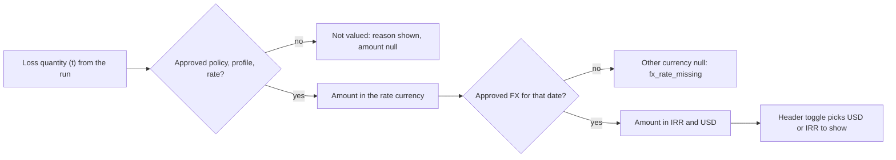

---

## 13. KPIs: OEE, downtime, MTBF and MTTR, Pareto

Every KPI is computed **inside the calculation run** and stored with its numerator, its denominator, and a value or "null with reason".

**Aggregation over many periods sums numerators and denominators. It never averages percentages** (T31: 90/100 and 450/900 give 540/1000 = 54 %, not 70 %).

### 13.1 Operational OEE, ISO 22400 (`domain/kpi/operational-oee.ts`)

```
S = scheduled time (after calendar exclusions)
D = availability stop time inside S (union, stops ≥ 60 s)
R = S − D                      run time
U = gross × seconds / capacity  ideal time of gross output (sustained rate)
V = good  × seconds / capacity  ideal time of good output
A = R / S     P = U / R     Q = V / U     OEE = V / S  (= A × P × Q)
```

**Example (§10.6 shift):**

| Term | Computation | Value |
|---|---|---|
| S | | 28,800 s |
| D | | 4,500 s |
| R | 28,800 − 4,500 | 24,300 s |
| A | 24,300 / 28,800 | **84.38 %** |
| U | 190 t ÷ 32 t/h = 5.9375 h | 21,375 s |
| P | 21,375 / 24,300 | **87.96 %** |
| V | 186 ÷ 32 = 5.8125 h | 20,925 s |
| Q | 20,925 / 21,375 | **97.89 %** |
| OEE | 20,925 / 28,800 | **72.66 %** |

**Spec fixture T20:** S 480 min, stop 60, rate 2/min, gross 756, good 718.2 → A 87.5 %, P 90 %, Q 95 %, OEE 74.81 %.

### 13.2 Reconciled PLA OEE (labelled, `reconciled-oee.ts`)

From the capacity ledger, with G = good, LA / LP / LQ = availability / performance / quality loss:

```
T = G + LA + LP + LQ
A = (G + LP + LQ) / T     P = (G + LQ) / (G + LP + LQ)     Q = G / (G + LQ)     OEE = G / T
```

**Example:** G = 186, LA = 40, LP = 26, LQ = 4, so T = 256. A = 216/256 = 84.38 %, P = 190/216 = 87.96 %, Q = 186/190 = 97.89 %, OEE = 72.66 %. It is the same as operational OEE here because there was no exclusion and no gain.

It is shown only when the capacity residual is within ε. Otherwise it reads "Not available: <reason>".

### 13.3 Null rules (T41)

Pro-Act never shows 100 % quality or a default 87 % when data is missing. Reasons include `no_scheduled_time`, `no_run_time`, `quality_evidence_missing`, `no_profile`, `no_sustained_rate`, `actuals_missing`. A value above 100 % is kept and marked as an exception.

### 13.4 Downtime measures (`downtime-measures.ts`)

| Measure | Rule |
|---|---|
| `downtime_total` | union of stop time in the window; overlapping causes share each second equally, so every breakdown adds up to the total |
| planned / unplanned / unknown / micro-stop time | by schedule class or micro-stop |
| `stop_count` | occurrences **starting** in the window (a split stop counts once); `carry_in_count` separately |
| mean stop duration | over completed stops ending in the window (open stops are censored) |
| scheduled availability | (S − D) / S |
| onstream factor | (calendar time − downtime) / calendar time |

"Unknown time is above zero: known downtime is a lower bound."

### 13.5 Reliability: MTBF, MTTR (D13, `reliability.ts`)

- **Functional failure:** a `FailureWO` work order, or an unplanned stop with a failure code, at least 60 s long. A work order overlapping a coded stop of the same asset counts once.
- **MTBF** = run time (exposure) ÷ failures starting in the window. With no failures: null `no_failures`; the exposure is still shown.
- **MTTR needs repair start / end evidence**, which no current source supplies, so it is null `repair_evidence_missing`. Pro-Act shows **"Mean downtime to restore"** instead, clearly labelled.

**Example:** 160 h of run time on Extruder Line 1 in a week, with 4 bearing / motor failures, gives MTBF = 40 h. If the four failures lasted 75 + 50 + 90 + 45 min, the mean downtime to restore is 65 min.

### 13.6 Downtime Pareto (`v2/reports/downtime-report.ts`)

- Group by reason (root, then drill to child codes), impact, OEE component or asset.
- Sorted largest first. `share = amount / total`; `cumulativeShare` = running sum / total.
- Value: allocated seconds ("Duration") or count of stops ("Frequency").
- Clicking a leaf lists the events behind it: the same server filter, the same calculation run.

**Example (manager AN01 spec):** stops of 60 min (pump, bearing), 60 min (valve, seal), 30 min (electrical) and 15 min (unknown) give:
- total 2:15;
- unknown 0:15;
- 3 bars, with Mechanical first at 5,400 s;
- Mechanical drills into Bearing 2,700 s and Seal 2,700 s.

**Where you see it:**
- **Downtime Analysis** (`/downtime`): tiles, Reliability, the "Downtime by reason" Pareto, Trend, Asset bad actors, Crew comparison, Window comparison, Stop timeline.
- **Production Loss Analysis → OEE**.
- **Dashboard** tiles.

---

## 14. RCA: triggers, cases, actions, verification, knowledge base

### 14.1 Trigger policy (D13, `domain/rca/rca-policy.ts`, `rca-triggers.ts`)

The `rca_policy` is approved and seeded on first use per plant, and may be overridden per unit:

| Setting | Default |
|---|---|
| duration threshold | **3,600 s** (60 min) |
| repeat trigger | **3** functional failures of the same asset within **30 days** |
| cost threshold | **null (off)** until finance sets it |
| auto-create | **`recommend`** (alternative `create`) |

Rules:
- **The duration trigger fires only for `downtime` + `unplanned`.** Planned, external and unknown stops never fire.
- **An open stop fires on elapsed time** as *provisional*; it is confirmed in place when it closes. There is no duplicate.
- Only live events fire (open or closed); superseded and retracted events never do.
- **Advisory events** can only be recommended, via `rca_trigger_hint` rules.
- **Idempotency key** `policy:<id>@<version>:<duration|repeat>:<occurrence>`: replays, re-evaluations and splits never create a second recommendation.
- Triggers run on every event change and in a 5-minute sweep of open stops, **only for plants with `v2.rca` on**. Plants with the flag off use the old v1 trigger config.
- **A recommendation never changes the event's RCA state and never sets a root cause.**

**Example (reliability spec):**

| Stop | Result |
|---|---|
| unplanned, started 65 min ago, running | one provisional recommendation |
| unplanned, 10 min | nothing |
| planned, 65 min | nothing |

### 14.2 Case lifecycle (`rca-case/`)

- **Statuses:** Draft, In Progress, Analysis, Published, Closed. **Priorities:** Low, Medium, High, Critical. A new case starts as Draft / Medium.
- No transition graph is enforced. The **only transition with side effects is into Closed**:
  - `actualCloseDate` is set;
  - **one unpublished knowledge entry** is created or updated per case;
  - every linked event's RCA state becomes **completed**.
- **Writers:** `reliability_engineer` or `manager_approver`. Engineers and Analysts can read but cannot write.
- **Unit scope:** a case without a unit is plant-wide and needs a plant-wide grant (`TENANT_SCOPE_REQUIRED`).

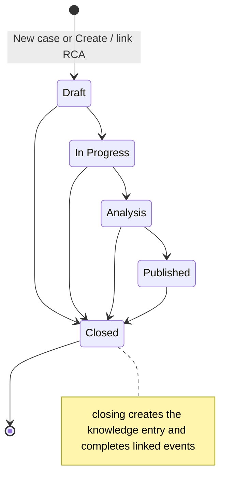

### 14.3 Links and the evidence package

- **Link types:** event, approved loss line, work order, occurrence. Unique per case; linking again returns the existing link.
- Linking an event sets its RCA state to **linked** and accepts its open recommendations.
- **The evidence package is snapshotted at link time** and never recomputed:
  - event facts and up to 50 revisions;
  - the unit's signals within ±1 h;
  - cause codes with their versions;
  - recurrence (same asset or reason, 90 days before);
  - **approved impact**: the loss lines of the latest approved revision, valued in IRR and USD.

### 14.4 Actions and verification

- **Action statuses:** open, in_progress, done, cancelled.
- An action may plan a **verification window**, with:
  - a **baseline**: metric recurrences or downtime seconds over N days, either declared or counted from history before the window;
  - a **claimed avoided loss** in IRR or USD.
- **Verification** runs hourly in the worker after the window ends, or on **Verify now**:

```
expected   = baseline × (verification days / baseline days)
difference = expected − observed
```

**Example:** baseline 6 recurrences in 30 days; verification window 15 days. Expected = 6 × 15/30 = 3. Observed 0, so the realized difference is 3.

**The outcome tab shows three numbers that are never netted:** approved historical loss (ledger), claimed avoided loss (people) and realized difference (measurement).

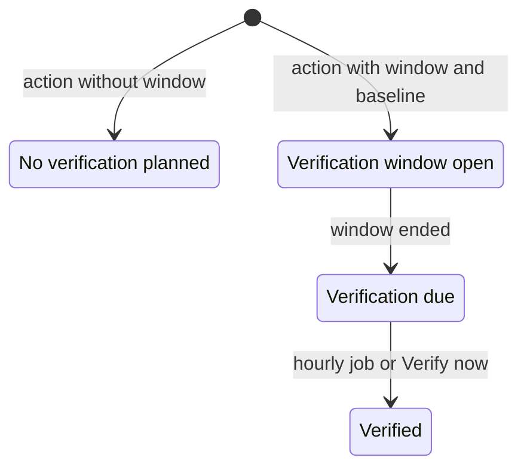

### 14.5 Knowledge base (v2, 2026-10-12)

- **Entries** are born unpublished when a case closes, one per case.
- **Publish / unpublish:** RCA writers (reliability engineer, manager approver), with optimistic concurrency.
- **Votes:** any member who may write; **one vote per user**, helpful or not helpful; a repeat vote replaces the previous one. Viewers cannot vote.
- **Search** (server): title, root cause, problem and description, plus filters for unit, asset, reason and published.
- **Quality score** (server, 0–100, `domain/rca/knowledge-quality.ts`):

| Factor | Points |
|---|---|
| root cause written | 30 |
| problem statement | 15 |
| at least one recommendation | 10 |
| source case has actions | 10 |
| share of actions done | up to 10 |
| names a unit or asset | 10 |
| still linked to its case | 5 |
| helpful share of votes | up to 10 |

- **Similar past RCAs for an event** (`knowledge-similar.service.ts`):
  - score: same asset 3, same reason (of a linked event) 2, same unit 1;
  - then published first, then newest; top 5;
  - entries already linked to this event are left out.

This replaces the old browser-side similarity score of up to 100 points (§23).

**Where you see it:**
- **Event Hub** event page (`/events/:eventId`): "RCA recommended: …", **Create / link RCA** (opens `/rca/new?eventId=…`).
- **RCA Analysis** (`/rca`): each case (`/rca/:caseId`) has the sections Overview, Evidence (`/evidence`), Analysis (`/analysis`), Recommendations & actions (`/actions`) and Links & outcome (`/links`).
- **Knowledge Base** (`/rca-knowledge-base`).

---

## 15. Data intake: PI, MQTT, raw store, normalization, quarantine, replay

### 15.1 The pipeline

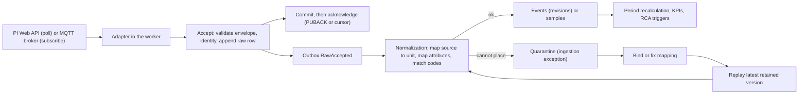

**Principles:**
- **Persist before acknowledge.** A crash loses nothing; a redelivery is recognised as a duplicate.
- **Raw rows are immutable** (`raw_observations`, partitioned by month).
- **Tenancy comes from the connection, never from the topic or payload.**

### 15.2 Ordering and duplicates (`intake/source-object-ordering.ts`)

| Delivery | Outcome |
|---|---|
| same message id | duplicate: counted, no raw row |
| same content, new id | `duplicate_content` |
| newer observation time (tie: higher source revision) | `revision`: applied |
| older | `stale`: kept raw, not applied |
| tie with no comparable revision | `conflict`: quarantined `order_conflict` |

**PI frames have no version.** The message id is WebId + content hash, and the observation time is the read time.

### 15.3 Mapping

**Source → unit** (`source-mapping/mapping-resolver.ts`). Tiers, first hit wins:
1. exact id;
2. exact path;
3. pattern (glob, highest precedence);
4. AF binding (element, then its ancestors).

A connection-specific rule beats an "any connection" rule. Two different targets in one tier → **ambiguous**, which goes to quarantine and is never guessed.

**Attributes → fields** (`attribute-mapping/attribute-mapper.ts`):
- typed conversion per template, versioned;
- PI "Duration" defaults to minutes;
- a TimeSpan text needs a `timespan` rule (otherwise `DURATION_UNPARSEABLE`);
- if a supplied duration and the timestamps differ by more than 1 s, **the timestamps win**.

### 15.4 Quarantine (`intake/entities/ingestion-exception.entity.ts`)

| Group | Codes |
|---|---|
| Mapping and processing | unknown_unit, mapping_ambiguous, mapping_invalid_target, unknown_template, unknown_code, unknown_signal, unit_conflict, duration_conflict, order_conflict, schema_invalid, no_handler, processing_failed |
| MQTT decoding | topic_shape, topic_not_allowed, not_json, too_large, unsupported_version, identity_mismatch, future_timestamp (> 5 min ahead), stale_timestamp, unmapped_value |

- **States:** open → resolved (a replay normalised it) or irrecoverable (closed with a reason, row kept).
- **The raw payload is visible to integration admins and manager approvers only**, with credential-like keys redacted.

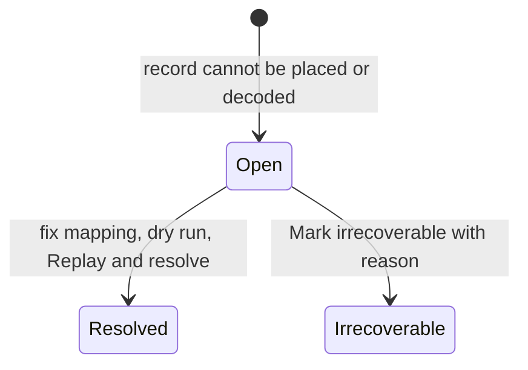

### 15.5 Replay

- Re-delivers the **latest retained version** of each source object, with its original identity, through the **current** mappings.
- Replaying twice converges on the same events. Replay invariance is tested.
- Scope: exception ids, objects, or a window of a connection.
- Always offered as a **dry run (counts only)** first.

### 15.6 Ingestion jobs

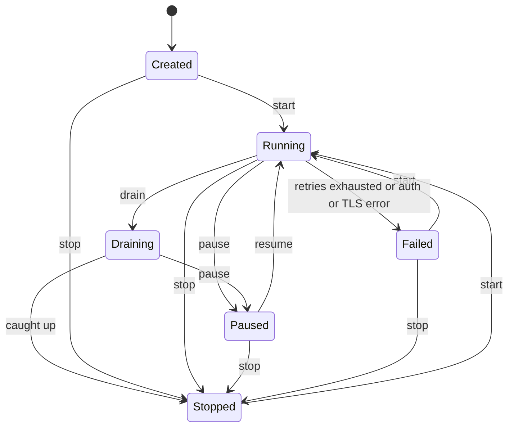

- **PI job kinds:**
  - **limited** (first window 120 min);
  - **backfill** (1–90 days, then drains);
  - **production** (every 60 s, with a 15 min overlap).
- Background PI jobs also cover open frames (re-read every 60 s), correction rescans (7 / 90 days) and an inventory that confirms deletions.
- **HTTP to PI:** 30 s timeout, 3 attempts with backoff.
- **MQTT subscription** = one job per connection:
  - **pause** disconnects but keeps the broker session (messages queue);
  - **resume** reconnects and receives the queue;
  - **stop** drops the session (messages are lost to Pro-Act).
  - A failed subscription restarts automatically only when the connection's configuration version changes.

### 15.7 MQTT specifics (`intake/adapters/mqtt/`, [MQTT_OT_CONTRACT.md](MQTT_OT_CONTRACT.md))

- **Payload profiles:** `interval_event_json` (downtime / loss with start and end), `measurement_json` (counters, rates), `state_json` (run state), `availability` (gateway ONLINE / OFFLINE, Last Will).
- **Topic template** with captures, e.g. `proact/v1/{site}/{area}/{line}/{unit}/events`.
- **Identity:** `boot_id + seq`, or `event_id + revision`, or payload hash + time.
- **Value maps** turn raw tokens (`RUN`, `STOP`, `MECH-01`) into Pro-Act values, exact first. Unmapped → `unmapped_value`, **no silent default**.
- **Times:** RFC 3339 with an offset. More than 5 min in the future is rejected. Older than 7 days: interval events rejected, samples flagged.
- **A Last Will "OFFLINE" means "source unavailable", never "machine stopped"** (T11).
- Run-state messages wait in quarantine as `no_handler` until the state engine (plan 1.10) exists.

### 15.8 Signals and samples

Measurements become versioned samples of a **signal** (counter, rate, state). They feed actuals (§9.2). No unit conversion is ever guessed (`unit_conflict`).

**Where you see it:** **Connectivity** (`/connectivity`, Integration console): Connections (Stages, Diagnostics, Discovery and mapping, Jobs and replay, Signals; MQTT Subscription, Payload profile, Quarantine), the **Quarantine** tab and the **Source mappings** tab. Event Hub "Evidence" → "Source deliveries".

---

## 16. Feature flags, v1 and v2, cutover

### 16.1 Why two versions exist

The rebuild follows "expand and contract" (MIG02):
- new **v2** tables, APIs and screens are built beside the old **v1** ones;
- plants were first switched screen by screen with a **feature flag**;
- since 2026-10-12 the application is **v2-only** (owner requirement): every route serves its v2 screen in every plant, the v1 screens and the frontend flag gates are removed, and v1 backend endpoints stay until a cleanup step confirms no callers.

### 16.2 The eight flags (`feature-flags/feature-flag-keys.ts`)

All flags default to off. They are set per plant.

| Flag | Screens it used to switch (now always v2) | Backend effect |
|---|---|---|
| `v2.codesAdmin` | `/codes-admin`, `/finance` | — |
| `v2.integrationConsole` | `/connectivity` | — |
| `v2.plansProfilesCalendars` | `/planning` | — |
| `v2.eventHub` | `/events` | — |
| `v2.downtimeAnalysis` | `/downtime` | — |
| `v2.planDashboard` | `/plans/:planId` | v1 reconcile / loss-category / OEE-summary writes answer 410 `V1_WRITE_GONE` |
| `v2.plaAnalytics` | `/dashboard`, `/pla-analytics`, `/reports` | — |
| `v2.rca` | `/rca`, the Event Hub RCA panel | enables the v2 trigger service; disables the v1 auto-create |

- The flags stay in the registry and the API, but no screen reads them any more: a flag that is off no longer shows a v1 page or a "… is not switched on for this plant" notice. `v2.rca` still matters on the server (trigger service, §14) and `v2.planDashboard` still retires the v1 writes listed above.
- **Who switches:** a `manager_approver` with a plant-wide grant, via `PUT /api/v2/feature-flags/<key>`. It is audited. There is no flag screen.

### 16.3 Cutover ([CUTOVER_RUNBOOK.md](CUTOVER_RUNBOOK.md), `migration-cutover/`)

The cutover is CLI-only (`scripts/cutover/*.ts`). Every step is a dry run unless `--apply --actor … --confirm-database …` is given.

1. **Freeze** v1 writes for the plant: every v1 write answers 423 `LEGACY_WRITES_FROZEN`; v2 stays writable.
2. **Remediate** legacy data. The jobs are references, sentinels, durations, duplicates, legacy-values, links, periods, reason-tree, rates and units. They never delete anything, and every applied change can be reverted.
3. **MIG04 comparison:** v1 vs v2 per unit. Every difference must be explained (formula_change / quality_change / defect), or the gate fails.
4. **Flags on**, in order: codesAdmin → integrationConsole → plansProfilesCalendars → eventHub → downtimeAnalysis → planDashboard → plaAnalytics → rca. Rollback runs in reverse.
5. **Release** the freeze.

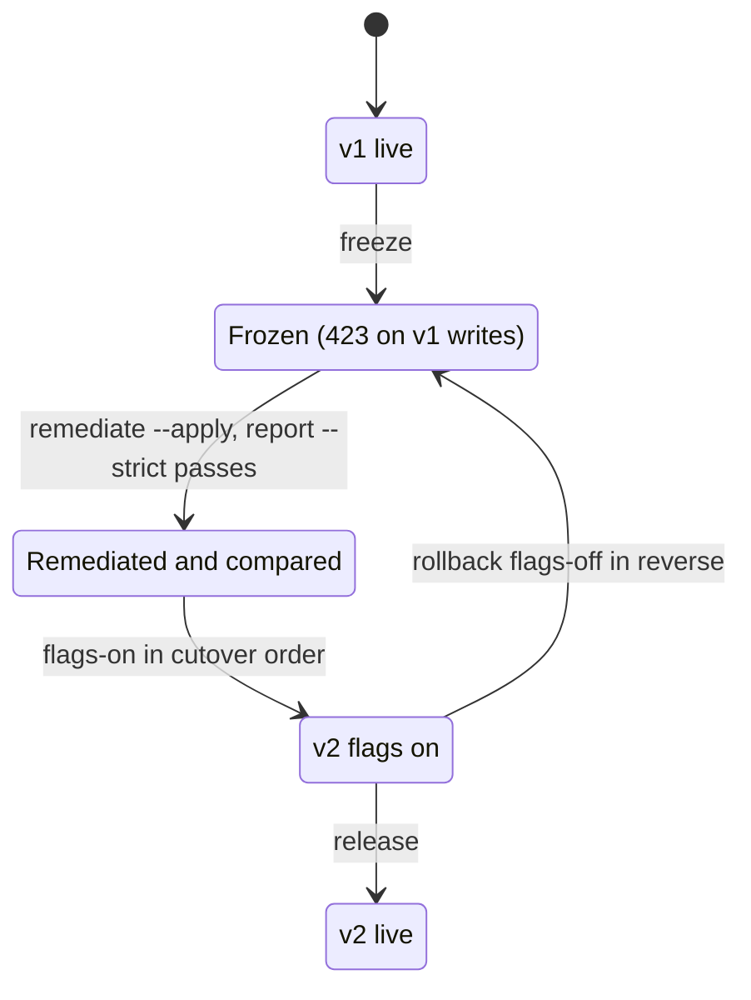

---

## 17. Multi-tenancy, roles and the role × capability matrix

### 17.1 How rights are computed (`auth/context/request-context.factory.ts`, mirrored in `src/features/auth/effective-roles.ts`)

1. **Legacy role** (`users.role`), with its D06 mapping:

   | Legacy role | Maps to |
   |---|---|
   | TenantAdmin, Manager | `manager_approver` |
   | Engineer, Analyst | `production_engineer` |
   | Operator | `operator` |
   | SuperAdmin, OrgAdmin | stay global |

   Where the legacy role counts:
   - in the **home plant** only;
   - SuperAdmin: everywhere;
   - OrgAdmin: in every plant of its organisation.
2. **Scope roles** (`user_scopes`) held in the **acting plant**: viewer, operator, production_engineer, reliability_engineer, integration_admin, master_data_admin, manager_approver. A scope can be plant-wide or limited to units.
3. **The acting plant** is the plant-selector choice, sent as the `X-Tenant-Id` header.
   - A non-SuperAdmin needs a scope row in that plant, else 403 `TENANT_NOT_ALLOWED`.
   - The tenant is **never** taken from a query parameter (v2 answers 400 `TENANT_FROM_IDENTITY`).
4. **Role checks:** SuperAdmin satisfies everything; OrgAdmin everything except SuperAdmin-only routes; others need the role itself.
5. **Guards run in this order:** JWT → roles (`FORBIDDEN_ROLE`) → scope (404 for out-of-scope ids, so plants cannot probe each other) → write access (`READ_ONLY_ROLE` for viewer-only) → tenant binding of v1 bodies (`TENANT_MISMATCH`).
6. **Database row-level security** (`tenant_isolation` on 137 tables) is a second wall behind the API.
7. **Rank for user management:**

   | Role | Rank |
   |---|---|
   | SuperAdmin | 100 |
   | OrgAdmin | 90 |
   | TenantAdmin | 80 |
   | Manager | 70 |
   | master-data / integration admin | 60 |
   | engineer roles | 50 |
   | operator | 40 |
   | viewer | 10 |

   - You may grant a role only up to your own rank.
   - You can manage only users strictly below you: no peers (SuperAdmin excepted).
8. **Users of a plant** (`/v2/users`, `/v2/users/directory`, task assignees, user names on every screen): the users whose **home plant** it is, plus the users of **any plant** who hold a scope grant there (owner decision 2026-10-12).
   - Row-level security hides other plants' `users` rows, so these reads go through one reviewed exception: the SECURITY DEFINER function `app_plant_user_directory(tenant)` (migration `PlantUserDirectory`). It returns only id, name, e-mail, role, active state, home plant, organization and timestamps, and refuses a tenant the database session is not bound to. The API passes only the acting plant.
   - A user granted in from another plant shows **"From <home plant>"** in the list. The plant administrator can grant and revoke that user's roles **in this plant** (`accessManageable`).
   - Profile, role, password, status and delete stay with the **home plant** (or a SuperAdmin): `manageable` is false and the server answers 403 `HOME_PLANT_ONLY`.
   - **First grant from another plant:** "Grant access by e-mail" on `/users`. The administrator types the user's **exact e-mail** (`GET /v2/users/lookup`, then `POST /v2/user-scopes { email, role }`). Only users of the plant's own organization are found (`users.organization_id`, else the home plant's organization); there is no partial search.

### 17.2 Role × capability matrix

**Column key:**

| Key | Role |
|---|---|
| SA | SuperAdmin |
| OA | OrgAdmin (own organisation) |
| TA | TenantAdmin |
| MA | Manager / manager_approver |
| PE | production engineer / Analyst |
| Op | Operator |
| V | viewer |
| RE | reliability engineer |
| IA | integration admin |
| MDA | master-data admin |

**Cell key:** Y = allowed; N = refused; "own" = not on items you authored (separation of duties).

| Capability | SA | OA | TA | MA | PE | Op | V | RE | IA | MDA |
|---|---|---|---|---|---|---|---|---|---|---|
| Read every screen of the plant (analysis menu) | Y | Y | Y | Y | Y | partial | Y | Y | Y | Y |
| Record, code, split, merge, close events; resolve review items | Y | Y | Y | Y | Y | Y | N | Y | Y | Y |
| Draft plan, generate periods | Y | Y | Y | Y | Y | N | N | N | N | N |
| Approve plan version | own | own | own | own | N | N | N | N | N | N |
| Write calendars, crews, rotations; publish calendar | Y | Y | Y | Y | N | N | N | N | N | Y |
| Draft profiles, rates, valuation rates, FX rates | Y | Y | Y | Y | N | N | N | N | N | Y |
| Approve or retire profiles, rates, valuation rates, FX; rate imports | own | own | own | own | N | N | N | N | N | N |
| Create or approve valuation policy | own | own | own | own | N | N | N | N | N | N |
| Period accounting: save lines, submit, recompute, cancel | Y | Y | Y | Y | Y | N | N | N | N | N |
| Propose actuals adjustment | Y | Y | Y | Y | Y | N | N | N | N | N |
| Approve or reject periods and adjustments; revise; change proposals | own | own | own | own | N | N | N | N | N | N |
| Import external production reports | Y | Y | Y | Y | N | N | N | N | Y | N |
| Write code libraries and default mappings | Y | Y | Y | Y | N | N | N | N | N | Y |
| Author and simulate declarative rules | Y | Y | Y | Y | N | N | N | N | N | Y |
| Activate, roll back, retire rules | own | own | own | own | N | N | N | N | N | N |
| RCA cases, links, actions, verification; dismiss recommendations | Y | Y | Y | Y | N | N | N | Y | N | N |
| Publish or unpublish knowledge entries | Y | Y | Y | Y | N | N | N | Y | N | N |
| Vote on knowledge entries | Y | Y | Y | Y | Y | Y | N | Y | Y | Y |
| Connections, jobs, signals, mappings, replay, quarantine | Y | Y | Y | Y | N | N | N | N | Y | N |
| See raw quarantined payloads | Y | Y | Y | Y | N | N | N | N | Y | N |
| Switch feature flags (plant-wide grant) | Y | Y | Y | Y | N | N | N | N | N | N |
| Units, assets, products (Master Data) | Y | Y | Y | Y | N | N | N | N | N | Y |
| List users / create, edit, delete users | Y/Y | Y/Y | Y/Y | Y/N | N | N | N | N | N | N |
| Organisations and plants | Y | own org | N | N | N | N | N | N | N | N |
| Audit log screen / edit audit rows | Y/Y | Y/N | N | N | N | N | N | N | N | N |
| Branding (application-wide settings) | Y | N | N | N | N | N | N | N | N | N |
| Request exports of approved figures | Y | Y | Y | Y | Y | Y | Y | Y | Y | Y |

**Notes:**
- "partial" for Operator: the menu is Dashboard, Production Loss Analysis, Event Hub, Downtime Analysis and Tasks.
- Unit-limited users (e.g. `ingrid.hansen`) see and write only their units, and get `TENANT_SCOPE_REQUIRED` on plant-wide writes (FX, policies, rules, flags, rate imports, plant-wide RCA cases).
- The UI hides what the server would refuse (`src/features/auth/server-role-sets.ts` mirrors the server's role sets, and a test fails if they drift).

**Where you see it:** the sidebar (§3 of the persona guide), the **Read-only** badge, disabled approve buttons with the SoD hint, and refusal messages.

---

## 18. Audit

There are two trails.

| Trail | Table | What | Mutable? |
|---|---|---|---|
| Request log | `audit_logs` | every successful POST / PUT / PATCH / DELETE: actor, action CREATE / UPDATE / DELETE, entity, id, method and path. Sub-resource writes (e.g. adding an RCA action) are logged against the **parent** case. Reads of raw payloads and connection samples are logged as READ | SuperAdmin may edit (legacy) |
| Domain trail | `audit_log` | reconciliation actions (save_draft, submit, approve, reject, revise, recompute, stale, tolerance, cancel, proposal accepted / dismissed) and export downloads, with before / after hashes, reason and correlation id | **append-only** (a database trigger refuses changes) |

Event history is separate (`event_revisions`, per event). So are ingestion-job transitions ("Audit trail" in the console).

**`X-Client-Audited: true`:** a client that already wrote its own audit row sends this header, so the server does not log the action twice.

**Where you see it:** **Audit Logs** (`/audit`, entry pages `/audit/:entryId`; SuperAdmin, OrgAdmin, TenantAdmin and manager approvers), Event Hub "History", the period page's "Revision history", and the job "Audit trail".

---

## 19. Exports and downstream events

### 19.1 Exports (`exports/`)

- **Contents:** `period_summary` and `loss_lines`, as **CSV**. PDF is not available yet.
- **Approved content only.** Either:
  - `published`: the latest approved revision of every period in the window; or
  - named approved revisions (otherwise 422 `REVISION_NOT_APPROVED`).
- **The sources are pinned when you request the export**, so later approvals do not change a running export.
- **Format:**
  - a header block (scope, filters, timezone, approved status, valuation status);
  - streamed rows;
  - a **sha256** of the file, so re-rendering the same job gives the same hash;
  - injection-safe cells;
  - two currency columns (IRR, USD).
- **Jobs:** `POST /exports` returns 202. The states are:

  ```mermaid
  stateDiagram-v2
      state "Queued" as q
      state "Running" as r
      state "Completed" as c
      state "Failed" as f
      state "Cancelled" as x
      [*] --> q : POST exports, 202
      q --> r : worker lease
      r --> c : file and sha256 ready, expires after 168 h
      r --> f : attempts exhausted
      q --> x : cancel
      r --> x : cancel
  ```

- **Who can export:** any member, **viewers included**. A unit-limited caller must name units of its scope.

### 19.2 Domain events (outbox)

Workflow messages: `PeriodSubmitted`, `PeriodApproved`, `PeriodRestated`, `PeriodRejected`, `PeriodRevisionOpened`, `PeriodRevisionCancelled`, `PeriodSubmissionStale`, `PeriodChangeProposed`.

Others: `PlanVersionApproved`, `ProfileBaselineChanged`, `PeriodRecalculateRequested`, `EventChanged`, `RawAccepted`, `RCARecommended`, `ConnectionChanged`.

- They are written in the same database transaction as the change (outbox), then relayed in order, with retries and a dead letter after 12 attempts.
- **Delivery reconciliation** lists every approved revision against the delivery of its `PeriodApproved` message: delivered, pending, dead or missing. A failed delivery never undoes an approval.
- External targets (webhook, CMMS, Kafka republish) are deferred (D12). In R1 the only outputs are exports and the outbox.

**Where you see it:** the period page's "Export (approved content only)"; Reports → **Exports**; Production Loss Analysis and Downtime Analysis export buttons (enabled only with "Approved only").

---

## 20. API conventions you will see in messages

| Convention | Meaning | Message |
|---|---|---|
| `Idempotency-Key` header on commands | a retry never doubles an action; the same key replays the stored answer | 428 `IDEMPOTENCY_KEY_REQUIRED`; 409 `IDEMPOTENCY_MISMATCH` |
| `If-Match` / ETag (row version) | optimistic locking: "I changed version 7" | 428 `REVISION_REQUIRED`; 412 `STALE_REVISION` → "Someone changed this event" / "Changed by someone else" |
| 422 with field errors | validation; shown next to the field | e.g. "validTo must be after validFrom" |
| 409 | state conflicts | `VERSION_OVERLAP`, `PLAN_OVERLAP`, `RUN_CHANGED`, `CODE_HAS_CHILDREN`, `INVALID_TRANSITION` |
| 202 + job | slow work runs in the worker | bulk coding > 500, period generation, recompute, exports, rate imports, replays |
| Keyset pagination | lists load page by page ("n loaded · scroll for more") | — |
| Realtime | screens refresh from scoped plant / unit rooms when the server signals a change; no polling of the whole plant | — |

---

## 21. Glossary

| Term | Meaning |
|---|---|
| **Accounting revision** | One version of a period's reconciliation: draft → in review → approved. |
| **Actuals** | Measured output of a period (gross, reject, good), with method, coverage and provenance. |
| **Adjustment** | A governed correction of actuals, approved by a second person. |
| **Advisory event** | An alarm or alert (IOW, SOL, APM, work order) that never creates a loss by itself. |
| **Attributed** | The sum of active loss lines explaining the gap. |
| **Availability (A)** | Run time ÷ scheduled time. Lost by stops ≥ 60 s. |
| **Baseline (plan)** | The approved plan version of the accounting-baseline scenario. |
| **Baseline (RCA)** | The expected recurrence or downtime against which an action is verified. |
| **Bridge line** | An explicit line that reconciles candidates exceeding the gap. |
| **Calculation run** | An immutable computation of a period from frozen inputs. |
| **Candidate** | An automatic loss line proposed by the engine: accept, adjust, replace or reject it. |
| **Capacity ledger** | Losses vs sustained rate × scheduled time. |
| **Change proposal** | Shows approved vs new figures when inputs change after approval. |
| **Coding** | The user layer of an event: reason, impact, OEE component, schedule class. |
| **Contribution margin** | Default valuation basis per tonne (D08). |
| **Coverage** | Share of the period covered by accepted actuals (100 % required by default). |
| **Derate** | A fractional slowdown; counts as performance. |
| **Effective facts** | The event as Pro-Act uses it: source facts plus user overrides. |
| **Exclusion** | Calendar time taken out of scheduled time (turnaround, no demand, excluded holiday). |
| **Feature flag** | A per-plant switch from a v1 to a v2 screen. |
| **FX rate** | An approved, dated USD↔IRR conversion. |
| **Gain** | Output above the reference (capacity ledger). |
| **Gap** | Target − good (plan ledger). |
| **Ingestion job** | A leased worker job that reads a source (PI window, backfill, MQTT subscription). |
| **Manager approver** | The approving role; legacy TenantAdmin and Manager map to it. |
| **Micro-stop** | A stop shorter than 60 s; counts as performance. |
| **MTBF** | Run time ÷ functional failures. |
| **Mean downtime to restore** | The labelled substitute for MTTR while no repair evidence exists. |
| **Occurrence** | One physical stop; its split pieces share it. |
| **OEE** | Availability × Performance × Quality = V ÷ S (operational, ISO 22400). |
| **Open event** | An event without an end; elapsed is computed "as of" now. |
| **Over-accounted** | More loss explained than the gap (residual < 0). |
| **Overproduction** | Good above target (gap < 0). |
| **Performance (P)** | Ideal time of gross ÷ run time. |
| **Period** | One shift of one unit; the accounting leaf. |
| **Plan ledger** | Losses vs the approved plan target. |
| **Planning rate** | The rate used for targets and plan-ledger losses. |
| **Plant / tenant** | One site; the unit of isolation. |
| **Profile** | Unit × product × mode, with rates. |
| **Provisional** | Figures or recommendations not yet confirmed (draft revision, open event). |
| **Quality (Q)** | Ideal time of good ÷ ideal time of gross. |
| **Quarantine** | Records that could not be placed or decoded; resolved by fix + replay. |
| **Raw observation** | An immutable copy of what a source sent. |
| **Reconciled PLA OEE** | OEE derived from the capacity ledger; labelled. |
| **Replay** | Re-processing retained raw data through the current mappings. |
| **Residual** | Gap − attributed (plan) or the capacity identity remainder; signed, never hidden. |
| **Review item** | A source vs user conflict, or a pending confirmation, on an event. |
| **Schedule class** | planned / unplanned / external / unknown. |
| **Scheduled time (S)** | Shift time minus calendar exclusions. |
| **Separation of duties (SoD)** | Author or submitter ≠ approver. |
| **Shift instance** | One real occurrence of a shift template, in UTC. |
| **Slice** | One product's share of a period. |
| **Source mapping** | A rule placing a PI element or MQTT topic on a unit / asset. |
| **Stale** | A submission whose inputs changed after submit. |
| **Sustained rate** | The demonstrated sustainable rate; the capacity-ledger and OEE reference. |
| **Tolerance adjustment** | An explicit line closing a residual within the policy tolerance. |
| **Unaccounted** | Gap not yet explained (residual > 0). |
| **Valuation policy** | The finance-approved basis, currencies and FX policy. |
| **Viewer** | A read-only role; any write gives `READ_ONLY_ROLE`. |
| **Waterfall** | A chart from target or capacity to actual whose bars always close. |

---

## 22. FAQ: why does the app do X?

1. **Why does a stop show "Running" with no duration?**
   Open events have no end. The server computes elapsed time "as of" now. A fake end (the old 9999 date) would corrupt every KPI.
2. **Why did two overlapping stops count as 60 minutes, not 90?**
   Unit downtime is the **union** of stop intervals. A unit cannot be down twice at once. Each overlapping second is shared between the causes, so breakdowns still add up.
3. **Why is a 45-second stop not in availability?**
   Stops under 60 s are micro-stops and count as **performance** (D04, ISO 22400).
4. **Why does my residual show "Unaccounted" when every stop is coded?**
   Coding says *why*. The ledger also needs *how much*. Your plan target may be above planning capacity (§10.6), or slow running was not covered by a candidate. Add a manual line with evidence.
5. **Why can't I submit with a residual of 0.3 t?**
   The tolerance is zero by default (D06). Either explain it, or a manager configures a tolerance, in which case it is turned into a visible tolerance-adjustment line.
6. **Why is Approve greyed out for me although I am a manager?**
   You submitted (or authored) it. Separation of duties requires a second person, even for SuperAdmin.
7. **Why did my period go back to "Draft" by itself?**
   An input changed after you submitted: a late PI correction, a recode, an adjustment. The submission went stale; recompute and resubmit. An *approved* period would get a change proposal instead.
8. **Why didn't approving a new rate (or FX) change last week's values?**
   Valuation is frozen inside each calculation run. Values change at the next recalculation. Approved periods get a change proposal, never a silent overwrite.
9. **Why is a loss shown as "— USD (FX rate missing)" instead of 0?**
   Pro-Act never invents money. Without an approved FX rate for that date, or a valuation rate, or an approved policy, the amount is null with its reason.
10. **Why are margin and cost-per-hour values not added together?**
    They are different views of the same loss. Adding them double-counts (VAL02).
11. **Why does the IRR toggle not call the server?**
    The server already computed both currencies. The toggle only chooses which one to show.
12. **Why does my PI or MQTT update not overwrite my reason code?**
    Coding belongs to the user layer. Sources own times and quantities; they never reset coding or workflow states.
13. **Why can't I edit the start time of a PI event?**
    Interval fields of a source event are owned by the source (`SOURCE_OWNED`). Use **Close stop** to set an end; the source confirms it later.
14. **Why did a split stop still count as one stop in Downtime Analysis?**
    Split children keep the original occurrence id. Stop counts are per occurrence.
15. **Why did the long planned changeover not raise an RCA?**
    The duration trigger fires only on **unplanned downtime** ≥ 60 min (D13).
16. **Why does the RCA badge say "provisional"?**
    The stop is still running. The trigger fired on elapsed time and is confirmed in place when the stop closes. It never fires twice.
17. **Why didn't recommending an RCA change the event's RCA state?**
    Recommendations are advice. Only linking to a case (linked) and closing the case (completed) move the state.
18. **Why can't our production engineers open RCA cases?**
    RCA writing belongs to reliability engineers and manager approvers (decision 3.9). Engineers read cases and do the accounting.
19. **Why does OEE show "Not available: quality_evidence_missing"?**
    Rejects were not measured, so Q cannot be computed honestly. Pro-Act shows null with a reason instead of 100 %.
20. **Why are there two OEEs?**
    Operational OEE (ISO 22400, time-based) is the standard. Reconciled PLA OEE comes from the capacity ledger and is labelled, so they are never confused.
21. **Why is MTTR blank but "Mean downtime to restore" filled?**
    True MTTR needs repair start / end evidence (from CMMS), which no source supplies yet (D13).
22. **Why can't I retire a reason code?**
    It still has active child codes. Retire or move them first. Events using the code do not block retirement; history is kept.
23. **Why did my message land in quarantine instead of creating an event?**
    Pro-Act could not place it on a unit (or decode it). It never guesses a unit. Bind the source and replay.
24. **Why must I run a dry run before a replay?**
    To see how many objects would be re-processed before changing anything. Replays are bounded and audited.
25. **Why did pausing MQTT not lose messages but stopping did?**
    Pause disconnects and keeps the broker session, so the broker queues messages. Stop drops the session.
26. **Why do two plants behave differently on RCA triggers?**
    Screens are the same everywhere (v2 only), but the per-plant flag `v2.rca` still decides whether the server uses the v2 RCA policy or the old v1 trigger config.
27. **Why can't a viewer save a task or an event?**
    Every write by a viewer-only caller is refused (`READ_ONLY_ROLE`). Exports and previews are allowed.
28. **Why can't I switch to Partner Plant?**
    It belongs to another organisation. The server refuses (`TENANT_NOT_ALLOWED`), and the selector does not offer it.
29. **Why are exports only of approved figures?**
    Exports are for others to rely on. Drafts change; approved revisions are immutable and reproducible (sha256).
30. **Why does the Event Hub show nothing from yesterday?**
    The default window is "Last 24 h". Choose "Last 7 days".
31. **Why does the plan preview put an odd number on the last shift?**
    Distribution truncates to 8 decimals and gives the remainder to the last eligible shift, so the sum equals the header exactly.
32. **Why does a turnaround not lower availability?**
    It is a calendar exclusion, so it is outside scheduled time. A planned stop *inside* the schedule does lower availability.

---

## 23. Where code and older documents disagree

**What was trusted:** the code. The older documents are kept but are stale in these places:

| Topic | Older document says | Code (trusted) |
|---|---|---|
| Where logic runs | `PROACT_APPLICATION_GUIDE.md` §5, §8, §10: OEE, cost, loss % and status rules computed in the browser | v2 computes everything on the server (calculation runs); browser heuristics are removed. The v1 screens are deleted (v2-only since 2026-10-12) |
| Unaccounted loss | Guide §5.3: a fixed 25–40 % estimate | Plan ledger residual = gap − attributed, signed, never estimated |
| Loss value | Guide §5.4: flat 100 $/unit | Approved valuation rates and policy, IRR and USD through FX, null when missing |
| OEE | Guide §8.1: three different OEEs, heuristics on the dashboards | Operational ISO 22400 OEE plus a labelled reconciled OEE, from stored KPI results |
| Duration units | Guide §4.5, §9: mixed minutes / hours | Seconds everywhere in v2; v1 `duration` is derived minutes |
| Event status | Guide §4.3: one status set by browser rules | Three state dimensions on the server; the v1 label is derived |
| PI re-sync | Guide §7: resets status to Open | Source updates never touch coding or workflow; review items for conflicts |
| RCA save | Guide §9: broken (field mismatch) | Fixed in 3.9 (v2 contract, v1 DTO aligned) |
| RCA trigger | Guide §6.2: v1 rules with cost / severity, first match | D13 policy: unplanned ≥ 60 min, 3 failures / 30 d, recommend-only, idempotent; v1 rules only for flag-off plants |
| RCA approval | Guide §6.3: Manager / OrgAdmin approves in the UI | v2 cases have no approval step; RCA writers close. The v1 module keeps its approval for flag-off plants |
| Knowledge base | Guide §6.6: entries only from seeders; browser similarity out of 100 | Entry on case close; server quality score and similar search (asset 3 / reason 2 / unit 1) |
| Security | Guide §9: no tenant isolation, public register, unguarded controllers | Global guard chain, row-level security, register needs an admin, scoped realtime (3.11) |
| Roles and menus | Guide §1, §11: roles only control menus | Server-side role sets per route; capabilities per selected plant drive the menus and the button hiding |
| Plan approval | Guide §3.2: Draft → Pending Review → Pending Approval → Approved, UI-only | v2: draft (optional submitted) → approved → superseded, server-gated, SoD |
| Plan default rate | Guide §3.3: 100 units/h placeholder | No default rate; approved planning rates only |
| SoD coverage | `PERSONA_TESTING_REPORT.md` §4 and DECISIONS 2.2 / 2.3: no SoD for plans, profiles, rates, FX | Extended to them on 2026-10-12 (`assertNotAuthor`) |
| Capability hiding | `PERSONA_TESTING_REPORT.md` §4: write controls shown to users who are refused | Hidden by capability (2026-10-12); the server stays the authority |
| Downtime route | `CUTOVER_RUNBOOK.md` table: `/downtime-analysis` | `/downtime` (`src/app/routes/production.tsx`) |
| Integration console MQTT | Plan 3.7 text: MQTT and Kafka "not available" | MQTT is available (1.8 wizard, subscription, profile, quarantine); Kafka is still not available |
| Database schema | Guide §10.3: `DB_SYNCHRONIZE=true` | Migrations only; synchronize is off |
| JWT lifetime | Guide §11: 24 h access token | 15-minute access token with a rotated refresh token (3.11) |
| Plant selection storage | Guide §2.1: `app-settings` key `plantSelection` | Per-user browser storage `proact.plantSelection.<userId>` |
| CSV vs screen rounding | — | Exports round every currency, IRR included, to 2 decimals (half-even); the screens show IRR with 0 decimals. Worth aligning |
