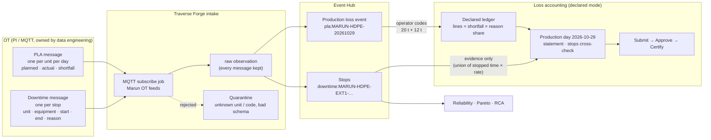
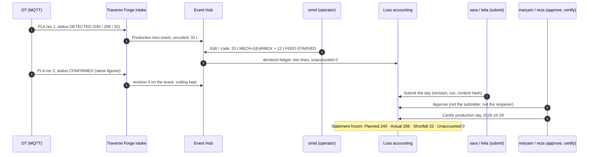
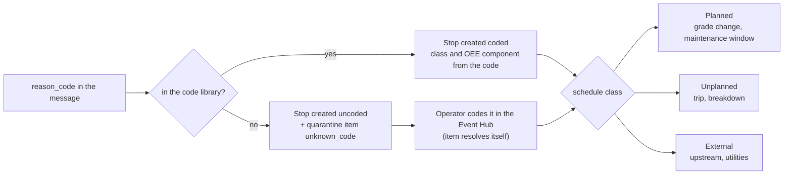
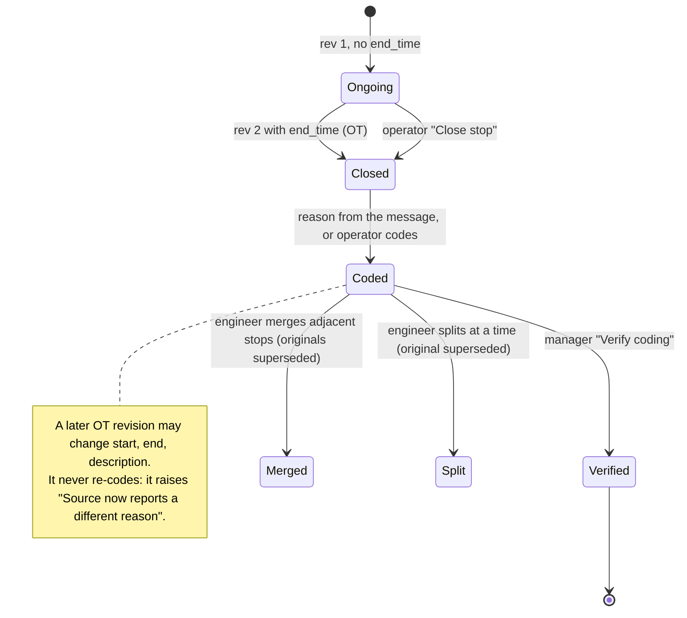
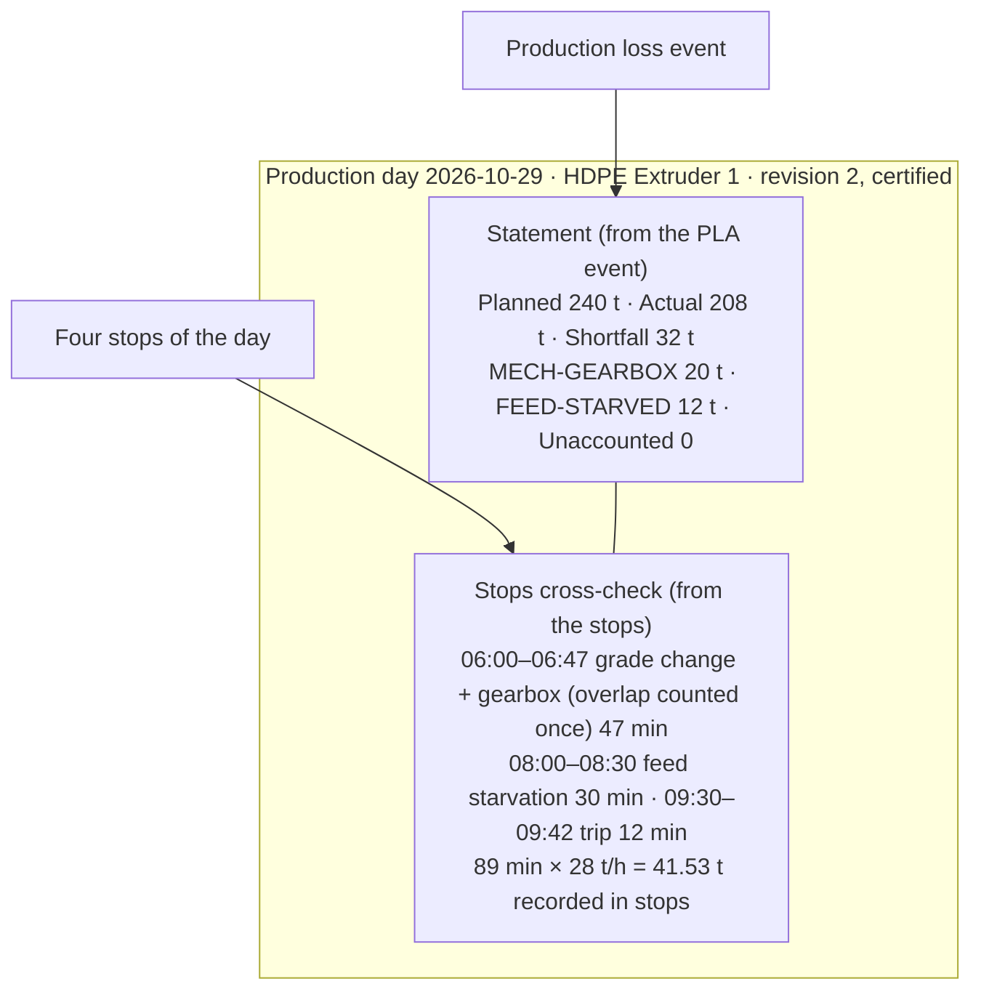

# Demo guide: the PLA day and the downtime stop, from OT to the certified statement

Traverse Forge on the Marun HDPE plant (tenant HDPE-TRAIN), 29 Oct 2026. Two OT messages feed the product:

| Use case | OT topic | One message = | Lands as | Who acts | Ends as |
|---|---|---|---|---|---|
| A. PLA (production loss accounting) | `proact/marun/hdpe/pla` | one production day of one unit: planned, actual, shortfall | a **Production loss** event in the Event Hub | operator codes the reason split, accountant submits, manager approves and certifies | the day's **loss statement** (240 / 208 / 32 / 0) |
| B. Downtime | `proact/marun/hdpe/downtime` | one stop: unit, equipment, start, end, reason | a **Stop** in the Event Hub | OT closes it by revision, operator codes, engineer merges or splits, manager verifies | reliability, Pareto, RCA, and the **stops cross-check** on the day |

The plant runs **declared mode**: the loss of the day is what OT declares, the operator's reason split is the attribution, and stops are evidence that never change an approved figure. Everything below is real data on the dev stack (`proact` database, web UI `http://localhost:8070`).

Logins: `<name>@hdpe-train.mpc`, one shared password (see the testing logins in `CLAUDE.md`). Personas used: **omid** (operator), **leila** (production engineer), **sara** (production accountant), **maryam** and **reza** (managers, approvers; reza certifies), **farid** (reliability engineer), **admin**.

---

## 0. The big picture



What to say: *"OT tells us how much was lost and when the line stopped. People tell us why. The system keeps the two apart until the day is approved, then freezes it."*

---

## A. PLA: one production day, end to end

### A.1 The OT message we are picking (latest certified day: 29 Oct 2026)

Published on topic `proact/marun/hdpe/pla`. First revision `DETECTED`, then the same day again as revision 2 `CONFIRMED` (this is what OT does once the figures are final). Stored as raw observations `pla:MARUN-HDPE-20261029:1` and `:2`.

```json
{
  "event_type": "PRODUCTION_LOSS_DETECTED",
  "schema_version": "1.0",
  "event_id": "MARUN-HDPE-20261029",
  "event_revision": 2,
  "plant": "MARUN_HDPE",
  "production_date": "2026-10-29",
  "period_start": "2026-10-29T00:00:00+03:30",
  "period_end": "2026-10-30T00:00:00+03:30",
  "plan": { "source": "PLANNING_SYSTEM_TBD", "plan_id": "PLAN-20261029", "revision": 1, "approved": true, "planned_production_t": 240 },
  "production": { "actual_good_production_t": 208, "shortfall_t": 32, "measurement_quality": "GOOD" },
  "status": "CONFIRMED"
}
```

| Field | What Traverse Forge does with it |
|---|---|
| `event_id` | identity of the day's loss; the event is `pla:MARUN-HDPE-20261029`, so a resend never duplicates it |
| `event_revision` | higher = newer; revision 2 replaced the status and kept the coding people had already given |
| `period_start` / `period_end` | the production day (plant time, UTC+03:30); the event covers exactly this window |
| `planned_production_t`, `actual_good_production_t`, `shortfall_t` | the declared figures; the identity check planned − actual = shortfall passed (tolerance 0) |
| `status` | `DETECTED` creates the event; `CONFIRMED` is required before the day can be approved |

The unit is not in the message: the feed is bound to **HDPE Extruder 1** (`da0560f4…`) in Settings → Integrations.

### A.2 The journey



What happened on the real record (event `e78d7f6f…`, period `be984a0f…`):

| Step | When (UTC) | Who | Where | What you can show |
|---|---|---|---|---|
| Message received | 27 Oct 13:08 | OT | Connectivity → connection "Marun OT feeds (UI e2e)" → subscribe job | counters: received / accepted / duplicate / quarantined; the PLA topic subscribed |
| Event created | 27 Oct 13:08 | system (revision 1, "created") | Event Hub, kind Production loss | "Production loss declared by the plant (PLA feed)", chip "MQTT · From a connected source", Declared figures 240 / 208 / 32, OT status DETECTED, plan PLAN-20261029 rev 1 approved |
| Coded | 27 Oct 13:09 and 13:10 | omid (revisions 2 and 3) | Event page → Edit / code | reason split 62.5 % MECH-GEARBOX (20 t) + 37.5 % FEED-STARVED (12 t); the "Per reason (on the loss lines)" block shows the two lines |
| Confirmed by OT | 27 Oct 13:12 | source (revision 4) | Event page → History | status CONFIRMED, coding unchanged |
| Submitted, approved | 27 Oct 13:11 to 13:13 | leila submit, reza approve | Period page → Approvals | revision 1 |
| Reopened and recertified | **29 Oct 07:03 to 07:05** | reza revise, sara recompute + submit, maryam approve, reza certify | Period page | revision 2 ("Approved: revision 2"), reason "Three OT stops of 29 Oct arrived after certification" |

Screens to open, in order:

1. **omid** → Event Hub, window 29 Oct: `http://localhost:8070/events?from=2026-10-28T20:30:00.000Z&to=2026-10-29T20:30:00.000Z&window=custom`. The Production loss card for 29 Oct sits above the stops. (`docs/qa/evidence/demo-2026-10-29/demo-01-omid-event-hub-29oct.png`)
2. **omid** → the event: `http://localhost:8070/events/e78d7f6f-6fa7-49b9-8185-97115f1a316b`. Point at: Declared figures, the two reason lines, "Accounting: approved", the History tab (4 revisions: created, coded, coded, source CONFIRMED). (`demo-04-omid-pla-29oct-coded.png`)
3. **reza** → the production day: `http://localhost:8070/plans/274b143e-d004-45d9-96cc-5ea20c8493a2/periods/be984a0f-914a-4841-902f-04be9076fc3b`. Point at: the waterfall 240 → 208, the statement line "Shortfall 32 t = net accounted 32 t + unaccounted 0 t", the two declared lines, "Status: Capacity figures not available (declared basis)", "Stops cross-check: 41.53 t recorded in stops", Approved: revision 2. (`demo-03-reza-period-29oct-rev2.png`)
4. **reza** → Accounting statement: `http://localhost:8070/pla-analytics/statement?from=2026-10-28T12:00:00.000Z&to=2026-10-29T12:00:00.000Z&window=dates`. The 29 Oct row 240 / 208 / 32 / 32 / 0. "View accounting" on the event opens the same row.
5. **sara** → the same event page: read-only (no Edit / code), sees everything.

### A.3 Live on stage: the 30 Oct day is already waiting, uncoded

A PLA message for 30 Oct (`MARUN-HDPE-20261030`, planned 240, actual 215, shortfall 25, DETECTED) was published this morning and created event `a241ec20…`, uncoded. The Event Hub shows the banner "Production loss to code". (`demo-02-omid-pla-30oct-uncoded.png`)

Do this live, as **omid**: open `http://localhost:8070/events/a241ec20-d833-4162-9f9a-f032faf64372` → Edit / code → give the reason (one code, or split by tonnes, for example 15 t SPEED-LOSS + 10 t MECH-GEARBOX) → save with a change reason. The "Per reason" block and the day's draft accounting update at once. Before coding, the statement reads "net accounted 0 t + unaccounted 25 t"; after coding, unaccounted 0.

If you want to show the arrival itself, publish a new day instead of reusing 30 Oct (same `event_id` with the same revision is a duplicate and writes nothing):

```bash
docker exec proact-mqtt-1 mosquitto_pub -h localhost -p 1885 -u proact-sim -P '<proact-sim password>' -q 1 \
  -t proact/marun/hdpe/pla -m '{"event_type":"PRODUCTION_LOSS_DETECTED","schema_version":"1.0","event_id":"MARUN-HDPE-20261031","event_revision":1,"plant":"MARUN_HDPE","production_date":"2026-10-31","period_start":"2026-10-31T00:00:00+03:30","period_end":"2026-11-01T00:00:00+03:30","plan":{"plan_id":"PLAN-20261031","revision":1,"approved":true,"planned_production_t":240},"production":{"actual_good_production_t":220,"shortfall_t":20,"measurement_quality":"GOOD"},"status":"DETECTED"}'
```

Within a few seconds the Event Hub lists a new Production loss for 31 Oct. To take a day all the way to certified it must be CONFIRMED (send revision 2 with `"status":"CONFIRMED"`), then: sara → Recompute and Submit on the period page, maryam → Approve, reza → Certify. That is the exact path used on 29 Oct this morning.

### A.4 What to say about declared mode

- The figure of record is OT's. Traverse Forge does not recompute it from counters; it checks that planned − actual = shortfall and otherwise raises a review item.
- Coding is the only human input to the number: shortfall × reason share. Uncoded share = **Unaccounted**, and the submit gate warns below 95 % coded.
- A later OT revision replaces figures, never the coding. A wrong resend of the same revision with other numbers goes to quarantine as `order_conflict`.
- Approval needs separation of duties: the approver is neither the submitter nor the person who reopened the day (reza reopened 29 Oct, so maryam approved and reza certified).

---

## B. Downtime: one stop, end to end

### B.1 The OT message we are picking

Latest fully worked stop: `MARUN-HDPE-EXT1-20261028-1905` on 28 Oct (gearbox trip, arrived open, closed by OT, coded, verified, re-coded by OT later and refused). Raw observations `downtime:MARUN-HDPE-EXT1-20261028-1905:1`, `:2`, `:3`.

Revision 1, the stop is still running (no `end_time`):

```json
{
  "event_type": "DOWNTIME",
  "schema_version": "1.0",
  "event_id": "MARUN-HDPE-EXT1-20261028-1905",
  "event_revision": 1,
  "plant": "MARUN_HDPE",
  "unit": "Extruder1",
  "equipment": "EXT1-Main",
  "start_time": "2026-10-28T19:05:00+03:30",
  "reason_code": "MECH-GEARBOX",
  "description": "Gearbox high vibration trip",
  "status": "OPEN"
}
```

Revision 2 closes it: same message plus `"end_time": "2026-10-28T19:40:00+03:30"`, `"duration_min": 35`, `"status": "CLOSED"`.

| Field | What Traverse Forge does with it |
|---|---|
| `event_id` | identity of the stop; revision 2 updated the same stop (`b801f719…`) instead of creating a second one |
| `unit` / `equipment` | matched to unit code **Extruder1** and asset code **EXT1-Main** ("Main drive and gearbox"); an unknown code goes to quarantine `unknown_unit` where admin binds it and replays |
| `start_time`, `end_time`, `duration_min` | half-open interval, stored UTC; no end = "Ongoing" in Current stops |
| `reason_code` | taken from the code library **on create only**; MECH-GEARBOX gives schedule class Unplanned and OEE component Availability. A reason sent later for an already coded stop raises the advisory review item "Source now reports a different reason" and changes nothing |

### B.2 Downtime types: the reason code decides the class

Every reason code in Master data → Codes carries a default schedule class, which is what the Event Hub shows as Planned / Unplanned / External:

| Reason code | Name | Category | Schedule class | OEE component | Stop on 29 Oct (plant time) |
|---|---|---|---|---|---|
| GRADE-CHANGE | Grade change | Planned | **Planned** | (not an availability loss) | 06:00–06:20 `…-20261029-0600` (`d5d88846…`) |
| FEED-STARVED | No upstream feed | Upstream | **External** | Availability | 08:00–08:30 `…-20261029-0800` (`f37c7cf0…`) |
| ELEC-TRIP | Electrical trip | Electrical | **Unplanned** | Availability | 09:30–09:42 `…-20261029-0930` (`c5070d9a…`) |
| MECH-GEARBOX | Gearbox failure | Mechanical › Drive train | **Unplanned** | Availability | 06:12–06:47 `E2E-DM-20261029` |
| SPEED-LOSS | Reduced extrusion rate | Process | Unplanned | Performance | (slowdown, not a stop) |

The three stops in the first rows were published this morning so that the 29 Oct day shows all three classes side by side. On the Event Hub list each row carries its class chip, the asset "Main drive and gearbox", source "MQTT" and "Accounting: approved".



### B.3 The life of a stop



```mermaid
sequenceDiagram
  autonumber
  participant OT as OT (MQTT)
  participant TF as Intake
  participant Hub as Event Hub
  participant Omid as omid (operator)
  participant Leila as leila (engineer)
  participant Reza as reza (manager)
  participant Day as Production day 2026-10-28

  OT->>TF: rev 1 OPEN, 19:05, MECH-GEARBOX
  TF->>Hub: stop b801f719, Ongoing, coded Unplanned
  Omid->>Hub: Current stops (1): "Ongoing · since 19:05 · MECH-GEARBOX"
  OT->>TF: rev 2 CLOSED, end 19:40, 35 min
  TF->>Hub: same stop closed, 35 min; Current stops (0)
  OT->>TF: rev 2 again (duplicate)
  TF-->>Hub: nothing written, counter duplicate +1
  Leila->>Hub: merge 18:00 + 18:05 stops, split the 16:30 stop
  Reza->>Hub: Verify coding → "Verified by Reza"
  OT->>TF: rev 3, reason ELEC-TRIP
  TF->>Hub: review item "Source now reports a different reason" (dismiss only)
  Hub->>Day: stop listed on the day; cross-check = stopped time × planned rate
  Note over Day: Loss statement unchanged (declared mode)
```

### B.4 Screens to open, in order

| Step | Persona | URL | What to point at | Evidence |
|---|---|---|---|---|
| The feed | admin | `http://localhost:8070/connectivity/connections/f334beca-ca4f-4310-b87f-116d84e07740` | the downtime topic subscribed; counters received / accepted / duplicate / stale / conflict / rejected at decode / parked / quarantined (open) | `docs/qa/evidence/downtime-mqtt-2026-10-28/dt-04-admin-feed-counters.png` |
| Today's stops by class | omid | `http://localhost:8070/events?from=2026-10-28T20:30:00.000Z&to=2026-10-29T20:30:00.000Z&window=custom` | Planned (GRADE-CHANGE 06:00), External (FEED-STARVED 08:00), Unplanned (ELEC-TRIP 09:30, MECH-GEARBOX 06:12); all "MQTT", "Accounting: approved" | `demo-2026-10-29/demo-01-omid-event-hub-29oct.png` |
| The worked stop | omid | `http://localhost:8070/events/b801f719-8f5c-4825-ae16-1abd0854c429` | banner "This stop comes from MQTT"; start, end, asset read-only "From MQTT" with "Override…"; 35 min; "Verified by Reza"; "Source conflicts (1)" with the dismiss-only item | `dt-01-…`, `dt-09-…` |
| Unknown reason | omid | `http://localhost:8070/events/351cc61a-c2c4-4dce-97a5-11c02f64666b` | arrived as SCREEN-CHANGE (not in the library) → created uncoded → omid coded GRADE-CHANGE → class Planned; OT revision 2 later changed the end to 17:15 and left the code alone | `dt-02-omid-unknown-code-coded.png` |
| Unknown unit | admin | `http://localhost:8070/connectivity/quarantine/1c6b978f-…` (Connectivity → Quarantine, state any) | "Source not mapped to a unit" for Pelletizer1 → Bind to Extruder1 → Dry-run replay → Replay and resolve; the stop then exists on Extruder1 | `dt-03-…`, `dt-11-…` |
| Merge and split | leila | Event Hub 28 Oct window → select 18:00 and 18:05 → Merge; the Pelletizer stop → Split | merged stop `037f10de…` 18:00–18:10; split parts `faf6cedc…` 16:30–16:38 and `5bd0a649…` 16:38–16:45; originals "Cancelled" | — |
| Verify | reza | the worked stop page → Coding verification → Verify coding | "Verified by Reza, 2026-10-28 19:46" | — |
| Analysis | omid / leila | Downtime analysis: Overview, Stops & timeline, Causes & Pareto (`/downtime/stops?from=2026-10-27T20:30:00.000Z&to=2026-10-28T20:30:00.000Z&window=dates`); Reliability | Pareto by stopped time per reason; MTBF / MTTR; "Downtime reasons" is the default Pareto on a declared plant | `dt-06-…`, `dt-07-…`, `dt-12-…` |
| RCA trigger | farid | the worked stop page | "Investigation recommended: Same failure repeating · 4 failures in 30 days (limit 3)" → Create or link investigation | `dt-13-farid-rca-recommendation.png` |

### B.5 Live on stage: an open stop that OT closes

Two commands, a minute apart. Use a fresh `event_id` each time you rehearse.

```bash
# 1. the stop starts (no end_time): Current stops shows it as Ongoing
docker exec proact-mqtt-1 mosquitto_pub -h localhost -p 1885 -u proact-sim -P '<proact-sim password>' -q 1 \
  -t proact/marun/hdpe/downtime -m '{"event_type":"DOWNTIME","schema_version":"1.0","event_id":"MARUN-HDPE-EXT1-20261029-DEMO1","event_revision":1,"plant":"MARUN_HDPE","unit":"Extruder1","equipment":"EXT1-Main","start_time":"2026-10-29T18:00:00+03:30","reason_code":"MECH-GEARBOX","description":"Gearbox vibration trip (live demo)","status":"OPEN"}'

# 2. OT closes it: same event_id, higher revision, end_time
docker exec proact-mqtt-1 mosquitto_pub -h localhost -p 1885 -u proact-sim -P '<proact-sim password>' -q 1 \
  -t proact/marun/hdpe/downtime -m '{"event_type":"DOWNTIME","schema_version":"1.0","event_id":"MARUN-HDPE-EXT1-20261029-DEMO1","event_revision":2,"plant":"MARUN_HDPE","unit":"Extruder1","equipment":"EXT1-Main","start_time":"2026-10-29T18:00:00+03:30","end_time":"2026-10-29T18:25:00+03:30","duration_min":25,"reason_code":"MECH-GEARBOX","description":"Gearbox vibration trip (live demo)","status":"CLOSED"}'
```

Set `start_time` to a few minutes before the current plant time; a start in the future is shown as "ahead of the server clock". To show the uncoded path, send `"reason_code":"SCREEN-CHANGE"` (not in the library): the stop arrives uncoded, Connectivity → Quarantine gets an `unknown_code` item, and it resolves itself the moment omid codes the stop.

---

## C. Where the two meet: the production day



- The statement comes only from the PLA event and the operator's split. Stops add no lines, so a stop that arrives late, is merged, split or re-coded cannot move an approved number.
- The cross-check is the union of the day's stopped time priced at the planned rate. 32 t declared against 41.5 t of stopped capacity tells the approver the stops over-explain the loss (some stops ran while the line still produced, or the planned rate is conservative). It is information for judgement, shown next to the statement, never booked.
- Both use the same reason-code library, so the day's reason split can be compared with the stop Pareto (20 t booked to the gearbox; the gearbox stops of the day were 35 min).
- "View accounting" on any stop or loss event opens the day's row in the Accounting statement; the day page lists the stops under the statement.
- When the cross-check should follow new stops on a certified day, a manager reopens (Revise), the accountant recomputes and submits, another manager approves, and the day is certified again: that is revision 2 of 29 Oct, done this morning.

---

## D. Questions you may get

| Question | Answer |
|---|---|
| Why not compute the loss from the stops? | The plant chose declared mode (owner decisions, 27 Oct): OT's day figures are authoritative, operators know reasons the stop feed never sees, and stop feeds double-report or miss stops. Computed mode (gap = target − actual, stops priced by time × rate) stays available per plant from an effective date in Settings → Loss accounting. |
| What if OT corrects a day after approval? | A higher `event_revision` updates the event and the day becomes stale; a manager reopens, and the day goes through submit / approve / certify again with the history kept. |
| What if the same message is sent twice? | Same `event_id` and revision: duplicate, nothing written, counter +1. Same revision with other figures (PLA): quarantine `order_conflict`. |
| What if the unit or the reason code is unknown? | Unit: quarantine `unknown_unit`, admin binds the code to a unit once, replays, and the mapping is remembered. Reason: the stop is created uncoded with a quarantine item that resolves itself when an operator codes it. |
| Who can do what? | omid codes and closes stops; leila merges and splits; sara recomputes and submits; maryam and reza approve (never their own submission or reopen) and reza certifies; farid runs RCA; admin binds sources and replays. |
| Is anything written when a page is opened? | No. Both journeys are covered by read-only Playwright specs (`e2e/pla-declared-mode.spec.ts`, `e2e/downtime-mqtt-journey.spec.ts`, 15 tests, green on 29 Oct 07:12 UTC) that abort every mutating request and assert none was attempted. |

---

## E. Reference

| Item | Value |
|---|---|
| Tenant | HDPE-TRAIN `433c1a69-7a32-4b32-ab20-c4139423abd2` |
| Unit / asset | HDPE Extruder 1 `da0560f4-2916-450d-9d30-4012e86fa17e` / EXT1-Main `dc043749…` |
| MQTT connection | "Marun OT feeds (UI e2e)" `f334beca-ca4f-4310-b87f-116d84e07740`, broker `proact-mqtt-1` port 1885, user `proact-sim`, topics `proact/marun/hdpe/pla` and `proact/marun/hdpe/downtime` |
| PLA event 29 Oct | `e78d7f6f-6fa7-49b9-8185-97115f1a316b` (`pla:MARUN-HDPE-20261029`), coded, revision 4 |
| PLA event 30 Oct (live) | `a241ec20-d833-4162-9f9a-f032faf64372` (`pla:MARUN-HDPE-20261030`), uncoded, 25 t |
| Production day 29 Oct | period `be984a0f-914a-4841-902f-04be9076fc3b`, revision 2 certified 29 Oct 07:05 UTC, cross-check 41.53 t |
| Worked stop 28 Oct | `b801f719-8f5c-4825-ae16-1abd0854c429` (19:05–19:40, MECH-GEARBOX, verified) |
| Stops 29 Oct by class | planned `d5d88846…`, external `f37c7cf0…`, unplanned `c5070d9a…`, gearbox `4763bd42…` |
| Payload contract | `docs/MQTT_FEEDS_PAYLOADS.md` |
| Downtime run report | `docs/DOWNTIME_MQTT_E2E_REPORT.md`, screenshots `docs/qa/evidence/downtime-mqtt-2026-10-28/` |
| Model explanation | `docs/PLA_DOWNTIME_CURRENT_MODEL.md`, `docs/PLA_DECLARED_MODE_PLAN.md` |
| Screenshots of this guide | `docs/qa/evidence/demo-2026-10-29/` |
