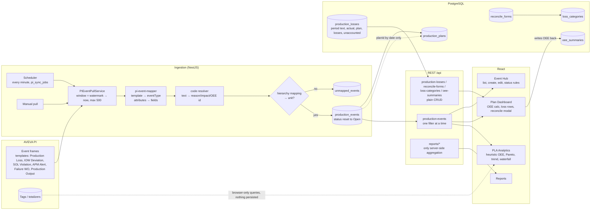

# Downtime Analysis & Production Loss Accounting — End-to-End Gap Analysis

**Scope:** two use cases, traced from AVEVA PI through ingestion, database, API and UI.
**Date:** 7 October 2026, after the move to PostgreSQL.
**Method:** code reading of the whole path (three parallel traces: ingestion, schema/API, UI), with the most consequential findings verified against the running app and database. Items marked **✔ verified** were confirmed by running a request or query; everything else is from reading the code.

Companion documents: [PROACT_APPLICATION_GUIDE.md](PROACT_APPLICATION_GUIDE.md) (what the whole app does), [TEAM_HANDOFF_GUIDE.md](TEAM_HANDOFF_GUIDE.md) (module reference).

---

## 0. Verdict in one page

| | Downtime analysis | Production loss accounting |
|---|---|---|
| **What exists** | Downtime is recorded as a generic production event (`eventType = ProductionLoss`) with start/end, reason, impact and OEE codes. Events arrive from PI event frames or manual entry. Event Hub lists and edits them. A few charts (by impact code, by day) and a server-side cost Pareto exist. | A plan holds one target quantity for a date range. The Plan Dashboard computes plan − actual, a reconcile form lets the user split the loss into categories with impact/OEE codes, and a waterfall shows planned → losses → actual. A server-side loss report exists. |
| **Maturity** | **~35%.** Capture works; analysis is thin and partly fabricated. | **~30%.** The workflow shape is there, but the key numbers are estimated or typed in, and the reconcile workflow does not persist what the user chose. |
| **Biggest blockers** | No duration is saved for manual events; units are mixed (minutes vs hours); PI re-syncs overwrite user coding; running PI event frames are stored with year-9999 end times; no planned/unplanned distinction; no MTBF/MTTR/availability from scheduled time; dashboards show heuristic OEE. | No per-period (day/shift) model; "unaccounted loss" is a hard-coded percentage; "Calculate from Events" uses a fake event list; reconcile update API is broken; event ↔ loss link is dropped on save; no approval; no ideal-rate/standard-rate model; no automatic attribution of coded downtime to the plan gap. |
| **Backend logic** | Almost none. Every KPI is computed in the browser from full tenant event lists. The server aggregates only in `reporting.service.ts` (cost Pareto by free-text category, sums of duration assumed to be minutes). | Same. `production-loss`, `reconcile-form`, `loss-category`, `oee-summary` are plain CRUD. Nothing derives `losses`, `unaccounted`, A/P/Q or OEE on the server. |
| **Verdict** | The storage and ingestion skeleton is reusable. The analysis layer needs to be built, and the data contract (duration, units, open events, planned/unplanned) fixed first. | The entities need a period model and a real attribution engine. The reconcile UI can be kept; its persistence and the server logic behind it must be rebuilt. |

**Recommended order:** fix the data contract (Phase 0) → downtime foundation (Phase 1) → loss accounting model (Phase 2) → analytics and reports (Phase 3). See §9.

---

## 1. What the two use cases need

Industry baseline (ISO 22400 / OEE "six big losses" / typical PLA products such as AVEVA Production Accounting, Proficy, Aspen):

### 1.1 Downtime analysis
1. **Capture** every stop per unit/asset with start, end (or *still running*), duration, source, and whether it is **planned or unplanned**.
2. **Classify** with a reason hierarchy (e.g. Mechanical → Pump → Seal failure) that maps each reason to an OEE bucket (Availability / Performance / Quality) and to planned/unplanned.
3. **Edit** operations: assign/reassign reason, split one stop into two, merge, bulk-code, close an open stop.
4. **Time context:** shift calendar and plant time zone, so "today", "shift A", "this week" mean plant-local time.
5. **KPIs:** total downtime, availability = (scheduled − downtime) / scheduled, **MTBF**, **MTTR**, number of stops, mean stop length, micro-stops.
6. **Analysis views:** Pareto by reason (with cumulative %), trend by day/shift/week, top bad actors (assets), shift/crew comparison, state timeline (Gantt) per asset, drill-down to the event list.
7. **Source integration:** PI event frames (open and closed), later OPC UA / MQTT state tags.

### 1.2 Production loss accounting
1. **Capability model:** for each unit × product, an ideal rate (maximum sustained capacity) and a planning rate.
2. **Plan per period:** target quantity per day/shift (not one number for a month).
3. **Actuals per period:** from output events or production counters/totalizers in PI.
4. **Loss per period** = period target − period actual (or ideal-rate × available time − actual).
5. **Attribution:** coded downtime and rate/quality losses are converted to lost quantity (duration × rate, or quantity lost) and subtracted from the gap; the remainder is **unaccounted loss**.
6. **Reconciliation workflow:** user explains the unaccounted remainder by adding/adjusting loss lines (each linked to an event or a reason), then **submits → approves**; the period is locked.
7. **Valuation:** lost quantity × product standard cost/margin; downtime × cost-per-hour.
8. **Reports:** waterfall (plan → loss categories → actual), loss tree, trend, OEE from the same data, reconciliation status per period, export.

---

## 2. End-to-end flow today

Where the logic lives today:

| Layer | Downtime | Loss accounting |
|---|---|---|
| PI ingestion | Real: template → type, attribute → field, code resolution, unit mapping, watermark, cron | Only event-frame quantities; **no counter/totalizer ingestion** |
| Database | Generic event row; no planned/unplanned, no state log, no shift calendar | Period is free text; no unit-product rate; no event ↔ loss link |
| Server | CRUD + `reporting.service.ts` sums | CRUD only; nothing derived |
| Browser | Status rules, cost auto-fill, all KPIs, heuristic OEE | plan − actual, fake unaccounted %, reconcile arithmetic, waterfall, OEE write-back |

---

## 3. Data model: today vs needed

### 3.1 Tables that exist (relevant columns)

**`production_events`** — the downtime/loss record
| Column | Type | Notes |
|---|---|---|
| `event_id` | varchar(255), nullable | PI WebId or `MAN-…`. **Not unique** (dedupe is in code) |
| `unit_id` | uuid, **NOT NULL**, FK | |
| `asset_id`, `plan_id`, `rca_id` | uuid, FK | `plan_id` set only for PI loss/output events by date match |
| `impact_code_id`, `oee_code_id`, `reason_code_id` | uuid, FK | |
| `event_type` | varchar(50) | ProductionLoss / IOW / SOL / APM / FailureWO / ProductionOutput. **No `Downtime` type**, no enum check |
| `start_time` | timestamptz NOT NULL | **No index** |
| `end_time` | timestamptz | PI running frames stored as `9999-12-31` ✔ |
| `duration` | decimal(10,2) | **Unit undeclared.** Not derived from start/end. Manual events never set it ✔ |
| `quantity`, `cost`, `defective_quantity` | decimal(10,2) | Cost never computed server-side |
| `status` | varchar(50) | Open / Coded / RCA Required / Closed / … |
| `severity`, `loss_category`, `shift`, `crew`, `operator_name`, `source` | varchar | All free text |
| IOW/SOL/APM/WO fields | | `parameter`, `value`, `limit_value`, `limit_type`, `breach_duration`, `sol_type`, `apm_type`, `recommended_action`, `work_order_id`, `failure_mode` |
| `tenant_id`, `organization_id` | **varchar(36)**, no FK | Mixed with `uuid` elsewhere |

**`production_plans`** — one target for a date range
`plan_name`, `unit_id` (varchar, no FK), `product_id` (varchar), `start_date`, `end_date`, `target_quantity` → `plannedQuantity`, `actual_quantity`, `tolerance_limit` (unused), `plan_basis`, `recurrence`, `data_entry_frequency`, `useful_production_time` (JSON string, never read by server), `shift`, `crew`, approval columns (`approval_status`, `submitted_*`, `reviewed_*`, `approved_*`, `rejection_reason`), `comments`, `audit_trail`.

**`production_losses`** — one row per plan per period
`plan_id` FK, `period` **varchar(50) free text**, `actual`, `short_range_plan`, `losses`, `unaccounted_loss` (all client-supplied), `action` (Reconcile / RCA Required / Closed), `loss_type`, `loss_category`, `quantity`, `cost`, `description` (**not in any DTO → cannot be written** ✔ by DTO inspection), `tenant_id` FK. No `unit_id`, no `period_start/end`, no status, no approver, no unique (plan, period).

**`reconcile_forms`** — `lossId` FK, `totalLossAmount`, `categorizedLossAmount`, `unaccountedLossAmount`, `productionEvent` **varchar (not an FK, one event)**, `comment`, `status` (Draft/Submitted/Approved/Rejected — only Draft ever written), `categories` (JSON duplicate), `tenantId`. No submitted/approved by/at.

**`loss_categories`** — a reconcile line, not a master: `reconcileFormId` FK, `categoryName` free text, `lossAmount`, `impactCodeId` FK NOT NULL, `oeeCodeId` FK NOT NULL, `description`. **No link to a production event.**

**`oee_summaries`** — `plan_id`, `availability`, `performance`, `quality`, `oee`, `period` text, `planned_production_time`, `actual_production_time`, `downtime` (**not in DTO → not writable**). No `unit_id`, no bucket.

**Code tables** — `impact_codes` (category A/P/Q, `cost_per_unit`, `cost_per_hour`, `cost_basis`), `oee_codes` (`category` Planned/Unplanned in the UI, `impact_type` A/P/Q), `reason_codes` (**no `parent_id`** ✔ — the tree UI's hierarchy is not saved). All `code` columns are **globally unique**, not per tenant.

**Capability fields that exist but nothing reads:** `units.ideal_cycle_time`, `units.capacity`, `products.standard_rate` (property `standardCost` — name is ambiguous), `impact_codes.cost_per_hour/cost_per_unit/cost_basis` (used only by the browser cost auto-fill).

### 3.2 Tables that do not exist

| Needed for | Missing table / columns |
|---|---|
| Downtime | planned/unplanned class on reason/OEE code; `equipment_states` (state log); `parent_event_id` for splits; indexes on `(tenant_id, unit_id, start_time)` |
| Both | `shifts` / `shift_calendar` and `crews`; plant time zone use (`tenants.timezone` exists, never read) |
| Loss accounting | `unit_product_rates` (ideal rate, planning rate, UoM, effective dates); `plan_periods` (plan_id, period_start/end, target); `production_periods`/`production_data` (unit, period_start/end, actual, planned, loss, unaccounted, status); `loss_lines` linked to `production_event_id` and reason/impact/OEE codes; loss-category master (`loss_category_defs`); reconcile approval columns |

### 3.3 Integrity gaps
- No `@Index` on any production table. No unique on `production_events(tenant_id, event_id)` or `pi_events(web_id)` → duplicate risk on overlapping syncs.
- `plans.unit_id`, `assets.unit_id`, `products.unit_id`, `events.tenant_id` are varchar without FKs; `tenant_id` is `uuid` on other tables → joins need casts.
- No CHECK constraints (`end_time ≥ start_time`, `duration ≥ 0`, enum values).
- FKs are `ON DELETE NO ACTION` → deleting a unit/code referenced by events returns 500.

---

## 4. Ingestion from PI — what exists and what's missing

### 4.1 Exists [✓]
- Event-frame pull per tenant connection, scoped to an AF database or element; Basic auth; credentials encrypted at rest.
- Template → event type mapping with tenant overrides (`pi_mappings.mappingRules`).
- Attribute → field mapping (defaults in `integration/pi-event-mapper.ts`):
  - *Production Loss*: Description, ReasonCode, OEECode, ImpactCode, Quantity, Cost, Shift, Crew, Duration, LossCategory, OperatorName
  - *Production Output*: GoodQty → quantity, ScrapQty → defectiveQuantity
  - IOW / SOL / APM / Failure WO: their specific fields
- Text code → id resolution (exact code/name, then substring; 5-min cache).
- Unit resolution via `source_hierarchy_mappings` (exact → wildcard → path containment) then `af_bindings`.
- Unmapped capture (`unmapped_events`, deduped on source id).
- Cron scheduler (every minute), per-scope watermark, lookback window, UI to set interval/lookback.

### 4.2 Partial [◐] and missing [✗]

| # | Finding | Tag | Where |
|---|---|---|---|
| I1 | **Re-sync overwrites user work.** Every pull builds the DTO with `status: 'Open'` and calls `update()` for existing events, so Coded / RCA Required / Closed is reset and manual edits to mapped fields are lost. ✔ | ◐ | `integration/pi-event-pull.service.ts` ~L300–345 |
| I2 | **Running event frames.** PI reports in-progress frames with `EndTime = 9999-12-31`. No sentinel handling exists; they are stored as closed in year 9999, and `(end − start)` durations are enormous (RCA auto-trigger can fire). ✔ | ✗ | same, L130, L313 |
| I3 | **Duration** comes only from a PI attribute named `Duration`, with no unit conversion and no TimeSpan parsing (`"00:15:00"` → `NaN`). Never derived from start/end. | ◐ | `pi-event-mapper.ts` `mapAttributesToFields` |
| I4 | **PI enumeration (digital-state) values** arrive as `{Name, Value}` objects. `String(obj)` → `"[object Object]"`, so reason/category/state held in enumeration sets is lost. ✔ (code path) | ✗ | `pi-event-mapper.ts` L117–129 |
| I5 | No `Downtime` event type and no planned/unplanned flag; downtime can only be `ProductionLoss`. | ✗ | `pi-event-mapper.ts`, entity |
| I6 | **Asset-only mappings lose the unit.** If a mapping targets an asset, `unitId` is not derived from `asset.unit_id`, so the event goes to unmapped — and the asset mapping also blocks the `af_bindings` fallback. | ✗ | `pi-event-pull.service.ts` L272–292, `hierarchy-mapping.service.ts` `buildHierarchyIds` |
| I7 | Wildcard patterns never match PI paths because `\` is normalised in the pattern but not in the path. | ◐ | `hierarchy-mapping.service.ts` `matchesPattern` |
| I8 | **No paging.** `maxCount` 500 (200 manual) per window; extra frames are silently skipped while the watermark still advances. Watermark advances even when events failed. | ✗ | `pullEvents`, `upsertWatermark` |
| I9 | Unmapped PI events are never re-processed after a mapping is added; the Plan Dashboard "assign" flow cannot handle them (no `event.id`). | ✗ | `unmapped-event.service.ts`, `PlanDashboard.tsx` ~L1167 |
| I10 | **Frontend mapping UI disagrees with backend defaults**: it offers `reasonCode`/`impactCode` (no `Id`), `goodQty`/`scrapQty`, and lacks `duration`/`operatorName`; a tenant override replaces the whole template map. Saving from that page can drop the Duration mapping. | ◐ | `src/services/pi/PIMapper.ts`, `pages/integrations/PIIntegration.tsx` `APP_FIELDS`, `parseTenantMappingRules` |
| I11 | **No production counter / totalizer ingestion.** `historian-tag` is a tag catalog only; nothing writes actuals into `production_losses.actual` or `oee_summaries`. Browser-side `PIHistorianProvider` can query `/streams/{id}/summary` (Total) but only for display. | ✗ | new service under `integration/` |
| I12 | `/pi-browser/:tenantId/request` DTO has no class-validator decorators; with `forbidNonWhitelisted` it likely rejects every body (breaks the historian provider when a tenant is set). | ◐ | `integration/pi-browser.controller.ts` |
| I13 | One HTTP call per attribute per frame (no streamsets); all plans of the unit loaded per event for `findPlanForEvent`. | ◐ | `pi-event-mapper.ts`, `pi-event-pull.service.ts` L235 |
| I14 | `tenants.timezone` is never read; all bucketing is UTC; display uses browser time. | ✗ | reporting, pull service, frontend formatting |
| I15 | Sync-job UI drops `templateName`/`maxCount`/scope on create; `stopSync` is a no-op; one job per tenant. | ◐ | `src/services/pi/AutoPIEventSyncService.ts`, `components/pi/PIEventSyncManager.tsx` |
| I16 | Other sources (OPC UA, Modbus, MQTT, Database, REST) return `"… not yet implemented"`; MQTT/OPC UA clients only broadcast live values, never persist. | ✗ | `connectivity/services/unified-event-pull.service.ts` (module removed 2026-10-14; v2 intake adapters replace it) |

---

## 5. API and server logic — what exists and what's missing

### 5.1 Routes relevant to the two use cases

| Controller | Routes | Filters | Verified issues |
|---|---|---|---|
| `production-events` | GET list, GET/:id, POST, PUT/:id, DELETE/:id, POST /upload | `tenantId` **>** `unitId` > `status` > `eventType` > `startDate+endDate` — **one filter only, first wins** ✔ | Date range uses Mongo `$gte/$lte` → **broken on Postgres** ✔. No `planId`/`reasonCodeId`/`assetId` filter, no pagination, no ordering. `reasonCode` and `rca` relations removed (MSSQL leftover). Create requires `eventId, unitId, description, startTime, source, status, eventType`; no enum validation; no `end ≥ start` check; duration/cost not derived. |
| `production-losses` | CRUD | `planId` > `tenantId` | `lossType, lossCategory, quantity, cost, description` not in DTOs → 400 if sent. Nothing computed. |
| `reconcile-forms` | CRUD | `lossId` > `tenantId` | **Update DTO declares `planId, period, categories, tenantId`** — `planId`/`period` are not columns (500), and `status/comment/amounts` are not allowed → **cannot submit or approve via PUT** ✔ |
| `loss-categories` | CRUD | `reconcileFormId` > `tenantId` | **Update DTO has `name`, column is `categoryName`** → update throws ✔; amount/codes not updatable |
| `oee-summaries` | CRUD | `planId` > `tenantId` | Time columns not writable; no computation |
| `production-plans` | CRUD | `tenantId` > `status` | **No `unitId` filter**; no overlap check; no realtime broadcast |
| `impact-codes`, `oee-codes` | CRUD | none (all tenants) | Impact update cannot set severity/color |
| `reason-codes` | CRUD | `tenantId` | `parentId` commented out; `findByParent` returns `[]` ✔ |
| `unmapped-events` | CRUD | `tenantId` > `unitId` | **No auth guard.** No "resolve → create event" route |
| `reports` | `oee-summary`, `production-loss`, `oee-trends`, `loss-analysis`, `dashboard` | `tenantId`, `startDate`, `endDate`, `unitId` | Loss/OEE records filtered by **`createdAt`**, not period; `unitId` ignored for records; unit labels are UUID prefixes |

### 5.2 Server-side calculation inventory

Only `reporting/reporting.service.ts` computes anything:
- `oee-summary`: unweighted mean of A/P/Q/OEE over `oee_summaries` rows (nulls count as 0); fallback `{eventCount, Σduration as "minutes", Σcost}` from ProductionLoss events.
- `production-loss`: Σ`losses`, Σ`cost`; events: Σcost, Σduration ("minutes"), `byCategory` (free-text `lossCategory`, **sum of cost**), `bySeverity`, `byUnit`, top-10 by cost, daily series (UTC days), **Pareto by cost with cumulative %**.

**Not computed anywhere on the server:** availability, performance, quality, OEE from events/plan/rates; MTBF/MTTR; downtime by reason/asset/shift; Pareto by **duration**; planned vs unplanned; loss per period; unaccounted = losses − Σ attributed; cost from impact-code rates; window clipping or overlap merge; shift/time-zone bucketing; pagination.

### 5.3 Realtime
`productionEvent*`, `productionLoss*`, `reconcileForm*`, `lossCategory*`, `oeeSummary*`, code tables and `unmappedEvent*` broadcast to **all clients of all tenants**; production plans do not broadcast at all; `productionEventCreated/Updated` are emitted twice.

---

## 6. UI — what exists and what's missing

### 6.1 Downtime

| Screen | Exists | Problems |
|---|---|---|
| **Event Hub** (`pages/EventHub.tsx`) | Tabs per event type; filters (source, PI template, search, severity, unit, asset, shift, dates); quick stats; create/edit/delete; reason-code tree picker; CSV export; detail modal with audit trail; websocket live refresh; "Create RCA" gate | **No duration input on create** — `eventForm.duration` is never set, so manual downtime has no duration ✔. Edit shows minutes read-only but never saves it. Detail modal shows "Duration (hours): 360" for a 6-hour event (seeders store minutes). Quick-stat treats duration as minutes (`floor(Σ/60) h`), cost auto-fill treats it as hours. Loss category is a hard-coded list. `planId` only sent for ProductionOutput → manual losses never link to a plan. Shift options (Day/Night/Afternoon) don't match other screens. IOW "signal trend" **silently falls back to `Math.random()` data**. Tenant for create = `session.tenant`, for list = `plantSelection.tenant`. No split/merge/bulk-code/close-open-stop. |
| **PLA Analytics** (`pages/PLADashboard.tsx`) | Date presets, unit/severity/status/asset/impact filters; tiles (total loss minutes, financial impact, events, top category); Pareto, Trend, Waterfall tabs; drill-down table | OEE tiles are the **heuristic** (`A = 95 − …`, constant 87% with no events). No `eventType` filter → IOW/APM count as losses. Category options (Mechanical/Electrical/…) and shift options (A/B/C) **never match the data**. **Trend period selector is unwired** (`groupBy="day"` hard-coded) ✔. Pareto has no cumulative line and sorts by impact code, not reason. Refresh = page reload; Fullscreen does nothing. |
| **Dashboard** | Top impacted assets (by **count**, labelled in hours) | Heuristic OEE; `equipmentHealthScore` computed, never shown |
| **Reports → Loss tab** | Server-side: Pareto with cumulative %, cost by severity/category/unit, daily cost and downtime trends, top cost events | `unitId` never sent; unit labels are UUID fragments; manual events report 0 minutes (no duration saved) |
| **Codes** (`CodesManagement.tsx`, `ReasonCodeLibraryTree.tsx`) | Impact codes with cost basis; OEE codes with Planned/Unplanned + A/P/Q; reason tree UI | **Reason hierarchy not persisted** ✔; reason not linked to OEE bucket or planned/unplanned; code lists load **all tenants'** codes |
| **Missing entirely** | — | MTBF/MTTR, availability vs scheduled time (except per-plan), asset state timeline/Gantt, shift comparison, micro-stop thresholds, "currently down" view, split/merge |

### 6.2 Production loss accounting

| Screen | Exists | Problems |
|---|---|---|
| **Plan form / templates** | Name, dates, unit, product, planned & actual qty, basis, recurrence, data-entry frequency, weekly working hours, shift/crew, approval workflow; template wizard | **One target per date range**; no per-day/shift targets, no rate, no product mix. Template default quantity assumes 100 units/h. `fetchOutputEvents` loads events with no tenant filter. |
| **Plan Dashboard** (`components/production-plans/PlanDashboard.tsx`) | OEE A/P/Q per plan (real arithmetic); Achievement tile with **Sync actual from output events**; loss rows table with validation flags; **Reconcile modal** (categories with amount, impact/OEE code, optional linked event); breakdown modal; unmapped-events modal; financial tiles; bottleneck risk | **"Calculate from Events" uses a hard-coded fake event array** (4200 output…) ✔. **Unaccounted loss = fabricated % (25–40% × 0.8/1.2)**. Reconcile save **drops the linked event** and always saves `Draft`; validation only Σ ≤ total; non-transactional (delete all categories, re-create). OEE written back to server on every view. Events loaded twice (unit-wide, then plan-only) → race decides which set drives OEE. "Create RCA" / "Reconcile" buttons in the priority list have no handler. Equipment Status hard-coded "Active". Period is a generated/free string. Financials use flat `lossValuePerUnit = 100`, not product cost. |
| **Waterfall** (`PlanWaterfallChart.tsx`) | Planned → −Σ quantity per `lossCategory` → Actual | Based on event quantities in the plan window (not reconcile data); "Unaccounted" bar only when there are **no** loss events; UoM hard-coded "MT" |
| **Reports → Loss tab** | As above | Sums `production_losses.cost`, which the API cannot write |
| **Missing entirely** | — | Period model (day/shift), ideal/planning rate per unit-product, automatic attribution of coded events to the gap, submit/approve/lock, loss-category master, actuals from PI counters, loss tree report |

### 6.3 Cross-cutting UI issues
- **Duration unit chaos:** minutes (CSV, Reports, analytics helpers, seeders), hours (Event Hub detail label and cost auto-fill), `floor(min/60) h` (quick stat).
- **Status automation rules** are stored in `localStorage`, edited in Admin Panel via `new Function(...)`; after any admin save the condition functions are lost (`JSON.stringify`) and Event Hub throws when applying rules.
- Every screen downloads **all events of the tenant** and filters in the browser; `QueryClientProvider` is mounted but `useQuery` is never used; the Pareto, Trend, Waterfall and drill-down table each refetch independently.
- Seeders (`CementIndustryDataSeeder`, `OilGasDataSeeder`, `PresentationDataSeeder`, `PLARCADataSeeder`) write through the API with **minute** durations; none create reconcile forms or loss categories; "Simulate Events" uses non-existent code ids `impact_1`/`oee_1`.

---

## 7. Capability matrices

Legend: ✓ exists · ◐ partial · ✗ missing · ⚠ simulated/fabricated

### 7.1 Downtime analysis

| Capability | PI | DB | API | Server logic | UI | Notes |
|---|---|---|---|---|---|---|
| Record a stop (start/end/unit/asset/reason/impact/OEE) | ✓ | ✓ | ✓ | – | ✓ | Only as `ProductionLoss` |
| Duration stored consistently | ◐ | ◐ | ✗ | ✗ | ✗ | Attribute-only from PI; never derived; no unit; no manual input |
| Open / running stop | ✗ (9999) | ✗ | ✗ | ✗ | ✗ | |
| Planned vs unplanned | ✗ | ✗ | ✗ | ✗ | ◐ (OEE code category, unused) | |
| Reason hierarchy → OEE bucket | – | ✗ | ✗ | – | ◐ (tree UI, not saved) | |
| Split / merge / bulk-code / close | – | ✗ | ✗ | ✗ | ✗ | `bulk-operations.dto.ts` exists unused |
| Shift calendar & plant time zone | – | ✗ | ✗ | ✗ | ✗ | `tenants.timezone` unused |
| Total downtime, availability vs scheduled | – | – | ✗ | ✗ | ◐ (Plan Dashboard only) | |
| MTBF / MTTR / stop count / mean stop | – | – | ✗ | ✗ | ✗ | |
| Pareto by reason with cumulative % | – | – | ◐ (by cost, free-text category) | ◐ | ◐ (by impact code, no cum. line) | |
| Trend by day / shift / week | – | – | ◐ (UTC day) | ◐ | ◐ (selector unwired) | |
| Top bad-actor assets | – | – | ✗ | ✗ | ◐ (by count) | |
| Shift / crew comparison | – | – | ✗ | ✗ | ✗ (filters mismatch) | |
| Asset state timeline / Gantt | – | ✗ | ✗ | ✗ | ✗ | |
| Dashboard OEE | – | – | – | ✗ | ⚠ heuristic | |
| Live updates | – | – | ✓ (all tenants) | – | ◐ (Event Hub only) | |
| PI re-sync preserves user coding | ✗ | – | – | ✗ | – | Status reset to Open |

### 7.2 Production loss accounting

| Capability | PI | DB | API | Server logic | UI | Notes |
|---|---|---|---|---|---|---|
| Unit × product ideal / planning rate | – | ◐ (`ideal_cycle_time`, `standard_rate` unused, no pair) | ◐ | ✗ | ◐ | |
| Plan target per period (day/shift) | – | ✗ (one number per range) | ✗ | ✗ | ✗ | |
| Actuals from output events | ✓ (Production Output EF) | ✓ | ✓ | ✗ | ✓ (Sync button) | |
| Actuals from PI counters/totalizers | ✗ | ✗ | ✗ | ✗ | ◐ (browser queries only) | |
| Loss per period = target − actual | – | ◐ (`losses` typed) | ✓ CRUD | ✗ | ✓ (browser) | |
| Attribution of coded events to the gap | – | ✗ (no event↔loss link) | ✗ | ✗ | ⚠ (fake events) | |
| Unaccounted loss | – | ◐ | ✓ CRUD | ✗ | ⚠ (fixed %) | |
| Reconcile: add loss lines with codes & linked event | – | ◐ (no event FK) | ◐ (update DTO broken) | ✗ | ◐ (link dropped on save) | |
| Submit → approve → lock period | – | ◐ (status col only) | ✗ | ✗ | ✗ | |
| Valuation (qty × std cost, h × cost/h) | – | ◐ (fields exist) | – | ✗ | ◐ (flat 100/unit; cost auto-fill in form) | |
| Waterfall plan → categories → actual | – | – | ✗ | ✗ | ◐ (event quantities only) | |
| Loss tree / category master | – | ✗ | ✗ | ✗ | ✗ (hard-coded list) | |
| OEE from the same data | – | ◐ (`oee_summaries` typed) | ✓ CRUD | ✗ | ◐ (per plan, browser) | |
| Server-side loss report | – | – | ✓ | ◐ | ✓ | filtered by `createdAt`, no unit |

---

## 8. Bugs that block the use cases today

Fix these before building on top; all are small.

| # | Bug | Verified | File |
|---|---|---|---|
| B1 | Event list applies only one filter; `unitId` ignored when `tenantId` present | ✔ | `production-event.controller.ts` L28–44 |
| B2 | `findByDateRange` uses Mongo operators → broken on Postgres | ✔ | `production-event.service.ts` L110 |
| B3 | Reconcile update DTO has wrong fields → cannot submit/approve; may 500 | ✔ | `reconcile-form/dto/update-reconcile-form.dto.ts` |
| B4 | Loss-category update DTO uses `name` vs column `categoryName` | ✔ | `loss-category/dto/update-loss-category.dto.ts` |
| B5 | PI re-sync resets `status` to Open and overwrites edits | ✔ | `pi-event-pull.service.ts` ~L331, L344 |
| B6 | Running PI frames stored with `9999-12-31` end | ✔ | same, L130/L313 |
| B7 | PI enumeration values become `"[object Object]"` | ✔ (code) | `pi-event-mapper.ts` L117 |
| B8 | Manual events never save a duration | ✔ | `EventHub.tsx` (no input bound to `eventForm.duration`) |
| B9 | "Calculate from Events" uses hard-coded fake events | ✔ | `PlanDashboard.tsx` ~L983–1032 |
| B10 | Reconcile save drops the selected production event link | code | `PlanDashboard.tsx` ~L721–804 |
| B11 | PLA trend period selector unwired | ✔ | `PLADashboard.tsx` L962/L982 |
| B12 | Reason-code `parentId` not persisted | ✔ | `reason-code.entity.ts`, DTOs, DB |
| B13 | `production_losses` DTOs omit `lossType/lossCategory/quantity/cost/description` | ✔ (DTO) | `production-loss/dto/*` |
| B14 | `unmapped-events` controller has no auth guard | code | `unmapped-event.controller.ts` |
| B15 | Status-rule persistence loses functions → Event Hub throws after admin edit | code | `AdminPanel.tsx`, `EventHub.tsx` L35–83 |
| B16 | IOW trend silently shows random data | code | `EventHub.tsx` ~L2388–2439 |
| B17 | `reasonCode`/`rca` relations stripped from event reads (MSSQL leftover) | code | `production-event.service.ts` |
| B18 | Products cannot be created with `tenantId`/`unitId` (DTO) | code | `product/dto/create-product.dto.ts` |

---

## 9. Target design and build plan

The target follows the intent already written in `docs/microserviceSpecs.md` (ProductionProfile, PlanPeriods, ProductionData per period, losses linked to events with a reconciliation status, code hierarchy) — implemented inside the existing monolith, not as microservices.

### Phase 0 — Fix the data contract (prerequisite, ~1 week)

**Schema**
- `production_events`: add `duration_minutes` (derive from `end − start` on create/update when absent; migrate existing `duration` assuming minutes), `is_open boolean` (true when end is null / PI sentinel), `downtime_class` (`Planned | Unplanned | External`, nullable), `parent_event_id`; `@Unique(['tenantId','eventId'])`; indexes `(tenant_id, unit_id, start_time)`, `(tenant_id, event_type, start_time)`.
- `reason_codes`: restore `parent_id`, add `level`, `path`, `oee_component` (A/P/Q), `downtime_class`, `exclude_from_availability`.
- Code tables: `@Unique(['tenantId','code'])` instead of global.
- `production_losses` / `oee_summaries`: add `period_start`, `period_end` (timestamptz), `unit_id`.

**Ingestion** (`pi-event-pull.service.ts`, `pi-event-mapper.ts`)
- Treat `EndTime ≥ 9999-01-01` as open; store `end_time = null`, `is_open = true`.
- On update of an existing event: only write fields PI owns (`start_time`, `end_time`, `is_open`, raw attribute fields that are still null); **never** touch `status`, codes or description once set by a user. Re-run RCA trigger when an open event closes.
- Enumeration values → `.Name`; parse TimeSpan durations; compute `duration_minutes` when PI gives none.
- Page through event frames (`startIndex`) until fewer than `maxCount`; do not advance the watermark past the last successfully processed frame.
- Asset-only mapping → derive `unit_id` from `assets.unit_id`; fix backslash normalisation in `matchesPattern`.
- Align `PIMapper.ts` / `APP_FIELDS` with backend field names; merge overrides per attribute.

**API**
- Rewrite `GET /production-events` with a query DTO (tenant, unit[], asset, eventType[], status[], reasonCode, plan, from, to, isOpen, page, pageSize, sort) → one QueryBuilder. Delete the Mongo date-range code.
- Fix the reconcile, loss-category, production-loss and product DTOs (use `PartialType(Create)`).
- Add `JwtAuthGuard` to `unmapped-events`; add `POST /unmapped-events/:id/resolve` (creates the production event with the chosen unit/plan).

**UI**
- Event Hub: add a duration field (minutes, auto-filled from start/end, editable), show one unit everywhere, remove the random IOW fallback (show "no PI data"), send `planId` for loss events when a plan covers the time.
- Move status rules out of `localStorage` into `app-settings` as declarative JSON (field/operator/value), no `new Function`.

### Phase 1 — Downtime analysis (~3 weeks)

**Schema**: `shifts` (tenant/unit, name, start, end, days of week, effective dates), `crews`; use `tenants.timezone`. Optional `equipment_states` log for Gantt.

**Server** (`new downtime module` or `reporting`):
- `GET /reports/downtime` — params: tenant, unit[], asset[], from, to, groupBy (`reason | reasonLevel1 | impactCode | oeeCode | asset | shift | crew | day | week`), downtimeClass. Returns Σ minutes **clipped to the window**, stop count, mean stop, cumulative % — computed in SQL (`SUM(LEAST(end, to) − GREATEST(start, from))`), bucketed in the tenant's time zone (`AT TIME ZONE`).
- `GET /reports/reliability` — MTBF = operating time / failure count, MTTR = Σ unplanned downtime / stop count, per asset/unit; availability = (scheduled − unplanned downtime) / scheduled where scheduled comes from the shift calendar (fallback: plan `useful_production_time`).
- Event operations: `POST /production-events/:id/split` (at a timestamp, both halves keep codes), `POST /production-events/merge`, `PATCH /production-events/bulk-code`, `POST /production-events/:id/close`.

**UI**
- New **Downtime Analysis** page: KPI row (downtime, availability, MTBF, MTTR, stops), Pareto by reason with cumulative line (click → drill to reason level 2 → event list), trend by day/shift/week (wired), top assets by minutes, shift/crew comparison, planned vs unplanned toggle, "currently down" panel. All from the new server endpoints with `useQuery`.
- Reason code tree editor persisting hierarchy, with OEE component and planned/unplanned on each node.
- Replace the heuristic OEE on Dashboard/PLA with values from the server or hide the tiles until Phase 2.

### Phase 2 — Production loss accounting (~4 weeks)

**Schema**
- `unit_product_rates` (unit_id, product_id, ideal_rate, planning_rate, rate_uom, effective_from/to).
- `plan_periods` (plan_id, product_id, period_start, period_end, target_qty) — generated from the plan's recurrence/data-entry frequency and working hours.
- `production_periods` (tenant, unit, product, period_start, period_end, plan_period_id, target_qty, actual_qty, scheduled_minutes, downtime_minutes, loss_qty, attributed_qty, unaccounted_qty, status `Open | Reconciled | Submitted | Approved | Locked`, submitted/approved by/at). Unique (unit, period_start).
- `loss_lines` (production_period_id, production_event_id nullable, reason_code_id, impact_code_id, oee_code_id, loss_qty, duration_minutes, cost, source `Auto | Manual`, comment).
- `loss_category_defs` master (replace the hard-coded list and free-text `loss_category`).
- Retire `reconcile_forms`/`loss_categories` in favour of `loss_lines` (keep read-only for existing data), or migrate.

**Server** (`production-accounting` module)
- Period engine: on plan approval, create `plan_periods`; nightly/at shift end create `production_periods`; `actual_qty` = Σ ProductionOutput events in the period (and later PI totalizer `Total` summaries via a new `pi-production-counter` service that reads `/streams/{webId}/summary`).
- Attribution: for each coded downtime/loss event overlapping the period, `loss_qty = duration_minutes × ideal_rate` (Availability) or `event.quantity` (Performance/Quality); write `loss_lines(source='Auto')`; `unaccounted_qty = loss_qty − Σ attributed`. Recompute when events or codes change (event-driven via the existing service hooks).
- OEE per period from the same numbers: A = (scheduled − unplanned downtime)/scheduled; P = actual / (ideal_rate × run time); Q = good / total. Persist into `oee_summaries` (with `unit_id`, `period_start/end`) — the browser stops writing OEE.
- Workflow: `POST /production-periods/:id/submit | approve | reject | unlock` with `RolesGuard` (Engineer submits, Manager/TenantAdmin approves); locked periods reject edits.
- Valuation: `loss_lines.cost` = qty × product standard cost, or minutes/60 × impact `cost_per_hour`. Rename `products.standard_rate` → clarify as `standard_cost` and add `standard_rate` properly.
- Reports: `GET /reports/loss-waterfall` (plan → categories → actual per period range), `GET /reports/loss-tree`, `GET /reports/reconciliation-status`.

**UI**
- Plan form: per-period targets preview; rate from `unit_product_rates`.
- **Production Accounting** page per unit: period grid (shift/day) with target, actual, loss, attributed, unaccounted, status; drill into a period → loss lines (auto + manual), add/edit line linked to an event or reason, submit/approve; waterfall from server data; loss tree.
- Remove "Calculate from Events" fake data and the fixed-percentage estimate; remove OEE write-back from Plan Dashboard.

### Phase 3 — Analytics hardening (~2 weeks)
- Server-side pagination everywhere; `useQuery` with cache keys; tenant rooms for websockets; broadcast plan/period changes.
- Reports page: send `unitId`, label units by name, add downtime and reconciliation tabs.
- Seeders: regenerate with minute durations, reason hierarchy, periods, rates and loss lines so demos exercise the real path.
- Non-PI sources (OPC UA / MQTT state tags → `equipment_states` → auto-generated downtime events) if required.

### Effort summary

| Phase | Backend | Frontend | Risk |
|---|---|---|---|
| 0 Data contract & bug fixes | ~4 d | ~3 d | Low; mostly mechanical |
| 1 Downtime analysis | ~8 d | ~7 d | Medium; shift calendar design |
| 2 Loss accounting | ~12 d | ~8 d | High; period/attribution semantics must be agreed first |
| 3 Hardening | ~5 d | ~5 d | Low |

---

## 10. Decisions needed from the product owner

1. **Duration unit** — recommend **minutes** everywhere (`duration_minutes`), derived from start/end.
2. **Period granularity** — shift, day, or both? Does a period span products (mix) or is it per unit × product?
3. **Loss quantification rule** — downtime × ideal rate (standard), or × planning rate? How are rate losses measured (counter vs target rate)?
4. **Planned downtime** — excluded from availability (standard OEE) or shown separately? Which reason codes are "planned"?
5. **Source of actuals** — Production Output event frames (today) or PI totalizer tags per unit (needs the counter ingestion service)?
6. **Reconciliation roles** — who may submit, approve, unlock? Should approval lock the period for event edits too?
7. **Keep or replace** `reconcile_forms` / `loss_categories` — migrate existing data or start clean (the DB is currently nearly empty, so starting clean is cheap now).
8. **Shift calendar scope** — per plant or per unit? Rotating crews?
9. **PI event templates** — confirm the actual template and attribute names in your PI AF (the defaults are guesses: "Production Loss", "ReasonCode", "Duration" …), and whether reason/state live in enumeration sets.
