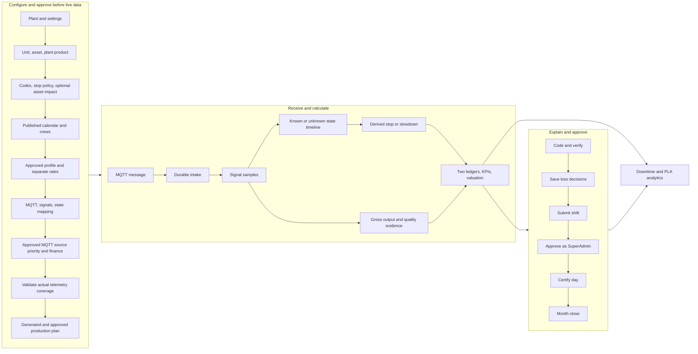
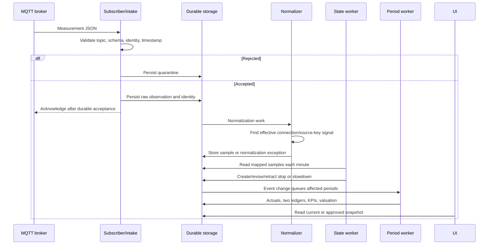
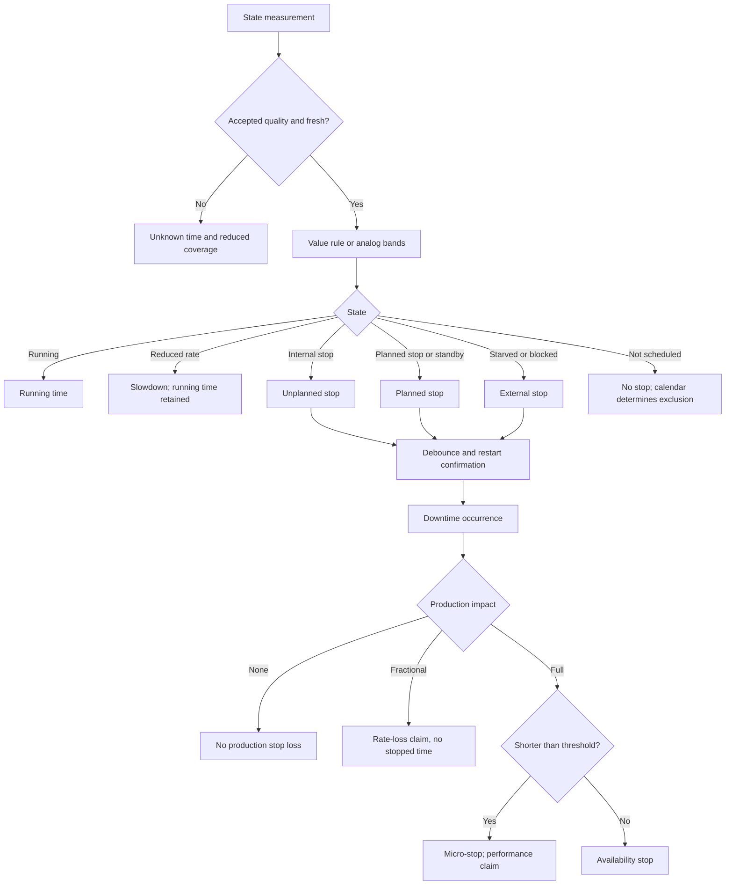
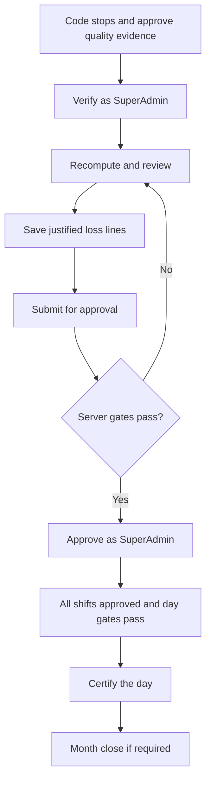

# Testing one HDPE extruder end to end

**Goal:** configure one extruder, receive MQTT measurements, explain production losses, reconcile and approve shifts, certify the production day, and verify downtime and production loss accounting (PLA).

This guide records the implementation inspected on **17 October 2026**. It is a source-backed procedure, not a record of a completed live test. All example production values, names, prices and FX rates are **Demo data**. Replace broker settings with your actual test broker.

**Before setup:** send the fillable [Equipment setup and end-to-end test: data request](OT_EQUIPMENT_DATA_REQUIREMENTS.md) to OT/data engineering and the production, maintenance, quality and finance owners. It lists the data to return, conditional fields, example formats, raw payloads and acceptance evidence. Use §27 below to turn that return into a setup and test handover.

## 1. Test identity and users

### 1.1 Consistent sample data

| Item | Demo value |
|---|---|
| Plant code / name | HDPE-DEMO / HDPE Demo |
| Plant time zone | Asia/Tehran |
| Calendar / digits | Persian if desired; Latin digits simplify numeric checks |
| Reporting week starts | Saturday |
| Unit code / name | Extruder1 / HDPE Extruder 1 |
| Asset code / name | EXT1-Main / Extruder 1 main drive |
| Product code / name | HD5502 / HDPE HD5502 |
| Product availability | This plant only |
| Quantity unit / operating mode | t / normal |
| Sustained rate / planning rate | 28 t/h / 28 t/h |
| Capacity model | Single stream |
| Operational day | 06:00 to next day 06:00 |
| Shift A / B / C | 06:00–14:00 / 14:00–22:00 / 22:00–06:00 |
| Daily plan | 672 t, normally 224 t per shift |
| Contribution margin | 150 USD/t |
| Demo FX | 600000 IRR per 1 USD, not a current market rate |
| Measurement boundary | extruder_outlet |

Examples use **17 October 2026**. Complete effective-now approvals before the test starts. If that date is past, move every effective date, plan window, MQTT timestamp, lot production date and analysis filter together. Source-priority approval takes effect now; it is not a historical backdating control.

| Plant time in Asia/Tehran | UTC |
|---|---|
| Operational day: 17 Oct 06:00 to 18 Oct 06:00 | 2026-10-17T02:30:00Z to 2026-10-18T02:30:00Z |
| Shift A: 17 Oct 06:00–14:00 | 2026-10-17T02:30:00Z to 2026-10-17T10:30:00Z |
| Gearbox stop: 17 Oct 08:00–09:00 | 2026-10-17T04:30:00Z to 2026-10-17T05:30:00Z |

UI fields use the plant clock and chosen calendar. With Persian display, select the dates corresponding to these Gregorian dates. Payloads/exports use ISO UTC.

### 1.2 SuperAdmin can complete the entire workflow alone

**Permanent application rule (owner decision, 16 October 2026): authenticated SuperAdmin has every role and bypasses separation-of-duties restrictions. One SuperAdmin can configure, author, submit, review, approve, verify, certify and close the entire extruder workflow. This applies in production as well as testing; no test-only switch is required.**

Approval remains an explicit action: click each **Approve**, **Verify coding**, **Validate failure detail**, **Submit**, **Certify**, finance sign-off and lock button in sequence. SuperAdmin can perform every stage personally; saving a draft does not automatically approve it. Required fields, valid references, evidence, generated periods, balanced ledgers, coding gates, current submission hashes and valid state transitions still apply. Select the intended plant before acting.

| Seeded login | Seeded password | Role |
|---|---|---|
| test@example.com | Test123!@# | SuperAdmin |
| admin@acme.com | demo123 | SuperAdmin |
| manager@acme.com | demo123 | TenantAdmin |
| engineer@acme.com | demo123 | Engineer |
| operator@acme.com | demo123 | Operator |

Use **A = test@example.com** for every step below, including approving your own records and certifying your own submitted shifts. **B = admin@acme.com** is an optional second SuperAdmin for testing with multiple people; it is not a dependency.

If persona seeding has run, these additional SuperAdmins share **Persona-2026!demo**:

- helena.fischer@demo.acme.com
- marcus.lindqvist@demo.acme.com
- priya.raman@demo.acme.com
- tomasz.nowak@demo.acme.com

These are optional alternative SuperAdmin accounts; a third participant is not required for the SuperAdmin workflow.

**These are source-verified seed definitions, not verified live credentials.** No seeder/login was run for the source review. TenantAdmin maps to manager_approver, not every finance/accounting/integration role.

| Action | Ordinary-user independence rule (SuperAdmin is exempt) |
|---|---|
| Approve profile, production rate, valuation rate | Not draft creator |
| Approve production plan | Not version creator |
| Approve unit impact rule | Shared version check prevents creator approval |
| Approve source priority | Not proposal creator |
| Approve valuation policy, FX, demand status | Independent approval |
| Approve lot disposition / actuals adjustment | Not proposer |
| Verify coding | Not current coding author |
| Validate failure detail | After verification; not current coding author |
| Approve period | Not submitter, author of any reviewed line, or person reopening the revision |
| Certify day | Submitted none of its shifts |
| Bridge above limit | Independent reviewer; final approver also differs from bridge reviewer |
| Month finance sign-off | Different from quantity closer and materiality reviewer, when required |

The table describes restrictions on **non-SuperAdmin** users, including OrgAdmin and users holding several ordinary roles. SuperAdmin may author the lines, submit the period, confirm an above-limit bridge review, approve that period, certify the day, close quantities, perform the materiality review, sign off finance and lock the month alone. Required bridge/materiality reviews still have to be recorded, by the same SuperAdmin if desired. SuperAdmin may also decide their own manual correction proposals, approve and adopt their own uncertainty budgets, verify completion of their own RCA actions with evidence, approve baseline corrections and decide closure of their own RCA investigations.

The exception comes from authenticated `RequestContext.isSuperAdmin` and the matching UI capability, never a request-body flag. Migration [SuperAdminApprovalOverride](../server/pro-act-backend/src/database/migrations/1794190400000-SuperAdminApprovalOverride.ts) adds `super_admin_override` to actuals adjustments, lot dispositions and uncertainty budgets so their database constraints permit privileged self-decisions. It defaults to false and is set only by the service for a SuperAdmin deciding their own record. Author, decider and timestamps remain real; historical overrides survive later role changes. Other workflows retain their existing actor audit/snapshot records. Apply pending migrations before using the updated backend (normal boot runs them unless `DB_MIGRATIONS_RUN` disables that).

SuperAdmin can also manage their own supplemental access grants and administer saved application preferences for any user across plants. Home-role scope mirrors are changed through the user's role rather than by deleting the mirror. Account self-deactivation/self-deletion safeguards remain; they do not require another approver for extruder operations. Seed definitions are not proof that these accounts currently exist or that the updated application is running.

Sources: [demo users](../server/pro-act-backend/scripts/seed-demo-users.ts), [personas](../server/pro-act-backend/scripts/demo-personas/persona-catalog.ts), [roles](../server/pro-act-backend/src/auth/roles/role-model.ts), [guard](../server/pro-act-backend/src/auth/guards/roles.guard.ts), [author check](../server/pro-act-backend/src/profiles/profile-errors.ts), [period independence](../server/pro-act-backend/src/domain/reconciliation/separation-of-duties.ts), [verification](../server/pro-act-backend/src/domain/events/coding-verification.ts), [day](../server/pro-act-backend/src/domain/close/day-certification.ts), [month](../server/pro-act-backend/src/domain/close/month-close-machine.ts).

## 2. Whole picture and setup order



Required below means enforced by inspected form/backend validation, not necessarily a visible asterisk. Dropdown records depend on the selected plant. Capture IDs from UI URLs; route placeholders such as :id are not literal inputs.

| Order | Route | Outcome |
|---|---|---|
| 1 | /admin/plants/new; /admin?tab=settings | Plant/time zone, calendar display, digits, week |
| 2–4 | /master-data/units/new; /master-data/assets/new; /master-data/products/new | Extruder, equipment, plant-owned grades |
| 5 | /master-data/codes-rules | Active reasons, defaults, loss categories and applicable rules |
| 6–7 | /master-data/stop-policy; /master-data/unit-impact-rules | Stop/plan policy and optional approved asset impact |
| 8 | /planning/calendars/new; /planning?tab=calendars | Published shifts, crews/rotations |
| 9 | /planning/profiles/new | Approved profile and separately approved sustained/planning rates |
| 10–12 | /connectivity/connections/new; saved connection Signals; /master-data/unit-state | MQTT, correctly bound signals, state/heartbeat mapping |
| 13 | /connectivity/source-authority | Approved MQTT output priority effective before the test |
| 14 | /finance and profile detail | Applicable approved policy, FX, margin and optional demand |
| 15 | /equipment-setup and saved connection setup/Signals/Quarantine | Actual samples, usable coverage and correct derived previews |
| 16 | /planning/plans/new | Generated shift periods and approved plan |
| 17–18 | /events; /plans/:planId/periods/:periodId; /approvals | Coding, evidence, reconciliation, approval and ready-day certification |
| 19 | /downtime; /pla-analytics | Compare results with the same interval, scope and ledger |

Route wiring: [administration](../src/app/routes/administration.tsx), [planning](../src/app/routes/production-planning.tsx), [production](../src/app/routes/production.tsx), [integration](../src/app/routes/integration.tsx).

## 3. Plant and Settings

### 3.1 /admin/plants/new

A needs SuperAdmin, or OrgAdmin for its organization. **TenantAdmin alone cannot create this plant.**

| Exact label | Required/type/validation | Demo input |
|---|---|---|
| Organization | Required dropdown; writable organizations | Your organization |
| Code | Required; max 50; starts letter/digit, then letters/digits/underscore/dot/hyphen; unique | HDPE-DEMO |
| Name | Required; max 255 | HDPE Demo |
| Time zone | Required IANA-zone text/suggestions; max 64; backend validates | Asia/Tehran |
| Description | Optional textarea; backend max 2000 | Demo single-extruder test |

Click **Create plant**; **Cancel** exits. Immediate creation, no approval. Select this plant before continuing.

Units without site assignment use the default site. Backend first-use resolution can create it from the plant time zone; check resolved calendar scope/time zone.

### 3.2 Admin Panel → Plant settings (/admin?tab=settings)

| Exact label | Options/behavior | Demo choice |
|---|---|---|
| Calendar system | Gregorian / Persian (Jalali / Shamsi) | Your display preference |
| Digits | Latin digits / Persian digits | Latin digits |
| First day of the week | Saturday / Monday | Saturday |
| Time zone | Read-only | Verify Asia/Tehran |

Calendar/digits: **Save**, **Discard changes**. Week start has its own **Save**. Plant administrator/manager settings capability is required.

**No date-format picker, time-format picker or currency input exists here.** Time zone is set at plant creation. Reporting currencies belong to Finance; display currency is another UI control.

Sources: [plant form](../src/features/admin/plants/hierarchy-form-page.tsx), [DTO](../server/pro-act-backend/src/v2/administration/hierarchy/hierarchy-v2.dto.ts), [settings](../src/features/settings/settings-page.tsx), [display choices](../src/features/settings/calendar-settings-form.tsx), [week](../src/features/settings/week-start-form.tsx), [default site](../server/pro-act-backend/src/calendar/sites.service.ts).

## 4. Unit, asset, product, hierarchy

### 4.1 /master-data/units → /master-data/units/new

| Exact label | Required/validation | Enter |
|---|---|---|
| Name | Required; max 255 | HDPE Extruder 1 |
| Code | Required; max 50; unique in plant | Extruder1 |
| Description | Optional textarea | HD5502 extrusion line |
| Unit of measure | Optional; max 50 | t |
| Capacity | Optional folded legacy nonnegative decimal | Blank |
| Ideal cycle time (seconds per unit) | Optional folded legacy nonnegative decimal | Blank |

Plant is displayed from selection. Legacy capacity/cycle time do not supply approved accounting rates. **Create**, **Cancel**; editing uses **Save changes**. No approval.

### 4.2 /master-data/assets → /master-data/assets/new

| Exact label | Required/options | Enter |
|---|---|---|
| Name | Required | Extruder 1 main drive |
| Code | Required; unique in plant | EXT1-Main |
| Production unit | Required dropdown | HDPE Extruder 1 |
| Description | Optional textarea | Main drive and gearbox |
| Asset type | Equipment, Instrument, Tool, Vehicle, Building, Other; default Equipment | Equipment |
| Criticality | High, Medium, Low; default Medium | High |
| Operating status | Active, Inactive, Maintenance, Offline; default Active | Active |
| Manufacturer | Optional | Demo manufacturer |
| Model | Optional | EXT-28 |
| Serial number | Optional | DEMO-EXT1-001 |
| Location | Optional | Polymer / Line 1 |

**Create**, **Cancel**, or **Save changes** when editing. No approval. No separate Asset class input exists; asset type and failure-dictionary equipment-class mapping serve different purposes.

### 4.3 /master-data/products → /master-data/products/new

| Exact label | Required/options | Enter |
|---|---|---|
| Name | Required | HDPE HD5502 |
| Code | Required; unique across organization products | HD5502 |
| Unit of measure | Optional | t |
| Description | Optional textarea | Demo HDPE extrusion grade |
| Available to | All plants of the organisation / This plant only | **This plant only** |
| Standard cost (unconfirmed) | Optional folded legacy nonnegative decimal | Blank |

**Create**, **Cancel**, or **Save changes**. No approval. Choose a plant-owned product: organization visibility alone does not make it usable in a plant profile/plan. **No density field exists.**

### 4.4 /master-data/hierarchy

Verify Organisation → plant → unit → asset. **Search units and assets** searches the selected plant. This is a tree/search page, not another parent-assignment form. Asset Production unit establishes the parent.

Sources: [unit](../src/features/master-data/units/unit-form.tsx), [asset](../src/features/master-data/assets/asset-form.tsx), [product](../src/features/master-data/products/product-form.tsx), [choices](../src/features/ux-kit/labels/master-data-labels.ts), [validation](../src/features/master-data/model/field-errors.ts), [hierarchy](../src/features/master-data/hierarchy/hierarchy-page.tsx).

## 5. Codes and failure dictionary

### 5.1 Master Data → Codes & rules (/master-data/codes-rules)

Libraries: **Reason codes**, **Impact codes**, **OEE codes**, **Failure code groups**, **Loss categories**.

Select Reason codes, open new-code dialog:

| Exact label | Required/options | Enter |
|---|---|---|
| Code | Required; unique in library; hint allows letters/digits and . _ : - | MECH-GEARBOX |
| Name | Required | Gearbox failure |
| Parent | Optional active parent; (top level) for none | Top level or mechanical parent |

**Create**, **Cancel**. Codes are live immediately. Then open /master-data/codes-rules/reason-codes/:codeId:

| Exact label | Options/validation | Enter |
|---|---|---|
| Name | Must be nonblank to save | Gearbox failure |
| Description | Optional | Extruder main-drive gearbox failure |
| Category | Optional free text | Mechanical |
| Default OEE component | (none), Availability, Performance, Quality, Idle (not counted), Not an OEE loss | Availability |
| Default schedule class | (none), Planned, Unplanned, External, Unknown | Unplanned |
| Default impact code | (none) or active impact code | Applicable code if configured |

Click **Save as version 2**; later saves increment version. No independent ordinary-code approval.

Create more reason codes:

| Code | Name | Default component | Default schedule |
|---|---|---|---|
| ELEC-TRIP | Electrical trip | Availability | Unplanned |
| FEED-STARVED | No upstream feed | Availability | External |
| SPEED-LOSS | Reduced extrusion rate | Performance | Unplanned |
| GRADE-CHANGE | Grade change | Consistent with transition model | Planned |

Category is text, **not a loss-category-tree dropdown**. Loss categories has hierarchy and **Order in reports**, min 0. Impact-code editing adds **Cost per hour (plant currency)**, four decimals, described as fallback where no approved valuation rate exists; it is not profile margin.

Failure code groups creation adds **Level**: Failure class / Problem / Cause / Remedy and optional **Parent**.

### 5.2 /master-data/failure-dictionary

This separate dictionary supplies event maintenance fields:

- **List**: Equipment class, Maintainable item, Failure mode, Failure mechanism, Failure cause, Detection method.
- **Equipment class** for item/mode: Every class or configured class.
- **Asset types (separated by ;)** for equipment classes.
- **Code**: nonblank, max 50.
- **Name**: nonblank, max 255.
- **Pending / unknown choice** checkbox.
- **Add entry**.

Demo: equipment class EXTRUDER / Extruder, asset type Equipment; failure mode GEARBOX_FAILURE / Gearbox functional failure for EXTRUDER. A broad Equipment mapping is only suitable for this isolated demo; retain established classification in a real plant. Without a dictionary, event fields use text.

Sources: [create](../src/features/codes-admin/codes/code-create-dialog.tsx), [editor](../src/features/codes-admin/codes/code-editor.tsx), [libraries](../src/features/codes-admin/model/code-fields.ts), [dictionary](../src/features/master-data/reliability/dictionary-entry-form.tsx), [dictionary types](../src/api/v2/types/failure-dictionary.ts).

## 6. Calendar, shifts, crews

### 6.1 /planning/calendars/new

For unit override use ?unitId=<Extruder1 UUID>; otherwise default-site scope.

| Exact label | Required/validation | Enter |
|---|---|---|
| Time zone | Required | Asia/Tehran |
| Operational day starts at | Required HH:mm | 06:00 |
| Effective from (operational date) | Required date | 2026-10-17 |
| Effective to (exclusive, optional) | Optional date | Blank |

Each shift's accessible labels end with **of shift N**: **Name**, **Start (local)**, **End (local)**, **Weekdays 1–7, Monday = 1 (empty = every day)**. Name/start/end required; times HH:mm; optional weekdays comma-separated 1–7.

| Name | Start | End | Weekdays |
|---|---|---|---|
| A | 06:00 | 14:00 | Blank |
| B | 14:00 | 22:00 | Blank |
| C | 22:00 | 06:00 | Blank |

End at/before start crosses midnight; equal means 24 hours. **Add shift**, **Remove**, **Preview**, **Save draft**, then **Publish**. Save before publication; unsaved edits disable Publish. Published versions are immutable; **New version from this** creates another.

Optional rows:

| Row | Labels/options | Buttons |
|---|---|---|
| Holiday | Date of holiday N; Name of holiday N; Treatment of holiday N → No production / Reduced hours | Add holiday; Remove |
| Exclusion | Start of exclusion N; End of exclusion N; Reason of exclusion N; Kind of exclusion N → Planned shutdown / Turnaround / No demand | Add exclusion; Remove |

Added holiday rows need date/name; exclusions need bounds/reason. **Reduced hours requires explicit working windows.** Choose Reduced hours → Add working window → Working start `06:00`, Working end `10:00` for a four-hour holiday; the preview excludes other shift time. An end at or before the start crosses midnight. Legacy published reduced holidays without windows retain their original hours and warn; create a new version to set actual hours. No exclusions for baseline.

### 6.2 /planning?tab=calendars

Crews are on the list page, not inside new-calendar editor.

1. **New crew** = Crew A → **Add crew**; repeat B/C.
2. Select **Crew**.
3. Populate **Cycle (shift names, “-” = off)**, **Cycle day 1**, **Effective from**.
4. **Add rotation**.

| Crew | Cycle | Cycle day 1 / Effective from |
|---|---|---|
| Crew A | A,B,C | 2026-10-17 |
| Crew B | B,C,A | 2026-10-17 |
| Crew C | C,A,B | 2026-10-17 |

Crew cycles label shifts, never change duration/scheduled time. Confirm assignments in preview.

Sources: [editor](../src/features/plans-profiles-calendars/calendars/calendar-editor.tsx), [scope](../src/features/plans-profiles-calendars/calendars/calendar-editor-page.tsx), [validation](../src/features/plans-profiles-calendars/model/calendar-draft.ts), [shift rows](../src/features/plans-profiles-calendars/calendars/shift-templates-editor.tsx), [crew rotation](../src/features/plans-profiles-calendars/calendars/crew-rotation-editor.tsx).

## 7. Profile and separately approved rates

### 7.1 /planning/profiles/new

| Exact label | Required/options/validation | Enter |
|---|---|---|
| Unit | Required | HDPE Extruder 1 |
| Product | Required | HDPE HD5502 |
| Operating mode | Form requires 1–64 letters/digits/underscore/dot/hyphen; default normal | normal |
| Quantity unit | Required; max 50 in DTO | t |
| Rate timebase | Required; per second/minute/hour/day | per hour |
| Capacity model | Single stream / Shared capacity / Independent streams | Single stream |
| Effective from | Required plant-local date/time | 2026-10-17 06:00 |
| Effective to (exclusive, optional) | Optional; after start | Blank |

A: **Save draft**. A: profile detail → **Approve**. **Cancel** exits. States draft → approved → retired. Unit/product/mode are fixed when editing a version.

**No rated/target/standard-rate numeric fields exist on profile creation.** Add rates separately.

### 7.2 Profile detail → Rates → Add rate version

| Exact label | Options/validation | First input |
|---|---|---|
| Kind | Nameplate / Demonstrated / Sustained / Planning / Budget / Forecast | Sustained |
| Rate (t) | Required decimal; max 16 integer/8 fractional digits | 28 |
| Timebase | per second/minute/hour/day | per hour |
| Effective from | Required | Test start |
| Effective to (optional) | Optional; after start | Blank |

A: **Add draft rate**; A: **Approve** on the row. Repeat with **Planning = 28 per hour**.

Nameplate/demonstrated/sustained/planning must be positive; budget/forecast may be zero. Rate validity fits the owning profile. Overlap is refused unless permitted **Supersede the approved predecessor** closes the predecessor at the new start. **Retire** uses a confirmation.

Nameplate alone does not replace sustained for capacity/OEE or planning for target generation.

### 7.3 Profile detail → Valuation rates → Add valuation rate

| Exact label | Options/validation | Enter |
|---|---|---|
| Basis | Choices below | Contribution margin |
| Value per t | Required nonnegative decimal; up to 8 fractional digits | 150 |
| Currency | IRR / USD, allowed by valuation policy | USD |
| Effective from | Required | Test start |
| Effective to (optional) | Optional; after start | Blank |

A: **Add draft valuation rate**; A: **Approve**. Configure Finance reporting currencies/policy in section 14 first if needed.

Basis choices: Contribution margin; Standard cost; Variable production cost (scrap); Salvage value (scrap); Disposal / handling cost; Downgrade price difference; Rework cost; Rework yield (recovered per reworked).

Yield shows **Recovered t per t reworked (0–1)**, requires >0 and ≤1, no currency. Hourly downtime rates belong to impact codes, not this picker. Legacy unconfirmed standard cost is informational.

**Profile, sustained rate, planning rate and valuation rate each need their own approval.** Money entry/approval uses finance-maintainer/finance-approver capabilities; SuperAdmin A satisfies both roles.

Sources: [profile](../src/features/plans-profiles-calendars/profiles/profile-editor.tsx), [rate](../src/features/plans-profiles-calendars/profiles/rate-form.tsx), [valuation](../src/features/plans-profiles-calendars/profiles/valuation-rate-form.tsx), [form validation](../src/features/plans-profiles-calendars/model/profile-form.ts), [version actions](../src/features/plans-profiles-calendars/profiles/version-actions.tsx), [rate validation](../server/pro-act-backend/src/profiles/rates.service.ts), [DTO](../server/pro-act-backend/src/v2/profiles/rate-v2.dto.ts).

## 8. Production plan and shift periods

Route /planning/plans/new:

| Exact label | Required/options | Enter |
|---|---|---|
| Name | Required on create | Extruder1 HD5502 — 17 Oct 2026 |
| Unit | Required | HDPE Extruder 1 |
| Scenario | Optional; blank uses accounting baseline | Accounting baseline |
| Window start | Required plant time | 2026-10-17 06:00 |
| Window end (exclusive) | Required; after start | 2026-10-18 06:00 |
| Change reason | Optional text in form | Demo daily plan |
| Basis | Time — schedule × planning rate / Quantity — header target distributed / Manual — per-shift targets | Quantity |
| Header target | Required for quantity unless every slice has its own target | 672 |
| Distribution | Proportional to scheduled planning capacity / Explicit slice weights / Equal per eligible shift | Proportional to scheduled planning capacity |

Slice fields: **Product of slice 1** required → HD5502; **Weight (explicit-weight distribution)** optional/conditional; **Slice target (replaces the header target)** optional; **Campaign start of slice 1**, **Campaign end of slice 1** optional, blank means whole plan window.

**Add slice**, **Remove slice 1** (last cannot be removed), **Save draft**, **Cancel**. New-version creation uses **Create version**.

No separate Period/Horizon/Quantity labels exist. The window/target/slices/calendar supply them. For the baseline use Quantity. To test Manual, choose it and use **Add shift target**: Product slice = Slice 1, Shift start = `2026-10-17 06:00`, Shift target = `224`; repeat at `14:00` and `22:00`. The server matches exact published shift starts and validates totals on preview/approval; unspecified shifts get zero. Editing preserves targets; copying carries quantities but clears dates so the new window must be entered explicitly. **Remove target** deletes a row. Adding or removing product slices clears manual-target rows so quantities cannot silently move to a different product.

1. **Save draft**.
2. **Preview periods**; optional **Distribution for the preview** override.
3. Verify three 8-hour shifts, about 224 t each, total 672 t, correct profile/rates.
4. **Generate periods**, wait for completion.
5. **Submit for approval**.
6. A: **Approval reason (optional)**, **Approve version 1**.
7. Capture plan and period IDs.

States draft → submitted → approved; later versions supersede. **Return to author… → Reason (required) → Return version** returns submitted to draft. Backend accepts approval of draft/submitted, but generated periods are mandatory. Use the visible submission flow. Overlapping approved same-unit/product/scenario plans are refused.

Sources: [plan](../src/features/plans-profiles-calendars/plans/plan-form.tsx), [slices](../src/features/plans-profiles-calendars/plans/slices-editor.tsx), [validation](../src/features/plans-profiles-calendars/model/plan-form.ts), [generation](../src/features/plans-profiles-calendars/plans/open-version-actions.tsx), [approval UI](../src/features/plans-profiles-calendars/plans/approve-plan-version.tsx), [service](../server/pro-act-backend/src/plans/plan-approval.service.ts).

## 9. Stop and plan policy

Route /master-data/stop-policy:

| Exact label | Validation | Enter |
|---|---|---|
| Applies to | Unit or The whole plant | Extruder1 |
| Micro-stop threshold (s) | Required integer 0–86400 | 60 |
| Threshold per asset class | Optional rows; nonblank unique classes and integer seconds 0–86400 | No override |
| Trip reason codes | Optional comma/newline-separated codes | ELEC-TRIP |
| Notes | Optional; max 1000 | Demo policy |

Class-row accessible labels: **Asset class N**, **Seconds for class N**. **Add an asset class**, **Remove**, **Record new version (effective now)**.

Grade-change radio choices:

- **Plans already allow for standard grade changes**: standard allowance informational against plan; overrun remains loss.
- **Count the allowance against the plan**: allowance also counts against plan.

Save with **Record (effective from now)**. These writes directly record approved policy versions; no separate draft approval. Previously calculated runs retain their references until the relevant recompute/correction.

The **Stop-engine settings** section now exposes the actual backend settings. After choosing Extruder1, enter:

| Exact label | Input / validation | Sample |
|---|---|---|
| Derive stops from unit state | Checkbox | Checked |
| Automatically merge unique cross-source duplicates | Checkbox | Checked |
| Stop debounce (seconds) | Required integer 0–86400 | 5 |
| Restart confirmation (seconds) | Required integer 0–86400 | 10 |
| Duplicate merge tolerance (seconds) | Required integer 0–86400 | 120 |
| Incident grouping window (seconds) | Required integer 0–86400 | 120 |
| Change notes | Optional max 1000 | Extruder heartbeat policy |

Click **Record stop-engine settings (effective from now)**. This records an approved policy version; existing derived events keep their recorded settings. In **State engine preview**, enter **State preview period** for at most seven days → **Preview derived stops and slowdowns**. It reads stored state and settings effective at the window end, shows stop/slowdown spans and open-at-window-end markers, and writes no events. Unknown time is never a stop.

Overlap allocation, general planned-stop handling and slowdown-component allocation remain backend policy options without general-purpose controls here.

Sources: [page](../src/features/master-data/reliability/policy/stop-policy-page.tsx), [micro form](../src/features/master-data/reliability/policy/micro-stop-form.tsx), [validation](../src/features/master-data/reliability/policy/micro-stop-form-model.ts), [allowance](../src/features/master-data/reliability/policy/transition-allowance-control.tsx), [backend derivation settings](../server/pro-act-backend/src/periods/stop-event-options.ts).

## 10. MQTT wizard: every field

Route /connectivity/connections/new. Use the MQTT wizard: **Profile → Basics → Connection → Advanced**.

### 10.1 Profile

| Exact label | Options/validation | Enter |
|---|---|---|
| Payload profile | Choices below | Measurements (signal samples) |
| Topic template | Required; equipment captured as unit/machine; overlaps a topic filter | proact/v1/{site}/{area}/{line}/{unit}/measurements/{attribute} |
| Identity strategy | Choices below | boot_id + seq |

| On-screen payload choice | Stored kind |
|---|---|
| Interval events (downtime / loss with start and end) | interval_event_json |
| Measurements (signal samples) | measurement_json |
| Machine state (state signal) | state_json |
| Gateway availability (ONLINE / OFFLINE, Last Will) | availability |

Identity labels:

- **boot_id + seq (delivery identity; samples, state, availability)** → seq_boot.
- **event_id + revision (events)** → event_id.
- **payload hash + event time (no ids from the source)** → payload_hash.

**The baseline uses measurement_json for state and throughput on one connection.** The dedicated state_json profile is also supported: it stores effective-dated digital samples on a State signal whose Source stream id equals the full topic. Unit State rules match the delivered token (after any value map). Availability/Last Will messages continue to update source health only. Choosing a profile fills preset template/filter/identity.

### 10.2 Basics

| Exact label | Required/validation | Enter |
|---|---|---|
| Name | Required | Extruder1 MQTT measurements |
| Broker URL | Required mqtt://host[:port] or mqtts://host[:port]; no path; port 1–65535; egress allowlist applies | mqtts://broker.plant.local:8883 (replace) |
| Topic filters (one per line) | Required 1–64; no duplicate filters; valid +/# placement | proact/v1/HDPE/Polymer/Line1/Extruder1/measurements/# |
| Availability topic (optional) | Optional valid filter | Blank |

Host/port are **one Broker URL field**. Overlapping another same-broker feed can be refused.

### 10.3 Connection

| Exact label | Options/validation |
|---|---|
| Protocol version | MQTT 5 (session expiry, reason codes) / MQTT 3.1.1 |
| Client id (blank = derived) | Optional; 1–64 letters/digits/underscore/hyphen; blank derives proact-<connection id> |
| User name | Optional; max 256 |
| Password | Write-only credential; edit shows Replace password |
| Trust mode | For mqtts://; choices below |
| CA certificate (PEM) | Required for caPem; max 65536 characters; certificate blocks, no private key |
| CA secret reference | Required for caRef; secrets:<UUID> |
| Server name override (SNI, optional) | Non-system trust modes; hostname max 253 |

Trust modes: **System trust store**; **CA certificate pasted (PEM)**; **CA certificate by secret reference**; **Insecure: no certificate verification (dev only, logged on every connect)**.

Plain mqtt:// hides TLS fields. Insecure is refused outside development. Broker/user/TLS edits can require password re-entry. Keep client ID stable and unique.

### 10.4 Advanced

| Exact label | Default | Validation/options |
|---|---|---|
| QoS | 1 | 0 — at most once / 1 — at least once (persist before ack) / 2 — exactly once |
| Clean start (drop the broker session on connect; loses queued messages) | Off | Checkbox |
| Session expiry (s) | 86400 | Integer 0–4294967295 |
| Keep-alive (s) | 60 | Integer 1–65535 |
| Connect timeout (s) | 30 | Integer 1–300 |
| Reconnect backoff min (s) | 1 | Integer 1–3600 |
| Reconnect backoff max (s) | 60 | Integer 1–3600; at least min |
| Max message size (bytes) | 65536 | Integer 1–1048576 |
| Schema version | 1.0 | Text |
| Timestamp unit | iso | auto / ms / s / iso |
| Max future skew (s) | 300 | Optional nonnegative integer |
| Max age (s) | 604800 | Optional nonnegative integer |
| On stale timestamp | Profile default | Reject (quarantine) / Flag quality.degraded (samples) |
| Quality protocol | PI | None declared / STRING_ENUM / OPC_DA / OPC_UA / SPARKPLUG / PI / NONE |

**Cancel**, **Back**, **Next**, **Create connection**; edit uses **Save changes**. No approval. A saved configuration does not prove broker reachability.

### 10.5 Field paths and health after creation

Open /connectivity/connections/:id?tab=profile, **Payload profile**:

- **Field overrides** rows: **Field**, **JSON path**.
- **Add override**, **Remove**, **Save profile**, **Discard changes**.
- Dotted paths permit letters/digits/underscore segments, e.g. payload.value.

| Decoder field | Default JSON path |
|---|---|
| eventTime | ts |
| sequence | seq |
| bootId | boot_id |
| source | source |
| quality | quality |
| site | site |
| tenant | tenant |
| signal | signal |
| value | value |
| unit | uom |

Leave defaults for this contract. Interval-event defaults additionally include event_id, revision, operation, template, element_path, start_ts, end_ts, attributes, attribute_units, Reason Code. Profile editor also has topic/schema/identity, time/quality rules and value maps. **Unmapped reason token** permits Reject (quarantine) / Keep the raw token for relevant event profiles.

On **Subscription**, inspect health/counters and state-dependent **Start**, **Pause**, **Resume**, **Drain**, **Stop** commands, audited with reasons. **Quarantine** lists rejections/exceptions. Gateway OFFLINE is source health, never an equipment stop.

Sources: [wizard](../src/features/integration-console/mqtt/mqtt-wizard-body.tsx), [Profile](../src/features/integration-console/mqtt/steps/profile-step.tsx), [Basics](../src/features/integration-console/mqtt/steps/basics-step.tsx), [Connection](../src/features/integration-console/mqtt/steps/connection-step.tsx), [TLS](../src/features/integration-console/mqtt/steps/tls-fields.tsx), [Advanced](../src/features/integration-console/mqtt/steps/advanced-step.tsx), [defaults](../src/features/integration-console/mqtt/model/mqtt-form.ts), [validation](../src/features/integration-console/mqtt/model/mqtt-validation.ts), [paths](../src/features/integration-console/mqtt/model/profile-draft.ts), [panel](../src/features/integration-console/mqtt/mqtt-connection-panel.tsx), [state handler](../server/pro-act-backend/src/intake/adapters/mqtt/handlers/mqtt-state.handler.ts).

## 11. State and throughput signal definitions

Open the MQTT connection → **Signals → Define signal**. Route /connectivity/connections/:id/signals/new. Save and Cancel both return to the Signals tab.

| Exact label | Required/options/validation |
|---|---|
| Name | Required |
| Production unit | Required dropdown |
| Source stream id | Required; use payload signal for this contract |
| Source path (optional, for reference) | Optional |
| Kind of measurement | Rate / Counter (totalizer) / State / Quality / Level / Output increments / Other |
| Unit of measure (e.g. t, t/h) | Optional; conflicting declared sample uom quarantined |
| Time base | Rate/counter only; per second/minute/hour/day; required for rate |
| Between samples | Step (hold last value) / Linear |
| Longest gap bridged (seconds) | Required integer 1–604800; default 900 |
| Counter resets | Counter only: Never resets / Resets at known instants / Detect resets from drops |
| Rollover value (optional) | Counter-only optional decimal |
| Lowest credible value (optional) | Optional signed decimal; max 16 integer/8 fractional digits in form |
| Highest credible value (optional) | Same |
| Expected sample interval, seconds (optional) | Integer 1–86400 |
| Valid from (optional) | Optional date/time |
| Use uncertain samples (questionable or substituted) | Checkbox; off |
| Authoritative source for this unit's output | Checkbox; off |

Engine settings are under collapsed **Advanced settings**.

| Field | Signal 1 | Signal 2 |
|---|---|---|
| Name | EXT1-State | EXT1-Throughput |
| Production unit | HDPE Extruder 1 | HDPE Extruder 1 |
| Source stream id | EXT1-State | EXT1-Throughput |
| Kind of measurement | State | Counter (totalizer) |
| Unit of measure | Blank | t |
| Time base | Not shown | per hour default; counter delta is quantity |
| Between samples | Step | Step |
| Longest gap bridged | 900 | 900 |
| Counter resets | Not shown | Never resets |
| Expected sample interval | 60 | 60 |
| Valid from | At/before first sample | At/before first sample |
| Use uncertain samples | Off | Off |
| Authoritative source... | Off | On |

**Save signal**, **Cancel**. No approval. Existing source key creates its next version.

The form explains the active payload profile: **Source stream id equals JSON signal** for this measurement contract; for state_json it equals the full topic. A topic is not a substitute for the measurement payload signal field.

**Rate units:** `t/h` with Time base per hour integrates to `t`; 28 over one hour gives 28 t. An explicit denominator inconsistent with the selected timebase is refused with `rate_uom_timebase_mismatch`. No kg→t or other physical conversion is inferred. The baseline still uses a t counter. **Signals → Preview samples / quantity → Preview quantity** shows the backend result and up to 50 stored samples with event time, quality, revision and boundary-neighbour status. MQTT has no source backfill; use Quarantine replay for retained raw observations or republish source data after correcting configuration.

Sources: [fields](../src/features/integration-console/signals/signal-form-fields.tsx), [validation](../src/features/integration-console/model/signal-form.ts), [page](../src/features/integration-console/pages/signal-editor-page.tsx), [decoder](../server/pro-act-backend/src/intake/adapters/mqtt/profiles/measurement.decoder.ts), [integrator](../server/pro-act-backend/src/domain/actuals/rate-integration.ts).

### 11.1 Dedicated machine-state format (alternative connection)

For a separate state feed choose **Machine state (state signal)** in the wizard; topic template `proact/v1/{site}/{area}/{line}/{unit}/state`, filter `proact/v1/+/+/+/+/state`, identity `boot_id + seq`. Define a State signal with Source stream id `proact/v1/HDPE/Polymer/Line1/Extruder1/state`, valid at/before the observation. Send a real contract packet like:

```json
{"schema_version":"1.0","state":{"name":"RUN","value":1},"quality":{"good":true},"ts":"2026-10-17T02:00:00Z","seq":1,"boot_id":"ext1-gateway"}
```

Use Unit State rules matching `RUN` → running and `STOP` → internal_stop, or the mapped tokens if the payload profile defines a value map. Each timestamp is retained independently; late observations are not discarded merely because a newer state timestamp arrived first. Retained messages keep the original event time, and duplicate delivery is idempotent. Bad/uncertain/missing source quality remains attached and affects state coverage; OFFLINE availability never creates a machine stop.

### 11.2 MQTT setup readiness, without guessed status

Open the connection → **Setup readiness**:

1. **Validate MQTT sample**: enter **Topic**, **Payload JSON**, **Sample receive time**, optional **Retained message** → **Validate sample (no writes)**. Use the packet above and receive time `2026-10-17 06:01` on an Asia/Dubai plant, or paste an actual source packet and its real receive time. The saved backend decoder checks schema/topic/time/identity/quality and reports the effective signal binding. It performs no broker I/O and stores nothing.
2. Select **Production unit** = HDPE Extruder 1. Review all current signal definitions for this connection/unit (pages are followed), and the **Approved primary output source**. PI output may be the initial default. Follow **Review and approve Source Priority** to propose MQTT and approve it explicitly; SuperAdmin can do both actions personally.
3. Set **Coverage period** to the experiment interval. Read server-computed scheduled/running/stopped/unknown seconds. Follow **Configure Unit State rules and heartbeat** if missing or stale.
4. Use the non-writing derived stop/slowdown preview. Follow **Stop-engine settings** if debounce/confirmation/merge values need adjustment.
5. Follow the profile/rate, calendar, plan/period and finance links. In Signals preview inspect stored output samples and coverage. In the period workspace Recompute and review actuals provenance, ledgers, coding gate, valuation and approval history.

This panel intentionally does not claim an end-to-end accounting pass from a broker CONNACK or one valid pasted sample. Approved authority, real stored output, complete schedule/rate coverage and a successful period run are separate evidence.

## 12. State mapping and optional asset impact

### 12.1 /master-data/unit-state

Choose **Unit = HDPE Extruder 1**, **State signal = EXT1-State**. Under **Signal value → state**, **Add a value**:

| Signal value N | State N |
|---|---|
| RUN | Running |
| STOP | Stopped (internal) |
| CHANGEOVER | Planned stop |
| STARVED | Starved (no input) |
| BLOCKED | Blocked (no output) |

Other states: Reduced rate (slowdown), Standby, Not scheduled. Nonblank matches, max 100 characters each; DTO max 200 rules. Matching ignores case; unmapped values are unknown.

| Exact label | Validation | Enter |
|---|---|---|
| Expected interval (s) | Required integer 1–86400 | 60 |
| Known jitter (s) | Integer 0–86400 | 0 |
| Stale after (intervals) | Integer 1–100 | 3 |
| Heartbeat source (a quiet signal means lost communication). Off for exception-based sources. | Checkbox | On |
| Effective from (empty = now) | Optional date/time | At/before test start |
| Notes | Optional; max 1000 | Demo digital mapping |

**Record new version**, no separate approval. Stale limit = **3 × 60 + 0 = 180 s**. Repeat current state every minute: STOP at 08:00 and RUN at 09:00 alone would leave most of the interval unknown.

Optional analog fields:

| Exact label | Validation |
|---|---|
| Band numeric values (throughput, motor current) by thresholds | Enables fields and State or analog signal choice |
| Stopped below | Required finite number when enabled |
| Reduced rate below (optional) | Greater than stop threshold |
| Hysteresis | ≥0 |
| Rated value (optional) | >0 |
| An analog stop is | Stopped (internal) / Starved (no input) / Blocked (no output) |

Rules win before analog bands. Demo: stop 1, reduced 27, hysteresis 0.5, rated 28. One mapping is in force per unit; analog is a separate window/version.

### 12.2 /master-data/unit-impact-rules

Optional for full-stop baseline. **Add rule**:

| Exact label | Required/options/validation | Enter |
|---|---|---|
| Unit | Required | Extruder1 |
| Asset | Required; unit-filtered | EXT1-Main |
| Impact on the unit | Full stop (the unit stops) / Partial (the unit loses a share of its rate) / None (the unit keeps running) | Full stop |
| Share of the rate lost (%) | Partial only; >0 and ≤100 | Not applicable |
| Standby that takes over (optional) | Another asset | No standby |
| Takeover window (s) | Integer 0–86400; default 60 | 60 |
| Why | Required | Main drive failure stops extrusion |
| Effective from | Required | Test start |
| Effective to (optional) | Optional; after start | Blank |

A: **Add draft rule**. A: **Approve**. Shared actions include Cancel, Retire, Supersede the approved predecessor. States draft/approved/retired.

Rules need the event's associated asset; unit state alone does not identify failed equipment. A person's explicit impact overrides derived impact.

Sources: [mapping](../src/features/master-data/reliability/unit-state/mapping-editor.tsx), [validation](../src/features/master-data/reliability/unit-state/mapping-editor-model.ts), [analog](../src/features/master-data/reliability/unit-state/analog-fields.tsx), [impact](../src/features/master-data/reliability/impact-rules/impact-rule-form.tsx), [impact validation](../src/features/master-data/reliability/impact-rules/impact-rule-form-model.ts).

## 13. Source priority

Route /connectivity/source-authority. **Unit = Extruder1 → New version**.

| Exact label | Required/options/validation | Enter |
|---|---|---|
| Applies to | This unit / The whole plant | This unit |
| Measurement boundary | Required 1–64 letters/digits/underscore/dot/hyphen | extruder_outlet |
| A lower rank replaces a better one when that one is | Missing / Stale / Incomplete / bad quality / In conflict with another source | First three |
| Sources, best first | 1–10 ranked rows | One MQTT rank |
| Notes (optional) | Max 2000 | Demo authority |

Each rank:

| Exact label | Options/validation | Enter |
|---|---|---|
| Kind | Calibrated primary totalizer / Redundant measurement / Reconciled production / inventory record / Approved estimate (manual) | Calibrated primary totalizer |
| Source | pi_counter / pi_output_ef / pi_rate / mqtt / kafka / manual / external_report, shown as human labels | mqtt |
| Signal (optional) | Source key; max 500 | EXT1-Throughput |
| Boundary of this source | Required boundary pattern | extruder_outlet |
| Measured at another boundary (declare how it is brought to the slice boundary) | Checkbox | Off |

Cross-boundary adds **The record already includes the stock change between the boundaries (otherwise it is never a substitute)**, **Lag (seconds)** nonnegative integer, **Evidence** required for adjustment, max 500.

**Add source**, **Move up**, **Move down**, **Remove**, **Save draft**, **Cancel**. A: **Approve version N**. Waiting state is proposed; **Reject… → Reject version** requires reason. Stale drafts can be refused.

Default authority is PI output event frames with PI-counter fallback. Flagging an MQTT signal authoritative does not change that policy. Approval is effective now; already-calculated/approved content follows recompute/correction controls.

Sources: [page](../src/features/integration-console/source-authority/source-authority-page.tsx), [editor](../src/features/integration-console/source-authority/hierarchy-editor.tsx), [rank fields](../src/features/integration-console/source-authority/hierarchy-entry-fields.tsx), [validation](../src/features/integration-console/source-authority/hierarchy-form.ts), [decisions](../server/pro-act-backend/src/v2/source-authority/source-authority-decisions.service.ts), [default](../server/pro-act-backend/src/periods/policy-bodies.ts).

## 14. Finance policy, FX, margin, demand

/finance tabs: **Valuation policy**, **Exchange rates**, **Demand**. Margin rates are on profile detail.

### 14.1 /finance/policies/new

| Exact label | Options/validation | Baseline choice |
|---|---|---|
| Default management view | Contribution margin / Standard cost / Economic impact (lost sales + incremental costs) | Contribution margin |
| Time-based costs | Each hour counted once / Each component counted on its own | Each hour counted once |
| Currency conversion | No currency conversion / Rate of the day (snapshot) | Snapshot |
| Starts (Asia/Tehran) | Required; zone follows plant | Test start |
| Reporting currencies | IRR/USD checkboxes; choose 1–2 | Both |
| Exchange-rate table | Economic (treasury conversion basis) / Group reporting (translation policy) / Budget / constant currency | Economic |
| Rate date | Rate of each loss date, summed into the month / Average rate of the month | Each loss date |
| Refuse the average beyond (ratio) | Monthly average; optional 0–1 ratio, max 6 decimals | 0.05 if tested |
| Lost sales | Lost sale only when the product was sold out / Every lost tonne is a lost sale / No economic view | Intended policy; margin is a separate view |
| Quality losses without a mapped code | Scrap / Downgrade (sold off-grade) / Rework (recovered) / None: unmapped quality losses stay unvalued | Appropriate disposition for economic test |
| Manual downtime lines get an hourly cost for the hours of their evidenced events | Checkbox | Retain intended setting |
| Quality losses disposed as ... | Impact-code selections per disposition | Configure for economic variant |
| Notes (optional) | Max 2000 | Demo policy |

Independent-component costing adds impact-code selection. Economic impact needs a lost-sales rule. Initial defaults favor economic view; explicitly choose Contribution margin for baseline.

A: **Save version (not approved)**. A: **Approve… → Approve version N**. Approval can queue recalculation; approved periods receive change proposals.

### 14.2 Exchange rates

| Exact label | Validation/options | Enter |
|---|---|---|
| Rate table | Economic/group reporting/budget | Economic |
| From (1 unit of) | IRR/USD | USD |
| To | IRR/USD; different from From | IRR |
| Rate (IRR per 1 USD) | Required >0; max 14 integer/10 fractional digits | 600000, Demo only |
| Valid from (Asia/Tehran) | Required | Test start |
| Valid until (optional) | After start | Blank for final |
| Provisional rate | Checkbox; requires end if enabled | Off |
| Source (optional) | Max 255 | Demo treasury rate |

A: **Save draft**. A: **Approve… → Approve rate**. Dialog: **End the approved rate it overlaps at this rate's start**. Retirement: **Retire… → Retire rate**. States draft/approved/retired.

### 14.3 Profile margin and demand

Complete section 7.3: separately approved Contribution margin 150 USD/t. Economic product values need their own rates; do not infer them from margin.

Demand form: **Product** required; **Demand** = Sold out (demand constrained) / Not constrained (inventory covers demand); **Valid from (Asia/Tehran)** required; **Valid until (optional)**; **Evidence** required, e.g. Demo backlog and inventory record; **Save draft**, then approve as SuperAdmin A.

Missing approved demand can leave the economic view unvalued, distinct from margin view.

Sources: [Finance](../src/features/finance/finance-page.tsx), [policy](../src/features/finance/policies/policy-form.tsx), [economic fields](../src/features/finance/policies/economic-fields.tsx), [labels](../src/features/ux-kit/labels/planning-labels.ts), [FX](../src/features/finance/fx/fx-rate-form.tsx), [FX validation](../src/features/finance/model/fx-form.ts), [FX actions](../src/features/finance/fx/fx-version-actions.tsx), [demand](../src/features/finance/demand/demand-status-form.tsx).

## 15. MQTT messages and processing

### 15.1 Contract data

State topic: proact/v1/HDPE/Polymer/Line1/Extruder1/measurements/EXT1-State

STOP at 08:00 plant time:

```json
{
  "schema_version": "1.0",
  "signal": "EXT1-State",
  "value": {"name": "STOP", "value": 0},
  "ts": "2026-10-17T04:30:00Z",
  "quality": {"good": true, "questionable": false, "substituted": false},
  "seq": 101,
  "boot_id": "gw-01-boot-1",
  "source": "pi-mqtt-gw-01"
}
```

Counter topic: proact/v1/HDPE/Polymer/Line1/Extruder1/measurements/EXT1-Throughput

```json
{
  "schema_version": "1.0",
  "signal": "EXT1-Throughput",
  "value": 1056.0,
  "uom": "t",
  "ts": "2026-10-17T04:30:00Z",
  "quality": {"good": true, "questionable": false, "substituted": false},
  "seq": 102,
  "boot_id": "gw-01-boot-1",
  "source": "pi-mqtt-gw-01"
}
```

RUN uses {"name":"RUN","value":1}. Send state/counter every 60 s, at shift boundaries and exact stop/restart instants. Use unique increasing sequences across the test publisher's messages; new boot ID when restarting its sequence. Counter stays monotonic; one reading cannot establish output.

Existing backend commands db:seed-demo-mqtt and mqtt:sim can create demo data. They are optional, not prerequisites to manual setup. Inspect their configuration before using them; this documentation change does not execute them.

### 15.2 From message to UI



1. Decode/validate topic, JSON/schema, time, quality protocol, delivery identity. Persist typed rejection before acknowledging a poison delivery.
2. Redelivery is idempotent, not a guaranteed quarantine. It must not create another production effect.
3. Match signal by connection/source key/effective time. Unknown signals or conflicting uom quarantine. Stored bad/uncertain quality is handled by downstream rules.
4. Mapping yields known/unknown state; heartbeat gaps are not assumed stops.
5. Deployed state worker runs every minute, derives idempotent stop/slowdown changes, reconciles duplicates, groups incidents, publishes event changes.
6. Event changes queue affected periods. Receipt is not synchronous ledger completion.
7. Actuals select authoritative quantity/coverage, apply approved adjustments/dispositions, preserve provenance.
8. Accounting calculates both ledgers/KPIs/value and reconciliation candidates. Unchanged input hashes may reuse results; approved changes follow correction/restatement controls.
9. Settled-period sweep defaults to 900 s after period end (ACTUALS_SETTLE_SECONDS). **This is not a mandatory 15-minute delay on every event/manual recompute.** Use Recompute and verify job completion.

Sources: [durable intake](../server/pro-act-backend/src/intake/adapters/mqtt/host/message-persister.ts), [measurement](../server/pro-act-backend/src/signals/measurement.handler.ts), [state job](../server/pro-act-backend/src/stop-events/state-engine.job.ts), [engine](../server/pro-act-backend/src/stop-events/derived-stop-engine.service.ts), [recalc triggers](../server/pro-act-backend/src/periods/period-recalc.consumer.ts), [settled sweep](../server/pro-act-backend/src/periods/period-sweep.job.ts), [actuals](../server/pro-act-backend/src/periods/period-actuals.compute.ts).

## 16. Event coding and quality evidence

### 16.1 /events/:eventId and /events/new

Detail action **Edit / code** opens /events/:eventId/edit. Manual creation uses /events/new.

| Exact label | Required/options/validation |
|---|---|
| Unit | Required on create; not editable as a field on edit |
| Type | Downtime/slowdown/quality loss/production output/advisory human labels |
| Start | Required plant-local time |
| End (empty = still running) | Optional; otherwise closes interval |
| or duration (minutes) | Optional nonnegative decimal; converted to seconds; must agree with entered end |
| Schedule class | Default/blank, Planned, Unplanned, External, Unknown |
| Reason code | Searchable leaf selection; optional while uncoded |
| Description | Optional textarea; max 4000 |

Downtime-only: **Impact on production** = Stops the unit / Reduces output (unit keeps running) / No production impact (e.g. standby took over); **Output lost (%)** for fractional impact, >0 and ≤100; **Approved planned end (time after it is overrun)** for planned downtime; **Caused by unit** = This unit/other; **Caused by asset** optional.

**Failure detail (maintenance)**:

- **Severity**: Pending investigation; Critical — function lost (counts in MTBF); Degraded — function partly lost (counts in MTBF); Incipient — no loss of function yet (not a failure).
- **Maintainable item**, **Failure mode**, **Mechanism**, **Cause**, **Detection method**.
- Optional dictionary choices or text; failure mode max 255, other text max 100.

Quality-loss-only **Off-spec product**: **Quantity** decimal; **Unit** max 32; **Disposition** = not decided / Downgrade / off-grade (sold at a discount) / Scrap / Rework / recycle.

Buttons: **Save**, **Keep draft and close**, **Discard → Discard changes**. Detail also has **Split**, **Close stop** for open events, **Retract** for manual events.

**Production output** now shows **Quantity** (required non-negative output) and **Unit** (required, max 32). Sample: a separate manual-source test may record `223` / `t`; first approve the appropriate manual source priority and avoid duplicating MQTT output in the baseline.

**Slowdown loss** shows **Lost quantity (optional when output loss % is given)** and **Unit**, plus **Output lost (%)**. Enter either measured loss `5` / `t` (sends impactMode `measured`) or `25` percent (sends impactMode `fractional`, impactFraction `0.25`), never both. These are causal claims within computed performance loss, not additional production-loss totals. The server still validates interval, evidence, scope and ledger allocation.

**No general Comment field; use Description. No single Failure code field.**

### 16.2 Baseline stop coding

As A, locate derived 08:00–09:00 stop → Edit / code:

- Reason code MECH-GEARBOX.
- Schedule class Unplanned.
- Impact on production Stops the unit.
- Severity Critical.
- Applicable Failure mode, e.g. GEARBOX_FAILURE.
- Description: Demo gearbox functional failure; restored at 09:00.
- Save.

Do not create a duplicate manual event in the baseline. Quick list/current-stop coding instead shows **Reason code**, **Investigation pending (no specific reason known yet)**, **Save reason**, **Cancel**.

A opens event → **Verify coding**, then **Validate failure detail** if present. SuperAdmin A may perform both stages after entering the coding personally; non-SuperAdmin verifiers must differ from the coder. Later edits may clear verification.

### 16.3 Approved 2 t off-grade disposition

A throughput counter supplies **gross**. A quality-loss event explains loss but is not automatically measured reject evidence.

Period Actuals & quality → /plans/:planId/periods/:periodId/dispositions/new:

| Exact label | Required/validation | Enter |
|---|---|---|
| Product | Required | HD5502 |
| Lot number | Required; max 64 | HD5502-DEMO-20261017-A |
| Recovery of reworked material (saleable again; first-pass good is not changed) | Checkbox | Off |
| Disposition | Wide-spec grade (ordered, good) / Downgrade / off-grade (sold at a discount) / Transition off-grade / Scrap / Rework / recycle | Downgrade / off-grade |
| Quantity (t) | Required >0 | 2 |
| Produced from | Required | 2026-10-17 06:00 |
| Produced to | Required; after start | 2026-10-17 14:00 |
| Lab released (optional) | Optional | Release time if used |
| Evidence (lab certificate, sample number) | Evidence reference | DEMO-LAB-A-001 |
| Note (optional) | Optional | Demo first-pass off-grade |

A: **Record disposition** creates proposal. A as SuperAdmin: **Approve**. **Reject… → Reject disposition** requires reason.

Alignment is by production interval, not lab release. Recovery is separate and never erases first-pass defects; remeasured recovery must not count twice.

Without reject evidence, gross-basis actuals use good=gross with **rejects_not_measured**. Do not present that as proven defect-free output.

Sources: [event fields](../src/features/event-hub/components/event-form-fields.tsx), [validation](../src/features/event-hub/model/event-form.ts), [failure fields](../src/features/event-hub/components/failure-fields.tsx), [quick coding](../src/features/event-hub/components/code-event-dialog.tsx), [verification](../src/features/event-hub/components/event-verification-panel.tsx), [disposition](../src/features/plan-dashboard/dispositions/disposition-form.tsx), [disposition model](../src/features/plan-dashboard/model/disposition-form.ts), [actions](../src/features/plan-dashboard/dispositions/disposition-actions.tsx), [gross/good handling](../server/pro-act-backend/src/domain/actuals/period/slice-actuals.ts).

## 17. Implemented calculations

### 17.1 State, micro-stops, overlaps, slowdowns



- Defaults: deriveFromState true, debounce 5 s, restart confirmation 10 s, duplicate tolerance 120 s, automatic matching-duplicate merge on, incident window 120 s. Actual policy/deployment may override.
- Full occurrence **strictly below** threshold is micro; exactly 60 s at threshold 60 is availability.
- Use full occurrence across split fragments/period boundaries, not each clipped fragment.
- Asset-class override applies; configured trip codes and critical/degraded failures force threshold zero.
- Micro time stays running and explains performance loss.
- Fractional downtime/slowdown is not stopped time; no-impact equipment events create no production stop loss.
- Analog fraction = max(0, min(1, 1 − weighted mean / rated)), eight decimal places. Without numeric/rated evidence, reduced-rate events can be unquantified.
- Equivalent downtime = Σ fraction × clipped duration, separate from actual stopped time.
- Overlapping stop causes share non-overlapping time segments by policy; do not count duration twice.
- Manual/source/derived duplicates may merge or require a decision. Repeat incidents affect failure counts; not every duplicate pair automatically merges.

Sources: [settings](../server/pro-act-backend/src/periods/stop-event-options.ts), [derived stops](../server/pro-act-backend/src/domain/reliability/derived-stops.ts), [slowdowns](../server/pro-act-backend/src/domain/reliability/derived-slowdowns.ts), [threshold](../server/pro-act-backend/src/domain/accounting/micro-stop-threshold.ts), [segmentation](../server/pro-act-backend/src/domain/accounting/segmentation.ts).

### 17.2 Operational A/P/Q/OEE and denominators

Define:

- S = period/slice seconds after schedule exclusions and any policy-excluded planned stops.
- D = union of availability-stop time inside S.
- R = S − D, including micro-stop/slowdown time.
- U = ideal gross-production time at sustained rate.
- V = ideal good-production time at sustained rate.

| KPI | Exact formula |
|---|---|
| Availability | R / S |
| Performance | U / R |
| Quality | V / U |
| OEE | V / S |

For constant sustained rate r:

```text
U = gross / r
V = good / r
Performance = gross / (r × running time)
Quality = good / gross
OEE = good / (r × scheduled production time)
```

Changing-rate ideal times use time-weighted sustained rate over running segments, or scheduled segments if none ran. Sequential slices combine ideal times; concurrent streams are not combined into one operational OEE.

**The denominator is production time/capacity, not the plan target quantity.**

| Supplemental measure | Basis |
|---|---|
| Scheduled availability | (scheduled time − qualifying in-schedule stopped time) / scheduled time; includes every qualifying in-schedule planned stop regardless of operational planned-stop exclusion policy |
| Controllable availability | Same scheduled-time denominator, external stops removed from stopped time |
| Onstream factor | (calendar-window seconds − total allocated stop seconds) / calendar-window seconds |
| State coverage | (known running + known stopped seconds) / scheduled seconds |
| Availability lower bound | Known running seconds / scheduled seconds |
| Availability upper bound | (known running + unknown seconds) / scheduled seconds |

Reduced-rate state counts as running for coverage/bounds. Unknown stays in the denominator. Scheduled availability is a separate calculation from operational OEE's policy-dependent treatment.

Missing/zero denominator yields null/unavailable with reasons. Factors >100% remain exceptions. Reports combine summed numerators / summed denominators, never average percentages; incompatible OEE policies may prevent combining ratios.

Sources: [operational](../server/pro-act-backend/src/domain/kpi/operational-oee.ts), [ideal times](../server/pro-act-backend/src/domain/kpi/ideal-time.ts), [period assembly](../server/pro-act-backend/src/domain/kpi/period-kpis.ts), [downtime measures](../server/pro-act-backend/src/domain/kpi/downtime-measures.ts), [state KPIs](../server/pro-act-backend/src/domain/kpi/state-kpis.ts), [aggregation](../server/pro-act-backend/src/domain/kpi/aggregate.ts).

### 17.3 Reliability and coding ratio

| Measure | Numerator / denominator or count |
|---|---|
| MTBF | Unit running exposure R / eligible failures starting in [window start, window end) |
| MTTR | Active repair seconds sum / completed, restored failures with repair start/end evidence |
| Mean downtime to restore | Full outage-duration sum / qualifying failure stops restored in window |
| coded_downtime_ratio | Allocated stop seconds with non-null reason code / all allocated stop seconds |
| Mean completed stop | Full completed occurrence-duration sum / occurrences ending in window |
| Stop count | Availability occurrences starting in window, split fragments counted once |
| Carry-in count | Occurrences started earlier and extending into window |

MTTR uses activeRepairSeconds if supplied, otherwise repairEnd − repairStart. No repair evidence means unavailable MTTR, not outage duration renamed. Open outages/repairs are censored from completion-based means.

Failures include functional-failure work orders or qualifying unplanned stops. Critical/degraded counts, incipient does not. The inspected view also accepts unplanned stops with a failure mode but no severity yet. Stop candidates undergo micro-threshold filtering; trip/functional severity can force zero. Overlapping work-order/stop representations deduplicate. Repeat incidents count once for MTBF. Standby asset MTBF uses its own running exposure where available.

Coding ratio includes allocated micro time; **investigation pending does not add a reason code to the numerator**. No downtime gives unavailable ratio, not assumed 100%.

Sources: [reliability](../server/pro-act-backend/src/domain/kpi/reliability.ts), [failure view](../server/pro-act-backend/src/database/migrations/1793921000000-FailureDetail.ts), [coding/downtime](../server/pro-act-backend/src/domain/kpi/downtime-measures.ts).

### 17.4 Capacity ledger in tonnes

For the single-stream t profile:

```text
C  = Σ sustained rate per second × segment seconds
E  = capacity belonging to schedule-excluded segments
LA = capacity over non-overlapping stopped segments
     + derate claims assigned to availability by policy

Effective running capacity = C − E − LA
LP   = max(0, effective running capacity − gross)
Gain = max(0, gross − effective running capacity)
LQ   = gross − good

Attributed losses = E + LA + LP + LQ + overClaim
Capacity residual = C − E − LA − LP − LQ − overClaim − good + Gain
```

C is full segmented slice capacity before E; without exclusions C = 28 × 8 = 224 t. Rate changes cut segments; missing rates are not invented. Invalid production relationships are flagged.

Component totals are computed once, then allocated to causes. Micro/slowdown claims explain portions of LP, not extra losses on top. Unclaimed capacity performance is no_cause/unexplained. Excess claims are retained/flagged and reflected in residual, not scaled away.

Sources: [capacity](../server/pro-act-backend/src/domain/accounting/capacity-ledger.ts), [time lines](../server/pro-act-backend/src/domain/accounting/time-lines.ts), [allocation](../server/pro-act-backend/src/domain/accounting/component-lines.ts), [shared math](../server/pro-act-backend/src/domain/accounting/ledger-common.ts).

### 17.5 Plan ledger and reconciled PLA OEE

```text
Gap = target − good
Attributed = signed sum of active plan loss/gain lines
Residual = gap − attributed

After reconciliation:
target − good = attributed + tolerance adjustment + residual
```

Plan candidates use planning rates scaled to target while preserving the time profile. No planning coverage means no invented automatic time allocation. Unexplained performance stays plan residual until explained, even when capacity has computed LP. Recovery above planned running rate is a separate signed gain.

Grade-change allowance follows policy: already-planned allowance is informational and only overrun explains gap; otherwise allowance also counts. Excess claims, overproduction, conflicts and negative residuals remain visible.

Separately labeled **Reconciled PLA OEE**:

```text
T = G + LA + LP + LQ
A = (G + LP + LQ) / T
P = (G + LQ) / (G + LP + LQ)
Q = G / (G + LQ)
OEE = G / T
```

Needs known quantities/losses and capacity residual within epsilon; exclusions disclosed separately. This is not plan achievement and must not be mislabeled operational OEE.

Sources: [plan ledger](../server/pro-act-backend/src/domain/accounting/plan-ledger.ts), [plan totals](../server/pro-act-backend/src/domain/accounting/plan-totals.ts), [reconciled OEE](../server/pro-act-backend/src/domain/kpi/reconciled-oee.ts), [basis checks](../server/pro-act-backend/src/domain/kpi/reconciled-terms.ts).

### 17.6 Valuation

```text
Contribution-margin amount = loss quantity × approved margin per quantity
Standard-cost amount = loss quantity × approved standard cost per quantity
Hourly amount = lost seconds / 3600 × approved impact-code hourly value
Report amount = native amount × direct FX, or native amount / inverse FX
```

Time-uniform lines may split at rate boundaries. Components use applicable dates/approved FX. Monthly average is time-weighted and can be refused for volatility. Approved final FX wins over authorized provisional FX; provisional conversions are marked.

| Economic disposition | Components |
|---|---|
| Unproduced | Lost contribution, demand-gated |
| Scrap | Lost contribution + spent variable cost − salvage + disposal |
| Sold downgrade | Price difference + applicable handling/disposal |
| Rework | Incremental cost, yield loss, displaced constrained output; recovered sale not charged as permanently lost |

Missing policy/profile/rate/uom/FX/demand/disposition evidence produces null/unvalued with reason. Demand-not-constrained can legitimately yield zero lost contribution. Decimal precision is retained internally; currency rounding is presentation behavior.

Sources: [line value](../server/pro-act-backend/src/domain/valuation/value-line.ts), [FX](../server/pro-act-backend/src/domain/valuation/fx.ts), [components](../server/pro-act-backend/src/domain/valuation/currency-amounts.ts), [economic view](../server/pro-act-backend/src/domain/valuation/economic-view.ts).

## 18. Worked shift: reproducible baseline

Use digital state mapping, t counter, no exclusions, approved sustained/planning 28, target 224, margin 150 USD/t. Keep optional variants separate.

```mermaid
gantt
  dateFormat HH:mm
  axisFormat %H:%M
  section Extruder1 baseline
  RUN output 28 t/h       :06:00, 120m
  STOP gearbox failure    :crit, 08:00, 60m
  RUN output 27.2 t/h     :09:00, 300m
```



### 18.1 Sample schedule

Transmit every minute. These are checkpoints:

| Plant time | UTC | State | Counter t |
|---|---|---|---:|
| 06:00 | 02:30Z | RUN | 1000 |
| 07:00 | 03:30Z | RUN | 1028 |
| 08:00 | 04:30Z | STOP | 1056 |
| 08:30 | 05:00Z | STOP | 1056 |
| 09:00 | 05:30Z | RUN | 1056 |
| 10:00 | 06:30Z | RUN | 1083.2 |
| 11:00 | 07:30Z | RUN | 1110.4 |
| 12:00 | 08:30Z | RUN | 1137.6 |
| 13:00 | 09:30Z | RUN | 1164.8 |
| 14:00 | 10:30Z | RUN | 1192 |

With m = minutes since 06:00:

```text
0 ≤ m ≤ 120:   counter = 1000 + 28 × m / 60
120 < m ≤ 180: counter = 1056
180 < m ≤ 480: counter = 1056 + 27.2 × (m − 180) / 60
```

Round intermediate samples consistently to supported precision; preserve exact boundaries. STOP is 08:00 inclusive to 09:00 exclusive. State stays RUN after restart despite lower throughput: this intentionally demonstrates an unexplained performance deficit.

### 18.2 Steps and reconciliation

1. Check connection, stored samples, no unexpected quarantine, full window coverage.
2. After state processing, verify one stop 08:00–09:00. Account for restart confirmation and asynchronous worker timing.
3. A codes gearbox/critical failure, then verifies coding and validates failure detail as SuperAdmin.
4. A records 2 t downgrade; A approves the disposition.
5. Period → **Review & close → Recompute**; wait for completion; inspect actuals provenance/coverage.
6. Compare values below. Do not invent a cause merely because capacity math finds a shortfall.
7. If the synthetic rate/totalizer record justifies SPEED-LOSS, A adds a manual performance line:
   - **Loss kind = Performance**.
   - **Quantity (t) = 4**.
   - **No event (cause without an event)** checked.
   - **Reason code = SPEED-LOSS**.
   - **Evidence = Totalizer reading** or **Rate record**.
   - **Evidence reference = DEMO-EXT1-A-COUNTER-001**.
   - **Reason / comment = Demo deficit: 5 h × (28 − 27.2) = 4 t**.
   - **Add line → Save lines**.
8. Do not manually duplicate the 2 t quality component already explained by evidence.
9. A submits, then A approves the same revision as SuperAdmin.

A manual cause assignment is supported by this synthetic dataset; real production requires real evidence.

### 18.3 Expected results

| Figure | Calculation | Result |
|---|---|---:|
| Scheduled | 8 h | 28800 s |
| Availability stop | 08:00–09:00 | 3600 s |
| Running | 8 − 1 | 7 h |
| Capacity | 28 × 8 | 224 t |
| Gross | 1192 − 1000 | 192 t |
| Reject/nonconforming | Approved disposition | 2 t |
| Good | 192 − 2 | 190 t |
| Availability loss | 28 × 1 | 28 t |
| Performance loss | 28 × 7 − 192 | 4 t |
| Quality loss | 192 − 190 | 2 t |
| Capacity residual | 224 − 28 − 4 − 2 − 190 | 0 t |
| Availability | 7 / 8 | 87.5% |
| Performance | 192 / 196 | 97.9592% |
| Quality | 190 / 192 | 98.9583% |
| Operational OEE | 190 / 224 | 84.8214% |
| Plan gap | 224 − 190 | 34 t |
| Plan attributed before speed explanation | 28 + 2 if candidates active | 30 t |
| Plan residual before explanation | 34 − 30 | 4 t |
| Plan attributed after justified speed line | 28 + 4 + 2 | 34 t |
| Plan residual after reconciliation | 34 − 34 | 0 t |

Plan totals depend on active/accepted candidates. Plan achievement happens to equal OEE here because target equals sustained capacity; they are different concepts.

One eligible functional failure starting in shift gives MTBF 7 h. Restored-in-window outage gives mean downtime to restore 1 h. **MTTR unavailable without repair evidence.** One reason-coded stop gives coded downtime ratio 100%.

Contribution-margin view, with corresponding lines included in selected ledger:

| Loss | t | USD at 150/t | IRR at Demo 600000/USD |
|---|---:|---:|---:|
| Availability | 28 | 4200 | 2520000000 |
| Performance | 4 | 600 | 360000000 |
| Quality | 2 | 300 | 180000000 |
| Total | 34 | 5100 | 3060000000 |

An unexplained plan residual is not automatically a coded performance-value line. Economic downgrade uses price difference, not automatically margin.

## 19. Period workspace and daily workflow

Route /plans/:planId/periods/:periodId:

| Section | Panels/numbers |
|---|---|
| Reconciliation | Target, Actual (good), Signed gap, Attributed, Tolerance adjustment, Residual, Over-accounted, Overproduction, Tolerance; two run ledgers, loss editor, waterfall |
| Actuals & quality | Provenance, adjustments, lot dispositions/recovery |
| Review & close | Workflow, bridge review, coding gate, SLA, day certification |
| Value | Money/status, currency selection, unpriced quantities, economic breakdown |
| History & exports | Revision history/export content |

Header: period bounds, unit, plan version, revision/lifecycle, calculation time, policy/engine details, tolerance, stale/rejection notices.

Selectors: **Revision → Current / Approved**, **Ledger → Plan / Capacity**.

**Run ledgers (plan vs capacity)** rows: Plan target; Capacity (sustained rate); Schedule exclusion; Availability; Performance; Quality; Gain; Attributed; Residual; Good (actual); Overproduction; Over-accounted; Status.

Run-ledger totals precede reconciliation decisions; reconciliation summary includes saved decisions/manual lines. Dedicated A/P/Q/OEE tiles live in PLA Analytics, not a separate KPI row here.

Loss candidates support acceptance/adjustment/replacement/rejection. **Save lines**, **Discard changes**. Manual fields include Loss kind, Quantity (t), event evidence or No event (cause without an event), Reason code missing (blocks submission), conditional Category/Evidence/Evidence reference, Reason / comment, Add line. Bridge/unaccounted options are role/policy-dependent.

### 19.1 Workflow



Exact actions: **Recompute**, **Submit for approval**, **Approve**; rejection returns to draft with reason; **Cancel draft… → Cancel draft**; **Unlock (revise)… → Reopen for revision**.

States draft → in_review → approved. Unsaved lines are not submitted. Changed inputs may require recompute/resubmission. SuperAdmin A may also approve a revision A reopened; ordinary approvers must remain independent.

Coding gate shows reason-coded/investigation-pending/uncoded counts, coded time ratio/target, blocking or warning mode, verification/validation counts. **Verify this shift’s stops** includes own coding for SuperAdmin. Ordinary users cannot verify their own coding; required verification and failure-validation evidence still applies.

Pilot labels mention 95% by shift end and 99% at daily approval; use the actual policy target/mode displayed. Investigation pending does not raise coded-time ratio.

Day panel: each shift workflow, approved-shift totals, coding gate; states Shifts in progress / Ready to certify / Day certified. A (SuperAdmin): **Certify the day**, including days whose shifts A submitted, after every shift is approved and all day gates pass. An ordinary certifier must have submitted none of the day’s shifts.

**One tested shift does not certify a three-shift day.** Supply complete B/C shift data and finish their workflows; do not assume planned quantity was produced.

Above-limit bridges add **Confirm the bridge as second reviewer**. SuperAdmin A can record that review and perform final approval personally. For ordinary users, the independent reviewer and final approver must be different participants; the required review is not skipped.

At /month-close: quantity closure → materiality review if required → finance sign-off → lock, subject to prerequisites/open proposals/certification. SuperAdmin A can perform all these stages alone. Other users remain subject to signer independence; this guide does not claim a full field inventory for month-close/RCA screens.

Sources: [workspace](../src/features/plan-dashboard/components/period-workspace.tsx), [ledgers](../src/features/plan-dashboard/components/ledger-comparison.tsx), [workflow](../src/features/plan-dashboard/workflow/workflow-bar.tsx), [manual form](../src/features/plan-dashboard/editor/manual-line-form.tsx), [evidence](../src/features/plan-dashboard/model/line-evidence.ts), [coding gate](../src/features/plan-dashboard/coding/coding-gate-panel.tsx), [day](../src/features/plan-dashboard/day/day-certification-panel.tsx), [bridge](../src/features/plan-dashboard/workflow/bridge-review-panel.tsx), [approval service](../server/pro-act-backend/src/reconciliation/approval.service.ts).

## 20. Downtime and PLA analysis checks

Align unit/window/ledger/current-versus-approved selections. Both analysis sections now provide **Period dates** for an exact interval as well as window presets. Sidebar groups are **Downtime Analysis** and **Production Loss Analysis (PLA)**, separate from operational **Production**. Their page links retain the applicable URL filters; changing between Downtime and PLA carries units, dates, window label and approval selection only.

### 20.1 Downtime Analysis pages

| Page | Route | Open here for |
|---|---|---|
| Overview | /downtime | Four headline KPIs, live current stops and one time trend; **More downtime figures** reveals the other summary metrics below |
| Stops & Timeline | /downtime/stops | **Show → Stop records / State timeline**; server-paged events, event details/coding/closure and physical-state observations |
| Causes & Pareto | /downtime/causes | **Rank by → Lost production / Downtime reasons / Assets / bad actors**; one analysis at a time and reason-event drill-down |
| Trends & Comparisons | /downtime/trends | **Compare → Time trend / Crew comparison / Previous-period comparison** |
| Reliability | /downtime/reliability | Failure exposure, MTBF and active-repair/restoration measures supported by evidence |

Available filters depend on the page. The full period-based set is: **Units**, **Products**, **Shifts**, **Crews**, **Window**, **Schedule class**, **Trend by**, **Include micro-stops**, **Approved only**. Class: All classes/planned/unplanned/external/unknown. Trend: shift/day/week/month.

| Panel | Analysis |
|---|---|
| Downtime summary | Total downtime; Downtime in schedule; Planned; Unplanned; External; Equivalent downtime; Micro-stops; Stops not classed planned/unplanned; Maintenance overrun; Stop time coded; Stops; Carry-in stops; Mean completed stop; Scheduled availability; Onstream factor |
| Controllable availability | Optional supplement excluding external stopped time with same denominator |
| Reliability | Unit, MTBF, Failures, active repair/restore duration as evidence supports |
| Current stops | Open stops with code/close actions |
| Lost production by stop reason | Quantity or policy-default value, plan-ledger availability loss, top 20 |
| Downtime by reason | Duration/frequency Pareto, hierarchical drilldown, linked events |
| Trend | Selected bucket/class breakdown |
| Asset bad actors | Asset, Downtime, Share, Stops |
| Crew comparison | Crew, Downtime/Stops, Share, Periods |
| Window comparison | Current/previous period comparison |
| Stop timeline | Intervals and event drill-through |

Baseline: one 1-hour gearbox stop, 87.5% scheduled availability, 100% coded time, 28 t reason loss when included in plan ledger.

**Filter scope:** product/shift/crew narrows period-based summary/breakdowns. Reliability and Lost production use every period of selected units; their unsupported controls are hidden. Stops and state timeline are current operational records; product/shift/crew, micro-stop and approved-revision controls are hidden there. Schedule class applies to stop records, not the state timeline. The live Current stops panel uses units only, independently of the historical summary window. Isolate a shift with exact dates. Unsupported selections stay in the URL so returning to a supporting page restores them. The period-summary export is unavailable while product/shift/crew filters are set, since its existing API supports units/dates only.

### 20.2 Production Loss Analysis (PLA) pages

Shared filters: **Site**, **Units**, **Period dates**, **Window**, **Approved only**. **Ledger → Plan / Capacity** appears for the overview, quantified loss breakdowns and valuation. Current loss-event records hide approval/ledger controls; repeat causes hide ledger. Each detail analysis exposes its own **Calculation details**, including provenance and coverage, without fetching the overview just for its header.

| Page | Route | Analysis / selector |
|---|---|---|
| Overview | /pla-analytics | Plan target or sustained capacity → actual good output waterfall; server opening/closing figures; **View waterfall values** opens the bar table |
| Loss Breakdown | /pla-analytics/losses | **Explore → Loss tree / Top opportunities / Repeat causes / Loss events**; each opens its own analysis |
| Trends | /pla-analytics/trends | **Show → OEE over time / Reconciliation residuals / OEE by unit / OEE by product**; grouping and Operational/Reconciled controls appear where applicable |
| OEE | /pla-analytics/oee | Separate Operational and Reconciled PLA OEE with A/P/Q/OEE and unit breakdowns |
| Reconciliation & Data Quality | /pla-analytics/reconciliation | **Inspect → Reconciliation status / Actuals quality coverage**; workflow/residual/age counts and links to period workspaces |
| Loss Valuation | /pla-analytics/valuation | **Valuation basis → Contribution margin / Standard cost / Operational cost / Economic impact components**; display currency toggle and unvalued reasons |

Old `/pla-analytics?tab=…` links, including opportunity/repeat-cause/quality anchors, redirect to the corresponding page and selector with the original scope. Detailed pages fetch only their selected analysis. Sidebar links and the page navigation preserve filters; event drill-down carries a return link to its filtered analysis page. **Reports & exports** remains available for the established export workflow. This navigation change does not change KPI/accounting/valuation formulas.

Loss grouping: **Reason**, **Impact**, **OEE component**, **Loss kind**, **Unit**.

Metrics: **Lost quantity**, **Value (policy default view)**, **Economic impact**, **Contribution margin**, **Standard cost**, **Operational cost (per hour of downtime)**.

Checks:

1. Capacity waterfall 224 − 28 − 4 − 2 = 190, no exclusion/gain/residual in baseline.
2. Plan residual 4 before justified explanation, zero afterward.
3. A/P/Q/OEE = 87.5 / 97.9592 / 98.9583 / 84.8214%, allowing rounding.
4. Margin 5100 USD when lines included; IRR 3060000000 at Demo FX.
5. Compare Approved only after approval; provisional/current is not approved.
6. Read null/unvalued reasons; absence is not zero.

Sources: [downtime](../src/features/downtime-analysis/downtime-page.tsx), [filters](../src/features/downtime-analysis/components/downtime-filters-bar.tsx), [metrics](../src/features/downtime-analysis/model/kpi-display.ts), [lost-production scope](../src/features/downtime-analysis/model/lost-production.ts), [PLA page](../src/features/pla-analytics/pla-analytics-page.tsx), [options](../src/features/pla-analytics/model/analytics-scope.ts), [OEE](../src/features/pla-analytics/tabs/oee-tab.tsx).

## 21. Optional variants and negative tests

Use separate windows/versions; do not mix these into baseline arithmetic.

| Test | Input | Expected |
|---|---|---|
| Micro-stop | STOP 30 s then confirmed RUN, no trip/critical/degraded coding | Performance claim; running retained |
| Exact threshold | STOP 60 s at threshold 60 | Availability |
| Short trip | Short stop coded ELEC-TRIP | Threshold zero; availability if derivation debounce passed |
| Analog slowdown | Rated 28, reduced threshold 27, measured 22 for 1 h | Fraction 21.428571%, about 6 t claim subject to component/reconciliation |
| Digital reduced token | Reduced-rate token without numeric/rated evidence | Event may exist unquantified |
| Heartbeat gap | >180 s without current-state sample | Unknown coverage, no invented stop |
| Unknown signal | signal XYZ | unknown_signal quarantine |
| Unit mismatch | Counter payload uom differs from t | unit_conflict; no guessed conversion |
| Future timestamp | Beyond configured 300 s skew | Rejection/quarantine |
| Invalid JSON/schema | Invalid payload | Typed rejection/quarantine |
| Redelivery | Same delivery identity | No second effect |
| Manual duplicate | Matching manual/derived stop in separate test | Inspect merge/decision, not guaranteed automatic merge |
| Default source priority | Leave PI authority | MQTT samples may exist without selection as actuals |
| SuperAdmin self-approval | A approves own authoring/submission | Allowed after normal validation and workflow prerequisites |
| Ordinary-user self-approval | Non-SuperAdmin approves own authoring/submission | SEPARATION_OF_DUTIES |
| Missing repair evidence | Only failure start/end | Restore duration possible, MTTR unavailable |
| Missing reject evidence | Only gross counter | good=gross with rejects_not_measured; not proven defect-free |
| Missing finance inputs | Omit approved rate/FX/demand as applicable | Null/unvalued with reason |
| Partial impact | Downtime reduced output 25% | Rate loss/equivalent downtime, not full stopped time |
| None impact | Standby takeover / impact none | Equipment event without production stop loss |

30 s at 28 t/h gives 0.233333... t rate claim. It explains part of LP, not extra loss added to computed LP.

RCA depends on active configured policy. Do not assert universal duration/percentage/repeat triggers.

## 22. Troubleshooting and limits

| Symptom | Check |
|---|---|
| Cannot create plant | SuperAdmin/appropriate OrgAdmin required |
| Cannot edit Settings time zone | Read-only there; do not invent selector |
| Product absent from profile | Active plant-owned product needed |
| Missing calendar/period | Scope/site, published calendar, separate approved rates/profile, Generate periods |
| Missing MQTT signal link | Updated connection has Signals → Define signal; check integration permissions and deployed frontend |
| Unknown signal | Source stream id equals payload signal for measurement_json, full topic for state_json, effective at sample time |
| State-format rejection | Setup readiness → Validate MQTT sample; check state object shape, topic template, binding to State signal and deployed backend |
| Stored state but no stop | Mapping effective time, worker, deriveFromState, quality/freshness/debounce |
| Unknown state | Heartbeat/quality; stale limit 3×60+jitter |
| Samples but no output | Approved MQTT hierarchy, source key/authority, uom, coverage, recompute |
| t/h versus t mismatch | Updated integrator yields t when Time base is per hour; check actual incoming unit, timebase and profile unit |
| Capacity closes but plan residual | Unexplained LP not automatically a plan cause |
| Quality unexpectedly 100% | rejects_not_measured and approved quality evidence |
| MTTR absent | Repair evidence, not outage time, required |
| Approval blocked | Check workflow/data gates and current hashes; independence applies only to non-SuperAdmin. Confirm current account role and updated backend/migrations |
| Day cannot certify | All shifts/gates ready; only non-SuperAdmin certifiers must have submitted none |
| Money absent | Approved policy/rate, FX table/date, demand/disposition as applicable |
| Report differs | Align scope/ledger/current-approved and filter limits |
| No immediate update | Job/worker health; Recompute; settled sweep not universal delay |

### Verified from source

Routes, listed field labels/options/actions, stated validation, implemented state/actuals/accounting/KPI/valuation logic, separation of duties, and seed definitions. Baseline arithmetic is derived from the supplied Demo dataset.

### SuperAdmin implementation checks

The permanent permission change is tested with unit/component checks and isolated PostgreSQL integration tests on `proact_test`: self-approval of profiles, actuals adjustments, quality dispositions and uncertainty budgets; tolerance adoption; one actor authoring/submitting/approving all shifts and certifying the day; retained stale-hash checks and real audit identities; role demotion taking effect; database independence checks still protecting ordinary decisions; safe migration rollback; and SuperAdmin administration of other users' preferences. Ordinary-user quality, metrology, RCA and month-close regressions also pass. The migration round-trip and entity/schema parity checks pass. These checks do not seed or execute the live extruder scenario.

### Not verified at runtime

- Seed execution, account existence/passwords/scopes and plant-specific dropdown records. The SuperAdmin approval migration was applied to the main application database in the earlier deployment; live plant data setup is not exercised by these tests.
- Broker address/network allowlist/credentials/TLS, actual subscription health and processing latency. The main API/worker/frontend deployment and health checks are verified; actual broker delivery is not.
- Plant policy overrides/effective dates, active dictionaries/rules, and actual screen results.
- Complete live end-to-end execution, optional simulator run, full month-close/RCA field inventory.
- Live plant rate telemetry and its approved output hierarchy; unit normalization is covered by isolated calculation tests, not a live production feed.

Acceptance requires observing stored samples, derived event, actuals provenance, ledger totals, approval history and analytics in the running environment. This guide gives steps/expected results and does not claim those observations already occurred.


## 23. Related administration screens in one workspace

Open **User Management** (`/users`): **Users**, **Permissions**, **Delegations** share one page header and URL-selected tabs. Permissions is now `/users?tab=permissions`; temporary approval access is `/users?tab=delegations`. Existing `/permissions` and `/delegations` links redirect while retaining user/filter parameters and hash. Users and Permissions require tenant administration; managers or other eligible approval-role holders can reach their Delegations tab without gaining user administration. SuperAdmin reaches all tabs. The Admin panel has a **User management** shortcut; plant/organization, custom attributes and branding stay in their related Admin panel sections.

Implementation: [workspace](../src/features/users/user-management-page.tsx), [redirects](../src/features/users/user-management-redirect.tsx), [navigation](../src/features/auth/navigation-items.ts), [Admin panel](../src/features/admin/admin-page.tsx).


### UI completion verification (17 October 2026)

The related User Management tabs, MQTT Signals/setup/sample preview, stop-engine form, manual output/slowdown fields, manual shift targets and explicit holiday windows are implemented. Focused frontend regression passes 194 tests in 27 files; backend calculation/decoder/accounting/OpenAPI regression passes 397 tests in 25 suites; both type checks and generated API parity pass. The isolated `proact_test` workflow passes packet validation without raw writes, foreign-tenant refusal, actual machine-state intake, late samples, duplicate delivery, good-quality digital samples, stop preview and idempotent derived-stop creation. This does not claim that the live extruder dataset, broker credentials, accounting period or plant-specific approval history was exercised. See [implementation checklist](../plans/UI_E2E_COMPLETION.md) for deployment verification.


Deployment verification: the updated main frontend/API/worker are active on `8070`/`4004`, all three containers healthy; direct and proxied API health return HTTP 200 with database connected. No pending application migrations; the permanent SuperAdmin override migration is applied. Served bundles contain User Management tabs, MQTT Signals/setup validation and stop-engine settings. Browser automation timed out, so live rendered-screen visual QA and the complete live extruder scenario remain unverified. No plant records were seeded and no source packets were published by this change.


## 24. Start the guided extruder setup in the app

Open **Administration → Equipment Setup Guide** (`/equipment-setup`). It is a separate page, with its own sidebar entry, rather than a Master Data tab. Existing `/master-data/setup` bookmarks redirect with query and anchor preserved. The Master Data overview retains a shortcut to the guide.

The recommended simple flow has six expandable phases. The phase containing your current step opens automatically; **Start equipment setup** / **Continue: …** opens the actual page for that step. Expand another phase to inspect its instructions or revisit an existing record. The guide retains all 19 detailed tasks:

| Phase | Tasks, in navigation order | Result to verify before proceeding |
|---|---|---|
| **1. Define the equipment** | 1 Plant and display settings → 2 Production unit → 3 Assets and hierarchy → 4 Products | Intended plant and active unit selected; equipment hierarchy and required product grades exist. |
| **2. Define production rules** | 5 Codes and rules → 6 Stop-engine and plan policy → 7 Asset impact rules (optional) → 8 Shift calendar and crews → 9 Profiles and production rates | Reasons/defaults and applicable policies exist; calendar is published; profiles and required rate versions are approved for the intended dates. |
| **3. Connect the data** | 10 MQTT connection → 11 State and output signals → 12 Unit-state mapping and heartbeat → 13 Approved output source priority | Correct saved connection, valid signal bindings/state mapping and approved MQTT output priority. |
| **4. Validate inputs** | 14 Valuation and exchange rates → 15 Validate real telemetry and derived events | Applicable approved financial rates/FX and actual stored samples, usable coverage and correct derived previews. Financial inputs are needed for money reporting. |
| **5. Complete the first production period** | 16 Production plan and generated periods → 17 Code and verify the events → 18 First period through approval and day certification | Approved plan, explained events and reconciled/approved period; production day certified when every shift is ready. |
| **6. Review the results** | 19 Downtime and production-loss analysis | Matching unit, dates, scope and ledger reconcile to the approved production period. |

### Why Codes & Rules comes here

Define the unit, assets and products first so the equipment context exists. Then configure or reuse **Codes & Rules** before selecting trip reasons in stop policy, enabling automatic classification, or coding received events. The code library remains at **Master Data → Codes & rules** (`/master-data/codes-rules`), after Units/Assets/Products/Plant hierarchy in that section's navigation. It is step 5, at the start of phase 2, in the equipment guide. Stop/impact policies, the published calendar and approved profile/rates now precede first-plan generation.

Reuse existing plant settings, product grades, code libraries and applicable published calendars. A second extruder should not require recreating shared plant configuration. Check equipment-specific bindings, rate versions, effective dates and approvals instead. This is the recommended setup order; data can already be arriving, and navigation order alone does not enforce business readiness.

### Actions inside the phases

1. **Plant and display settings** — select/create the plant in Admin Panel; use **Plant settings** for display and reporting preferences. Time zone is read-only there.
2. **Production unit** — create/open the extruder, save it, then choose it in **Setup production unit**. If it already exists, use **Existing production unit (optional)** on the landing page.
3. **Assets and hierarchy** — create/select equipment under that unit; review classes, criticality and parents.
4. **Products** — create/select active grades and consistent quantity units.
5. **Codes and rules** — reuse/create reasons, defaults, loss categories, automatic rules and required failure dictionary entries.
6. **Stop-engine and plan policy** — configure derivation timing, duplicate/incident rules, micro-stop/trip settings and transition allowance, using the reasons already defined.
7. **Asset impact rules** — configure/approve when full-stop, derate or standby behavior is required; otherwise this step is optional.
8. **Shift calendar and crews** — preview the exact shift/holiday/crew schedule and publish it.
9. **Profiles and production rates** — approve the unit/product profile plus planning and sustained rate versions over the full intended window.
10. **MQTT connection** — create/open the saved connection; opening it lets the guide remember its URL. Test broker access and inspect actual delivery separately.
11. **State and output signals** — use that connection's Signals tab to define correctly bound signals, quantity units and timebases.
12. **Unit-state mapping and heartbeat** — select the same unit; verify physical state mapping and quality/staleness handling.
13. **Approved output source priority** — explicitly approve the intended MQTT output hierarchy for the unit and boundary.
14. **Valuation and exchange rates** — approve policy/FX and applicable profile valuation rates for financial losses.
15. **Validate real telemetry and derived events** — inspect real stored samples, coverage and derived previews in Setup readiness/Signals; use quarantine to diagnose rejected packets. A valid pasted sample or connected broker does not prove production coverage.
16. **Production plan and generated periods** — enter targets/products/window, preview, generate, submit and approve. Open the saved plan so the guide remembers its URL.
17. **Code and verify the events** — filter Event Hub to the same unit and interval; verify reasons and required failure/disposition evidence.
18. **First period through approval and day certification** — open the remembered plan and a generated period. Recompute, inspect provenance/ledgers/residuals/coding/valuation, save, submit, approve and certify the ready day.
19. **Downtime and production-loss analysis** — align unit/date/scope/ledger with the approved period; optional links continue to month close or RCA.

**Previous setup step**, **Open this step**, **Next setup step** and **All setup steps** remain above the actual forms while the guide is active. The navigation bar names the current phase and step. Normal save/detail navigation and reloads retain your place within this browser session, scoped to user and plant. Opening a real period remembers its exact URL. Changing the setup unit clears the remembered plan/period. **Exit guide** / **Finish guide** close only navigation, without altering saved records.

### Flow assessment and remaining improvements

The prior flow covered the screens but presented 19 equal steps and mixed configuration with first-run operations. Six phases make the distinction visible, reveal detail when needed, and retain previous/next navigation and a clear resume action. This follows [W3C guidance on splitting long processes and indicating the current step](https://www.w3.org/WAI/tutorials/forms/multi-page/) and [progressive disclosure guidance](https://www.nngroup.com/articles/progressive-disclosure/).

The guide is still navigation and instructions. Next does not save, approve, publish, verify telemetry or mark equipment ready. Each form's Unit field remains authoritative. The checks refer to actual backend previews and lifecycle records; visited steps are not displayed as completed. SuperAdmin can perform all roles personally; other users retain existing permissions.

A backend-backed readiness summary is now implemented (see §25): it checks saved configuration, effective approved/published versions and actual state/output coverage, with direct actions for gaps. A future guided save-and-continue flow could advance after a successful form save and prefill shared context wherever supported. The complete live extruder/broker/accounting scenario remains unverified.

Navigation changes retained: **Settings** is **Admin Panel → Plant settings** (`/admin?tab=settings`), with Branding separate. `/settings` redirects there. **Codes & Rules** and its record routes are under `/master-data/codes-rules`; `/codes-admin` links redirect with search/hash intact. Reader/manager navigation does not grant unrelated write access.

Earlier navigation baseline: 280 focused frontend tests in 36 files passed before this separate-guide refinement. The current refinement's verification is recorded in [the implementation checklist](../plans/ADMIN_AND_SETUP_NAVIGATION.md). No live plant records were seeded or source packets published for these navigation changes.


Separate-guide deployment verification (17 October 2026): 246 focused frontend tests in 20 files pass; typecheck, lint (0 errors) and production build pass. The main frontend is healthy and serves the separate guide route, menu entry and six-phase content on port 8070. Direct and proxied API health return 200 with the database connected; API and worker retain their prior image. Visual browser verification remains unverified because the Playwright Chromium executable is absent.


## 25. Automatic equipment readiness checks

On **Administration → Equipment Setup Guide**, create/select the extruder unit first. The **Automatic readiness checks** panel then reads the existing server records. Choose **Product grade**, enter **Operating mode** exactly as on the production profile (default `normal`), and set **Readiness window (maximum 31 days)** on the plant clock. The initial window is the last complete 24 hours; change it to the actual trial/production interval. Product, mode and window preferences are remembered in this browser session separately for each user, plant and unit; readiness results themselves are not stored in browser storage.

The check runs on scope changes, on return/focus, every minute while the page is visible, and when **Refresh checks** is pressed. It shows **Last checked**, counts and detailed evidence. Step cards also show the combined status of their automatic checks. **Open …** takes you to the actual guide step; its existing save/publish/approve actions and permissions apply. A role that cannot open the step sees a disabled action.

| Status | Meaning |
|---|---|
| **Passed** | The named automatic check passed for this selected unit/product/mode/window. This does not certify every business setting or complete the entire equipment setup. |
| **Missing** | A required saved record or usable state input is absent. |
| **Needs attention** | Records exist but an approval, effective-date coverage, configuration, quality or workflow requirement is missing. |
| **Not checked** | Context is missing, manual review is required, or the bounded evaluator cannot safely prove this case. |
| **Optional** | No optional impact rules overlap the window; configure them if this equipment requires derating or standby behavior. |

The server performs these checks:

- **Equipment:** active scoped unit, at least one active asset under it, active selected product, and an active leaf reason with an OEE default covering the window. Asset presence does not validate its class/criticality or the completeness of the reason library. Review those details on their actual pages.
- **Calendar:** a published site calendar or unit override resolves on each operational date touched by the window, using the site's timezone and operational-day start. Generated shift contents are still reviewed during plan generation.
- **Profiles/rates:** the selected unit/product/mode has approved, complete profile coverage and positive approved planning and sustained rate coverage. Adjacent approved versions can cover a window together; an overlap cannot conceal a gap. Rate validity is clipped to the parent profile's validity.
- **Policies:** stored stop/OEE policy coverage with state derivation enabled; applicable impact-rule approvals/coverage; and approved MQTT primary output priority. A draft is not an approved source switch, and MQTT configured only as a conditional fallback does not prove it will be selected. These reads never create first-use default policy records.
- **Connection/signals:** the remembered saved connection, or MQTT connections already bound to the unit's signals, are active MQTT records; mapped state and output definitions cover the window. This is saved configuration, not a broker reachability test. A foreign connection/unit/plan/period is refused.
- **State telemetry:** the actual mapped signal's stored samples are passed through the existing state engine, preserving heartbeat staleness, quality and unknown state. Results show running, known-stopped and unknown seconds. This readiness coverage uses the **full selected window**, including unscheduled time; it is not scheduled-time OEE availability. A missing/mixed mapping version or excessive sample count is explicit rather than guessed.
- **Output telemetry:** the approved primary MQTT rank identifies the intended product signal. A missing or ambiguous binding is reported. The existing rate/counter/output-increment preview evaluates stored samples, units/timebase, coverage and exceptions. Rate/counter checks show observed/missing seconds; discrete output records do not establish continuous time coverage. Period accounting remains responsible for final source selection/conflicts, known counter reset evidence, product allocation and accounting-unit compatibility.
- **Finance:** approved valuation policy coverage, approved contribution-margin coverage with matching profile quantity units, and final direct/inverse FX coverage for every reporting currency using the policy's FX table. Same-currency reporting needs no FX row. Provisional FX is flagged. A `period_average` FX rule is **Not checked** here because the actual full production-month averaging/deviation gate must run in the period; economic demand, quality dispositions and other valuation evidence also remain period checks.
- **First run:** open the saved plan/period while the guide is active so it remembers their IDs. The snapshot reads the selected plan's latest approval/generation/window/product state and the remembered period's latest accounting revision, current validated calculation, actuals/hash match, product/plan context and saved day certification. Visiting a period cannot approve it. Event/coding evidence and analysis review stay explicitly **Not checked** for human review in the existing workspace.

For example, a unit can show **Passed** for published calendar/profile while **Approved planning rate** shows **Needs attention** with 40% coverage. An approved profile alone does not cover its missing rate interval. A connected MQTT record can pass while **Known physical state coverage** shows unknown seconds because samples went stale. Approving Source Priority can resolve its approval gap; output coverage still needs actual usable samples.

Technical contract: read-only `GET /api/v2/equipment-setup/readiness`, scoped from authenticated plant/unit access. Query fields are `unitId`, `from`, `to`, optional `productId`, `operatingMode`, `connectionId`, `planId`, `periodId`. The window is half-open and at most 31 days; version reads are bounded at 500 and per-signal telemetry evaluation at 50,000 samples. Oversized/unsupported cases are reported rather than silently truncated into a pass. The response contains server `asOf`, scope/window and named checks; it exposes no connection credentials or endpoint configuration. This endpoint does not ingest packets, seed defaults, approve records or calculate/persist production ledgers.

Implementation/verification record: [readiness checklist](../plans/EQUIPMENT_READINESS.md). Live extruder/broker evidence remains separate from the isolated automated checks.


Readiness verification (17 October 2026): 269 focused frontend tests, 24 backend unit/OpenAPI checks, 20 valuation/FX fixture checks and 9 isolated database integration cases pass; the final readiness/journey component suite also passes after its model refactor. Both typechecks, generated API parity, lint (0 errors) and production builds pass. Updated frontend/API/worker are active and healthy, with direct/proxied health 200 and readiness authentication enforced. The documented seed login returned 401 during an optional live read-only probe, so a live authenticated readiness snapshot remains unverified; no credentials were changed. Browser automation also timed out, so rendered-screen visual QA and the full live extruder scenario remain unverified. See the readiness checklist for exact deployed image/asset evidence.


## 26. Pending approvals across roles

Open **Overview → Pending Approvals** (`/approvals`) after selecting the plant. The Equipment Setup Guide readiness panel also links here. **My Queue** remains the separate period preparation, review and escalation queue.

The inbox reads saved pending records across workflows, oldest **Created** time first. It checks the approval role at each record’s unit/site/plant scope on the server; a plant-wide Viewer grant does not widen an approval role held on one unit. SuperAdmin sees every supported pending type in the selected plant and may approve its own work. Ordinary authors see the independent-approver explanation and cannot approve/reject/return their own record.

| Pending record | Approval role | Available decision |
|---|---|---|
| Production profile, planning/sustained rate, grade-transition standard, stream, flow route, asset impact rule | Manager approver | Approve / Retire |
| Profile/impact valuation rate, FX rate, demand status | Finance approver | Approve / Retire |
| Valuation policy | Finance approver | Approve |
| Submitted production-plan version | Manager approver | Approve / Return to author with reason |
| Proposed source priority | Production accountant / source owner | Approve / Reject with reason |
| Draft source-status matrix | Production accountant / source owner at plant scope | Review record → Source Status Rules → Approve |
| Proposed actuals adjustment | Manager approver | Approve / Reject with reason |
| Proposed lot disposition | Quality approver | Approve / Reject with reason |
| Proposed measurement uncertainty budget | Metrology approver | Approve / Reject with reason |
| Draft rule definition | Manager approver at plant scope | Approve & activate / Retire |
| Submitted period reconciliation, including stale submissions | Manager approver / Production accountant | Review record → period workspace; check coding, input hash, bridge reviews and evidence before deciding |
| Open approved-period change proposal | Manager approver / Production accountant | Review record → period workspace → accept or dismiss under the existing correction workflow |
| Approved restatement without a posting decision | Finance approver | Review record → period workspace → set posting date and treatment |
| RCA at closure review | Manager approver independent of the investigation (SuperAdmin exception) | Review record → RCA workspace → approve closure or return according to the workflow |
| Month materiality review outstanding | A permitted policy reviewer who also holds a month-review route role | Review record → selected month → Review materiality |
| Quantities closed and required materiality review complete | Finance approver | Review record → selected month → finance sign-off |
| Finance sign-off complete, month not locked | Finance approver | Review record → selected month → Lock |
| Suggested duplicate-stop merge | Manager approver / Production engineer | Review record → Event Hub stop → accept or reject the suggested merge |

### Example: approve the extruder setup

1. As the approver (or SuperAdmin), select the same plant and open **Pending Approvals**.
2. Choose **Production profiles** in **Workflow**. Locate **EX-01**, its product/mode and version. Click **Review details** or **Open workspace**.
3. Click **Approve**. The dialog loads the current saved record, including effective dates and its units. If the draft changed since the inbox was loaded, close the dialog and click **Refresh** before deciding.
4. Leave **Supersede the approved predecessor at this version’s effective start** clear for the first version. Select it only when intentionally replacing an approved predecessor; overlapping versions still use the backend’s existing validation. Confirm **Approve**. The decided record disappears after the inbox refreshes.
5. Repeat for **Production rates**, **Valuation rates**, **Exchange rates**, **Source priority** and the other applicable workflow types. Finance, quality, metrology and source-owner approvals appear for their respective assigned roles. SuperAdmin can perform all of these roles personally.
6. For an unwanted versioned draft, select **Retire**, inspect the current record and confirm **Retire**. The version remains in history and cannot be reactivated by undo. For proposed records use **Reject**; for a submitted plan use **Return to author**, entering a reason. The app does not substitute retirement for those decisions.
7. For period, restatement, RCA and month-close entries, use **Review record** and make the decision in the full workspace after reviewing its evidence and prerequisites.

The page offers **Workflow**, **Refresh**, bounded server pagination and a **Period preparation & escalations** link. It refreshes every minute while visible. Reading the inbox never creates defaults or approves records. Commands retain existing role guards, audit, idempotency, optimistic concurrency where supported and lifecycle/data gates. No bulk or automatic approval is added. Calendar publication remains on the calendar screen; day certification remains in the production-day panel of a period workspace because these are separate readiness/publication operations.

Implementation: `server/pro-act-backend/src/v2/approvals/` and `src/features/approvals/`. The new read API is `GET /api/v2/approval-inbox`; decisions reuse the existing workflow APIs. Pending-record indexes are added by `1794190800000-ApprovalInboxIndexes`.

Pending-approvals verification and deployment (17 October 2026): frontend/API/worker are healthy and serve the new route. Migration `ApprovalInboxIndexes1794190800000` is applied with 22 indexes. Ten final approval-inbox integration tests, six access/cursor unit tests, the OpenAPI snapshot, six migration round-trip/parity tests, 198 focused frontend tests and ten final inbox UI checks pass (frontend counts overlap). Typechecks, generated API-type parity, lint (0 errors; existing warnings) and production image builds pass. Direct/proxied health return 200; the inbox API requires authentication (401 without credentials). Authenticated live browser rendering remains unverified. No live plant records were seeded or decided during verification.

Approval inbox follow-up: **State / required approval role** describes the record’s lifecycle and its normal workflow role. SuperAdmin satisfies every displayed approval role and may decide its own records; an **in review** state still needs the review decision. The inbox explicitly identifies SuperAdmin access, and **Review & decide** opens the existing workspace for detailed reviews. Audit records retain the actual SuperAdmin approver. After a successful approval, retirement or other terminal inbox decision, the record is removed immediately from cached pages and filters. Other workspace decisions refresh the active inbox and discard inactive snapshots before returning; failed commands retain the pending record.

The immediate-removal and SuperAdmin-label follow-up is deployed (17 October 2026): 52 focused tests pass, frontend typecheck and lint pass with 0 errors, the production frontend is healthy and proxied API health returns 200. Backend and worker remain healthy; no new migration was required.


## 27. Collect real equipment data and complete the handover

Use [OT_EQUIPMENT_DATA_REQUIREMENTS.md](OT_EQUIPMENT_DATA_REQUIREMENTS.md) as the request to send before the next real extruder trial. Its **[reply]** cells are for actual values, evidence references and named owners; repeat tables for each asset, grade, shift, signal, reason, rate and repair operation. The examples are Demo data. Request stable codes rather than app-generated UUIDs; map those codes to record links during setup.

### 27.1 What must come back before a meaningful test

| Return from | Minimum usable return | Enter/review here |
|---|---|---|
| OT + equipment owner | Plant/time zone, unit/assets/grades, physical boundaries, tag dictionary, actual state meanings and approved engineering units | §3–5; setup steps 1–5 |
| Production/planning + engineering | Stop/micro-stop/trip policy, published shift/holiday schedule, sustained/planning rates by grade/mode, actual plan/campaign targets | §6–9; setup steps 6–9 and 16 |
| OT/data engineering + network | Broker/TLS/ACL settings through the proper secret channel, topic/profile/identity contract, raw JSON and full timestamped state/output history with quality, resets and cadence | §10–13 and §15; setup steps 10–13 and 15 |
| Production + quality | Signed gross/good/reject figures on the same boundaries, lot dispositions and release evidence, timestamped stop/slowdown reasons and causal evidence | §16 and §18–19; setup steps 17–18 |
| Maintenance | Failure severity/dictionaries, actual stop/restoration history, work-order diagnosis/repair/test intervals and waiting time if MTTR is in scope | §5, §16–17 and §20 |
| Finance/treasury | Approved policy, valuation rates/currency/UOM/effective dates, direction/source of FX, demand/quality economics if used | §14 and §17; setup step 14 |

Resolve units and coverage before starting. Physical state alone does not measure tonnes, gross output alone does not establish good/reject quantity, and outage duration alone does not establish active repair time. Product density conversion, asset-class assignment and mandatory client-certificate authentication need explicit integration confirmation where the current forms have no dedicated field. The request document identifies these gaps rather than treating them as supported inputs.

### 27.2 Use the returned data in this order

1. Agree a future T0/T1 and one plant time zone; reconcile local/UTC timestamps. Complete effective-now source-priority approval and stop-policy recording before T0. If replay is needed, agree an isolated environment and timestamp/identity/age handling; do not silently backdate the policy or alter real history.
2. Open **Administration → Equipment Setup Guide**. Enter/reuse master data, codes/policies, published calendar, profiles and approved rates in the six-phase order in §24. Keep a business-code → saved-record URL map.
3. Configure MQTT, define signals from the saved connection, map states/heartbeat and approve MQTT output priority. A measurement-format source key equals payload `signal`; a native state-format key equals the full topic. Sequence/boot identity must remain unique across the equipment’s messages.
4. Validate returned raw samples, then actual stored samples, quarantine, output provenance and derived events. Run **Automatic readiness checks** for the selected unit/product/mode and exact test window (§25). Resolve missing records, approvals and coverage; a connected broker or visited step is insufficient.
5. Enter finance inputs if validating money, then create/approve the plan and generated periods. Observe the authorized trial or replay; reconcile source evidence to the worked method in §18 without inventing missing production or quality quantities.
6. Code/verify events and required failure details, approve quality evidence/corrections, recompute, explain residuals, save lines, submit and approve. Certify the day only after every shift is approved and all day gates pass. **One SuperAdmin can personally perform every approval role and self-decision.** Explicit decisions, evidence and valid states remain required.
7. Use **Overview → Pending Approvals** (`/approvals`) to review **State / required approval role** across the workflow. SuperAdmin can act for every listed role. Confirmed approved/retired records disappear from the pending queue; complex records open their review workspace (§26). Failed decisions remain pending.
8. Align unit/product/date/scope/ledger filters in period, Downtime and PLA Analytics. Reconcile scheduled time, gross/good output, failure/repair evidence, capacity losses, plan gap/residual and money separately. Record exceptions and agreed tolerances; do not force a financial or physical balance with unsupported manual lines.

### 27.3 Record expected versus actual results

| Acceptance evidence | Capture for this equipment/run |
|---|---|
| Setup and scope | Plant/unit/product/mode, T0/T1 in local and UTC, measurement boundary, returned data version and record URLs |
| Readiness and transport | Check results, active approved/published versions, quality/coverage, raw-to-stored sample comparison, quarantine explanations and source-priority provenance |
| Quantities and downtime | Published scheduled time, running/stopped/unknown time, gross/good/reject totals, eligible failures, coded ratio, actual repair evidence or explicitly unavailable MTTR |
| Accounting and valuation | Both ledgers, candidate versus accepted lines, residual/over-accounted amounts, A/P/Q/OEE where supported, applicable valuation/FX snapshot or missing-price status |
| Workflow and UI | Submission/approval history, day certification, pending-inbox removal, matching period/Downtime/PLA views and their filters |
| Sign-off | Expected/actual comparison, approved tolerance, unresolved gaps with owner/date, acceptance by OT/production/quality and finance where money is included |

The request file and source-backed instructions do not establish live completion. Authenticated live browser rendering and the physical broker → approved ledger → analytics run remain **unverified until this acceptance evidence is collected**. No plant data was seeded or live approval performed for this documentation update.


Analysis navigation update (17 October 2026): the five Downtime and six PLA routes above replace the long Downtime page and PLA tab navigation. Verification and deployed frontend evidence are recorded in [the implementation checklist](../plans/ANALYSIS_PAGE_NAVIGATION.md). Native browser capture timed out during this change; rendered-screen visual verification and the full live extruder scenario remain unverified.
