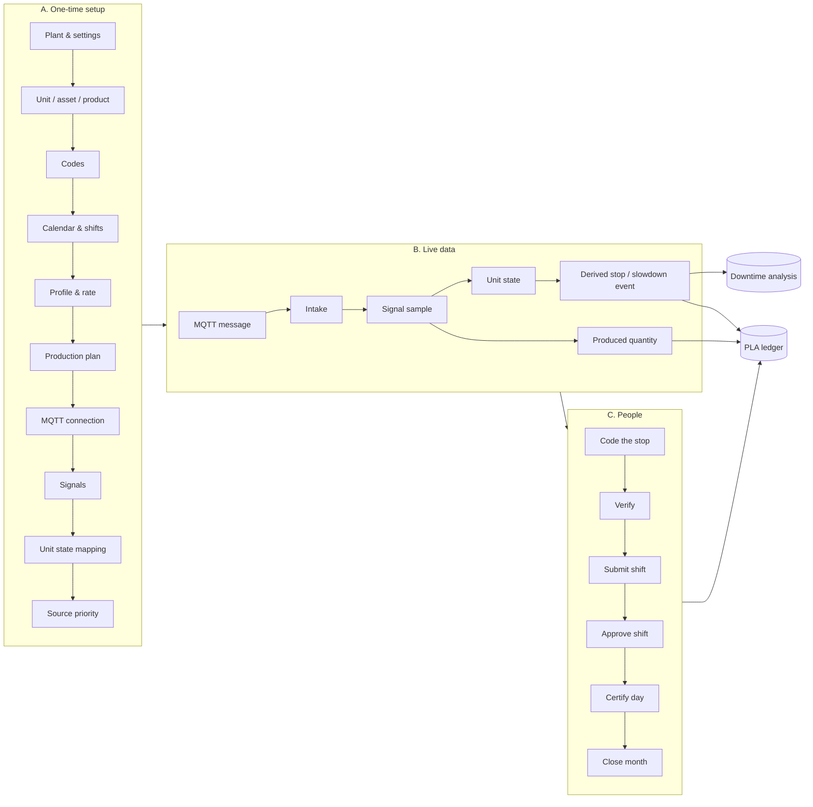
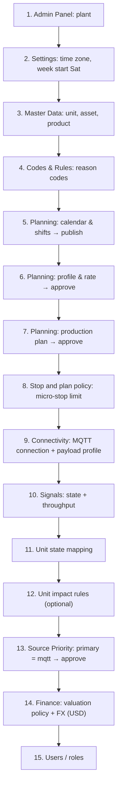
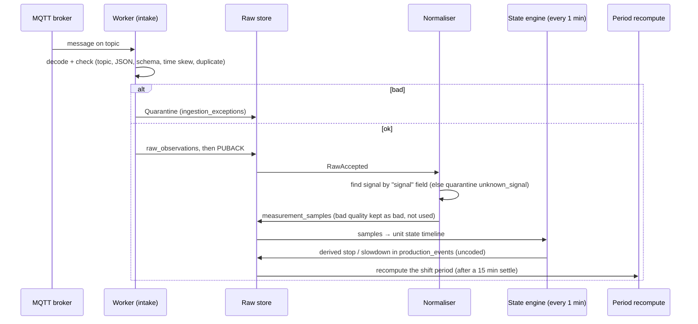
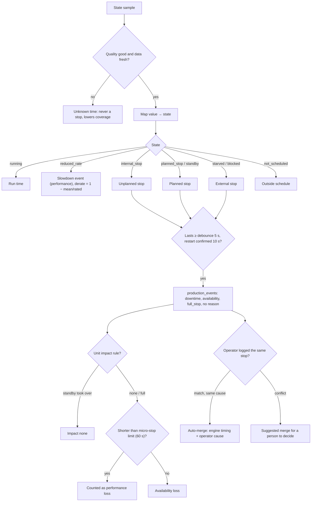
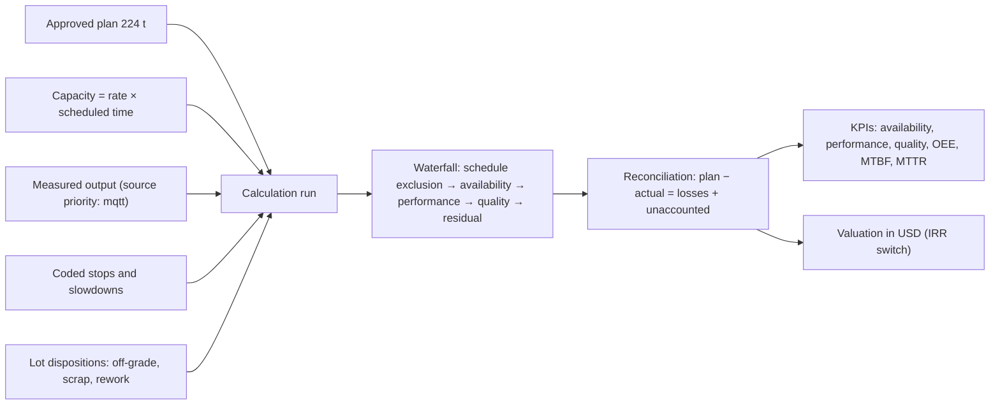
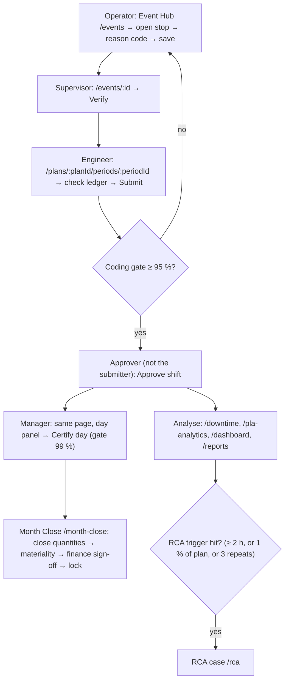

# Testing one extruder end to end: from an MQTT message to the PLA and downtime results

**Goal:** set up one HDPE extruder, feed it MQTT messages, and check that the downtime screens and the production loss accounting (PLA) screens show the expected results.

**Example used throughout:**

| Item | Value |
|---|---|
| Unit | `Extruder1` |
| Grade | `HD5502` |
| Rated rate | 28 t/h |
| Shifts | 3 × 8 h |
| Week start | Saturday |
| Currency | USD |

All demo values are marked **Demo**.

---

## 1. The whole picture



---

## 2. Setup, in order (do this before any message is sent)



| # | Page (route) | What to enter for `Extruder1` | Role |
|---|---|---|---|
| 1 | Admin Panel `/admin/plants/new` | Plant "HDPE Demo" | TenantAdmin |
| 2 | Settings `/settings` | Asia/Tehran, Persian calendar, **week start Saturday**, USD | TenantAdmin |
| 3 | Master Data › Units `/master-data/units`, › Assets `/master-data/assets`, › Products `/master-data/products` | Unit `Extruder1`, asset `EXT1-Main`, product `HD5502` | master_data_admin |
| 4 | Codes & Rules `/codes-admin` | Reason codes (e.g. `MECH-GEARBOX`, `ELEC-TRIP`, `GRADE-CHANGE`) | master_data_admin |
| 5 | Planning › Calendars & crews `/planning/calendars/new` | 3 shifts 06–14, 14–22, 22–06, crews A/B/C → **Publish** | master_data_admin |
| 6 | Planning › Profiles & rates `/planning/profiles/new` | `Extruder1` + `HD5502`, rate **28 t/h** → **Approve** (another user) | master_data_admin → manager_approver |
| 7 | Planning › Plans `/planning/plans/new` | Plan for the test day, `HD5502`, 224 t per shift → **Approve** | production_engineer → manager_approver |
| 8 | Master Data › Stop and plan policy `/master-data/stop-policy` | Micro-stop limit 60 s (default) | manager_approver |
| 9 | Integration › Connectivity `/connectivity/connections/new` | MQTT broker, topic template with `{unit}`, payload kind **`measurement_json`** | integration_admin |
| 10 | `/connectivity/connections/:id/signals/new` (**type this URL**, the MQTT page has no link) | Signal `EXT1-State` type `state`; signal `EXT1-Throughput` type `counter` (t) or `rate` (t/h). **Source stream id = the payload `signal` value** | integration_admin |
| 11 | Master Data › Unit state `/master-data/unit-state` | Signal `EXT1-State`: RUN→running, STOP→internal_stop, CHANGEOVER→planned_stop, STARVED→starved; heartbeat 60 s | integration_admin |
| 12 | `/master-data/unit-impact-rules` | Optional: `EXT1-Main` = full stop → approve | master_data_admin → manager_approver |
| 13 | Integration › Source Priority `/connectivity/source-authority` | Primary **`mqtt`** → approve. **Without this step the MQTT output is ignored** (the default primary is PI output frames) | integration_admin → production_accountant |
| 14 | Finance `/finance` | Valuation policy, margin per t, FX USD/IRR → approve | finance_maintainer → finance_approver |
| 15 | `/users`, `/permissions` | One user per role in §6; the approver must be a different person from the author | TenantAdmin |

---

## 3. The MQTT messages

Topic: `proact/v1/HDPE/Polymer/Line1/Extruder1/measurements/<signal>`

**Machine state** (a digital sample):
```json
{"schema_version":"1.0","signal":"EXT1-State","value":{"name":"STOP","value":0},
 "ts":"2026-10-17T08:00:00Z","quality":{"good":true,"questionable":false,"substituted":false},
 "seq":101,"boot_id":"gw-01-boot-1","source":"pi-mqtt-gw-01"}
```

**Throughput** (counter in t):
```json
{"schema_version":"1.0","signal":"EXT1-Throughput","value":1532.4,"uom":"t",
 "ts":"2026-10-17T08:00:00Z","quality":{"good":true,"questionable":false,"substituted":false},
 "seq":102,"boot_id":"gw-01-boot-1","source":"pi-mqtt-gw-01"}
```

> ⚠ Send state as a `measurement_json` sample. A `state_json` message is quarantined as `no_handler`.
> Simulator: `npm run db:seed-demo-mqtt`, then `npm run mqtt:sim` (backend).

---

## 4. What the app does with one message



**Quarantine reasons to test:** unknown signal, invalid JSON, wrong topic, timestamp more than 5 min in the future, duplicate `seq`. They appear on the connection's **Quarantine** tab, where you can replay them.

---

## 5. Downtime logic



---

## 6. PLA logic (per shift period)



Each run is immutable. Any later change to an event or a quantity creates a new run and a revision.

---

## 7. Daily workflow (after data flows)



| Step | Page | Role |
|---|---|---|
| Code stop | `/events` → `/events/:id` | operator |
| Verify coding | `/events/:id` (Verification) | production_engineer / manager_approver |
| Record off-grade | `/plans/:planId/periods/:periodId/dispositions/new` | operator → quality_approver |
| Correct a quantity | `.../adjustments/new` | production_engineer → manager_approver |
| Submit shift | period workspace | production_engineer |
| Approve shift | period workspace / `/my-queue` | manager_approver or production_accountant |
| Certify day | period workspace, day panel | manager_approver |
| Close month | `/month-close` | manager_approver → finance_approver |

---

## 8. Test script for one shift (06:00–14:00)

```mermaid
gantt
  dateFormat HH:mm
  axisFormat %H:%M
  section Extruder1
  RUN 28 t/h            :06:00, 120m
  STOP gearbox 45 min   :crit, 08:00, 45m
  RUN                   :08:45, 75m
  Micro-stop 30 s       :milestone, 10:00, 0m
  Reduced 22 t/h        :active, 10:00, 60m
  RUN                   :11:00, 180m
```



| Time | Send | Expected in the app |
|---|---|---|
| 06:00 | `EXT1-State` RUN, counter every minute | Unit state is running, no events |
| 08:00 | STOP | One open stop in `/events` (State engine, uncoded) within about 1 min |
| 08:45 | RUN | The stop closes at 45 min |
| 08:10 | Operator logs a manual stop 08:00–08:45 coded `MECH-GEARBOX` | Auto-merged: one stop, engine timing, operator code |
| 10:00 | STOP for 30 s, then RUN | A stop under 60 s → performance loss, not availability |
| 10:00–11:00 | Throughput at 22 t/h | Slowdown event, derate ≈ 21 %. **Only if** the unit's state mapping is the analog kind on a `rate` signal (stop below 0.5, reduced below 26, rated 28). A unit has one current mapping, so test this on a second extruder or a second mapping version. |
| any | Message with `signal` = `XYZ` | Quarantine `unknown_signal` |
| 14:15 | wait for the 15 min settle | Period has a calculation run |

**Expected shift result (approximate):**

| Line | ≈ t |
|---|---|
| Plan | 224 |
| Availability loss (45 min × 28 t/h) | 21 |
| Performance loss (slowdown, about 6 t, plus the micro-stop) | ~6.2 |
| Actual (from the MQTT counter) | ~196.8 |
| Unaccounted | ~0 |

Then run the day workflow in §7 and check:
- the gearbox stop is in the `/downtime` Pareto;
- `/pla-analytics` shows the losses in USD;
- after switching to IRR, the IRR value equals the USD value × the FX rate;
- the KPIs show availability ≈ 90.6 % (435 of 480 min).

---

## 9. Pitfalls that block the test

| Symptom | Cause / fix |
|---|---|
| No stops appear | State was sent as `state_json`; send it as `measurement_json`. Or the unit state mapping is missing or the signal type isn't `state`. |
| Every message is quarantined `unknown_signal` | The signal's "Source stream id" ≠ the payload `signal` value. |
| Actual output is empty | Source Priority still has primary `pi_output_ef`; approve a version with `mqtt`. |
| No period or ledger | The profile or plan is not approved, or the calendar is not published. |
| Approve is refused | Separation of duties: the approver authored or submitted. Use another user. |
| Stop shown as unknown time | Quality bad or a heartbeat gap > 3 × 60 s. |
| Stop-engine settings (debounce, merge tolerance) | API only: `POST /v2/stop-event-policies` (no screen). |
