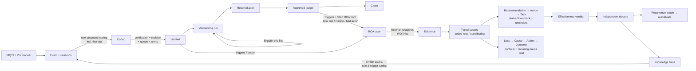

# Pro-Act — Industrial Capability Assessment & Gap Analysis

**PLA, Downtime Management and RCA compared with industry-leading products**

| | |
|---|---|
| Date | 2026-10-18 |
| Branch inspected | `feat/downtime-area2-b` (with uncommitted working-tree changes) |
| Status | Assessment only. No code, schema, API or calculation was changed. Recommendations need approval before implementation. |
| Supersedes | Nothing. Complements `plans/EXPERT_REVIEW.md` (the current self-assessment register). `docs/DOWNTIME_AND_LOSS_ACCOUNTING_GAP_ANALYSIS.md` declares itself superseded (v1 baseline, 7 Oct). |

---

## Contents

0. [Executive summary — the five answers](#0-executive-summary--the-five-answers)
1. [Method, evidence rules and limits](#1-method-evidence-rules-and-limits)
2. [Deliverable 1 — Current application capability inventory](#2-deliverable-1--current-application-capability-inventory)
3. [Deliverable 2 — Vendor capability benchmark](#3-deliverable-2--vendor-capability-benchmark)
4. [Deliverable 3 — Functional comparison matrix](#4-deliverable-3--functional-comparison-matrix)
5. [Deliverable 4 — Existing strengths and differentiators](#5-deliverable-4--existing-strengths-and-differentiators)
6. [Deliverable 5 — Partial implementation report](#6-deliverable-5--partial-implementation-report)
7. [Deliverable 6 — Capability gap analysis](#7-deliverable-6--capability-gap-analysis)
8. [Module assessments: PLA, Downtime, RCA](#8-module-assessments-pla-downtime-rca)
9. [Deliverable 8 — Cross-module workflow analysis](#9-deliverable-8--cross-module-workflow-analysis)
10. [Deliverable 7 — Opportunity backlog (prioritised)](#10-deliverable-7--opportunity-backlog-prioritised)
11. [Deliverable 9 — Implementation roadmap](#11-deliverable-9--implementation-roadmap)
12. [Deliverable 10 — Business questions for SMEs](#12-deliverable-10--business-questions-for-smes)
13. [Deliverable 11 — Evidence and sources](#13-deliverable-11--evidence-and-sources)

---

## 0. Executive summary — the five answers

### Q1. What do we already have?

Pro-Act has a substantial, server-side, tested implementation of all three modules on the **v2** stack. The v1 screens are removed; v1 routes are legacy.

- **PLA.** A deterministic decimal accounting engine (`ACCOUNTING_ENGINE_VERSION 2.7.0`) with:
  - two baselines at once: a capacity ledger at the sustained rate and a plan ledger at the planning rate;
  - a signed residual that is never clamped, with conservation checks;
  - overlap allocation (`first_out` / `equal_share`), stream sharing, and upstream starvation through buffer cover;
  - immutable, hash-fingerprinted calculation runs;
  - reconciliation with bridge limits;
  - hash-bound maker-checker approval;
  - day certification and month close with lock;
  - post-close change proposals, restatement and reversal lines;
  - multi-view, multi-currency valuation;
  - NIST-style measurement-uncertainty budgets that justify tolerances.

  The agents ran 1,213 backend unit tests, 433/434 fixture tests and 245 frontend tests on this branch, and all of these passed. The one failure was MQTT, not PLA.
- **Downtime.** Stops are detected automatically by a state engine from MQTT signals, including derived slowdowns from analog thresholds. PI event-frame ingest exists but is tested against a simulator only. Further features:
  - each event carries three state dimensions and four classification axes, with immutable revisions; source facts and user overrides are layered;
  - split, merge, close, retract and bulk-code;
  - cross-source duplicate reconciliation, with approval and undo;
  - staged coding verification and a coding gate;
  - ISO 22400 / ISO 14224-aligned KPIs (OEE, MTBF on confirmed failures, time to restore vs active repair time, standby exposure);
  - server-side Pareto, trend and bad-actor reports.

  205 backend and 184 frontend tests passed.
- **RCA.** A gated case workflow: Draft → In Progress → Analysis → Monitoring → Closure Review → Closed, with closure approved by an independent approver.
  - Six analysis methods are persisted, with server-side FMEA RPN and fault-tree probability.
  - Linked evidence packages are frozen at link time.
  - Triggers are policy-based on duration, repeats, bad-actor share, cost and critical assets.
  - CAPA actions carry **statistical effectiveness verification**: run-time-normalised recurrence, a frozen baseline and a zero-failure MTBF bound.
  - A case shows the **approved loss in money and tonnes behind it**, with approved, claimed and realised kept separate.
  - Knowledge base with similarity search.

  94/94 backend tests passed. Frontend RCA tests are **flaky**: 1 and then 7 failures across two runs.

### Q2. What is incomplete or not working as intended?

The highest-impact issues are integrity and connection problems, not missing modules:

1. **Coding verification bypasses the event revision store.** A raw `UPDATE` sets the verified/validated stamps with no `event_revisions` row and no outbox/realtime message, and open screens get an unexplained 412 (`server/pro-act-backend/src/v2/production-events/stop-verification.service.ts:209-213`).
2. **RCA has no field-level history.** Case writes are not in the append-only domain `audit_log`; only the text auto-log records them.
3. **RCA behaviour depends on the `v2.rca` flag, which defaults to off.** Flag-off plants run a hidden legacy auto-create from `rca_trigger_configs`, which no screen can edit, while their UI shows the v2 policy page.
4. **Loss → RCA is one-way in the UI.** There is no "Start RCA" from a loss line, period, Pareto bar or bad actor. Loss lines can only be linked by pasting an id.
5. **Three disconnected "action" concepts:** case recommendations (JSON), `rca_actions` (CAPA) and tasks (a soft link), with no status flow-back.
6. **No reminders or notifications** for RCA actions, tasks, uncoded backlog or long open stops. Notifications are in-app only and cover reconciliation SLA.
7. **Root cause is one free-text field.** There is no typed direct/contributing/root classification, and the RCA cause-code catalogue exists but is never used by cases. Recurring-cause analytics by cause is therefore impossible.
8. **Coding rules apply only to manual events.** They do not run on MQTT/PI/state-engine events, which are the main volume.
9. **Calculation transparency stops at the API.** Every input of a loss line is exposed, but no screen shows "rate × seconds × share = quantity".
10. **Plant values are still synthetic.** Rates, matrices, flow map, tolerances and thresholds are HDPE demo values. Key decisions (D04–D14) are "as per standard" with no named confirmer.

### Q3. What do the reference products offer that we do not?

These are the relevant capabilities we lack, all confirmed from vendor sources unless noted:

- **Multiple weighted reasons per downtime event**, pro-rated across day boundaries (Yokogawa Exaquantum/DTA).
- **PCS first-out cause linked to the stop** (DTA). The fault list maps to a default reason (GE Proficy Plant Applications).
- **Historian pre-event evidence window** captured with the event (AVEVA PI "root cause" child event frames).
- **CMMS loop.** Work requests are created in SAP/Maximo from alerts (Emerson Optics, Aspen Mtell). Ours is file import only.
- **Scheduled report distribution by e-mail** (DTA). We have no e-mail infrastructure.
- **Action reminders** on assignment, before the due date and while overdue (PROACTOnDemand, Sologic Causelink).
- **Typed cause taxonomies** (TapRooT Root Cause Tree; PROACT physical/human/latent levels; CCPS).
- **Cross-incident common-cause detection** (Causelink Enterprise).
- **Recurrence-driven re-evaluation of a closed RCA** (GE Vernova APM "Tracking Items" auto-switch to *Reevaluate*).
- **Meter-level data reconciliation and gross-error detection** (AspenTech AORA/AURA, AVEVA Production Accounting, Honeywell PAR, Yokogawa mPower). This is a different product class from our plan-vs-actual reconciliation.
- **ML diagnostics and GenAI assistants** (Honeywell Forge Diagnose, Aspen Mtell, TrendMiner, Cognite Atlas AI). These are mostly evidenced by marketing and press material.

### Q4. What can we achieve beyond current capabilities, and what could differentiate us?

**No vendor source we found documents, in one product, the chain from measured loss (tonnes and money from an approved ledger) to an RCA trigger, then corrective action, then statistically verified recurrence reduction, then realised value.**

- Vendors split this across modules or licences. One example is Exaquantum/DTA for loss capture plus a separate RCA tool. Another is AVEVA Production Management plus AVEVA Production Accounting.
- Pro-Act already has every link in that chain on the server. What is missing is mostly the **connective UI and the structured cause data**.
- This is an inference from missing evidence, not proof that no vendor does it.

The differentiators within reach, in order of feasibility:

1. **A Loss → Cause → Action → Outcome view.** A portfolio view of approved loss by root cause, open actions, verified effectiveness and realised value, built on existing ledgers and verification data.
2. **"Explain this number."** Per-line calculation lineage (formula, rate version, segment, evidence share) built from data the API already returns.
3. **Recurring cause cost.** Once causes are structured, show the approved loss attributable to each recurring cause across assets and time.
4. **Recurrence re-evaluation.** Extend the action-level verification to recommend reopening a closed case when same-mode losses return.
5. **Accounting-integrity exceptions queue.** Unify the conditions the engine already detects (signed residuals, over-claims, uncoded time, duplicate suggestions, stale submissions, source substitutions) into one actionable queue.
6. **An AI investigation assistant (later phase).** It drafts the problem statement, summarises similar cases and evidence packages, and proposes hypotheses. A human must accept every suggestion, and each one is audited. This needs approval for a new dependency.

### Q5. What should we implement first, and why?

**First, fix integrity, then connect what exists, then structure the cause data. Large new integrations come last.**

1. **Wave 0, decisions (no code).**
   - Confirm the accounting policies (D04–D14).
   - Decide the `v2.rca` cutover.
   - Decide the SuperAdmin self-approval posture for production.
   - Complete PI certification inputs (D02).

   Every number the product produces depends on these.
2. **Wave 1, integrity.**
   - Verification writes as revisions.
   - RCA field history in the append-only audit.
   - Retire the hidden legacy RCA auto-create.
   - Retire or harden the v1 endpoints (unpaginated `/api/production-events`, unscoped `/api/tasks/:id`).
   - Stabilise the flaky RCA tests and widen the e2e smoke in CI.

   These are the only items that could make a figure or an audit trail wrong today.
3. **Wave 2, connect.**
   - "Start / link RCA" from loss lines, Pareto bars, bad actors and periods.
   - The calculation explainer.
   - A verification queue.
   - Unify recommendation → action → task, with in-app reminders.
   - Coding rules on auto-detected events.

   All of this is mostly frontend or service glue over existing data, with high daily value.
4. **Wave 3, structured RCA and value.**
   - Typed causes linked to the cause catalogue.
   - Recurring-cause cost analytics.
   - The Loss → Cause → Action → Outcome view.
   - Case-level recurrence re-evaluation.
   - A server-side RCA report.
5. **Wave 4, integrations and advanced.**
   - Historian evidence snapshots.
   - CMMS adapter.
   - E-mail delivery.
   - Multi-reason allocation, if SMEs want it.
   - AI assistant.
   - Mass-balance reconciliation only if it comes into scope.

> **Naming risk (business/legal, not code).** **PROACT®** is a registered RCA methodology and SaaS brand of Reliability Center, Inc. (PROACTOnDemand). It is also licensed into GE Vernova APM's RCA module ("PROACT for Meridium"). Marketing an RCA module as "Pro-Act" to oil & gas reliability teams risks confusion and possible trademark conflict. A legal review is recommended. We have not verified the trademark class or jurisdiction.

---

## 1. Method, evidence rules and limits

### 1.1 How the assessment was done

1. **Repository inventory.** Four parallel read-only reviews (PLA, Downtime, RCA, shared platform) read source, migrations, tests and plans, then ran the relevant unit test suites. Key claims were re-checked by hand. Re-checking corrected one reviewer finding (see §1.4).
2. **Vendor research.** Two parallel web-research passes, one for PLA/downtime/production accounting and one for RCA/diagnostics. Each finding is classified by evidence strength.
3. **Comparison.** The comparison covers **behaviour and outcome**, not feature names.

### 1.2 Implementation status legend

| Status | Meaning |
|---|---|
| ✅ **Working** | Implemented and working: code plus passing tests (unit tests run during this assessment unless stated). |
| 🟡 **Partial** | Some behaviour exists; specific gaps listed. |
| 🖥️ **Frontend only** | UI exists; backend behaviour or persistence missing. |
| ⚙️ **Backend only** | Backend exists; not reachable through the intended user workflow. |
| 📄 **Planned** | Documented in `plans/` but not built. |
| ❌ **Missing** | No implementation found. |
| ❔ **Unverified** | Insufficient evidence. |
| 🪦 **Legacy** | Present but superseded; candidate for retirement. |

### 1.3 Vendor evidence legend

| Tag | Meaning |
|---|---|
| **[C-doc]** | Confirmed from official technical documentation. |
| **[C-mkt]** | Confirmed from a vendor product page, brochure, press release or partner page. This shows the capability is claimed, not how well it behaves. |
| **[S]** | General industry practice or standard; not unique to one product. |
| **[V]** | Needs further verification (snippet-only, outdated, or inferred). |
| **[P]** | Proposed capability for Pro-Act. |

### 1.4 Limits of this assessment

- **Tests run:** backend Jest unit and fixture suites for each module, and frontend Vitest for each module. **Not run:** the 177 Postgres integration specs and the 70 Playwright specs. These need a database or seeded environment, and CLAUDE.md asks for owner go-ahead before seeding or running full plant e2e. `plans/EXPERT_REVIEW.md` reports 225/232 e2e passing; this assessment did not reproduce that.
- **CI status on GitHub is unverified.** Phase 0.3/0.4 still lists the CI run as open.
- **Vendor documentation** was often partly reachable: JavaScript-rendered docs, unreadable PDFs, 404s. Product pages are marketing. Where a vendor capability is absent from our findings, that is **absence of evidence**, not evidence of absence. Modules and licences differ by vendor.
- **Correction made during verification.** One reviewer reported the SuperAdmin bypass of separation of duties in `server/pro-act-backend/src/reconciliation/approval.service.ts` as a bug. It is an **owner decision** (`plans/DECISIONS.md:535`, 2026-10-16, "Permanent SuperAdmin full workflow authority"). This document treats it as a governance risk to revisit for production, not as a defect.
- **Stale documentation noticed (not changed):**
  - CLAUDE.md lists `EventHub.tsx`, `PlanDashboard.tsx` and `RCAModule.tsx` as oversized files, but they no longer exist.
  - `docs/FEATURE_IMPLEMENTATION_STATUS.md` claims protocol connectors (Modbus, OPC UA, …) at 100%, but only baseline tables exist.
  - `plans/README.md:17` and EXPERT_REVIEW RCA-02 reference removed RCA controllers.

---

## 2. Deliverable 1 — Current application capability inventory

Backend paths are relative to `server/pro-act-backend/`. Frontend paths start with `src/`. API routes are under `/api` and versioned (`/api/v2/...`, `common/http/configure-http-app.ts:31`). IDs (P-xx, D-xx, R-xx, S-xx) are referenced throughout the document.

### 2.1 Production Loss Accounting (PLA)

| ID | Capability | Status | What it does | Key evidence |
|---|---|---|---|---|
| P-01 | Rate basis (profiles and rates) | ✅ | Versioned, effective-dated unit × product rates of six kinds. The engine uses **sustained** (capacity) and **planning** (plan). Rates need maker-checker approval and support CSV import. A back-dated rate triggers recalculation. | `src/domain/profiles/profile.types.ts:18`, `rate-math.ts`; `/v2/profiles`, `/v2/rates/:id/approve`, `/v2/rate-imports`; migration `1792275200000-ProfilesAndRates`; `rate-math.spec.ts`, `profiles-api.int-spec.ts` |
| P-02 | Production plans and targets | ✅ | Plan versions (draft → submit → return/approve), scenarios, worker-generated plan periods, target distribution prorated to slices. | `src/plans/*`, `src/domain/plans/period-generator.ts`, `target-distribution.ts`; `/v2/production-plans/**`; `plans-*.int-spec.ts` (8); e2e `plans-profiles-calendars-plan03.spec.ts` |
| P-03 | Calendars and schedule exclusion | ✅ | Shift instances, excluded spans as `schedule_exclusion` lines, week start, Jalali months. | `src/domain/calendar/*` (with specs) |
| P-04 | Actuals | ✅ | Counter deltas, then rate integration, then running-time proration. Missing data is null, never zero. A source hierarchy carries substitution flags. Adjustments use maker-checker. External report import. | `src/periods/period-actuals.compute.ts`, `src/domain/actuals/counter-delta.ts`; `/v2/production-periods`, `/v2/actuals/adjustments`; UI `plan-dashboard/components/actuals-provenance.tsx` |
| P-05 | Loss engine | ✅ | Atomic time segments feed the capacity ledger and the plan ledger, followed by conservation checks. decimal.js, deterministic. | `src/domain/accounting/period-accounting.ts:67`, `segmentation.ts`, `capacity-ledger.ts:200`, `plan-ledger.ts:244`, `conservation.ts:127`; `period-accounting.spec.ts`, `test/fixtures/fixtures.spec.ts` |
| P-06 | Loss classification | ✅ | Downtime, slowdown, quality loss and grade transition. Only a full stop removes time; a partial stop becomes a performance claim. Micro-stop threshold per asset class. Quality split by disposition class. Grade-transition allowance and excess come from an approved matrix. | `src/domain/accounting/accounting.types.ts:18-60`, `micro-stop-threshold.ts`, `quality-class-lines.ts`, `transition-*.ts` |
| P-07 | No double counting | ✅ | Per segment, overlap allocation uses `first_out` (default) or `equal_share`, with shares summing to exactly 1. Losses are taken in sequence A → P → Q. Parallel streams share capacity. Starvation is charged upstream beyond buffer cover. One event cannot be claimed beyond its own quantity (`EVENT_OVER_ALLOCATED`). | `cause-allocator.ts:29`, `shares.ts:12`, `streams.ts`, `flow-propagation.ts:166`; migration `1793917000000-OeePolicyFirstOut`; `event-conservation.spec.ts`, `flow-propagation.spec.ts` |
| P-08 | Run provenance | ✅ | Each run records the engine and policy versions, a SHA-256 input hash and `supersedesRunId`. Runs are immutable. Unchanged input reuses the existing run; failed runs are stored. | `src/accounting/accounting-run.service.ts:97-221`, `run-input-hash.ts:15` |
| P-09 | Event ↔ loss-line link | ✅ (soft FK) | Loss lines carry `cause_event_id`. `loss_line_evidence` stores event, revision, share and clipped interval. Editing an event triggers a recalculation. **There is no DB foreign key on `cause_event_id`** (events are tombstoned, never deleted, which limits the risk). | `src/accounting/entities/loss-line.entity.ts:183`, `loss-line-evidence.entity.ts:26-29`; UI `plan-dashboard/editor/event-link.tsx` |
| P-10 | Reconciliation | ✅ | Candidates can be accepted, adjusted, replaced or rejected, and manual lines added. Each slice satisfies `target − actual = attributed + tolerance + residual`, with a signed residual. Bridge lines need evidence and limits plus a second review. Submission gates block bad states. | `src/domain/reconciliation/reconcile.ts:171`, `bridge-limits.ts`, `submission-gates.ts`; `/v2/production-periods/:id/reconciliation`, `/submit`, `/approve`; `reconciliation-*.int-spec.ts` (8) |
| P-11 | Approval of losses | ✅ | The approver must not be the submitter or a line author. Approval is bound to the reviewed hash (409 STALE). The snapshot is immutable (DB trigger). Delegations are supported. **SuperAdmin may self-approve, by owner decision** (`plans/DECISIONS.md:535`). | `src/reconciliation/approval.service.ts`, `src/domain/reconciliation/separation-of-duties.ts`; migration `1793914000000-ApprovedLedgerLines`, `1794190400000-SuperAdminApprovalOverride` |
| P-12 | Periods and month close | ✅ | Day certification, then month close: open → quantities closed → finance sign-off → locked, on WD3/WD5. Reopen, materiality review, SLA escalation (48 h / 72 h), data holds. | `src/domain/close/month-close-machine.ts`; `/v2/month-closes/:month/**`, `/v2/production-days/:unitId/:localDate/certify`; UI `src/features/month-close/*` |
| P-13 | Post-approval and post-close corrections | ✅ | Revising an approved period opens revision n + 1. In a locked month the correction must go through a change proposal (proposer ≠ decider). Restatement delta, separate finance posting date, reversal lines carry the approved value. | `src/close/month-lock.ts:66-84`, `restatement-delta.ts:150`; `/v2/period-change-proposals`; migrations `1794060000000-ManualChangeProposal`, `1794130003000-ReversalLines` |
| P-14 | Valuation | ✅ | Margin and standard cost, cost per hour, and an economic view (scrap, downgrade, rework, demand-constrained lost sales). Every policy currency through approved FX; a missing rate gives `unvalued` with a reason. USD by default, IRR display toggle. | `src/domain/valuation/value-line.ts:120`, `economic-view.ts:100`, `fx.ts`; `/v2/valuation-*`, `/v2/fx-rates`, `/v2/reports/loss-value`; `src/features/display-currency/*` |
| P-15 | Measurement uncertainty | ✅ | Per-boundary budget following NIST TN 1297 (with correlations), U = k·u_c. Approval by someone other than the author. Explicit adoption turns it into a tolerance. | `src/domain/uncertainty/uncertainty-budget.ts:61`, `src/uncertainty/tolerance-adoption.service.ts`; `/v2/uncertainty-budgets` |
| P-16 | PLA analytics | ✅ | Server-built waterfall (with a `closes` flag), loss tree, reconciliation trend and status, actuals quality, OEE, period summaries. Reports use approved revisions by default. | `src/domain/reconciliation/waterfall.ts:72`; `/v2/reports/{scope-waterfall,loss-tree,reconciliation-trend,...}`; UI `src/features/pla-analytics/*`; e2e `pla-analytics-an02.spec.ts` |
| P-17 | Exports | ✅ | Immutable CSV and PDF of period summary and loss lines, from approved revisions, rendered by a worker job. | `src/exports/*`, `/v2/exports` |
| P-18 | Calculation transparency | 🟡 | The API exposes segment window, basis, `rateVersionId`, cause event, share, clipped interval, flags, versions and hash. The **UI shows versions, basis and event link, but never the per-line formula**. | `plan-dashboard/components/period-header.tsx:27`, `editor/candidate-row.tsx:40` |
| P-19 | Audit on loss records | ✅ | Immutable revisions, snapshots and runs. `approval_actions` and `month_close_actions`. Append-only domain `audit_log`. Period history panel. | `common/audit/audit-trail.ts`; `plan-dashboard/workflow/period-history.tsx` |
| P-20 | Unused rate kinds | 🟡 | Nameplate, demonstrated, budget and forecast rates are stored but drive no report. There is no capacity-gap view. | `profile.types.ts:18` |
| P-21 | Legacy PLA tables | 🪦 | `production_losses`, `reconcile_forms`, `loss_categories`, `oee_summaries` and `production_plan_template` are entity-only and read only by `migration-cutover`. The v1 `/api/production-plans` route is bridged to v2. | `src/database/data-source.ts:27`; `src/plans/plan-legacy-bridge.service.ts:29` |

### 2.2 Downtime Management

| ID | Capability | Status | What it does | Key evidence |
|---|---|---|---|---|
| D-01 | MQTT event ingestion | ✅ (phase 1.8 🔄) | Decode, map, resolve codes, place, then create or revise the event. Unplaceable frames go to quarantine. Unknown codes produce uncoded events. | `intake/adapters/mqtt/handlers/mqtt-interval-event.handler.ts:42-95`; ~20 MQTT specs; `mqtt-subscriber-*.int-spec.ts` |
| D-02 | Durable intake | ✅ | Persist-before-ack raw store, jobs, quarantine, replay. | `/v2/ingestion-exceptions`, `/v2/replay-runs/:id`; `intake-*.int-spec.ts` |
| D-03 | PI Web API (event frames, signals) | 🟡 | Paging, cursors, the 9999 open-frame sentinel, source-revision layering. **Simulator-only. Real PI certification is blocked on D02.** | `integration/pi-frame-ingest.service.ts`, `integration/pi/*`; `pi-certified-*.int-spec.ts` with `fake-pi-server.ts` |
| D-04 | Automatic detection (state engine) | ✅ | Signals become a state timeline, which yields derived stops and **derived slowdowns** (analog thresholds). Unknown or stale time is never counted as a stop. Advisory lock per unit, idempotent, worker job every minute. | `stop-events/state-engine.job.ts:28-57`, `derived-stop-engine.service.ts:79-136`; `domain/reliability/unit-state.ts:143`, `derived-stops.ts:178`, `derived-slowdowns.ts:103` |
| D-05 | Rules engine | 🟡 | Lifecycle with validate, simulate, activate, rollback. **Only `coding_default` is applied, and only on manual create.** Not applied on PATCH or to MQTT/PI/derived events. `validation` rules are not enforced. | `rules/grammar/rule-catalog.ts:9`; `v2/production-events/production-events-v2-commands.service.ts:219-260`; `rules/rule-classification.service.ts:33` |
| D-06 | Manual entry | ✅ | Unit and reference checks, failure dictionary, end time or duration (checked for agreement), rejects times in the future. | `production-events-v2-commands.service.ts:78-127`; `domain/events/event-interval.validation.ts:40,100` |
| D-07 | Lifecycle model | ✅ | `physical_state`, `coding_state` and `rca_state` with revisions; `row_version` gives optimistic concurrency. | `domain/events/event-classification.ts:41-61`; `production-event/event-write-model.ts:140-215` |
| D-08 | Time model | ✅ | UTC `timestamptz`, half-open intervals, generated `duration_seconds`, GiST span index. | `production-event/production-event.entity.ts:43-50,115-120`; migration `1793908000000-ProductionEventsSpanIndex` |
| D-09 | Classification axes | ✅ | Physical type, schedule class, OEE component, impact mode and fraction. Origin unit and asset, planned end with overrun, ISO 14224 failure detail. Unit-impact and standby rules. | migrations `1794190100000-UnitImpactRules`, `1793919000000-EventOrigin`, `1793921000000-FailureDetail` |
| D-10 | Code libraries | ✅ | Hierarchical, versioned libraries for reason, impact, OEE, loss category and failure groups. Mapping rules apply as of the event start. | `/v2/reason-codes`, `/v2/code-mapping-rules`; UI `src/features/codes-admin/` |
| D-11 | Uncoded queue and verification | 🟡 | "To code" filter, inline code, staged verification (supervisor ≠ the person who coded, then maintenance validation), coding gate (warn at 95%, or block). **Verification writes bypass revisions and the outbox. There is no "to verify" list filter.** | `v2/production-events/stop-verification.service.ts:131-217` (raw `UPDATE` at :209); `domain/events/coding-verification.ts`; `event-hub/model/event-filters.ts:105-122` |
| D-12 | Split / merge / close / retract / bulk-code | ✅ | Lineage kept in `event_relations`. Bulk operations run as worker jobs over a server selection snapshot. Retract is a tombstone. | `event-operations/*`, `domain/events/event-operations.ts:105-160`; e2e UX04 J1 |
| D-13 | Retrospective edit | ✅ | Source-owned facts are protected (409 `SOURCE_OWNED`). User edits become override revisions. Edits trigger a period recalculation; approved periods change only through proposals. | `production-event/revisions/source-revision.ts`; `periods/period-recalc.consumer.ts:28-60` |
| D-14 | Duplicate / repeat / overlap | ✅ | `possibleDuplicate` and `possibleRepeat` at read time. Cross-source stop reconciliation: auto-merge or suggestion, through the `stop-merge` approval, with undo. Repeat-stop incidents. First-out allocation. | `stop-events/stop-reconciliation.service.ts:44`, `duplicate-merge.ts`; `domain/events/stop-incidents.ts:78` |
| D-15 | Rate loss vs full stop | ✅ | `slowdown` type, fractional impact, equivalent downtime, derived slowdowns. | `stop-events/derived-slowdown-writer.ts`; migration `1793912000000-KpiEquivalentDowntime` |
| D-16 | Event Hub UI | ✅ | Keyset paging, current stops, filters in the URL, revision timeline, source vs effective facts, conflict dialog, CSV export. | `src/features/event-hub/**`; e2e `event-hub-v2-ux04.spec.ts` |
| D-17 | Downtime analytics | ✅ | Server bundle (tiles, bad actors, crew, trend) from `kpi_results`, a Pareto reason tree, a controllable-availability switch. **Only calculated periods count.** The timeline is still built from the event list. | `v2/reports/downtime-bundle-report.ts`, `downtime-reason-tree.ts`; `downtime-analysis/components/state-timeline.tsx:31-44` |
| D-18 | Reliability KPIs | ✅ | MTBF on confirmed functional failures over exposure (null with exposure when there are no failures). Time to restore vs active repair time. Standby MTBF and failure on demand. Availability bounds. | `domain/kpi/reliability.ts:49,81,211`, `standby-mtbf.ts`; `/v2/reports/reliability` |
| D-19 | CMMS | 🟡 | Inbound work-order operations import only (idempotent), auto-linked to the running stop. **No SAP PM / Maximo connector, no outbound work request.** | `v2/reliability/work-order-operations-v2.controller.ts:85-140`; migration `1793942000000-WorkOrderOperations` |
| D-20 | Realtime push | ✅ | Outbox → scoped Socket.IO → TanStack invalidation. | `realtime/scoped-realtime.gateway.ts:54-198`; `src/features/v2-foundation/realtime-bridge.tsx` |
| D-21 | Downtime notifications | ❌ | Nothing alerts on a long or open stop, an uncoded backlog, pending verification or a merge suggestion. | `notifications/user-notification.entity.ts:6-10` (kinds limited to SLA/source) |
| D-22 | Legacy downtime surface | 🪦 | v1 `/api/production-events` (GET **unpaginated** without page parameters; the frontend no longer uses it). `unmapped_events` is written but never read. Orphan `streaming/`, `historian-*`, `pi-event`, `pi-mapping`, `data-source`, `verification-status-code` entities. Legacy `/socket.io`. | `production-event/production-event.controller.ts:28-75`; `integration/pi-unmapped-recorder.ts` |

### 2.3 Root Cause Analysis (RCA)

| ID | Capability | Status | What it does | Key evidence |
|---|---|---|---|---|
| R-01 | Case CRUD, list, summary | ✅ | Manual creation, filters, summary. | `v2/rca/rca-cases-v2.controller.ts:77-160`; `test/integration/rca-cases.int-spec.ts`; e2e `rca-integration-rca01-03.spec.ts` |
| R-02 | Create/link from an event | ✅ | "Create / link RCA" on event detail, with prefill. | `v2/rca/event-rca-link-v2.controller.ts:42,65`; `src/features/rca/event-rca-panel.tsx:30` |
| R-03 | Automatic triggers (v2) | ✅ when `v2.rca` is on | Policy (`rca_policy`) plus trigger-hint rules. Kinds: duration, share of plan, same-mode repeats, bad-actor cumulative, cost, critical asset. Triggered on event change, period approval/restatement and a 5-minute sweep. Default is recommend-only. **The cost trigger is inactive while `costThreshold` is null (D08).** | `rca-case/triggers/rca-trigger.consumer.ts`, `rca-trigger-sweep.job.ts:26`; `domain/rca/rca-triggers.ts`; `plans/DECISIONS.md:402` |
| R-04 | Legacy auto-create | ⚙️ / 🪦 | Runs on event save **for plants with `v2.rca` off**, from `rca_trigger_configs`, **which has no controller or UI**. | `production-event/production-event.service.ts:121`; `rca/rca-auto-create.service.ts:47`; `feature-flags/feature-flag-keys.ts:13` |
| R-05 | Definition and team | ✅ | Problem statement, charter, consequence class, target date. Lead, members, an append-only investigator list. Team locked from Monitoring. | `domain/rca/case-workflow.ts` (`TEAM_LOCKED_STATUSES`); `case/definition/definition-page.tsx` |
| R-06 | Workflow and gates | ✅ | Six-state machine with reopen. Investigation gate (rejects unsupported causes such as "operator error"). Close gate (root cause, actions done with evidence, effectiveness verified, residual risk). Independent closure approver. | `domain/rca/case-workflow.ts:51-65`, `investigation-gate.ts`, `close-gate.ts`; `rca-closure-independence.int-spec.ts` |
| R-07 | Evidence and attachments | ✅ | Typed evidence items (JSON on the case) linked to logic-tree nodes; file attachments. | `rca-case/rca-case-json.ts:46-70`; `rca-case-workspace-v2.controller.ts:190,215` |
| R-08 | Historian evidence | 🟡 | Stores the PI query (tags, window) only. **No values or snapshot.** | `features/rca/case/evidence/series-fields.tsx`; `rca-case/evidence-package.ts:46` |
| R-09 | Links with frozen evidence packages | ✅ | Links to events, loss lines, work orders and occurrences, each freezing a snapshot: facts, revisions, codes, 90-day recurrence, approved impact. **The loss-line link needs a pasted id; the work-order link is free text.** | `rca-links-v2.controller.ts`; `rca-case/evidence-package.ts:160-203`; `rca/links/add-link-form.tsx:40` |
| R-10 | Analysis methods | ✅ | 5-Why, Fishbone, FMEA (server RPN/AP), Fault tree (server top-event probability), Barrier, Change, each in its own table. Logic tree and event diagram on the case. | `rca-case-workspace-v2.controller.ts:89-176`; `domain/rca/fmea.ts`, `fault-tree.ts`; `fmea.spec.ts`, `fault-tree.spec.ts` |
| R-11 | Typed causes (direct / contributing / root) | ❌ | One free-text `rcas.root_cause`. Node "kind" is a free label. | `rca/rca.entity.ts` |
| R-12 | RCA cause-code catalogue | ⚙️ | Hierarchical CRUD exists, but **cases never reference it**. Verification checklists are likewise CRUD only. | `v2/rca-settings/rca-causes-v2.controller.ts`; migration `1793900060000-RcaCauseCodeParent` |
| R-13 | Recommendations | ✅ (JSON) | Title, owner, due date, status, cost. **Not related to actions** (no `recommendation_id`). | `rcas.recommendations`; `case/actions/recommendations-section.tsx` |
| R-14 | CAPA actions | ✅ | Owner, due date, type, completion evidence, verifier ≠ owner, verification window, baseline, claimed avoided loss. | `rca-actions-v2.controller.ts:58-85`; `rca-case/rca-actions.service.ts`, `action-completion.ts` |
| R-15 | Reminders and overdue | 🟡 | Overdue is counted in summaries only. **No reminders or notifications.** | `rca-case-commands.service.ts:70,101` |
| R-16 | Tasks | 🟡 | v2 tasks with `linkType 'RCA'` (soft link). Duplicate tasks are prevented in the browser by matching titles. No status flows back to the action or case. The legacy v1 `/api/tasks` is still mounted (`@TenantBound`, but `findAll()` with no filters and `GET/PUT/DELETE :id` rely on RLS only). | `v2/administration/tasks/*`; `task/task.controller.ts:13-56`; `case/actions/create-task-button.tsx:17-58`; `plans/DECISIONS.md:439` |
| R-17 | Effectiveness verification | ✅ (strength) | Frozen baseline, acceptance criteria and query version. Hourly worker plus on-demand check. Same-mode unplanned incidents per 1,000 run hours (standby-aware). Verdict: effective, not effective or insufficient evidence, with a zero-failure MTBF bound. Baseline corrections need manager approval. | `domain/rca/effectiveness.ts`; `rca-case/action-baseline.ts`, `rca-verification.service.ts:51`; `effectiveness.spec.ts`, `test/fixtures/RCA01-04.json` |
| R-18 | Money and tonnes behind a case | ✅ (strength) | Approved historical loss (approved ledger only, per currency), claimed savings and realised difference, **never summed together**. | `GET /v2/rcas/:id/outcome`; `rca-case/rca-outcome.ts`, `approved-impact.ts`; `features/rca/outcome-panel.tsx` |
| R-19 | Recurrence and bad actors | ✅ | Ranking by quantity, value or stops, by asset or failure mode, with trigger state. Recurrence counts feed evidence and readiness. **Not by root cause** (see R-11 and R-12). | `/v2/reports/bad-actors`; `domain/rca/bad-actor.ts`; `rca-recurrence.ts` |
| R-20 | Knowledge base | ✅ | Entry created automatically on close. Publish, share, votes, SQL similarity (asset 3, reason 2, unit 1, plus text), quality score. Similar cases shown in Event Hub. | `v2/rca-knowledge/*`; `knowledge-similar.service.ts:28`; `rca-knowledge.int-spec.ts` |
| R-21 | Templates | ✅ (thin) | A template seeds the logic tree. | `/v2/rca-templates`; `rca-case-writer.ts:101-107` |
| R-22 | Reports | 🖥️ | Browser JSON/CSV export and copy-report. **No server or PDF case report.** | `features/rca/model/case-export.ts` |
| R-23 | RCA change history | ❌ | Only a row version and the text auto-log. **Not in the append-only domain `audit_log`; no history tab.** | `rca/rca.entity.ts:228`; `case/case-nav.tsx:6-10` |
| R-24 | AI/LLM assistance | ❌ | None. "Similar" and "recommendation" are rule-based. | repository-wide search: no anthropic/openai/llm/embedding |
| R-25 | Legacy RCA layer | 🪦 | Orphan v1 entity folders (fishbone-diagram, five-why-analysis, fault-tree-analysis, fmea-analysis, barrier-analysis, change-analysis, logic-tree-node, rca-analysis-config, rca-evidence, evidence-category, evidence-location, rca-recommendation). Dead `rcas` columns (`calculated_roi`, `effectiveness_score`, …). | `src/database/data-source.ts:27`; `rca/rca.entity.ts:103-210` |

### 2.4 Shared platform

| ID | Capability | Status | Key evidence |
|---|---|---|---|
| S-01 | Routing and lazy loading: every page lazy, capability-gated navigation | ✅ | `src/App.tsx:72-80`, `src/app/routes/*`, `src/features/auth/navigation-items.ts:47-113` |
| S-02 | Auth chain: throttle → JWT → roles → scope (404) → write access → tenant binding; RLS on; 12 plant roles; delegations; rotating refresh tokens | ✅ | `app.module.ts:100-105`; `auth/roles/role-model.ts`; `common/context/request-context.ts:24-37`; `plans/DECISIONS.md:426` |
| S-03 | Password reset / SSO | ❌ (SSO deferred by D15) | `auth/auth.controller.ts`; unused `forgot-password.dto.ts` |
| S-04 | Audit: text auto-log on every write (no before/after values, 30-day retention) + append-only domain audit (close, exports, periods, reconciliation, source authority only) | 🟡 | `audit-log/audit-auto-log.interceptor.ts`; `common/audit/audit-trail.ts` |
| S-05 | Shared approvals inbox (master data + 16 workflow kinds, including rca-closure and stop-merge) | ✅ | `v2/approvals/approval-catalog.ts:51-136`, `approval-workflows.ts:40-259`; UI `/approvals` |
| S-06 | Notifications: in-app only, three kinds (SLA reminder, SLA escalation, source fallback); **no e-mail/SMS** | 🟡 | `notifications/*`; `plans/DECISIONS.md:514` |
| S-07 | Worker jobs (outbox, intake, accounting, plans, exports, state engine, PI sync, RCA triggers and verification, SLA) | ✅ | `worker.module.ts:37-82` |
| S-08 | Kafka | 📄 (containers only; in-process outbox) | `common/outbox/in-process-outbox.transport.ts`; plan 1.9 ⬜ |
| S-09 | OPC UA / Modbus / other protocol connectors | 📄 / ❌ (tables only) | `database/migrations/1791411016572-Baseline.ts:209-219`; Phase R2 ⬜ |
| S-10 | AI / ML | ❌ ("causality assistance" is Phase R2 ⬜) | `plans/README.md` |
| S-11 | Tests and CI: 194 unit specs, 30 fixture specs, 177 integration, 190 vitest, 70 Playwright. CI runs lint, types snapshot, typecheck, unit, integration, and **e2e smoke of only 3 specs** | 🟡 | `.github/workflows/ci.yml:211` |
| S-12 | OpenAPI v2 snapshot (~347 paths) checked in CI | ✅ | `openapi/v2.json`, `v2/openapi-v2.spec.ts` |
| S-13 | Feature flags: per-tenant cutover switches, **all default off** | ✅ (cutover pending) | `feature-flags/feature-flag-keys.ts:6-13`; `plans/DECISIONS.md:361,415` |

---

## 3. Deliverable 2 — Vendor capability benchmark

Only capabilities relevant to Pro-Act's scope are listed. Full URLs are in §13.

### 3.1 Production loss and downtime products

**Yokogawa Exaquantum/DTA (Downtime Analytics).** This is the closest functional analogue to our Downtime + PLA scope. [V1]
- [C-mkt] Automatic capture of downtime, and of **rate loss below the Maximum Sustainable Production Rate**, per unit. Rate loss is computed daily.
- [C-mkt] Two-way conversion between time and quantity.
- [C-mkt] **Several reasons per event, weighted by percentage or duration, pro-rated across day boundaries.**
- [C-mkt] The **PCS "First Out" stop cause** is linked to the event.
- [C-mkt] Standby tracking.
- [C-mkt] Plant and reason hierarchies.
- [C-mkt] Reports: Reason Classification with drill-down; downtime, rate-loss and equipment rankings (bad actors); 30-day availability KPIs.
- [C-mkt] Scheduled e-mailed reports, Excel and SSRS.
- [V] Audit trail, approval and period lock are not documented. No RCA workflow.

**AVEVA Production Management (formerly MES / Ampla).** [V2]
- [C-doc] "Real" vs "virtual" downtime. Virtual downtime means running below a threshold; it is converted to equivalent lost time at the optimal rate.
- [C-doc] **Real downtime takes precedence over virtual downtime when they overlap.**
- [C-doc] Virtual events start only after a configured delay.
- [C-doc] Capture and split conditions; manual split only above 5 minutes, with no undo.
- [C-doc] `CauseLocations` limits which equipment can be the cause.
- [C-doc] A time-usage model.
- [C-mkt] KPIs recalculated when late data arrives.
- [C-mkt] ERP feed.
- [V] Accenture/Rio Tinto "delay auto-coding" comes from a customer deck.

**AVEVA PI System (Event Frames, PI Vision).** [V3]
- [C-doc] Event frames are generated from start and end triggers, with a "true for" delay.
- [C-doc] A **child "root cause" frame captures a pre-event window**, shown in PI Vision overlay and Gantt views.
- [C-doc] Users can acknowledge and annotate events.
- [C-doc] Only **one reason attribute** per frame.
- [C-mkt] (feedback portal) Event-frame attributes cannot easily feed rollups.

**AVEVA Production Accounting.** [V4]
- [C-doc] Model validation and missing-flow detection.
- [C-doc] Constrained weighted least-squares reconciliation.
- [C-doc] Gross errors excluded and flagged; mass and volume balances.

**AspenTech AORA / AURA.** AspenTech has been an Emerson subsidiary since March 2025. [V5]
- [C-mkt] Rule-based expert-system **gross-error detection** (leaks, instruments).
- [C-mkt] Daily reconciliation and monthly close.
- [C-mkt] Production vs plan.
- [C-mkt] Tank and movement integration; ERP upload; OData.
- [C-mkt] AURA adds a "Smart Solver" and GHG tracking.

**Honeywell Forge Production Intelligence and Honeywell PAR.** [V6]
- [C-mkt] Cloud ML contextualisation, anomaly detection, "Guided Diagnostics with Root Cause Analysis" (the *Diagnose* module, a separate module).
- [C-mkt] No loss accounting or reason workflow is documented.
- [C-mkt] (via summaries) PAR offers statistical reconciliation, custom accounting periods, **approval workflows with audit trails**, positioning against AMIRA P754 and SOX, and meter-bias detection.

**Emerson Plantweb Optics.** [V7]
- [C-mkt] Asset-health portal with persona alerts and KPIs.
- [C-mkt] **CMMS workflows** that create work requests in SAP/Maximo from analytics alerts.
- [C-mkt] No production-loss accounting.

**Yokogawa Exaquantum/mPower.** [V8]
- [C-mkt] Material and energy balancing with reconciliation.
- [C-mkt] "Rogue measurement" detection.
- [C-mkt] **Closing accounting periods**; auditable methodology.

**GE Vernova Proficy Plant Applications (Efficiency module, paid).** [V9]
- [C-doc] Detection models:
  - Model 200: tag ≠ running value; a **fault list maps to default reasons**; minimum delay.
  - Model 212: **infers the cause location** along a line.
- [C-doc] Separate cause and **corrective-action reason trees** per location.
- [C-doc] OEE Pareto and waterfall.

**Others.**
- Seeq [V10]:
  - [C-mkt] Condition-based loss events.
  - [C-mkt] **Flags events with no reason code.**
  - [C-mkt] Quantifies lost production per event.
  - It is an analytics workbench, not a system of record.
- Rockwell FactoryTalk Metrics [V11]: [C-mkt] OEE plus 14 KPIs; auto-assignment of downtime to root faults (case study).
- Siemens XHQ [V12]: [C-mkt] Events tagged with monetary cost (2014).
- Quorum Energy Components [V13]: [C-mkt] Downtime and **deferment** accounting for upstream.
- EnergySys [V14]: [C-mkt] Date-ranged configuration with **retroactive re-run**.

### 3.2 RCA, reliability and diagnostics products

**GE Vernova APM — RCA module (PROACT® for Meridium).** [V15] The best-documented RCA workflow.
- [C-doc] Workflow steps:
  1. Preserve failure data.
  2. Team charter.
  3. Event timeline.
  4. **Logic tree with hypotheses and verifications.**
  5. Root cause.
  6. Recommendations.
- [C-doc] Failure modes imported from FMEA and RCM.
- [C-doc] **RCA Tracking Items** compare post-implementation failure count or cost against criteria and **switch automatically to "Reevaluate"**.
- [C-doc] Example trigger rule: more than 2 failures in 12 months.
- [V] The tracking-item detail comes from a snippet plus a PDF.

**Reliability Center PROACTOnDemand.** [V16]
- [C-mkt] Logic tree, 5-Why and fishbone.
- [C-mkt] A **severity matrix guides method choice**.
- [C-mkt] Hypothesis verification status.
- [C-mkt] **Task reminder e-mails** on assignment, the day before the due date, and daily when overdue.
- [C-mkt] **ROI calculator**.
- [C-mkt] Published analyses become searchable templates.

**Sologic Causelink.** [V17]
- [C-mkt] Timeline that turns into a cause-and-effect chart.
- [C-mkt] Evidence and actions attached to causes.
- [C-mkt] Action tracking with e-mails.
- [C-mkt] Enterprise edition: **Common Cause Detection** and ROI.

**TapRooT.** [V18] [C-mkt] SnapCharT, the **Root Cause Tree® taxonomy** (human performance and management-system causes), Corrective Action Helper.

**SAP EHS / IBM Maximo HSE.** [V19]
- [C-doc] Incident → investigation/RCA → CAPA → closure.
- [C-doc] Deeper RCA via partners (SAP).

**Aspen Mtell.** [V20]
- [C-mkt] Learns failure signatures from EAM work orders and historian data.
- [C-mkt] Creates work orders.
- [C-mkt] **Human triage of unknown anomalies.**
- [C-mkt] 2026 release: AI alert grouping and embedded FMEA.
- [C-mkt] Users report weak RCA (G2).

**AVEVA Predictive Analytics.** [V21] [C-mkt] Contributing-sensor fault diagnosis and a fault library.

**TrendMiner (Siemens).** [V22]
- [C-mkt] Similarity search.
- [C-mkt] **Recommender suggests candidate cause tags for an engineer to verify.**
- [C-mkt] ContextHub with SAP PM and PI event frames.

**GenAI assistants.** [V23]
- [C-mkt] Cognite Atlas AI: Aker BP RCA agents draft cause maps. The 70% time saving is a customer claim.
- [C-mkt] AVEVA Industrial AI Assistant (demo).
- [C-mkt] Honeywell Intelligent Assistant.
- **No source documents AI that closes an RCA on its own.** Human validation is explicit only in Mtell and TrendMiner.

### 3.3 Relevant standards and industry practice [S]

| Standard | Relevance to Pro-Act |
|---|---|
| IEC 62740:2015 — Root cause analysis | Required process steps, criteria for choosing a technique, blame-free principle |
| API RP 585 — Pressure equipment integrity incident investigation | **Three investigation levels**; precursor and near-miss investigation; 5-Whys annex |
| ISO 14224 — Reliability and maintenance data (petroleum, petrochemical, gas) | Equipment taxonomy and failure mode, mechanism and cause codes (Pro-Act's failure dictionary is aligned) |
| ISO 22400 — Manufacturing operations KPIs | OEE and availability definitions (Pro-Act's KPI engine is aligned) |
| CCPS — Guidelines for Investigating Process Safety Incidents | Immediate causes, causal factors and root (management-system) causes; recommendation follow-up |
| IEC 60812 (FMEA), IEC 61025 (FTA) | Techniques Pro-Act already implements |
| ISO 55001 | Nonconformity and corrective action; continual improvement |
| ISA-18.2 / IEC 62682 | Alarm bad-actor analysis (not in Pro-Act's scope today) |
| ISA-95 / IEC 62264 | Production performance and event models |
| NIST TN 1297 | Measurement-uncertainty method (Pro-Act implements it) |
| AMIRA P754 | Metal accounting code that Honeywell PAR markets against (mining; possibly relevant to audit expectations) |

The text of ISO 14224, CCPS, ISO 55001, API 580/581 and ISA-18.2 was cited from general knowledge and not fetched in this session.

---

## 4. Deliverable 3 — Functional comparison matrix

Columns follow the brief:

| Column | Meaning |
|---|---|
| **Capability** | The specific industrial function. |
| **Use case** | The real problem it solves. |
| **Ref** | The reference product where the capability is documented. |
| **Ours** | What our application currently does. |
| **Evidence** | IDs from §2. |
| **Cmp** | Functional comparison: Eq = equivalent, Lim = more limited, Diff = different, Adv = more advanced, Unv = unverified. |
| **Advantage** | What our application already does well. |
| **Gap** | What is missing or could be improved. |
| **Enhancement** | What we could add to our existing product. |
| **Value** | Why the enhancement matters to plant personnel. |
| **Deps** | Data, integrations, business rules or architectural changes needed. |
| **Pri** | Priority, P0–P3. |
| **Conf** | V = verified in code and tests; PV = partially verified; S = speculative. |

### 4.1 Production Loss Accounting

| # | Capability | Use case | Ref | Ours | Evidence | Cmp | Advantage | Gap | Enhancement | Value | Deps | Pri | Conf |
|---|---|---|---|---|---|---|---|---|---|---|---|---|---|
| M-01 | Planned vs actual | Explain shortfall against plan | AORA/AURA [C-mkt], AVEVA PM [C-mkt] | Plan ledger with versions, scenarios, signed residual | P-02, P-05, P-10 | Adv | Two simultaneous baselines (capacity and plan); unexplained shortfall never relabelled as slow running | Plan values synthetic | Confirm plant plans and rates (Wave 0) | Credible variance reporting | SME data | P0 (data) | V |
| M-02 | Rate loss below a sustainable rate | Quantify slow running | DTA [C-mkt], AVEVA PM virtual downtime [C-doc] | Slowdown type; sustained-rate capacity ledger; derived slowdowns from analog thresholds | P-01, P-06, D-15 | Eq/Adv | Rate loss falls out of the capacity ledger, so it cannot be double counted | Sustained rates are demo values | Confirm the sustained-rate basis | Correct performance loss | SME (D04) | P0 (data) | V |
| M-03 | Time ↔ quantity conversion | Compare stops with rate losses | DTA [C-mkt], AVEVA PM [C-doc] | Equivalent downtime; loss quantities per line | D-15, P-05 | Eq | — | — | — | — | — | — | V |
| M-04 | Overlap / concurrency rules | Avoid double counting | AVEVA PM "real beats virtual" [C-doc] | `first_out` / `equal_share`, sequence A → P → Q, event cap, streams, starvation charged upstream | P-07 | Adv | Formal conservation; deterministic shares | Overlap policy unconfirmed (SME Q11: no universal rule) | Record a confirmed overlap policy per plant | Defensible figures | SME | P0 (decision) | V |
| M-05 | Several weighted reasons per event | One stop has several contributors | DTA (% or duration, pro-rata over days) [C-mkt]; PI limited to one reason [C-doc] | One coding per event; overlapping *events* share cause by policy | D-10, P-07 | Lim/Unv | Overlap allocation covers concurrent events | One event cannot be split across reasons except by splitting it in time | [P] Optional weighted reason allocation per event, feeding loss-line evidence shares | Better attribution for complex stops | Engine change (evidence shares), UI, SME rule | P2 | PV |
| M-06 | Allocating loss to the cause equipment | Charge loss to the true origin | Proficy Model 212 [C-doc]; AVEVA CauseLocations [C-doc] | Origin unit/asset; flow map; starvation beyond buffer charged upstream; site consolidation | D-09, P-07 | Adv | Buffer-aware starvation is uncommon in vendor documentation | Flow map and buffers are demo values | Confirm the plant flow map | Correct bad-actor ranking | SME | P0 (data) | V |
| M-07 | Period close and lock | Freeze reported figures | mPower [C-mkt], PAR [C-mkt], AORA [C-mkt] | Day certification → month close → lock on WD3/5, reopen, SLA | P-12 | Eq/Adv | Close is linked to working-day calendar, SLA and escalation | Close calendar and materiality bands are demo values | Confirm values | Audit-ready close | SME (finance) | P0 (data) | V |
| M-08 | Retroactive corrections | Late data, corrections after close | AVEVA PM late-data KPIs [C-mkt]; EnergySys re-run [C-mkt] | Revise n + 1, change proposals, restatement delta, separate posting date, reversal lines | P-13 | Adv | Separate operational and financial dates; reversal without re-pricing | — | — | — | — | — | V |
| M-09 | Approval and audit trail | SOX-style control | PAR approvals with audit trails [C-mkt] | Hash-bound maker-checker, immutable snapshots, delegations | P-11, P-19 | Adv | Approval bound to the content hash | **SuperAdmin may self-approve (owner decision)**, which weakens segregation of duties for auditors | [P] Mark self-decided records in reports and exports; optional per-tenant switch "enforce SoD for all roles" in production | Audit acceptance | Owner decision | P1 | V |
| M-10 | Meter data reconciliation / gross-error detection | Mass balance, find faulty meters | AORA, AVEVA PA [C-doc], PAR, mPower | **Different scope**: plan-vs-actual reconciliation; source substitution flags; uncertainty budgets | P-04, P-10, P-15 | Diff | Uncertainty-justified tolerances | No mass/volume network balance; no gross-error detection | [P] Out of scope unless the plant needs node balances. Possible later "meter consistency check" across sources | Detect meter bias | New data model, SME | P3 | V |
| M-11 | Valuation of loss | Money impact | XHQ cost tags [C-mkt]; RCA tools' ROI [C-mkt] | Multi-view, multi-currency, approved FX, unvalued with a reason | P-14 | Adv (limited vendor evidence) | Approved ledger only; never a zero for a missing price | Valuation rates are demo values | Confirm values | Decisions in money | SME (finance) | P0 (data) | PV |
| M-12 | Calculation transparency | "How was this computed?" | mPower "auditable" [C-mkt]; PAR [C-mkt] | Every input exposed through the API; the UI shows basis and versions only | P-18 | Lim (UI) | Lineage stored per line | No formula or lineage view | [P] "Explain this line" drawer: rate version × segment seconds × share = quantity, with links to the event, rate and run | Trust; faster review; auditor self-service | Frontend only | P1 | V |
| M-13 | Pareto, ranking, drill-down | Find top losses | DTA [C-mkt], Proficy [C-doc] | Server Pareto reason tree, loss tree, waterfall, drill to events | P-16, D-17 | Eq | Server-computed; approved by default | No drill to "start RCA" | [P] Pareto bar / loss line → Start or link RCA | Close the loop | Frontend + existing API | P1 | V |
| M-14 | Capacity gap (nameplate vs demonstrated vs sustained) | Debottleneck and creep | Common practice [S] | Rates stored, unused | P-20 | Lim | Data already versioned | No view | [P] Capacity-gap report from stored rate kinds | Investment cases | Report only | P2 | V |

### 4.2 Downtime Management

| # | Capability | Use case | Ref | Ours | Evidence | Cmp | Advantage | Gap | Enhancement | Value | Deps | Pri | Conf |
|---|---|---|---|---|---|---|---|---|---|---|---|---|---|
| M-15 | Automatic detection from signals | No missed stops | Proficy [C-doc], PI EF [C-doc], DTA [C-mkt], AVEVA PM [C-doc] | State engine from MQTT; derived stops and slowdowns; PI EF ingest | D-01, D-03, D-04 | Eq/Adv | Unknown time never counted as a stop; idempotent on late samples | PI not certified (D02); MQTT phase 1.8 open | Finish certification | Real plant coverage | PI admin, data engineering | P0 (integration readiness) | V |
| M-16 | Minimum duration / micro-stops | Ignore noise | PI "true for" [C-doc]; Proficy min delay [C-doc]; AVEVA PM delay [C-doc] | Micro-stop policy per asset class; stop-event policies | D-04, P-06 | Eq | Per-asset-class policy | Thresholds are demo values | Confirm | Clean data | SME | P0 (data) | V |
| M-17 | Fault code → reason defaults | Less manual coding | Proficy fault list [C-doc]; DTA first-out link [C-mkt] | Code mapping rules; `coding_default` rules **manual create only** | D-05, D-10 | Lim | Versioned, simulated rules | Auto-detected events are not rule-coded; no PCS first-out link | [P] Apply `coding_default` to MQTT/PI/derived events as provenance-marked *proposals*; [P] ingest first-out cause as evidence | Big drop in manual coding | Service change; SME rule; first-out signal from the DCS | P1 | V |
| M-18 | Split / merge / correction | Fix event boundaries | AVEVA PM split (>5 min, no undo) [C-doc] | Split, merge, close, retract, bulk; lineage; undo for merge suggestions | D-12, D-13 | Adv | Lineage and source-protected facts | — | — | — | — | — | V |
| M-19 | Cross-source duplicates | Same stop reported twice | Not documented by vendors found | Stop reconciliation with auto-merge, suggestion and approval, undo | D-14 | Adv (unique in sources) | — | No alert on pending suggestions | Include in notifications (M-24) | — | — | P1 | V |
| M-20 | Unclassified queue and verification | Data quality before close | Seeq flags unreasoned events [C-mkt]; DTA manual verify [C-mkt]; PI acknowledge [C-doc] | "To code" filter, staged verification, coding gate | D-11 | Adv/Lim | Segregated two-stage verification; coding gate blocks close | **Verification is not a revision and not broadcast; no "to verify" queue** | [P] Write verification as event revisions with outbox; add verification queue filter and counts | Integrity; supervisor workflow | Service + UI | **P0** (revision) / P1 (queue) | V |
| M-21 | Reason hierarchy | Consistent coding | Proficy, DTA, AVEVA [C] | Hierarchical, versioned libraries; ISO 14224 failure dictionary | D-10, D-09 | Eq/Adv | Effective-dated mappings | — | — | — | — | — | V |
| M-22 | MTBF / MTTR / availability | Reliability KPIs | Not found in PLA products; APM tools [S] | ISO-aligned: confirmed failures, restore vs repair, standby | D-18 | Adv | Rigorous definitions | Failure basis waits for SME (DT-05) | Confirm | — | SME | P1 | V |
| M-23 | CMMS integration | Link stops ↔ work orders | Optics → SAP/Maximo [C-mkt]; Mtell → EAM [C-mkt]; TrendMiner SAP PM [C-mkt] | File/JSON import of WO operations, auto-linked to stops | D-19 | Lim | Idempotent import feeds repair time | No live connector; no outbound work request; RCA work-order link is free text | [P] Inbound connector first (SAP PM/Maximo), then outbound notification from stop or RCA action | Removes double entry | D12 decision, CMMS access | P2 | V |
| M-24 | Alerts and notifications | Act while it matters | DTA scheduled e-mail [C-mkt]; Optics persona alerts [C-mkt] | Realtime cache refresh; SLA notifications only | D-20, D-21, S-06 | Lim | Scoped realtime infrastructure exists | No stop, backlog, verification or merge alerts; no e-mail | [P] In-app notifications for long open stop, uncoded backlog, pending verification, merge suggestions; later e-mail | Faster coding; fewer close delays | SME thresholds; e-mail infrastructure (later) | P1 (in-app) / P2 (e-mail) | V |
| M-25 | KPIs without plan or calendar | New units, early deployment | DTA availability on all equipment [C-mkt] | KPIs only for calculated periods | D-17 | Lim | Reproducible from runs | Units with no plan show no downtime KPIs | [P] Calendar-time downtime KPIs computed on the server from events | Value from day one | Report service | P1 | V |

### 4.3 Root Cause Analysis

| # | Capability | Use case | Ref | Ours | Evidence | Cmp | Advantage | Gap | Enhancement | Value | Deps | Pri | Conf |
|---|---|---|---|---|---|---|---|---|---|---|---|---|---|
| M-26 | Investigation triggers | Investigate the right events | GE APM rule example [C-doc]; PROACT trigger concept [S]; API 585 levels [S] | Policy triggers (duration, repeats, bad actor, cost, critical asset), recommend-only by default | R-03, R-04 | Adv (loss-based) | Triggers driven by approved figures | **Flag-split behaviour; cost threshold null; no severity → investigation-level mapping** | Retire legacy auto-create; [P] map consequence class → investigation depth (API 585-style) | Proportionate effort | Owner decision (cutover), SME | **P0** (flag) / P2 (levels) | V |
| M-27 | Gated workflow and closure | Discipline and quality | GE APM [C-doc]; SAP EHS [C-doc] | Six-state machine, investigation and close gates, independent approver | R-06 | Adv | Independence plus evidence-backed close gate | — | — | — | — | — | V |
| M-28 | Causal techniques | Structured reasoning | PROACTOnDemand, Causelink, GE APM [C] | 5-Why, Fishbone, FMEA, FTA, Barrier, Change, logic tree | R-10 | Eq | Server-side RPN and FTA maths | No severity-guided method choice | [P] Suggest a method from consequence class | Faster start | — | P3 | V |
| M-29 | Cause taxonomy and causal levels | Comparable, aggregatable causes | TapRooT tree [C-mkt]; PROACT physical/human/latent [S]; CCPS [S]; ISO 14224 [S] | Free-text root cause; catalogue not used by cases | R-11, R-12 | Lim | Catalogue already hierarchical | Cannot aggregate by cause | [P] Typed causes (direct / contributing / root, optionally physical / human / latent) linked to `rca_cause_codes`, required at close | Enables recurring-cause analytics | SME taxonomy; migration; DTO change | P1 | V |
| M-30 | Evidence preservation and historian | Reproducible investigation | PI root-cause frame [C-doc]; GE Preserve Items [C-doc] | Attachments; frozen evidence package; historian query only | R-07, R-08, R-09 | Lim | Snapshot at link time | No trend values captured | [P] Snapshot signal samples (pre-event and event window) into the evidence package | Evidence survives historian retention | Signals store / PI read; data engineering owns MQTT | P2 | V |
| M-31 | CAPA tracking and reminders | Actions get done | PROACTOnDemand reminders [C-mkt]; Causelink [C-mkt] | `rca_actions` with verifier ≠ owner; no reminders; three overlapping concepts | R-13–R-16 | Lim | Rich action model | No reminders; recommendation ↔ action ↔ task not linked | [P] Recommendation → action link; task status flows back; in-app due and overdue reminders | Fewer forgotten actions | Service + UI; small migration | P1 | V |
| M-32 | Effectiveness and recurrence | Prove the fix worked | GE Tracking Items auto-"Reevaluate" [C-doc] | Statistical verification per action (rate per 1,000 run h, frozen baseline, MTBF bound) | R-17 | Adv (action level) | Statistically grounded | No case-level "reevaluate" after closure | [P] Recurrence watch after closure → recommend reopening | Closes the learning loop | Uses existing exposure query | P2 | V |
| M-33 | Financial link and ROI | Justify investigations | PROACTOnDemand ROI [C-mkt]; Causelink ROI [C-mkt] | Approved loss vs claimed vs realised, per case | R-18 | Adv | Grounded in the approved ledger; never summed | No portfolio view | [P] Loss → Cause → Action → Outcome portfolio (D-1 in §10) | Management visibility | Report service | P1 | V |
| M-34 | Common-cause detection across incidents | Systemic issues | Causelink Enterprise [C-mkt] | Bad actors by asset or failure mode; recurrence counts | R-19 | Lim | Loss-weighted ranking | Not by root cause | Follows M-29 | Systemic fixes | M-29 | P2 | V |
| M-35 | Knowledge reuse | Avoid re-investigating | PROACTOnDemand templates [C-mkt] | KB auto-entry, similarity, templates, shown in Event Hub | R-20, R-21 | Eq | Shown at the point of need (event detail) | Weights unreviewed | Confirm weights | — | SME | P3 | V |
| M-36 | RCA reporting | Share and present findings | PROACTOnDemand Present-It [C-mkt] | Browser JSON/CSV only | R-22 | Lim | — | No server/PDF report | [P] Server PDF case report via the existing export worker | Management and regulator packs | Exports module reuse | P2 | V |
| M-37 | ML diagnostics / anomaly detection | Early warning, candidate causes | Honeywell Diagnose, Mtell, TrendMiner, AVEVA PA [C-mkt] | None | S-10 | Lim (out of current scope) | — | — | [P] Not recommended now; consider rule-based "candidate signals" first | — | Data science, historian depth | P3 | V |
| M-38 | GenAI investigation assistant | Faster, more consistent RCA | Cognite, AVEVA, Honeywell [C-mkt, press] | None | R-24 | Lim | Structured, audited data is a good base for AI | — | [P] Assistant drafts, summarises and suggests; a human accepts; every suggestion audited | Investigator time | New dependency (needs approval), data governance | P2 | S |
| M-39 | RCA change history | Investigation audit | GE APM, SAP EHS [S] | Row version and text auto-log only | R-23 | Lim | — | No field-level history | [P] Write RCA commands to the append-only `audit_log` with before/after hashes; add a history tab | Regulatory defensibility | Service + UI | **P0** | V |

---

## 5. Deliverable 4 — Existing strengths and differentiators

**Category A: capabilities we already have.** These match or exceed established products. Do not rebuild them.

| # | Strength | Why it matters to plant personnel | Implementation | Reliability | Possible further value |
|---|---|---|---|---|---|
| A-1 | **Dual-ledger loss engine with conservation** (P-05, P-07) | Accountants can show that every tonne is either produced, explained or openly unexplained. Nothing is silently clamped. | Pure decimal domain engine with fixtures T01–T46 | ✅ 1,213 unit and 433 fixture tests pass | Explain-this-line UI (M-12) |
| A-2 | **Immutable, hashed runs and hash-bound approval** (P-08, P-11) | Auditors can reproduce any approved figure and prove it was what the approver saw. | `accounting-run.service.ts`, `approval.service.ts`, DB triggers | ✅ | Mark SuperAdmin self-decisions (M-09) |
| A-3 | **Post-close governance** (P-12, P-13) | Corrections after close never rewrite history. Finance gets its own posting date. | Month-close machine, change proposals, reversal lines | ✅ | — |
| A-4 | **Uncertainty-justified tolerance** (P-15) | Tolerance is a measured property of the meters, not a negotiated number. | NIST TN 1297 budget → explicit adoption | ✅ | Needs plant-owned budgets |
| A-5 | **Event model with revisions and source layering** (D-07, D-13) | A historian re-sync never wipes operator coding; every change is traceable. | `event_revisions`, source-revision layering | ✅ | Bring verification into it (M-20) |
| A-6 | **Automatic stops and slowdowns from state** (D-04, D-15) | Stops are captured even when nobody types them; unknown data is never invented. | State engine plus derived slowdowns | ✅ (MQTT); PI pending | Rule-code these events (M-17) |
| A-7 | **Cross-source duplicate reconciliation** (D-14) | One physical stop is counted once even when DCS and manual entry both report it. | Stop reconciliation with approval and undo | ✅ | Alerts (M-24) |
| A-8 | **ISO-aligned reliability KPIs** (D-18) | MTBF and MTTR mean what reliability engineers expect (ISO 14224 / 22400). | `domain/kpi/reliability.ts` | ✅ | Confirm failure basis (DT-05) |
| A-9 | **Gated, independent RCA closure** (R-06) | A case cannot close on an "operator error" root cause or unverified actions. | Investigation and close gates, independent approver | ✅ | Typed causes (M-29) |
| A-10 | **Statistical effectiveness verification** (R-17) | "Did it work?" is answered with run-time-normalised evidence, not opinion. | Frozen baseline, exposure query, MTBF bound | ✅ | Case-level re-evaluation (M-32) |
| A-11 | **Approved money and tonnes behind each RCA** (R-18) | Investigation effort is tied to real, approved losses; claimed savings never inflate them. | `rca-outcome.ts`, approved ledger | ✅ | Portfolio view (M-33) |
| A-12 | **Loss-driven RCA triggers** (R-03) | Investigations start from the losses that matter, including repeats and bad actors. | Policy triggers, consumer and sweep | ✅ when the flag is on | Retire the legacy path (M-26) |

**Where Pro-Act appears to go beyond the documented vendor capabilities we found.** This claim rests on the absence of vendor evidence and should be used carefully in external communication.
- The integrated chain from approved loss to trigger, action, verified effectiveness and realised value.
- A signed, never-clamped residual with two baselines.
- Uncertainty budgets adopted as tolerances.
- Reversal lines and a separate financial posting date.
- Cross-source stop reconciliation with approval and undo.

---

## 6. Deliverable 5 — Partial implementation report

**Category B: complete or connect before building new modules.** These are also **Category E**: value without major features.

| # | Partial capability | What exists | What is missing | Effort | Category |
|---|---|---|---|---|---|
| B-1 | Coding verification (D-11) | Two-stage verification, coding gate | Revision row, outbox/realtime message, "to verify" filter and counts | S–M | Integrity + workflow |
| B-2 | Loss → RCA (R-09, P-09) | Backend `loss_line` link type with frozen evidence; approved-loss triggers | "Start / link RCA" from loss line, period, Pareto bar and bad actor; navigation back from the RCA link to the period or line | S–M (mostly frontend) | Connect existing |
| B-3 | Calculation transparency (P-18) | All lineage fields in the API | Per-line explain drawer | S (frontend) | Connect existing |
| B-4 | Recommendations ↔ actions ↔ tasks (R-13, R-14, R-16) | All three exist | `recommendation_id` on actions; task completion → action status; server-side duplicate prevention (not by title) | M | Remove double entry |
| B-5 | Reminders (R-15, S-06) | In-app notification infrastructure (table, worker, bell, realtime hint) | Kinds for action due/overdue, task assigned, case stalled, long open stop, uncoded backlog, merge suggestion | M | Reuse infrastructure |
| B-6 | Coding rules (D-05) | Versioned, simulated `coding_default` rules | Apply to auto-detected events (as proposals with provenance) and on PATCH; enforce `validation` rules | M | Reuse existing engine |
| B-7 | RCA cause catalogue (R-12) | Hierarchical `rca_cause_codes` CRUD | Used by cases (typed causes); verification checklists used in action completion or closure | M | Connect existing |
| B-8 | Historian evidence (R-08) | Query metadata stored | Values snapshot | M | Extend |
| B-9 | Downtime KPIs (D-17) | Server KPIs from runs | Calendar-time fallback for units with no plan | M | Extend |
| B-10 | Downtime timeline (D-17) | Event-list-based bars, 500 per page in the browser | Use the existing state timeline on the server (the comment in `state-timeline.tsx:31-44` is outdated) | S–M | Performance + accuracy |
| B-11 | CMMS (D-19) | Inbound file import | Live connector, outbound requests | L | Integration |
| B-12 | Audit (S-04) | Text auto-log plus domain audit for PLA | Domain audit for RCA and events' non-revision writes; before/after for v1 | M | Integrity |
| B-13 | RCA triggers (R-03, R-04) | v2 policy triggers | Single path (retire `rca_trigger_configs`); set `costThreshold` | S (code) + decision | Integrity |
| B-14 | Rate kinds (P-20) | Nameplate, demonstrated, budget, forecast stored | Capacity-gap report | S–M | Reuse data |
| B-15 | Integrity of soft references (P-09, R-09, R-16) | Events tombstoned; links snapshot their evidence | Periodic integrity check (dangling `cause_event_id`, `rca_case_links.target_id`, `tasks.entity_id`); FK where the model allows it | S–M | Integrity |

---

## 7. Deliverable 6 — Capability gap analysis

**Category C: valuable capabilities that are missing.** Only those that fit Pro-Act's scope are included.

| # | Missing capability | Industrial use case | How vendors address it | User benefit | Minimum viable implementation | Data and rules needed | Fits architecture? | Complexity / risk |
|---|---|---|---|---|---|---|---|---|
| C-1 | **Typed causes and cause taxonomy** | Aggregate "why" across cases | TapRooT Root Cause Tree [C-mkt]; PROACT levels [S]; CCPS [S] | Recurring-cause cost; systemic fixes | `rca_causes` rows per case (kind: direct / contributing / root; cause-code FK; evidence links); close gate requires ≥1 coded root cause | SME taxonomy (start from ISO 14224 cause codes plus a human/organisational level) | Yes: domain rule + migration + DTO (OpenAPI snapshot update) | M; risk: taxonomy design; old cases stay free text |
| C-2 | **Action reminders and notifications** | Overdue CAPA, stale cases | PROACTOnDemand, Causelink [C-mkt] | Actions get done | New notification kinds; worker evaluates due dates every 10 minutes (reuse the SLA job pattern) | Recipients, lead times, escalation (SME) | Yes | S–M; risk: alert fatigue |
| C-3 | **Case-level recurrence re-evaluation** | Fix decays or was wrong | GE APM Tracking Items [C-doc] | Learning loop | After closure, watch same-mode incidents and loss against the case's baseline; above threshold → recommendation "reevaluate/reopen" | Watch period and threshold (SME) | Yes: reuse the exposure query and recommendations | M |
| C-4 | **Historian evidence snapshot** | Evidence outlives retention | PI root-cause frames [C-doc] | Reproducible RCA | On link, copy N signal samples (pre-event window plus event) into an immutable evidence blob | Window size; which signals (unit defaults) | Yes (signals store); PI read depends on D02 | M; storage growth |
| C-5 | **Weighted multi-reason events** | One stop, several causes | DTA [C-mkt] | Fairer attribution | Optional reason weights per event (sum = 1) that flow into loss-line evidence shares | SME: when allowed; who sets weights | Engine change (evidence shares already exist) | M–L; risk: interaction with the overlap policy, so needs SME agreement |
| C-6 | **PCS first-out cause capture** | Trip cause known automatically | DTA [C-mkt]; Proficy fault list [C-doc] | Less manual coding; better RCA evidence | Map a first-out signal → proposed reason on the derived stop | Signal on MQTT contract (data engineering) | Yes (state engine + code mapping) | M; dependency on the DCS feed |
| C-7 | **Server/PDF RCA report** | Management, insurer and regulator packs | PROACTOnDemand Present-It [C-mkt] | Shareable, immutable reports | New export kind in the existing worker | Report content (SME) | Yes | S–M |
| C-8 | **E-mail delivery** | Off-app alerts, scheduled reports | DTA [C-mkt]; RCA tools [C-mkt] | Reach people not logged in | SMTP adapter behind the notification service with retries and backoff | Mail relay (IT) | Yes; **new dependency needs approval** | M; deliverability, secrets |
| C-9 | **CMMS connector** | Avoid double entry; repair evidence | Optics, Mtell [C-mkt] | Linked maintenance context | Inbound WO sync (scheduled, idempotent); later outbound notification | D12 decision; CMMS API access | Yes (intake framework) | L |
| C-10 | **AI investigation assistant** | Faster, more consistent investigations | Cognite, AVEVA, Honeywell [C-mkt] | Investigator time | Draft problem statement, summarise similar cases and evidence package, propose hypotheses; human accept/reject; audited; tenant-scoped prompts | Data governance; allowed data | Yes (worker job + `202`); **new dependency needs approval** | M–L; hallucination risk mitigated by citations to evidence ids |
| C-11 | **Investigation level by consequence** | Proportionate effort | API RP 585 three levels [S]; PROACTOnDemand severity matrix [C-mkt] | Right depth for each case | Consequence class → required methods and gates | SME matrix | Yes (gates are pure functions) | S–M |
| C-12 | Meter reconciliation / gross-error detection | Meter bias, mass balance | AORA, AVEVA PA, PAR, mPower | Data quality | Out of scope now | Network model | Would be a new subsystem | L; **not recommended now** |

---

## 8. Module assessments: PLA, Downtime, RCA

### 8.1 Production Loss Accounting

| Topic from the brief | Present? | Assessment |
|---|---|---|
| Planned vs actual reconciliation | ✅ | Plan ledger, signed residual, bridge rules (P-02, P-10) |
| Downtime vs reduced-rate losses | ✅ | Full stop removes time; partial is performance; derived slowdowns (P-06, D-15) |
| Loss classification and allocation | ✅ | Classification axes, disposition classes, transition matrix, origin/starvation (P-06, P-07) |
| Concurrent events / no double counting | ✅ | Overlap policy, A → P → Q, event cap, streams. **Policy confirmation outstanding** (M-04) |
| Accounting exceptions / unexplained discrepancies | ✅ (per period) | Signed residual, `claim_exceeds_component`, `bridge_required`, `plan_allocation_required`, submission gates. **No cross-period exceptions queue** (see D-5 in §10) |
| Retrospective corrections and finalised periods | ✅ | Revise, change proposals, restatement, reversal, posting date (P-13) |
| Loss Pareto / recurring constraints | ✅ | Loss tree, waterfall, bad actors (P-16, R-19) |
| Calculation transparency and audit trail | 🟡 / ✅ | Audit ✅; transparency stops at the API (P-18) |

**Greatest improvement:** confirm plant values and policies first (Wave 0). Then add the explain-this-line view and Start-RCA-from-loss. The engine itself needs no rebuild.

### 8.2 Downtime Management

| Topic from the brief | Present? | Assessment |
|---|---|---|
| Automatic vs manual identification | ✅ | State engine (MQTT), PI (simulator), manual entry |
| Verification and unclassified queue | 🟡 | "To code" ✅; verification is not a revision and has no queue (B-1) |
| Duplicate / overlap / concurrent events | ✅ | Stop reconciliation, repeat incidents, overlap allocation |
| Rate-loss vs shutdown | ✅ | Slowdown type, derived slowdowns |
| Split / merge / retrospective correction | ✅ | With lineage and source protection |
| Recurring-event analysis | ✅ | Repeat incidents, bad actors, recurrence counts |
| Integration with PLA, maintenance, RCA | ✅ PLA / 🟡 CMMS / ✅ RCA (event → case) | CMMS inbound file only |
| Reliability and downtime KPIs | ✅ | ISO-aligned. **Only for calculated periods** (B-9) |

**Greatest improvement:**
- Verification integrity.
- Rule-coding of auto-detected events (the main volume).
- In-app alerts.
- Calendar-time KPIs.

### 8.3 Root Cause Analysis

| Topic from the brief | Present? | Assessment |
|---|---|---|
| Investigation from significant or recurring downtime | ✅ (flag-dependent) | Policy triggers. Default recommend-only; cost trigger off until D08 |
| Historian and maintenance evidence | 🟡 | Historian query only; WO link free text; WO operations feed reliability, not RCA evidence |
| Direct causes and contributing factors | ❌ | Single free-text root cause (C-1) |
| Formal analysis techniques | ✅ | Six methods plus logic tree, server maths |
| CAPA tracking | ✅ / 🟡 | Rich action model; no reminders; three overlapping concepts |
| Verifying recurrence prevention | ✅ | Statistical, per action (A-10); no case-level re-evaluation |
| Linking root causes to production loss | ✅ (case level) | Approved loss per case; **not per cause** until C-1 |
| Recurring causes across assets and time | 🟡 | By asset or failure mode, not by root cause |

**Automated diagnostics vs formal investigation.** Pro-Act has **formal investigation management** only, and it is strong. It has **no automated diagnostics**: no ML, no anomaly detection, no candidate-signal ranking. The vendors that offer diagnostics (Honeywell Diagnose, Mtell, TrendMiner, AVEVA PA) are mostly weak on formal investigation. GE APM, PROACTOnDemand and Causelink have no loss accounting. Pro-Act's natural position is to **keep investigation central and add evidence-based assistance**, not to compete on ML diagnostics.

---

## 9. Deliverable 8 — Cross-module workflow analysis

### 9.1 Current workflow (as implemented)

```mermaid
flowchart LR
  A[MQTT / PI / manual] -->|state engine, intake| B[Production event<br/>revisions]
  B -->|To code, verify<br/>(verify = raw UPDATE)| C[Coded event]
  C -->|EventChanged → recalc| D[Accounting run<br/>loss lines + evidence]
  D --> E[Reconciliation<br/>submit → approve]
  E --> F[Approved ledger] --> G[Day cert / month close / lock]
  C -->|v2.rca on: triggers| H[RCA recommendation]
  F -->|approved-loss trigger| H
  C -->|Create / link RCA button| I[RCA case]
  H -->|accept / auto-create| I
  F -.->|loss_line link:<br/>paste id only| I
  I --> J[Analysis + evidence<br/>free-text root cause]
  J --> K[Recommendations JSON]
  J --> L[rca_actions CAPA]
  J -.->|soft link, title dedupe| M[Tasks]
  L -->|hourly verification| N[Effectiveness verdict]
  N --> O[Close gate + independent approval]
  O --> P[Knowledge base entry]
  P -.->|similar cases| B
```

### 9.2 The nine steps

| Step | Status | What exists | Disconnection or gap |
|---|---|---|---|
| 1. Event identified or entered | ✅ | State engine (MQTT), PI (simulator), manual | PI certification (D02); MQTT phase 1.8 |
| 2. Validated and classified | 🟡 | Coding, staged verification, coding gate, duplicate reconciliation | Verification not a revision; rules not applied to auto-detected events; no verification queue; no alerts |
| 3. Production impact calculated | ✅ | Engine with event evidence shares, recalculation on change | Only where plan, calendar and period exist; impact shown in Event Hub as impacted periods but **not linked to them** |
| 4. Loss incorporated into the period | ✅ | Reconciliation, approval, close, restatement | Plant values synthetic |
| 5. Significant/recurring loss triggers investigation | 🟡 | Policy triggers on events and approved periods | Flag split (legacy path); cost threshold null; **no Start-RCA from loss, Pareto or bad actor** |
| 6. Evidence collected, causes established | 🟡 | Methods, frozen evidence packages, attachments | No typed causes; catalogue unused; no historian values; WO link free text |
| 7. Actions assigned and tracked | 🟡 | `rca_actions` with verifier, baseline | Recommendation/action/task not linked; no reminders |
| 8. Effectiveness measured against later events and losses | ✅ | Hourly statistical verification per action; outcome (approved, claimed, realised) | No case-level re-evaluation; no portfolio view |
| 9. Findings improve future decisions | 🟡 | KB auto-entry; similar cases in Event Hub; templates | No feedback into coding rules, trigger tuning or recurring-cause analytics |

### 9.3 Proposed target workflow



### 9.4 Required relationships, transitions and decisions

| Item | Kind | Notes |
|---|---|---|
| `rca_actions.recommendation_id` (nullable FK) | New relation | Links the case recommendation to the CAPA that implements it. Recommendations may need to move out of JSON into rows. |
| `rca_causes` (case FK, cause-code FK, kind) | New entity | Replaces the free-text root cause going forward; the old text is kept read-only. |
| Task ↔ action link and status flow-back | Transition | Task completion proposes action completion. Evidence is still required (close-gate rules unchanged). |
| Verification as event revision | Transition | `verified` / `validated` become revision kinds; outbox `EventChanged` (no recalculation needed unless a gate depends on it). |
| Loss line → RCA navigation | UI over existing API | Uses the `loss_line` link type; adds a deep link back to `/plans/:planId/periods/:periodId`. |
| Recurrence watch state on closed cases | New state/recommendation kind | Reuses `rca_recommendations` and the exposure query. |
| Business decisions | SME/owner | Overlap policy, cost threshold, taxonomy, reminder rules, verification SLA, `v2.rca` cutover, SuperAdmin SoD in production (§12). |

---

## 10. Deliverable 7 — Opportunity backlog (prioritised)

Complexity scale: **S** ≈ under 1 week, **M** ≈ 1–3 weeks, **L** ≈ over 3 weeks, for one developer familiar with the codebase. These are relative estimates, not commitments. The "Existing data?" column says whether the item can be delivered with today's data and architecture (✔) or needs new data, integrations or architecture (✖).

### P0 — Correctness and integrity

| ID | Recommendation | Current status | Problem | Value | Evidence | Cx | Dependencies | Risks / open rules | Acceptance criteria | Existing data? |
|---|---|---|---|---|---|---|---|---|---|---|
| **P0-1** | **Confirm accounting policies and plant values** (overlap policy, sustained/planning rates, transition matrix, flow map/buffers, micro-stop thresholds, tolerances/uncertainty budgets, valuation and FX sources, materiality, close calendar) | All synthetic HDPE demo values; D04, D05, D06, D08 and D14 "as per standard" without a confirmer (`plans/DECISIONS.md`, 15 Oct) | The figures are only as correct as the inputs | Credible numbers in production | `plans/EXPERT_REVIEW.md` area summaries; SME answers 2026-10-14 | — (business) | SMEs, plant data | Without this, all P1+ work demonstrates on fake data | Each policy in `plans/DECISIONS.md` with "Confirmed by / date"; plant values loaded through the existing approval flows | ✔ |
| **P0-2** | **Coding verification as revisions** | Raw `UPDATE` (`stop-verification.service.ts:209-213`) | No event revision, no outbox/realtime; open screens get an unexplained 412; the audit relies on the text log only | Verifiable data-quality trail before close | D-11 | S–M | None | Revision kind naming; migration of existing stamps (backfill revisions or leave them) | Verify and validate each create one `event_revisions` row and an outbox message; Event Hub refreshes through realtime; existing tests plus a new int-spec; no 412 for unrelated edits | ✔ |
| **P0-3** | **RCA change history in the append-only audit** | Row version and text auto-log (R-23) | Who changed the root cause, actions or gates is not provable with before/after values | Investigation defensibility | R-23, S-04 | M | None | Volume of JSON fields (logic tree); hash vs full before/after | Every RCA command writes `audit_log` (before/after hash + changed field names + reason); the case has a History tab; int-spec covers transition, action, evidence and root-cause edits | ✔ |
| **P0-4** | **Single RCA trigger path** (decide `v2.rca` cutover; retire `rca_trigger_configs` auto-create) | Flag-off plants run hidden legacy auto-create (R-04) | Two behaviours; the legacy one has no UI and is superseded (`plans/DECISIONS.md:457`) | Predictable investigations | R-03, R-04, S-13 | S (code) | Owner cutover decision (`plans/DECISIONS.md:415`) | Plants not ready for v2 RCA | Legacy auto-create removed or disabled for all plants; `rca_trigger_configs` read-only, with a retirement migration plan; test proves events no longer auto-create via v1 | ✔ |
| **P0-5** | **Retire or harden v1 surfaces** (`/api/production-events` unpaginated GET; `/api/tasks` by-id scope; legacy `/socket.io`; `unmapped_events` writer) | Mounted (D-22, R-16) | Unpaginated reads; by-id scope relies on RLS only | Security and performance hygiene | D-22, R-16; `plans/DECISIONS.md:439` | S–M | Cutover (MIG05); write freeze in place | v1 consumers outside the frontend (unknown) | Routes return 410 or are removed after cutover, or are scoped and paginated; route-guard allowlist test updated; OpenAPI flagged | ✔ |
| **P0-6** | **Test and CI reliability** (stabilise flaky RCA Vitest; widen the e2e smoke to cover PLA approve, event code/verify and RCA close; confirm GitHub CI passes) | 1–7 flaky failures; smoke covers 3 specs; CI unverified | Regressions in core journeys would pass CI | Safe change velocity | S-11; RCA inventory | S–M | CI runner | — | Five consecutive green Vitest runs of `src/features/rca`; CI e2e smoke includes the 3 journeys; a green GitHub CI run recorded in `plans/README.md` | ✔ |

### P1 — High-value enhancements

| ID | Recommendation | Current status | Problem / opportunity | Value | Evidence | Cx | Dependencies | Risks / open rules | Acceptance criteria | Existing data? |
|---|---|---|---|---|---|---|---|---|---|---|
| **P1-1** | **Start / link RCA from loss line, period, Pareto bar and bad actor**, with navigation back | Backend link type exists; UI needs a pasted id (B-2) | Loss → investigation takes manual steps | Investigations start where the loss is seen | R-09, P-09, M-13 | S–M | None | Which roles may start a case from PLA screens | One click from each surface opens `/rca/new` prefilled with a `loss_line` link; the RCA link shows period and line with a deep link back; e2e journey | ✔ |
| **P1-2** | **"Explain this line"** | API complete; UI absent (P-18) | Users cannot see how a figure was computed | Trust, faster review, auditor self-service | M-12 | S | None | Display rounding vs stored 8 dp | Drawer shows formula with values (rate version, segment window, seconds, share, stream share, quantity), cause event link, run id/hash, policy versions; numbers exactly match the API; no browser maths beyond display formatting (formula text comes from the server or shows server fields only) | ✔ |
| **P1-3** | **Verification queue** | Per event / per period only (D-11) | Supervisors have no work list | Faster, complete verification before close | M-20 | S | P0-2 | SLA for verification (SME) | Event Hub filter `verification=pending` with counts; server filter + index; e2e | ✔ |
| **P1-4** | **Recommendation → action → task linkage** | Three disconnected concepts (B-4) | Double entry; status drift | One source of truth for CAPA | R-13, R-14, R-16 | M | Small migration; DTO change (OpenAPI) | Whether to merge recommendations into actions (SME) | Action references its recommendation; task completion updates the action (evidence still required); server-side duplicate guard; int-specs | ✔ |
| **P1-5** | **In-app reminders and operational alerts** | SLA kinds only (S-06) | Overdue actions, long stops, uncoded backlog, pending merges go unnoticed | Timely action | M-24, M-31 | M | SME thresholds and recipients | Alert fatigue; recipient rules | New kinds evaluated by a worker job; one notification per user/object/level (idempotent like SLA); bell shows them; settings per plant | ✔ |
| **P1-6** | **Coding rules for auto-detected events** | Manual create only (D-05) | Most events need manual coding | Less operator effort, more consistent coding | M-17 | M | SME rule review | Rules overriding source codes; provenance must be visible | Active `coding_default` rules propose classification for MQTT/PI/derived events (marked `declarative_rule` basis); never overwrite source-owned facts; simulation shows effect; int-specs | ✔ |
| **P1-7** | **Typed causes linked to the cause catalogue** | Free text (C-1) | No aggregation of causes | Enables recurring-cause analytics (P2-1) and the portfolio (P1-8) | M-29, R-11, R-12 | M | SME taxonomy; migration; DTO/OpenAPI | Old cases; taxonomy churn | Case has ≥1 typed cause (kind + code + evidence); close gate requires a coded root cause; catalogue retire keeps history; int-specs | ✔ |
| **P1-8** | **Loss → Cause → Action → Outcome view** (differentiator) | Per-case outcome only (R-18) | Management cannot see which causes cost most and whether fixes worked | Prioritise reliability spend by value | M-33 | M | P1-7 for the per-cause dimension (case-level first) | Approved vs claimed vs realised must stay separate | Server report: per plant/period → approved loss linked to cases, open/overdue actions, effectiveness verdicts, realised vs claimed (never summed); drill to case; keyset paginated | ✔ |
| **P1-9** | **Calendar-time downtime KPIs** | Calculated periods only (D-17) | New units show nothing | Value from day one | M-25 | M | None | Two KPI bases could confuse; label clearly | Server KPIs from events when no run exists, labelled "calendar basis"; tests; UI badge | ✔ |
| **P1-10** | **Make SuperAdmin self-decisions visible** | Owner decision allows self-approval (`plans/DECISIONS.md:535`) | Auditors expect segregation of duties (SOX-style; Honeywell PAR markets SOX alignment) | Audit acceptance without changing the decision | M-09 | S | Owner | Owner may prefer enforcing SoD in production | Approved-ledger exports, period history and approvals show a "self-approved (SuperAdmin)" marker from the existing durable flags; optional tenant setting proposed to the owner | ✔ |

### P2 — Advanced capabilities

| ID | Recommendation | Status | Value | Cx | Dependencies | Acceptance criteria (summary) | Existing data? |
|---|---|---|---|---|---|---|---|
| P2-1 | Recurring-cause cost analytics (by coded cause across assets and time) | Missing | Systemic fixes ranked by approved loss | M | P1-7 | Ranking by approved loss/value/occurrences per cause code, drill to cases and events | ✔ (after P1-7) |
| P2-2 | Case-level recurrence watch → "reevaluate" recommendation | Missing (C-3) | Learning loop; matches GE Tracking Items | M | Watch window and threshold (SME) | Closed case with same-mode incidents above threshold gets a recommendation; tests with fixtures | ✔ |
| P2-3 | Historian evidence snapshot in RCA | Partial (R-08) | Reproducible evidence | M | Signals store; PI read (D02) | Linking an event snapshots samples for unit default signals in the window; immutable; size-bounded | ✖ (PI part) |
| P2-4 | Server PDF RCA report | Frontend export only | Shareable packs | S–M | Exports worker | New export kind; immutable; hash | ✔ |
| P2-5 | Capacity-gap report (nameplate → demonstrated → sustained → planning) | Data stored, unused | Debottleneck cases | S–M | SME confirms rate meanings | Server report per unit/product over time | ✔ |
| P2-6 | Investigation level by consequence (API RP 585-style) | Missing (C-11) | Proportionate effort | S–M | SME matrix | Consequence class sets required methods and gates | ✔ |
| P2-7 | Weighted multi-reason events | Missing (C-5) | Fairer attribution | M–L | SME rule; engine change | Weights sum to 1; flow to evidence shares; conservation fixtures | ✔ |
| P2-8 | PCS first-out cause capture | Missing (C-6) | Automatic trip cause | M | First-out signal on MQTT contract (data engineering) | Derived stop gets proposed reason + evidence from first-out | ✖ |
| P2-9 | CMMS inbound connector (SAP PM / Maximo), later outbound | File import only (D-19) | No double entry | L | D12 decision; CMMS access | Scheduled idempotent sync; RCA WO link becomes a reference, not free text | ✖ |
| P2-10 | E-mail delivery for notifications and scheduled reports | Missing | Reach off-app users | M | Mail relay; **new dependency approval** | Retries/backoff; per-user opt-in | ✖ |
| P2-11 | AI investigation assistant (draft, summarise, suggest; human accepts; audited) | Missing | Investigator time | M–L | **New dependency approval**; data governance; P0-3 audit | Every suggestion cites evidence ids, is accepted or rejected by a named user, is stored in audit; no automatic state changes; worker job + `202` | ✖ |
| P2-12 | Accounting-integrity exceptions queue (cross-period) | Signals exist per period | One place for residuals, over-claims, uncoded time, stale submissions, substitutions, pending merges | M | None | Server list, keyset paginated, filter by type/unit, links to the fixing screen | ✔ |

### P3 — Future opportunities

| ID | Recommendation | Why later |
|---|---|---|
| P3-1 | Meter reconciliation / gross-error detection (mass and volume network) | Different product class (AORA, PAR, mPower); large data model; not requested |
| P3-2 | ML anomaly detection / candidate signal ranking | Needs historian depth and data science; vendors' strength; low evidence of value for loss accounting |
| P3-3 | Kafka transport, OPC UA and other connectors | Planned (1.9, R2); only needed when MQTT/PI are insufficient |
| P3-4 | Upstream deferment / hydrocarbon allocation | Different domain (Quorum EC, EnergySys) |
| P3-5 | Method suggestion from severity; knowledge-weight tuning | Small value until case volume grows |
| P3-6 | Alarm bad-actor analysis (ISA-18.2) | Adjacent domain; needs an alarm feed |
| P3-7 | Retire dead legacy tables and orphan entity folders (with migrations) | Housekeeping once cutover completes; low user value but reduces confusion |

### D — Differentiation opportunities: status check

| Opportunity (from the brief) | Status in Pro-Act | Backlog item |
|---|---|---|
| Downtime event linked to quantified loss and RCA | ✅ event → loss (evidence) and event → RCA; 🟡 loss → RCA in the UI | P1-1 |
| Financial/production impact of recurring root causes | 🟡 per case; ❌ per cause | P1-7, P2-1 |
| Do corrective actions reduce later losses? | ✅ per action (statistical); ❌ portfolio, case re-evaluation | P1-8, P2-2 |
| Detect unclassified events and accounting discrepancies automatically | ✅ per period / per event; ❌ unified queue | P1-3, P2-12 |
| Explain how each loss figure was calculated | 🟡 (API only) | P1-2 |
| Detect duplicate or overlapping loss attribution | ✅ (overlap allocation, event cap, stop reconciliation) | — |
| Event + process data + maintenance in one investigation | 🟡 (events ✅, historian query only, WO free text) | P2-3, P2-9 |
| Unified loss–cause–action–outcome view | ❌ | P1-8 |
| AI assistance with human validation and audit | ❌ | P2-11 (after P0-3) |

---

## 11. Deliverable 9 — Implementation roadmap

The waves are dependency-ordered. Wave 0 runs in parallel with Wave 1. Each item follows the repo workflow: plan first when touching more than 3 files, tests with the change, OpenAPI snapshot for contract changes, and decisions recorded in `plans/DECISIONS.md`.

```mermaid
gantt
  dateFormat  X
  axisFormat  W%s
  section Wave 0 decisions
  P0-1 policies & plant values      :a1, 0, 6
  v2.rca cutover / SoD posture / D02 :a2, 0, 3
  section Wave 1 integrity
  P0-2 verification revisions       :b1, 0, 2
  P0-3 RCA audit history            :b2, 1, 3
  P0-4 single trigger path          :b3, after a2, 1
  P0-5 v1 surfaces                  :b4, after a2, 2
  P0-6 tests & CI                   :b5, 0, 2
  section Wave 2 connect
  P1-1 Start RCA from loss          :c1, 3, 2
  P1-2 Explain this line            :c2, 3, 1
  P1-3 verification queue           :c3, after b1, 1
  P1-4 rec→action→task              :c4, 4, 3
  P1-5 reminders & alerts           :c5, 5, 3
  P1-6 rules on auto events         :c6, 5, 3
  P1-10 SoD visibility              :c7, 3, 1
  section Wave 3 structure & value
  P1-7 typed causes                 :d1, 7, 3
  P1-8 loss→cause→action→outcome    :d2, after d1, 3
  P1-9 calendar-time KPIs           :d3, 7, 2
  P2-1 recurring-cause cost         :d4, after d1, 2
  P2-2 recurrence watch             :d5, 9, 2
  P2-4 RCA PDF / P2-12 exceptions   :d6, 9, 3
  section Wave 4 integrations & advanced
  P2-3 historian snapshot           :e1, 12, 3
  P2-9 CMMS / P2-10 e-mail          :e2, 12, 6
  P2-11 AI assistant                :e3, 14, 5
```



Week numbers are relative and indicative for one to two developers.

| Wave | Goal | Items | Can start with existing data? | Exit criteria |
|---|---|---|---|---|
| **0** | Business inputs | P0-1, the `v2.rca` cutover decision, the SuperAdmin SoD posture, PI D02 inputs | Yes (business work) | Decisions recorded with confirmer and date |
| **1** | Nothing wrong, everything traceable | P0-2 … P0-6 | Yes | Verification and RCA edits auditable; one trigger path; v1 surfaces closed; CI green with core journeys |
| **2** | Connect what exists | P1-1 … P1-6, P1-10 | Yes | Loss → RCA in one click; explain drawer; verification queue; linked CAPA; reminders; rule-coded auto events |
| **3** | Structured causes and value | P1-7, P1-8, P1-9, P2-1, P2-2, P2-4, P2-12 | Yes (after the SME taxonomy) | Portfolio view live; recurring-cause cost; re-evaluation recommendations |
| **4** | Integrations and advanced | P2-3, P2-5 … P2-11 | **No**: needs PI certification, CMMS access, mail relay and dependency approvals | Per item |

**Why this order.**
- Wave 1 fixes the only issues that can make an audit trail or behaviour wrong today.
- Wave 2 delivers the most daily value per unit of effort, because it is mostly UI and service glue over data that already exists.
- Wave 3 needs one business input, the cause taxonomy, and turns Pro-Act's unique chain into a visible management capability.
- Wave 4 depends on external systems and approvals.

---

## 12. Deliverable 10 — Business questions for SMEs

These cannot safely be inferred from the code. Owner roles follow `plans/DECISIONS.md` conventions.

### Accounting (production accountant, operations control, finance)

1. **Overlap policy.** Is `first_out` confirmed as the plant rule for concurrent stops, or does it differ by unit or event type? (SME Q11 said there is no universal rule.)
2. **Multi-reason events.** Should one stop be able to carry several weighted reasons, as in Exaquantum/DTA? If yes, who sets the weights, and how should this interact with the overlap policy?
3. **Rates.** Confirm the meaning and source of the sustained and planning rates per unit and product. Should nameplate and demonstrated rates drive a capacity-gap report?
4. **Uncertainty.** Who owns the per-boundary uncertainty budgets, and when are they adopted as tolerances? (Tolerance is zero until then.)
5. **SuperAdmin self-approval.** For production, should SuperAdmin keep full self-approval (`plans/DECISIONS.md:535`)? Should self-approved records be visibly marked in exports, or should segregation of duties be enforced for all roles in production tenants?
6. **Materiality and close calendar.** Confirm the materiality bands, WD3/WD5 deadlines and holiday calendar.
7. **Valuation.** Confirm the valuation rate sources, the FX source and the approval cadence (USD default, IRR display).

### Downtime (operations, maintenance, data engineering)

8. **Rule coding.** May `coding_default` rules propose classification for automatically detected stops? Must an operator confirm each proposal, or can proposals count as coded?
9. **Verification.** What is the SLA for supervisor verification and maintenance validation? Should missing verification block day certification or only warn?
10. **Alerts.** Which alerts are wanted, with thresholds and recipients? Candidates: a stop open longer than N minutes; uncoded time above X% before end of shift; pending duplicate-merge suggestions; pending verification.
11. **First-out.** Can the DCS first-out trip cause be published on the MQTT contract? (Data engineering owns the feed.)
12. **KPIs without a plan.** Should downtime KPIs be shown for units with no plan or calendar, on a calendar-time basis?
13. **MTBF failure basis** (DT-05; D8–D11). Which event classes count as functional failures?
14. **CMMS.** Is file import enough for R1? If not, which system (SAP PM or Maximo), in which direction (inbound operations; outbound notification or work order), and what do the timestamps mean (D10)?

### RCA (reliability lead, HSE)

15. **Cause taxonomy.** Which taxonomy should be used: ISO 14224 cause codes plus a human/organisational level (physical / human / latent, or CCPS immediate / causal factor / root)? Is a coded root cause required to close a case?
16. **Investigation levels.** Should consequence class determine investigation depth and required methods (API RP 585-style levels)?
17. **Triggers.** Set the RCA money threshold (D08) and the critical-asset list. Should triggers stay recommend-only, or auto-create?
18. **Reminders.** Who is reminded about due and overdue actions, with what lead time, and how do reminders escalate?
19. **Recommendations vs actions vs tasks.** Should recommendations become actions, or stay separate with a link? Should tasks be the execution layer of actions?
20. **Re-evaluation.** After closure, how long should recurrence be watched, and what threshold should recommend reopening?
21. **Historian evidence.** Should trend values be snapshotted into RCA evidence? If so, which window and which signals by default?
22. **Verification checklists.** Should they gate action completion or case closure?

### Product, legal, IT

23. **Naming.** Has legal reviewed "Pro-Act" against the **PROACT®** RCA trademark (Reliability Center, Inc.; licensed in GE Vernova APM)?
24. **`v2.rca` cutover.** When is `v2.rca` switched on for every plant so the legacy auto-create can be retired? (DECISIONS 2026-10-10 is not yet reviewed by the owner.)
25. **E-mail.** Is there a mail relay? May the project add a mail dependency?
26. **AI.** Is AI assistance acceptable for RCA? What data may leave the plant network (hosted vs on-premise model)? May the project add an LLM dependency?

---

## 13. Deliverable 11 — Evidence and sources

### 13.1 Repository evidence index

| Area | Principal evidence |
|---|---|
| Accounting engine | `server/pro-act-backend/src/domain/accounting/{period-accounting,segmentation,capacity-ledger,plan-ledger,conservation,cause-allocator,shares,streams,flow-propagation,time-lines}.ts`; `test/fixtures/fixtures.spec.ts` |
| Runs and approval | `src/accounting/accounting-run.service.ts`, `run-input-hash.ts`; `src/reconciliation/approval.service.ts`; `src/domain/reconciliation/{reconcile,bridge-limits,submission-gates,separation-of-duties,waterfall}.ts` |
| Close and corrections | `src/domain/close/month-close-machine.ts`; `src/close/month-lock.ts`, `restatement-delta.ts`; migrations `1794010000000-MonthClose`, `1794060000000-ManualChangeProposal`, `1794130003000-ReversalLines` |
| Valuation and uncertainty | `src/domain/valuation/{value-line,economic-view,fx}.ts`; `src/domain/uncertainty/uncertainty-budget.ts`; `src/uncertainty/tolerance-adoption.service.ts` |
| Events and downtime | `src/production-event/production-event.entity.ts`, `event-write-model.ts`, `revisions/*`; `src/stop-events/{state-engine.job,derived-stop-engine.service,stop-reconciliation.service,duplicate-merge}.ts`; `src/domain/reliability/{unit-state,derived-stops,derived-slowdowns}.ts`; `src/v2/production-events/stop-verification.service.ts` |
| Rules | `src/rules/grammar/rule-catalog.ts:9`, `src/rules/rule-classification.service.ts`; `src/v2/production-events/production-events-v2-commands.service.ts:219-260` |
| KPIs and reports | `src/domain/kpi/{reliability,standby-mtbf,downtime-allocation}.ts`; `src/v2/reports/{downtime-bundle-report,downtime-reason-tree,bad-actor-sql}.ts` |
| RCA | `src/domain/rca/{case-workflow,investigation-gate,close-gate,effectiveness,fmea,fault-tree,rca-triggers,bad-actor}.ts`; `src/rca-case/{evidence-package,rca-outcome,approved-impact,rca-verification.service,rca-knowledge}.ts`; `src/rca/rca-auto-create.service.ts`; `src/v2/rca/*` |
| Platform | `src/app.module.ts:79,100-105`; `src/feature-flags/feature-flag-keys.ts`; `src/audit-log/audit-auto-log.interceptor.ts`; `src/common/audit/audit-trail.ts`; `src/notifications/*`; `src/worker.module.ts`; `src/task/task.controller.ts` |
| Frontend | `src/app/routes/*`; `src/features/{event-hub,downtime-analysis,plan-dashboard,pla-analytics,month-close,rca,rca-knowledge,tasks,approvals}/*` |
| Plans and decisions | `plans/DECISIONS.md` (lines 340, 361, 402, 415, 426, 439, 441, 457, 514, 535); `plans/EXPERT_REVIEW.md`; `plans/README.md`; `plans/SME_ANSWERS_ALL_PHASES_2026-10-14.md` |
| CI | `.github/workflows/ci.yml` (e2e smoke at :211) |

**Test runs during this assessment (2026-10-18):**

| Suite | Result |
|---|---|
| Backend Jest, PLA scope | 85 suites, 1,213 tests, pass |
| Backend fixtures | 433/434 (1 MQTT decoder failure: `test/fixtures/mqtt/mqtt-decoders.spec.ts:131`) |
| Backend Jest, downtime scope | 27 suites, 205 tests, pass |
| Backend Jest, RCA scope | 16 suites, 94 tests, pass |
| Frontend Vitest, PLA | 44 files, 245 tests, pass |
| Frontend Vitest, downtime | 32 files, 184 tests, pass |
| Frontend Vitest, RCA/knowledge/tasks | **flaky**: 1/86 then 7 failures in `rca-detail-workspace.test.tsx`, `rca-flows.test.tsx`, `rca-ux-flows.test.tsx` |
| Integration (177) and Playwright (70) | **Not run** |

### 13.2 Vendor and standards sources

Product pages and brochures are marketing evidence ([C-mkt]). Documentation pages are [C-doc]. "Snippet" means only search-index text could be read.

**Yokogawa**
- [V1] Exaquantum/DTA: https://www.yokogawa.com/solutions/products-and-services/information/production-management/production-management-software/downtime-analytics-exaquantum-dta/ ; https://yokogawa.com/solutions/solutions/asset-operations-and-optimization/production-management-software/downtime-analytics-exaquantum-dta
- [V8] Exaquantum/mPower: https://www.yokogawa.com/solutions/products-platforms/solution-based-software/integrated-production-information-exaquantummpower
- Exaquantum PIMS: https://www.yokogawa.com/us/solutions/products-and-services/information/production-management/data-historian/plant-information-management-system/
- OpreX Asset Health Insights: https://yokogawa.com/solutions/featured-topics/digital-transformation/yokogawa-cloud/asset-health-insights

**AVEVA**
- [V2] Production Management:
  - https://www.aveva.com/en/products/production-management/
  - https://docs.aveva.com/bundle/production-management/page/1060575.html (snippet)
  - https://docs.aveva.com/bundle/production-management/page/924716.html (snippet)
  - https://docs.aveva.com/bundle/glossary/page/1455123.html
  - User review: https://tr-web.dev.trustradius.com/products/aveva-production-management/reviews/all
- [V3] PI System:
  - https://docs.aveva.com/bundle/pi-server-af-analytics/page/1021691.html
  - https://docs.aveva.com/bundle/pi-server-af-analytics/page/1021793.html (root-cause event frames)
  - https://docs.aveva.com/bundle/pi-vision/page/1010058.html
  - https://docs.aveva.com/bundle/pi-vision/page/1010051.html
  - https://pisystem.feedback.aveva.com/ideas/PIVISION-I-1608
  - https://pisystem.feedback.aveva.com/ideas/PIDA-I-584
- [V4] Production Accounting: https://docs.aveva.com/bundle/production-accounting/page/1336289.html (snippet)
- [V21] Predictive Analytics: https://www.aveva.com/en/products/predictive-analytics/
- AI Assistant:
  - https://events.aveva.com/hannover-messe-2025/microsoft
  - https://itwire.com/business-it-news/data/aveva-unveils-its-connected-roadmap-for-the-future-of-industrial-intelligence-at-aveva-world-paris

**AspenTech / Emerson**
- Emerson acquisition of AspenTech: https://www.emerson.com/en-us/news/2025/emerson-completes-acquisition-of-remaining-outstanding-shares-of-aspentech
- [V5] AORA: https://www.aspentech.com/ja/products/pages/aspen-operations-reconciliation-and-accounting
- [V5] AURA:
  - https://home.aspentech.com/ja/products/msc/aspen-unified-reconciliation-and-accounting-aura
  - https://www.aspentech.com/en/resources/interactive-infographic/aspen-unified-reconciliation-and-accounting-aura-infographic
- [V7] Plantweb Optics:
  - https://d1-auth.emerson.com/en-au/automation/asset-performance-management/asset-monitoring/health-monitoring/plantweboptics
  - Mtell data collector for Optics: https://s1-live.emerson.com/documents/automation/product-data-sheet-aspen-mtell-data-collector-for-ams-optics-ams-en-10275992.pdf
- [V20] Aspen Mtell:
  - https://lakesidecontrols.com/products/digital-solutions/asset-performance-management/predictive-maintenance-aspen-mtell
  - https://www.emerson.com/en-us/news/2026/emerson-redefines-scalable-industrial-reliability-ai-driven-apm
  - https://www.g2.com/products/aspen-mtell/reviews
- Aspen ProMV: https://4sight.cloud/offerings/aspen-promv
- Aspen Fidelis: https://www.aspentech.com/en/resources/blog/increase-profit-reduce-risk-by-knowing-all-the-answers

**Honeywell**
- [V6] Forge Production Intelligence:
  - https://process.honeywell.com/us/en/products/industrial-software/operational-excellence/honeywell-forge-production-intelligence
  - Diagnose module: https://www.honeywell.com/us/en/news/2023/12/new-diagnose-module-helps-industrial-customers-drive-production-efficiency
  - Brochure: https://hcenews.honeywell.com/rs/093-RAU-212/images/Brochure-HoneywellForge-Production_Intelligence.pdf
- [V6] Honeywell PAR:
  - https://www.controleng.com/articles/ec-honeywell-production-accounting-and-reconciliation-r200-1
  - Datasheet (not readable): https://process.honeywell.com/content/dam/forge/en/documents/datasheets/Honeywell_PAR_Datasheet.pdf
- Intelligent Assistant: https://www.honeywell.com/us/en/news/press-releases/2025/02/honeywell-unveils-innovative-ai-assistant
- APM brochure: https://process.honeywell.com/content/dam/process/en/campaigns/ccc/resources/documents/hon-ia-hps-honeywell-asset-performance-management-apm-2025-brochure.pdf

**GE Vernova**
- [V9] Proficy Plant Applications:
  - https://www.gevernova.com/software/documentation/proficy-plant-applications/legacy/ProficyPAModels/model_200.htm
  - https://www.gevernova.com/software/documentation/proficy-plant-applications/legacy/ProficyPAModels/Model_212.htm
  - https://www.gevernova.com/software/documentation/proficy-plant-applications/legacy/ProficyPAManagingEfficiency/Configuration_for_Tracking_Downtime.htm
- [V15] APM RCA:
  - https://www.gevernova.com/software/documentation/cloud-apm/euc/rca-admin.html
  - https://gevernova.com/software/documentation/apm-classic/v4611/help/pdf/Root_Cause_Analysis.pdf

**Other products**
- [V10] Seeq:
  - https://seeq.com/?p=2290
  - https://www.controlglobal.com/manage/data-analytics/article/33012135/quantifying-lost-manufacturing-time
- [V11] Rockwell FactoryTalk Metrics: https://www.rockwellautomation.com/en-au/company/news/case-studies/global-cosmetic-manufacturer-cuts-downtime--improves-production.html
- [V12] Siemens XHQ: https://oilit.com/HTML_Articles/2014_10_15.php
- [V13] Quorum Energy Components: https://resources.quorumsoftware.com/datasheets/energy-components-hydrocarbon-management
- [V14] EnergySys: https://energysys.com/tag/production-allocation-and-reporting
- [V16] Reliability Center PROACT®:
  - https://reliability.com/proact-approach-to-rca/
  - https://reliability.com/root-cause-analysis/new-features-to-proactondemand/
- [V17] Sologic Causelink: https://sologic.com/en-us/rca-software/enterprise
- [V18] TapRooT: https://taproot.com/three-essential-root-cause-analysis-tools/
- [V19] SAP EHS and IBM Maximo HSE:
  - https://learning.sap.com/learning-journeys/discover-the-environment-health-safety-modules-in-sap-s-4hana/outlining-incident-management-1_ef89ce80-8b17-45af-b56a-6dbdba4495bd
  - https://www.ibm.com/docs/en/SS5GME_cd/hse/overview/c_prod_overview.html
- [V22] TrendMiner:
  - https://www.siemens.com/en-us/products/trendminer/
  - https://www.bloorresearch.com/solutions/trendminer-a-software-ag-company/
- [V23] Cognite Atlas AI:
  - https://www.cognite.com/en/company/newsroom/cognite-atlas-ai-drives-customer-momentum-with-new-major-release
  - https://akerbp.com/aker-bp-leverages-cognite-atlas-ai-to-pioneer-an-ai-first-future-in-exploration-and-production/
- Bentley AssetWise APM (2015): https://www.arcweb.com/node/13116

**Standards**
- IEC 62740:2015: https://store.standards.org.au/product/iec-62740-2015
- API RP 585: https://inspectioneering.com/journal/2015-10-28/4886/api-rp-585-incident-investigat
- ISO 14224, ISO 22400, CCPS, IEC 60812, IEC 61025, ISO 55001, ISA-18.2, ISA-95 and NIST TN 1297 are cited from general knowledge; their texts were not fetched.

**Not verified in this assessment:**
- Yokogawa KBC.
- SAP APM RCA specifics.
- Honeywell Process Reliability Advisor RCA features.
- Current Bentley APM RCA.
- Whether AURA replaces AORA.
- DTA audit trail and overlap rules.
- The PROACT® trademark registration details.
- Whether ARMS Reliability owns RealityCharting (no evidence found).

---

*End of assessment. No implementation will begin until the recommendations are reviewed and approved. The suggested first approval is Wave 0 (decisions) and Wave 1 (P0-2 … P0-6).*
