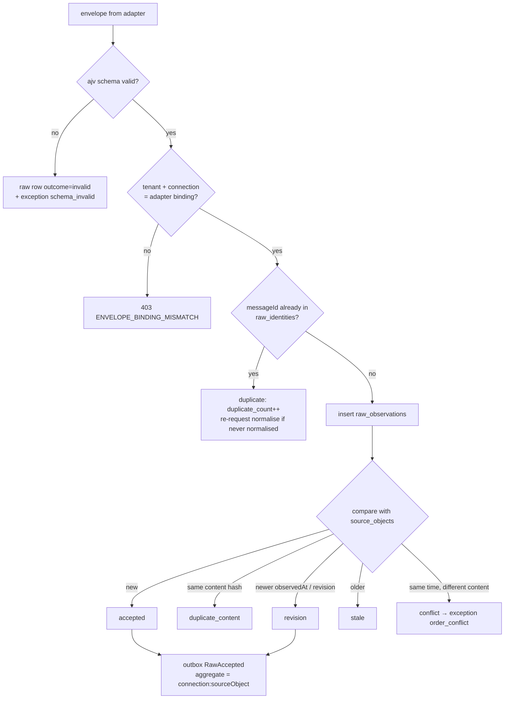
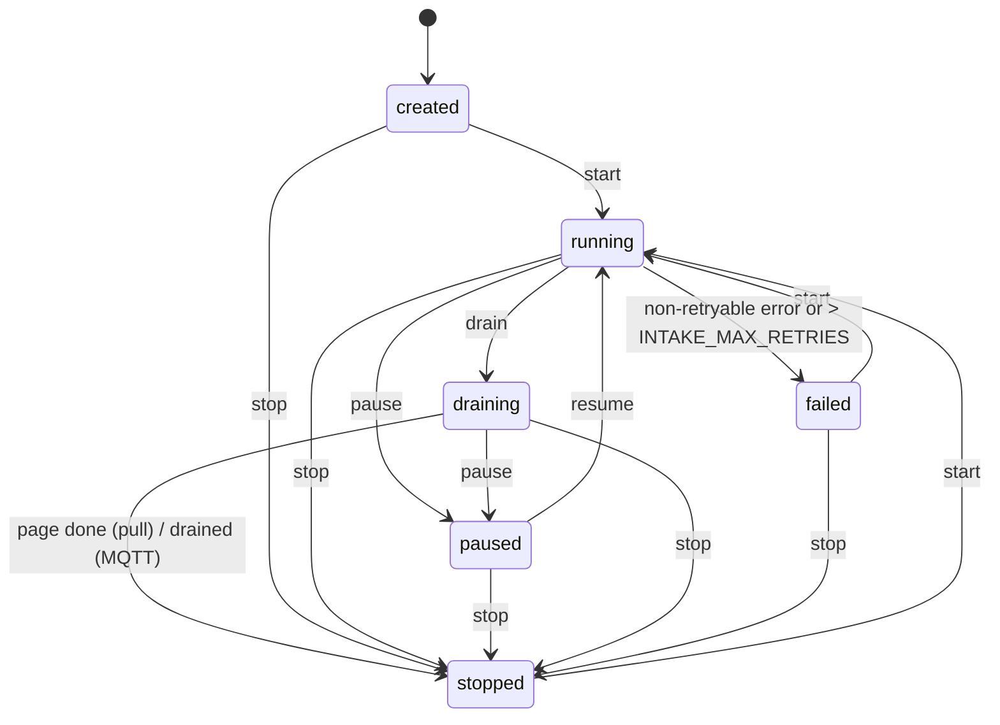
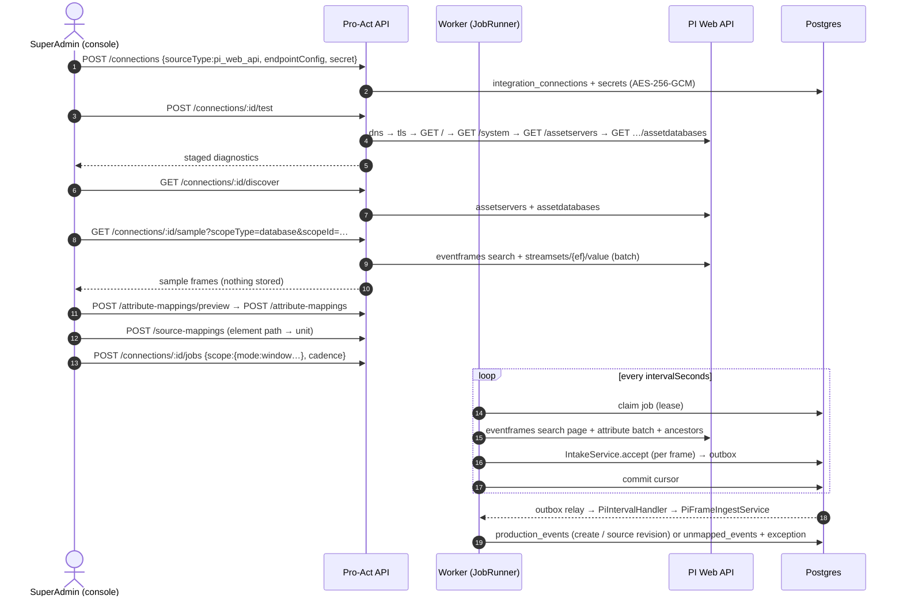
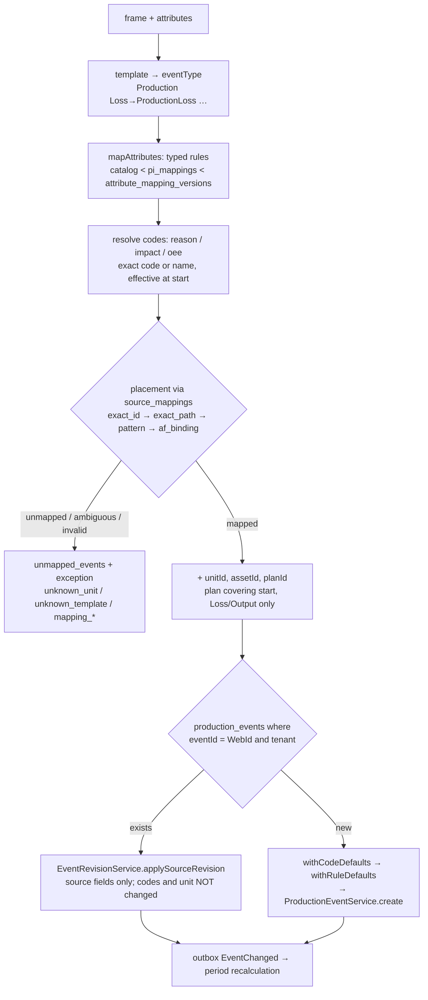
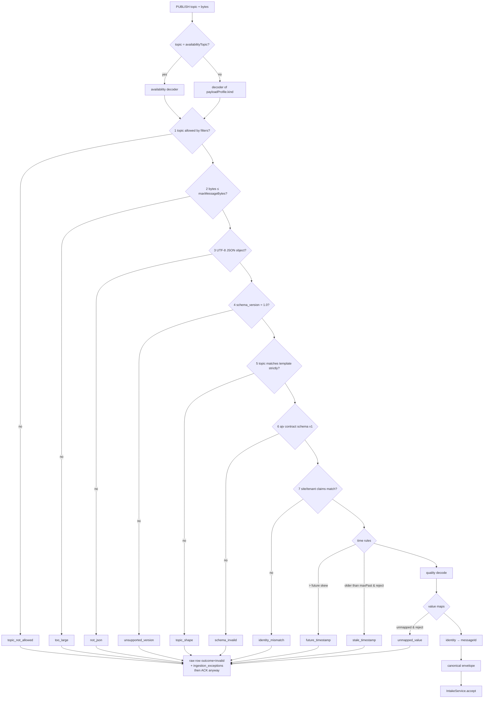
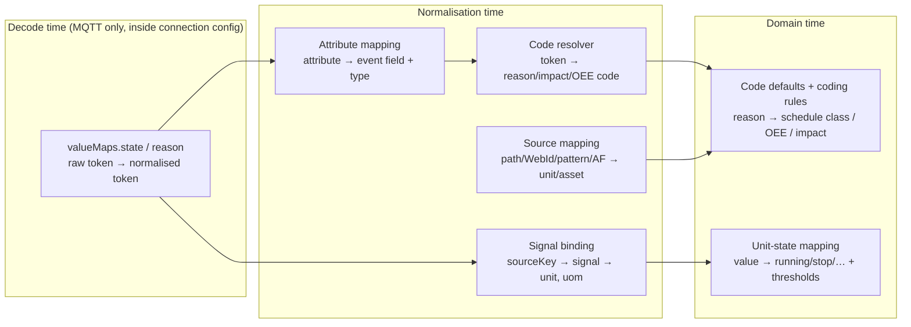
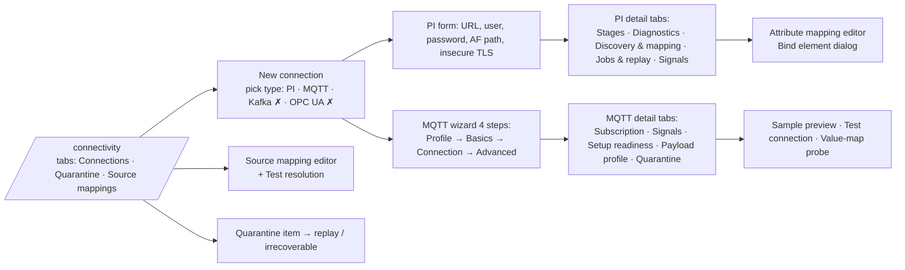
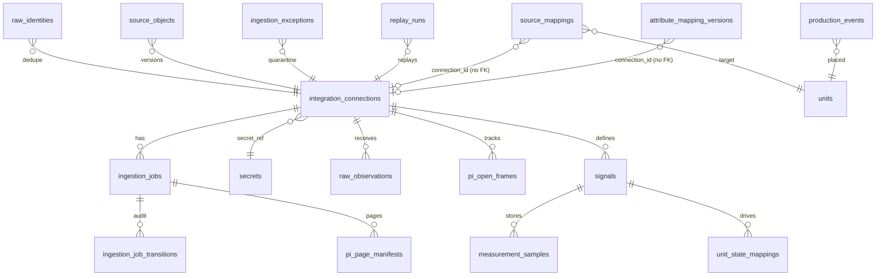

# Pro-Act Integration: End-to-End Analysis (PI Web API and MQTT)

Status: code-verified analysis, 19 Oct 2026, branch `feat/downtime-area2-b`.
Where this document and other docs disagree, the code was checked and this document follows the code (see §13).

Paths:
- Backend paths are relative to `server/pro-act-backend/src/`.
- Frontend paths start with `src/` (repo root).
- All REST routes are under `/api/v2`.

---

## Contents

1. [Big picture](#1-big-picture)
2. [Core concepts](#2-core-concepts)
3. [Shared intake core (connector-neutral)](#3-shared-intake-core-connector-neutral)
4. [PI Web API: end to end](#4-pi-web-api-end-to-end)
5. [MQTT: end to end](#5-mqtt-end-to-end)
6. [Mapping layers: all of them in one place](#6-mapping-layers-all-of-them-in-one-place)
7. [Downstream: from mapped record to domain data](#7-downstream-from-mapped-record-to-domain-data)
8. [Integration console (UI) journey](#8-integration-console-ui-journey)
9. [REST API reference](#9-rest-api-reference)
10. [Data model](#10-data-model)
11. [Security, roles, configuration](#11-security-roles-configuration)
12. [Use cases and runbooks](#12-use-cases-and-runbooks)
13. [Docs vs code discrepancies](#13-docs-vs-code-discrepancies)
14. [Gaps and risks (prioritised)](#14-gaps-and-risks-prioritised)
15. [Open questions for the integration stage](#15-open-questions-for-the-integration-stage)

---

## 1. Big picture

Pro-Act has **two working connectors**: **PI Web API** (pull) and **MQTT** (push/subscribe).
- Both feed one **source-neutral intake pipeline**.
- Kafka, OPC UA and the import types exist only as enum values. They have no adapter: the UI shows them disabled, and the API answers 422 `ADAPTER_UNAVAILABLE`.

```mermaid
flowchart LR
  subgraph Plant["Plant / OT side"]
    PI[(AVEVA PI Server + AF)]
    PIWEB[PI Web API]
    GW[PI→MQTT gateway<br/>owned by data engineering]
    BROKER[(MQTT broker)]
    PI --> PIWEB
    PI --> GW --> BROKER
  end

  subgraph Worker["Pro-Act worker process (PROCESS_ROLE=worker|all)"]
    RUNNER[JobRunner<br/>cron 5 s, leased pull jobs]
    PIA[PiWebApiAdapter.read]
    HOST[MqttSubscriberHost<br/>reconcile 10 s, heartbeat 20 s]
    DEC[decodeMqttMessage<br/>profiles + value maps]
    RUNNER --> PIA
    HOST --> DEC
  end

  PIWEB -- HTTPS GET/POST batch --> PIA
  BROKER -- SUBSCRIBE QoS1, ack after persist --> HOST

  subgraph Intake["Intake core (one DB transaction per record)"]
    ACC[IntakeService.accept<br/>dedupe · raw row · ordering]
    Q[(ingestion_exceptions<br/>quarantine)]
    OUT[(outbox RawAccepted)]
    ACC --> OUT
    ACC -.order_conflict / schema_invalid.-> Q
  end

  PIA -- canonical envelopes --> ACC
  DEC -- canonical envelope --> ACC
  DEC -. decode failure .-> Q

  subgraph Norm["Normalisation (outbox relay)"]
    NS[NormalizationService<br/>first supports wins]
    H1[PiIntervalHandler]
    H2[MqttIntervalEventHandler]
    H3[MqttStateHandler]
    H4[MeasurementHandler]
    H5[RetractionHandler]
    NS --> H1 & H2 & H3 & H4 & H5
  end
  OUT --> NS

  subgraph Domain["Domain data"]
    PE[(production_events)]
    MS[(measurement_samples<br/>signal_summaries)]
    SE[StateEngineJob 1 min<br/>DerivedStopEngine]
    UE[(unmapped_events)]
  end
  H1 & H2 --> PE
  H1 & H2 -.unplaceable.-> UE
  H3 --> H4 --> MS --> SE --> PE
  H5 --> PE
```



### The two code generations
- **v1 (legacy).** The tables `pi_connections`, `pi_mappings`, `pi_events`, `pi_sync_jobs`, `pi_sync_watermarks` and `pi_af_elements` still exist.
  - Their controllers and services were deleted in commit `9853bd7d`.
  - What is left: the entities, `PISyncSchedulerService` (which bridges old v1 job rows into v2 jobs), and `pi_mappings.mapping_rules` (still read as a legacy attribute-rule layer).
- **v2 (current, "certified" path).** `integration_connections` → `ingestion_jobs` → adapter → `IntakeService` → outbox → normalisation handlers. **Every** PI and MQTT route today is a v2 route. There is no `/pi/*` route left.

---

## 2. Core concepts

| Concept | What it is | Where |
|---|---|---|
| **Connection** | One configured source (a PI Web API endpoint or an MQTT broker feed). Config is in `endpoint_config` (jsonb); the password is in `secrets`. | `integration_connections` |
| **Adapter** | Per-source-type plugin implementing `SourceAdapter`: `capabilities`, `validateConfig`, `test`, `discover`, `read`, `health`, plus optional `sample`, `validateScope`, `validateAmongPeers`. | `intake/adapters/adapter.interface.ts:103-118` |
| **Ingestion job** | A unit of work on a connection. PI: a pull job with a `scope` and a `cadence`. MQTT: one `subscribe` job per connection. | `ingestion_jobs` |
| **Canonical envelope** | The source-neutral record every adapter emits. Kinds: `interval_event`, `measurement`, `state`, `output_event`, `retraction`. | `intake/envelope/canonical-envelope.ts` |
| **Delivery identity** (`messageId`) | Dedupe key for "same delivery seen again". | `raw_identities` |
| **Source object** (`sourceObjectId`) | The logical thing being versioned, for example one PI event frame or one MQTT event_id. | `source_objects` |
| **Raw observation** | Immutable copy of every accepted or rejected delivery. Partitioned monthly. | `raw_observations` |
| **Quarantine** | Open exception per (connection, object, error code). An operator resolves it by replay or by marking it irrecoverable. | `ingestion_exceptions` |
| **Normalisation** | Turns accepted raw records into domain rows. Runs once per outbox message. | `intake/normalization/*` |
| **Mapping** | Several distinct layers (§6): source → unit/asset placement, attribute → event field, signal binding, value maps, unit-state rules, code resolution, code defaults. | various |

---

## 3. Shared intake core (connector-neutral)

### 3.1 Accept (`intake/intake.service.ts:67-329`), one DB transaction per record



- **Ordering** (`source-object-ordering.ts:33-55`): `observedAt` is compared first, then a numeric `sourceRevision`.
- **Per-object order downstream** is kept because the outbox aggregate id is `connectionId:sourceObjectId`.

### 3.2 Normalisation (`intake/normalization/normalization.service.ts:115-261`)
- **Exactly once:** inbox key `normalize:<outboxId>`.
- **Snapshot kinds** (measurement, state, output): an older revision is skipped as `superseded`.
- **Handler choice:** the first `supports()` wins. Registered handlers:

| Handler | Supports |
|---|---|
| `PiIntervalHandler` | `pi_web_api` + `interval_event`, not retract |
| `MqttIntervalEventHandler` | `mqtt` + `interval_event`, not retract |
| `MqttStateHandler` | `mqtt` + `state` |
| `MeasurementHandler` | `measurement` (PI and MQTT) |
| `RetractionHandler` | `retract` operations |
| (none) | `output_event`: quarantined as `no_handler` |

- **Failures:** no handler gives `no_handler`; a handler exception gives `processing_failed`. Both are quarantined.
- **Applied but flagged:** a record can be applied and still leave an open exception, for example an event created uncoded with `unknown_code`.

### 3.3 Jobs (`intake/jobs/*`)



- **Uniqueness:** at most one non-stopped job per `(connection, scope_hash)`, enforced by a partial unique index.
- **Pull runner** (`job-runner.service.ts`, cron every 5 s, up to 10 pages per tick):
  1. Claims a job with `FOR UPDATE SKIP LOCKED` and a lease of `INTAKE_LEASE_SECONDS` (60).
  2. Reads with a timeout of `INTAKE_READ_TIMEOUT_MS` (120 s).
  3. Accepts records one by one, with a heartbeat every 50.
  4. **Only then commits the cursor.** The cursor never moves on failure.
- **Retry:** backoff `5 s × 2^n`, capped at 900 s, up to `INTAKE_MAX_RETRIES` (10). A non-retryable `AdapterError` (auth, TLS, egress, rejected scope) fails the job at once.
- **Subscribe jobs (MQTT):** `next_run_at` is NULL, so the pull runner never picks them up. The MQTT subscriber host owns them.
- **Audit:** every transition is written to `ingestion_job_transitions` and announced as outbox `IngestionJobChanged`.

### 3.4 Replay (`intake/replay/*`)
- `POST /connections/:id/replays` creates a `replay_runs` row and returns 202.
- A worker claims the run under a lease and pages through `source_objects` (keyset, 200 per page).
- For each object it **re-accepts the latest raw envelope** with `replayRunId` and normalises it inline.
- `dryRun` **only counts** objects; it does not show results.
- ⚠ Replay re-runs **normalisation**: placement, attribute mapping, code resolution and signal binding. It does **not** re-run MQTT **decode**, so fixes to value maps or the payload profile never apply to old data. Decode-rejected messages have no `source_object`, so replaying them does nothing (§14).

### 3.5 Quarantine error codes (`entities/ingestion-exception.entity.ts:4-27`)

| Group | Codes |
|---|---|
| Envelope / intake | `schema_invalid`, `order_conflict`, `no_handler`, `processing_failed` |
| MQTT decode | `topic_not_allowed`, `too_large`, `not_json`, `unsupported_version`, `topic_shape`, `identity_mismatch`, `future_timestamp`, `stale_timestamp`, `unmapped_value` |
| Placement (events) | `unknown_unit` (PI), `unknown_template` (MQTT), `mapping_ambiguous`, `mapping_invalid_target` |
| Measurement | `unknown_signal`, `unit_conflict` |
| Codes | `unknown_code` |

- There is one open row per (tenant, connection, sourceObjectId, errorCode). A repeat increments `occurrences`.
- Resolve with `POST /ingestion-exceptions/:id/resolve` and `{action: 'replay' | 'irrecoverable', reason}`.

---

## 4. PI Web API: end to end

### 4.1 Lifecycle overview



### 4.2 Step 1: create the connection

**Payload** (from the console form `src/features/integration-console/connections/pi-connection-fields.tsx`):
```json
POST /api/v2/connections          Idempotency-Key: <uuid>
{
  "sourceType": "pi_web_api",
  "displayName": "Marun PI (prod)",
  "endpointConfig": {
    "piWebApiUrl": "https://pi.marun.local/piwebapi",
    "username": "svc_proact",
    "afDatabasePath": "\\\\PIAF01\\HDPE",
    "allowInsecureTls": false
  },
  "secret": "<password>",
  "isActive": true
}
```

| Field | Rule |
|---|---|
| `piWebApiUrl` | `^https?://\S+$`. Normalised to `<origin>/piwebapi`: query, hash and userinfo are stripped, and `/piwebapi` is appended if missing (`pi-proxy/pi-proxy-policy.ts:29-46`). |
| `username` | Used for HTTP **Basic** auth. If empty, requests are anonymous. |
| `secret` | Write-only. AES-256-GCM in `secrets` (`kind='pi_password'`). Never returned; views show only `hasSecret`. |
| `allowInsecureTls` | Boolean. Turns off certificate verification; a warning is logged on every client build. |
| `afDatabasePath` | Informational / default scope. |
| any key matching `/pass\|secret\|token\|api_key\|credential/i` | 422 `SECRET_IN_CONFIG`. **Top level only** (§14). |

- Auth is **Basic only** today. There is no Kerberos, NTLM, Bearer or custom CA bundle (the open question is in DECISIONS D02).
- Egress is restricted by `CONNECTOR_EGRESS_ALLOWLIST`. An empty list means unrestricted.

### 4.3 Step 2: test connection (`integration/pi/pi-diagnostics.ts`)

The steps run in order with a 10 s timeout each. After the first failure the remaining steps are `skipped`.

| # | Stage | Call | Failure meaning |
|---|---|---|---|
| 1 | `dns` | `dns.lookup(host)` | Host unknown |
| 2 | `tls` | raw `tls.connect` with SNI | Certificate or chain problem (`not_applicable` for http) |
| 3 | `auth` | `GET /piwebapi/` | 401: bad credentials |
| 4 | `version` | `GET /piwebapi/system` → `ProductVersion` | Not a PI Web API |
| 5 | `authz` | `GET /piwebapi/assetservers` | 403: account lacks AF rights |
| 6 | `read` | `GET /assetservers/{webId}/assetdatabases` | Cannot read AF databases |
| + | batch probe | `POST /piwebapi/batch {}` | 404/405/501 means no batch support |

- The result is `{connected, message, diagnostics, capabilities}`.
- ⚠ The detected `batch` capability is returned but **not persisted**.

### 4.4 Step 3: discovery and sample
- **`GET /connections/:id/discover`** returns `{metadata:{assetServers:[{name, webId, databases:[{name, webId}]}]}}`. It does **not** browse elements, attributes or templates.
- **`GET /connections/:id/sample?scopeType=database|element&scopeId=<WebId>&templateName=&from=&to=&limit≤50`** (range at most 31 days):
  - runs one frame search page and reads the attributes;
  - returns `{records:[{sourceObjectId, name, templateName, startTime, endTime, element:{webId,path}, attributes}], templates, truncated}`;
  - stores nothing. It is an audited read.

### 4.5 Step 4: mapping (two independent layers)
1. **Attribute mapping** (event-frame attribute → event field, per template). See §6.2.
2. **Source mapping** (AF element → Pro-Act unit or asset). See §6.1.

Both have preview endpoints. Without a source mapping, frames are quarantined as `unknown_unit` and recorded in `unmapped_events`.

### 4.6 Step 5: jobs and read modes

`POST /connections/:id/jobs`:
```json
{
  "scope": { "mode": "window", "scopeType": "database", "scopeId": "D0hd…",
             "templateName": "Production Loss", "lookbackMinutes": 60, "overlapMinutes": 15 },
  "cadence": { "intervalSeconds": 60, "pageSize": 500 },
  "start": true
}
```

| Mode | Purpose | PI calls | Cursor / behaviour |
|---|---|---|---|
| `window` (default) | Incremental event-frame sync | `GET /assetdatabases/{w}/eventframes` or `/elements/{w}/eventframes` `?startTime&endTime&searchMode=Overlapped&sortField=StartTime&sortOrder=Ascending&startIndex&maxCount[&templateName]` | Window `[checkpoint − overlap, now)`. A full page moves `startIndex` and runs again at once; a short page closes the window. Each page is recorded in `pi_page_manifests`. |
| `open_frames` | Re-poll frames that are still open (EndTime ≥ 9999 or missing) | `GET /eventframes/{webId}` (batched) | Uses the `pi_open_frames` tracker; a frame is forgotten once closed |
| `rescan` | Correction scan | Same as window | Always re-reads the full `[now − rescanDays, now)` |
| `inventory` | Detect deleted frames | WebId-only listing over `inventoryDays`, then a `GET` of each missing frame | A 404 means deleted, which emits a **retract** envelope (`<webId>:deleted`) |
| `recorded` / `backfill` | Signal samples | `GET /streamsets/recorded?webId=…&startTime&endTime&boundaryType=Inside&maxCount` | Per-signal progress checkpoints |
| `summary` | Totals per interval | `GET /streams/{w}/summary?summaryType=Total&calculationBasis=TimeWeighted&summaryDuration=Nm` | Rate signals only; `totalTimebase` required |
| `updates` | Near-real-time signals | `POST /streams/{w}/updates` → `GET /streams/updates/{marker}` | A lost marker means re-register plus a recorded backfill |

The UI offers three presets:

| Preset | Interval | Page size |
|---|---|---|
| limited | 60 s | 50 |
| backfill | 300 s | 500, then auto-drain |
| production | 60 s | 500 |

The legacy v1 scheduler (`pi-sync-job/pi-sync-scheduler.service.ts`, every minute) turns each old `pi_sync_jobs` row into **five** v2 jobs:

| Job | Interval |
|---|---|
| window | v1 interval |
| open_frames | 60 s |
| rescan 7 days | daily |
| rescan 90 days | weekly |
| inventory 7 days | daily |

### 4.7 HTTP client behaviour (`integration/pi/pi-http-client.ts`, `pi-batch.ts`)
- **Requests:** `Accept: application/json`, `maxRedirects: 0`, timeout `PI_HTTP_TIMEOUT_MS` (30 s), response cap `PI_HTTP_MAX_RESPONSE_BYTES` (64 MiB).
- **Retries:** up to `PI_HTTP_MAX_ATTEMPTS` (3) with full-jitter backoff `random × min(10 s, base × 2^n)`. `Retry-After` is honoured, capped at 60 s.
- **Batch:** `POST /piwebapi/batch` in chunks of 250, with the body `{"0":{"Method":"GET","Resource":"<abs url>"}}`. If PI answers 404/405/501, it falls back to single GETs and stores `capabilities.batch=false`.

| HTTP / error | Code | Retryable | Job health |
|---|---|---|---|
| 401 | `PI_AUTH_FAILED` | no | `auth_failed` |
| 403 | `PI_FORBIDDEN` | no | `authz_failed` |
| 404 | `PI_NOT_FOUND` | no | `not_found` |
| 405 / 501 | `PI_UNSUPPORTED` | no | `unsupported` |
| 408 / 429 / 5xx | `PI_UNAVAILABLE` | **yes** | `source_unavailable` |
| other 4xx | `PI_REQUEST_REJECTED` | no | `request_rejected` |
| network | `PI_UNREACHABLE` | **yes** | `unreachable` |
| TLS | `PI_TLS_FAILED` | no | `tls_failed` |
| too large | `PI_RESPONSE_TOO_LARGE` | no | `response_too_large` |
| allowlist | `PI_EGRESS_DENIED` | no | `egress_denied` |

### 4.8 Frame → envelope (`integration/pi-envelope.ts`)

| Envelope field | Value |
|---|---|
| `messageId` | `<WebId>:<payloadHash>` |
| `sourceObjectId` | `WebId` |
| `kind` / `operation` | `interval_event` / `observe` |
| `observedAt` | Read time (so any content change counts as a new revision) |
| `startTime` / `endTime` | Frame times; an end at or after `9999-01-01`, missing, or unparsable becomes `null` (open) |
| `location.sourcePath` | Primary element path, else frame path, else WebId |
| `location.sourceElementIds` | [primary, …referenced elements, …ancestors (closest first)] |
| `values` | `{templateName}` |
| `provenance.rawPayload` | `{frame, attributes}` |
| `sourceControls.pi` | `{webId, rawEndTime}` |

Ancestors are resolved by `pi-element-ancestors.ts`:
- `GET elements/{w}?selectedFields=WebId;Path`, then `GET elements?path=<ancestor>` for each level.
- Cached per connection for `PI_ELEMENT_CACHE_TTL_MS` (10 min).

### 4.9 Ingest pipeline (`integration/pi-frame-ingest.service.ts`), used by PI **and** MQTT interval events



**Template → event type** (`attribute-mapping/event-field-catalog.ts`)

| PI template | Event type |
|---|---|
| Production Loss | `ProductionLoss` |
| IOW Deviation | `IOW` |
| SOL Violation | `SOL` |
| APM Alert | `APM` |
| Failure WO | `FailureWO` |
| Production Output | `ProductionOutput` |
| `*NoTemplate*` / unknown | `ProductionLoss` |

**Default attribute rules, Production Loss**

| PI attribute | Event field | Type | Notes |
|---|---|---|---|
| Description | description | string | Falls back to the frame Name, then "Event from PI" |
| ReasonCode | reason | digital | Source fact → `reasonCodeId` |
| OEECode | oeeCode | digital | Fact → `oeeCodeId` |
| ImpactCode | impactCode | digital | Fact → `impactCodeId` |
| Quantity | quantity | number | `UnitsAbbreviation` → `quantityUom` |
| Cost | cost | number | |
| Shift | shift | string | |
| Crew | crew | string | |
| Duration | suppliedDurationSeconds | duration (minutes) | Checked against the timestamps; `DURATION_MISMATCH` if more than 1 s off (the timestamps win) |
| LossCategory | lossCategory | string | |
| OperatorName | operatorName | string | |

Production Output maps `GoodQty` (alias `Quantity`) to `quantity`, and `ScrapQty` to `defectiveQuantity`.

### 4.10 Worked example: one PI Production Loss frame

**1. Frame search**
```http
GET /piwebapi/assetdatabases/D0hd…/eventframes?startTime=2026-10-19T07:45:00.000Z&endTime=2026-10-19T08:15:00.000Z
    &searchMode=Overlapped&sortField=StartTime&sortOrder=Ascending&startIndex=0&maxCount=500&templateName=Production%20Loss
```
```json
{"Items":[{"WebId":"F1FmEF01","Name":"EX100 trip 07:52","TemplateName":"Production Loss",
  "StartTime":"2026-10-19T07:52:10Z","EndTime":"2026-10-19T08:10:40Z",
  "Path":"\\\\PIAF01\\HDPE\\EventFrames[EX100 trip 07:52]",
  "PrimaryReferencedElementWebId":"F1EmEX100"}]}
```

**2. Attributes (batch)**
```json
POST /piwebapi/batch
{"0":{"Method":"GET","Resource":"https://pi/piwebapi/streamsets/F1FmEF01/value?selectedFields=Items.Name;Items.Value.Value;Items.Value.UnitsAbbreviation"}}
```
```json
{"0":{"Status":200,"Content":{"Items":[
  {"Name":"ReasonCode","Value":{"Value":{"Name":"MECH-GBX","Value":12,"IsSystem":false}}},
  {"Name":"Quantity","Value":{"Value":4.6,"UnitsAbbreviation":"t"}},
  {"Name":"Duration","Value":{"Value":18.5,"UnitsAbbreviation":"min"}},
  {"Name":"Shift","Value":{"Value":"B"}}]}}}
```

**3. Ancestors**
- `GET elements/F1EmEX100?selectedFields=WebId;Path` returns `\\PIAF01\HDPE\Plant\Line1\EX100`.
- Then one lookup each for `…\Line1` and `…\Plant`.

**4. Placement.** The rule `exact_path = \\PIAF01\HDPE\Plant\Line1\EX100` maps to unit `U100`. It is matched after normalisation (`/` separators, lower case).

**5. Result: a `production_events` row**

| Column | Value |
|---|---|
| eventId | `F1FmEF01` |
| eventType | `ProductionLoss` |
| source | `PI` |
| startTime / endTime | `07:52:10Z` / `08:10:40Z` |
| description | `EX100 trip 07:52` (frame Name) |
| quantity / quantityUom | 4.6 / `t` |
| shift | `B` |
| reasonCodeId | uuid of the tenant code `MECH-GBX` |
| unitId | `U100` |
| planId | plan of U100 covering 07:52 |
| classification | Defaults of the reason code, then `coding_default` rules |
| facts | `reason {MECH-GBX, 12}`, `suppliedDurationSeconds 1110` (matches the timestamps) |

**Variations of this example**
- **Frame still open** (`EndTime: "9999-12-31T23:59:59Z"`): `endTime = null`, and the frame is tracked in `pi_open_frames`.
- **No placement rule:** no event is created. Instead there is an `unmapped_events` row and an exception `unknown_unit`.
- **Reason token not in the code library:** the event is created **uncoded**, with an exception `unknown_code`.
- **Frame deleted in PI:** the inventory job gets a 404 and sends a retract. The event is tombstoned.

### 4.11 PI signals (measurements)
- A signal is defined with `POST /signals {connectionId, name, sourceKey=<stream WebId>, unitId, semanticType, canonicalUom, …}`.
- Example reply from `recorded`: `{"Items":[{"WebId":"F1AbRATE","Items":[{"Timestamp":"2026-10-19T08:00:00Z","Value":12.4,"UnitsAbbreviation":"t/h","Good":true}]}]}`.
- The envelope gets `sourceObjectId = F1AbRATE@2026-10-19T08:00:00.000Z` and `values.sample {signalRef: F1AbRATE, value, unit}`.
- `MeasurementHandler` binds it to the signal version whose `source_key = WebId`, effective at the sample time, and writes `measurement_samples` (or `signal_summaries` for Totals).

**Quality mapping**

| PI value | Quality |
|---|---|
| system digital `No Data` | `missing` |
| `Good:false` or any system digital (Shutdown, I/O Timeout…) | `bad` |
| `Questionable` / `Substituted` | `uncertain` |
| otherwise | `good` |

**Unit check:** if the sample's unit differs from `canonicalUom`, the sample is quarantined as `unit_conflict`. There is no automatic conversion.

---

## 5. MQTT: end to end

**Ownership:** the MQTT feed (PI → MQTT gateway) is owned by the data engineering team. Pro-Act only **subscribes** to it.

### 5.1 Lifecycle overview

```mermaid
sequenceDiagram
  autonumber
  actor SA as SuperAdmin (console)
  participant API as Pro-Act API
  participant H as Worker: MqttSubscriberHost
  participant B as MQTT broker
  participant DB as Postgres

  SA->>API: POST /connections {sourceType:mqtt, endpointConfig:{mqtt, payloadProfile}, secret}
  API->>API: validateMqttConfig + duplicate-feed peer check
  API->>DB: integration_connections + secrets; outbox ConnectionChanged
  DB-->>H: ConnectionChanged → immediate reconcile (else every 10 s)
  H->>DB: ensure subscribe job (state running, next_run_at NULL)
  H->>DB: claim lease (FOR UPDATE SKIP LOCKED, 60 s)
  H->>B: CONNECT (clientId proact-<id>, clean=false, sessionExpiry 86400)
  B-->>H: CONNACK
  H->>B: SUBSCRIBE topics @QoS + availabilityTopic @QoS1
  loop each PUBLISH
    B->>H: PUBLISH (QoS 1)
    H->>H: decode (frame → profile → schema → time → quality → identity)
    H->>DB: IntakeService.accept  OR  quarantine (one tx, timeout 0.5×keepalive)
    H-->>B: PUBACK only after the commit
  end
  loop every 20 s
    H->>DB: heartbeat: extend lease, merge health, last_observation_at
  end
  SA->>API: POST /connections/:id/test (CONNACK-only probe, throwaway client)
  SA->>API: POST /connections/:id/mqtt-preview (decode a sample, no writes)
```

### 5.2 Connection configuration (`endpointConfig.mqtt`, `intake/adapters/mqtt/mqtt-config.ts`)

| Field | Rule | Default |
|---|---|---|
| `brokerUrl` | `mqtt://host[:port]` or `mqtts://host[:port]`; no path, query or credentials; port 1–65535. Normalised with the default port 1883 / 8883. | required |
| `protocolVersion` | `5` or `4` (3.1.1) | 5 |
| `clientId` | `^[A-Za-z0-9_-]{1,64}$`. Blank means `proact-<connectionId>`. | blank |
| `username` | at most 256 characters | – |
| `qos` | 0 / 1 / 2 | 1 |
| `cleanStart` | boolean | false |
| `sessionExpirySeconds` | 0–4294967295 (MQTT 5 only) | 86400 |
| `keepaliveSeconds` | 1–65535 | 60 |
| `connectTimeoutSeconds` | 1–300 | 30 |
| `reconnect` | `{minSeconds, maxSeconds}`, 1 ≤ min ≤ max ≤ 3600 | {1, 60} |
| `tls` | `{mode: system\|caPem\|caRef\|insecure, caPem?, caRef?, servername?}`. Any mode other than `system` needs `mqtts://`. PEM must contain `BEGIN CERTIFICATE` and no `PRIVATE KEY`. `caRef` = `secrets:<uuid>`. | `{mode:'system'}` |
| `topics` | 1–64 valid topic filters, no duplicates | required |
| `availabilityTopic` | One filter (gateway LWT / birth) | – |
| `maxMessageBytes` | 1–1048576 | 65536 |

- Unknown keys anywhere give 422 `unknown setting`.
- A password stored with no username gives `PASSWORD_WITHOUT_USERNAME`.
- **Secret re-entry rule** (`connection-change.ts:78-127`): changing `brokerUrl`, `username`, `tls`, `protocolVersion`, `clientId` or `cleanStart` requires the password to be sent again (422 `SECRET_REQUIRED`). Topic, QoS, timing and profile changes do not.
- **Duplicate-feed guard:** two active MQTT connections in a tenant with overlapping topic filters are refused (422 `DUPLICATE_FEED`). At runtime the newer connection is parked (`parkedReason='duplicate_feed'`).

### 5.3 Payload profile (`endpointConfig.payloadProfile`)

| Field | Values / default |
|---|---|
| `kind` | `interval_event_json` · `measurement_json` · `state_json` · `availability` |
| `topicTemplate` | Levels are literals or `{capture}`. Must capture `{unit}` or `{machine}` (except availability). Measurement also needs `{attribute}`. |
| `identityStrategy` | `seq_boot` → `<equipment>:<boot_id>:<seq>` · `event_id` → `<event_id>:<revision>` · `payload_hash` → `<sha256>:<observedAt>` |
| `schemaVersion` | `1.0` (the only supported version) |
| `time` | `{unit: iso\|ms\|s\|auto (default iso), maxFutureSkewSeconds 300, maxPastSeconds 604800, onStale: reject\|flag}`. `onStale` default: events reject; others flag. |
| `quality.protocol` | `PI` (default) · `STRING_ENUM` · `OPC_DA` · `OPC_UA` · `SPARKPLUG` · `NONE` (always for availability) |
| `fields` | Dotted-path overrides. ⚠ Effectively unusable, see §14. |
| `valueMaps` | `{state:{RUN:'running', STOP:'stopped'}, reason:{token: codeKey}}` |
| `reasonUnmapped` | `reject` (→ `unmapped_value`) or `keep` |
| `tenancy` | `{expectedSite?, expectedTenantClaim?}`, checked against the `{site}` / `{tenant}` captures |

Console presets (contract v1):

| Kind | Topic template | Identity |
|---|---|---|
| events | `proact/v1/{site}/{area}/{line}/{unit}/events` | `event_id` |
| measurements | `proact/v1/{site}/{area}/{line}/{unit}/measurements/{attribute}` | `seq_boot` |
| state | `proact/v1/{site}/{area}/{line}/{unit}/state` | `seq_boot` |
| availability | `proact/v1/{site}/gateway/availability` | `seq_boot` |

**Full create payload**
```json
POST /api/v2/connections
{
  "sourceType": "mqtt",
  "displayName": "HDPE gateway – events",
  "endpointConfig": {
    "mqtt": {
      "brokerUrl": "mqtts://broker.plant.local:8883",
      "protocolVersion": 5, "qos": 1, "cleanStart": false,
      "sessionExpirySeconds": 86400, "keepaliveSeconds": 60, "connectTimeoutSeconds": 30,
      "reconnect": { "minSeconds": 1, "maxSeconds": 60 },
      "tls": { "mode": "caPem", "caPem": "-----BEGIN CERTIFICATE-----\n…", "servername": "broker.plant.local" },
      "username": "proact",
      "topics": ["proact/v1/HDPE/+/+/+/events"],
      "availabilityTopic": "proact/v1/HDPE/gateway/availability",
      "maxMessageBytes": 65536
    },
    "payloadProfile": {
      "kind": "interval_event_json",
      "topicTemplate": "proact/v1/{site}/{area}/{line}/{unit}/events",
      "identityStrategy": "event_id",
      "schemaVersion": "1.0",
      "time": { "unit": "iso", "maxFutureSkewSeconds": 300, "maxPastSeconds": 604800, "onStale": "reject" },
      "quality": { "protocol": "PI" },
      "valueMaps": { "reason": { "Mechanical": "MECH-01" } },
      "reasonUnmapped": "keep"
    }
  },
  "secret": "<broker password>",
  "isActive": true
}
```

### 5.4 Test connection (`mqtt-probe.ts`, `mqtt-connack.ts`)
- **What it does:** one CONNECT with the throwaway client id `test-<epochms>` and `clean:true`. It waits for CONNACK, then disconnects. It **subscribes to nothing**.
- **Diagnostics returned:**
  - always: `broker`, `protocolVersion`, `clientId`, `username`, `tlsMode`, `elapsedMs`;
  - on success: `connect:'ok'`, `sessionPresent`, `serverKeepAlive`, `receiveMaximum`, `maximumPacketSize`;
  - on failure: `reasonCode`, `reasonName`, `errorCode`, `retryable`.

**Error classification**

| Class | Examples | Retryable |
|---|---|---|
| `refused` (CONNACK code) | NotAuthorized, BadUserNameOrPassword, Banned, ClientIdentifierNotValid | **no** for these, otherwise yes |
| `tls` | CERT_HAS_EXPIRED, DEPTH_ZERO_SELF_SIGNED_CERT, ERR_TLS_CERT_ALTNAME_INVALID | no (hint: set `servername` / provide a CA) |
| `unreachable` | ECONNREFUSED, ENOTFOUND, ETIMEDOUT, ECONNRESET | yes |
| `timeout` | no CONNACK within `connectTimeoutSeconds+1` | yes |

### 5.5 Subscriber host (`host/*`)
- **Where it runs:** only in the worker (`PROCESS_ROLE=worker|all`).
- **When it reconciles:** every 10 s (`MQTT_RECONCILE_INTERVAL_MS`), and immediately on `ConnectionChanged` or `IngestionJobChanged`.
- **Lease:** one owner per connection across workers (`claimSubscription` with `SKIP LOCKED`, 60 s), heartbeat every 20 s. A lost lease aborts the client.

Job state → broker behaviour:

| Job state | Broker behaviour |
|---|---|
| running | Connected and subscribed |
| paused / created / failed | Clean DISCONNECT, session **kept**; the broker queues QoS 1 messages up to `sessionExpirySeconds` |
| draining | Unsubscribe, disconnect (keep), then `stopped` |
| stopped | Disconnect with `sessionExpiry=0`; the queue is **dropped** and messages are lost |
| duplicate-feed loser | Parked: disconnected, health written |

- **Config change:** a changed `config_version` gives a restart (keep session).
- **Reconnect:** `min(min·2^n, max)` × jitter in [0.5, 1.5). mqtt.js auto-reconnect is off.
- **Failure recovery:** a failed job is auto-restarted only if the config changed since the failure; otherwise an operator must `start` it.
- **Health JSON** in `ingestion_jobs.health`:
  - `connected`, `connectionError`, `reconnects`, `lastMessageAt`, `lastPersistAt`, `persistFailed`, `inflight`, `sessionPresent`, `effectiveClientId`, `configVersion`, `subscribedTopics`, `parkedReason`;
  - `counters {received, accepted, duplicate, stale, conflict, quarantined, parked}` (reset when the worker restarts);
  - `sourceAvailable`, `lastAvailabilityAt`, `sourcePiConnected`.

### 5.6 Message pipeline (decode), in order



- **Persist-before-ack.** The PUBACK is sent only after the DB commit (`MqttSession.handleMessage` override).
  - A DB error or timeout (0.5 × keepalive) leaves the message **unacknowledged** and aborts the session, so the broker redelivers it.
  - A poison message is quarantined *and* acknowledged, so it never blocks the session.

**Quality decoding**

| Protocol | Rule |
|---|---|
| PI (object) | `good:false` → bad; `questionable:true` → uncertain; `good:true` → good (⚠ `substituted` stays good) |
| STRING_ENUM | GOOD/OK → good; UNCERTAIN/QUESTIONABLE/SUBSTITUTED/STALE/UNKNOWN → uncertain; BAD/ERROR/FAILED → bad; MISSING/NO_DATA → missing |
| OPC_DA | bits 7–6 |
| OPC_UA | top 2 severity bits |
| SPARKPLUG | 192 good · 0 bad · 500 uncertain |
| NONE | always good |

### 5.7 The four payload contracts (v1, `contracts/mqtt-message-schemas.ts`, `additionalProperties:false`)

#### A. `interval_event_json`: downtime and loss events
Topic: `proact/v1/HDPE/Polymer/Line1/Extruder1/events`
```json
{
  "schema_version": "1.0",
  "event_id": "EF-1",
  "revision": "2026-10-11T06:09:30.000Z",
  "operation": "upsert",
  "template": "Production Loss",
  "element_path": "\\\\PIAF\\HDPE\\Polymer\\Line1\\Extruder1",
  "start_ts": "2026-10-11T05:40:00.000Z",
  "end_ts": null,
  "attributes": { "Reason Code": "MECH-01", "Quantity": 2, "Severity": "High" },
  "attribute_units": { "Quantity": "t" },
  "ts": "2026-10-11T06:09:30.100Z",
  "seq": 1844,
  "boot_id": "gw-01-2026-10-11T05:00:00Z",
  "source": "gw",
  "quality": { "good": true }
}
```

| Field | Required | Notes |
|---|---|---|
| schema_version, event_id (≤256), revision (string ≤64 or int ≥0), operation (`upsert`\|`delete`), ts, seq, boot_id | always | |
| template, element_path, start_ts | upsert | |
| end_ts | optional | null means open; must be after start and before year 9000 |
| attributes | optional | number / string ≤4096 / boolean / null / `{name, value}` |
| attribute_units | optional | strings ≤32 |

**Delete:** `{"schema_version":"1.0","event_id":"EF-1","revision":"2026-10-11T07:00:00Z","operation":"delete","ts":"…","seq":1850,"boot_id":"…"}` produces a retraction, and the event is tombstoned.

**Mapping of this payload:**
- `mqttFrameOf` turns it into a PI-shaped frame:

  | MQTT field | Frame field |
  |---|---|
  | `event_id` | `WebId` |
  | `template` | `TemplateName` |
  | `element_path` | `Path` / `PrimaryReferencedElement.Path` |

- It then goes through **the same `PiFrameIngestService`** (§4.9) with `sourceSystem='MQTT'`. So the attribute mapping, code resolution and source mapping (rules with `source_system='MQTT'`) all apply.
- **Placement:** use an `exact_path` rule on `element_path`. An `exact_id` rule would match the *event_id*.
- **Reason code:** the `"Reason Code"` attribute → optional `valueMaps.reason` → code resolver.

#### B. `measurement_json`: analog values and counters
Topic: `proact/v1/HDPE/Polymer/Line1/Extruder1/measurements/throughput`
```json
{ "schema_version": "1.0", "signal": "F1DP-throughput", "value": 12.5, "uom": "t/h",
  "ts": "2026-10-11T06:07:14.187Z", "quality": { "good": true }, "seq": 42,
  "boot_id": "gw-01-2026-10-11T05:00:00Z" }
```
- **Binding:** to the `signals` row with `source_key = payload.signal`. This is **not** the topic.
- **Placement:** the signal's `unit_id` decides it. The topic `{unit}` is not used.

#### C. `state_json`: machine state
Topic: `proact/v1/HDPE/Polymer/Line1/Extruder1/state`
```json
{ "schema_version": "1.0", "state": { "name": "RUN", "value": 1 }, "previous": { "name": "STOP", "value": 0 },
  "ts": "2026-10-11T06:07:14.187Z", "quality": { "good": true }, "seq": 7, "boot_id": "gw-01-…" }
```
- **Value map (first layer):** `valueMaps.state {RUN:'running', STOP:'stopped'}`. With a map present, an unmapped token gives `unmapped_value`.
- **Signal binding:** to a signal with `source_key = <the exact topic>` and `semantic_type='state'`. Otherwise `unknown_signal` or `mapping_invalid_target`.
- **Second layer:** `unit_state_mappings` (§6.5), which feeds the state engine and derives stops.

#### D. `availability`: gateway health (birth / last will)
Topic: `proact/v1/HDPE/gateway/availability`
```json
{ "schema_version": "1.0", "state": "OFFLINE", "ts": "2026-10-11T06:10:00Z",
  "boot_id": "gw-01-…", "source": "pi-mqtt-gw-01", "pi_connected": false }
```
- **Effect:** updates the subscribe job's `sourceAvailable` and `sourcePiConnected`, and sends `SourceHealthChanged`.
- It **never creates a stop**.

### 5.8 Sample preview (`POST /connections/:id/mqtt-preview`)
**Request:**
```json
{ "topic": "proact/v1/HDPE/Polymer/Line1/Extruder1/state", "payload": "{\"schema_version\":\"1.0\",…}",
  "receivedAt": "2026-10-11T06:07:15Z", "retained": false }
```
**Response:**
```json
{ "ok": true, "kind": "state", "observedAt": "2026-10-11T06:07:14.187Z",
  "quality": { "status": "good", "sourceFlags": [], "degraded": false },
  "values": { "state": { "stateRef": "proact/v1/…/state", "value": "running", "previousValue": "stopped", "sequence": 7 } },
  "sourceKey": "proact/v1/…/state", "availability": false,
  "binding": { "signalId": "…", "name": "EX1 run state", "unitId": "…", "semanticType": "state", "canonicalUom": null },
  "bindingStatus": "bound" }
```
- On failure: `{ok:false, code:"TOPIC_SHAPE", detail:"…"}`.
- `bindingStatus` is one of: `bound`, `unknown_signal_or_out_of_scope`, `state_signal_required`, `unit_conflict`, `event_mapping_required` (events: the source mapping is not checked), `source_health_only` (availability).
- Nothing is subscribed or written.

---

## 6. Mapping layers: all of them in one place

A value from the plant passes through up to **seven** mapping layers before it shows up in a KPI.



### 6.1 Source mapping: placement (`source_mappings`, `source-mapping/*`)
- **Rule fields:** `matchKind` (`exact_id` | `exact_path` | `pattern` | `af_binding`), `matchValue`, `connectionId` (null = any connection), `sourceSystem` (`PI` | `MQTT` | `*`, **API default `PI`**), `precedence` (−1000…1000), `targetType` (`unit` | `asset`), `targetId`, `effectiveFrom`/`effectiveTo`, `isActive`, `description`.
- **Resolution** (`mapping-resolver.ts`), first tier that matches wins:
  1. `exact_id`: PI primary element WebId (MQTT: the event_id)
  2. `exact_path`: separators normalised to `/`, case-insensitive
  3. `pattern`: glob with `*` and `?`; the highest precedence wins
  4. `af_binding`: element, then ancestors closest first (reads `af_bindings`, ⚠ which nothing writes)
- **Within a tier:** a connection-specific rule beats an "any connection" rule. Two different targets give `ambiguous`. A target from another tenant gives `invalid_target`.
- **Versioning:** edited **in place**; `version` is only an edit counter, with no history. There is no delete; deactivate the rule instead.
- **Test:** `POST /source-mappings/preview {connectionId?, samples:[{sourceId?, sourcePath?, afElementWebIds?}]}` returns, per sample, `mapped` / `ambiguous` / `invalid_target` / `unmapped`, the tier, and the candidates.

```json
POST /api/v2/source-mappings
{ "matchKind": "exact_path", "matchValue": "\\\\PIAF01\\HDPE\\Plant\\Line1\\EX100",
  "targetType": "unit", "targetId": "<U100 uuid>", "precedence": 0,
  "connectionId": "<pi conn uuid>", "sourceSystem": "PI", "isActive": true }
```

### 6.2 Attribute mapping (`attribute_mapping_versions`)
- **Precedence per field:** catalog defaults < legacy `pi_mappings.mapping_rules` < versioned overrides.
- **Versioning:** append-only, with the next version under an advisory lock. It takes effect immediately (or from `effectiveFrom`). There is no draft or approval step.
- **Rule shape:** `{sourceAttr, aliases?, targetField, type: string|number|boolean|digital|duration, unit? (duration: seconds|minutes|hours|timespan), required?}`.
- **Preview:** `POST /attribute-mappings/preview {templateName, connectionId, attributes, startTime, endTime?, fieldRules?}` returns the columns, facts and diagnostics.
- **Diagnostics:** `UNKNOWN_FIELD`, `REQUIRED_MISSING`, type mismatch, `DURATION_UNIT_MISSING`, `DURATION_UNPARSEABLE`, `QUANTITY_UNIT_INVALID`, `DURATION_MISMATCH`.

### 6.3 Signal binding (`signals`)
- **Fields:** `connectionId`, `name`, `sourceKey`, `sourcePath?`, `unitId`, `semanticType` (state | rate | level | counter | other…), `canonicalUom`, `rateTimebase`, `interpolation`, `maxGapSeconds`, `resetPolicy`, `rolloverModulus`, `expectedMin`/`expectedMax`, `cadenceSeconds`, `qualityPolicy {acceptUncertain}`, `isAuthority`, `effectiveFrom`.
- **Versioning:** effective-dated; defining the same `sourceKey` again creates the next version.

**What `sourceKey` means per source**

| Source | `sourceKey` |
|---|---|
| PI | stream WebId |
| MQTT measurement | payload `signal` |
| MQTT state | the exact topic |

### 6.4 Code resolution and code defaults
- **Resolver** (`master-data-code-resolver.service.ts`):
  - matches the exact code or name, case-insensitive, among the tenant's codes effective at the event start;
  - no fuzzy matching; cache TTL 60 s;
  - a miss leaves the event **uncoded** with an exception `unknown_code`.
- **Code mapping rules** (`code_mapping_rules`, append-only versions):
  - kinds `reason_to_schedule_class`, `reason_to_oee`, `reason_to_impact`, `impact_to_valuation`;
  - applied when an event is created (`withCodeDefaults`), followed by `coding_default` rules.

### 6.5 Unit-state mapping (`unit_state_mappings`)
- **Scope:** one open version per unit, bound to one state signal.
- **Rules:** `rules[{match, state}]`, with states `running`, `reduced_rate`, `internal_stop`, `planned_stop`, `starved`, `blocked`, `standby` and `not_scheduled`. An unlisted value counts as unknown time.
- **Optional analog thresholds:** `stopBelow`, `reducedBelow`, `hysteresis`, `ratedValue`, `stopState`.
- **Staleness:** `expectedIntervalSeconds`, `jitterSeconds`, `staleAfterIntervals`, `isHeartbeat`.
- **Consumer:** `StateEngineJob` (every minute), then `DerivedStopEngineService`, which writes derived stop and slowdown events (`source_kind='derived'`).
- **Coverage:** `GET /unit-state-mappings/coverage?unitId&from&to` gives the availability bounds and the known/unknown time.

### 6.6 MQTT value maps (decode time)
- **Token:** a string as is; a boolean as `"true"`/`"false"`; an integer as its digits; an object by its `.name`.
- **Matching:** exact first, then a case-insensitive unique match. With no map configured, the token passes through.
- **Constraint:** a state map must map at least one token to `running` or `stopped`.

### 6.7 Summary table

| Layer | Table / location | Versioned | Approval | Preview | Applied |
|---|---|---|---|---|---|
| Value maps | connection `payloadProfile` | configVersion | no | mqtt-preview | decode |
| Attribute mapping | `attribute_mapping_versions` | append-only | no | yes | normalise |
| Source mapping | `source_mappings` | in place (counter) | no | yes | normalise |
| Signal binding | `signals` | effective-dated | no | signal preview | normalise |
| Code resolver | (code library) | – | – | – | normalise |
| Code mapping rules | `code_mapping_rules` | append-only | no (⚠ guide says yes) | 30-day effect | event create |
| Unit-state mapping | `unit_state_mappings` | effective-dated | no | coverage | state engine |
| Source status mapping | `source_status_mappings` | draft → approved | **maker-checker** | – | external reports |
| Source authority | source-authority versions | draft → approved | **maker-checker** | – | measurement hierarchy |

---

## 7. Downstream: from mapped record to domain data

| Envelope kind | Handler | Domain result | Follow-on |
|---|---|---|---|
| `interval_event` (PI/MQTT) | Pi/MqttInterval → `PiFrameIngestService` | `production_events` created, or source revision applied | `EventChanged` → `PeriodRecalcConsumer` |
| `retraction` | `RetractionHandler` | Event tombstoned | `EventRetracted` → recalculation |
| `measurement` | `MeasurementHandler` | `measurement_samples` / `signal_summaries` | `PeriodSweepJob` (5 min) for late samples |
| `state` (machine) | `MqttStateHandler` → `MeasurementHandler` | sample with `semanticType=state` | `StateEngineJob` → derived stops |
| `state` (availability) | `MqttStateHandler` | job health + `SourceHealthChanged` | none (never a stop) |
| `output_event` | none | `no_handler` quarantine | – |

**Rules on re-ingest of an existing event** (`applySourceRevision`)
- Only **source fields** change: times, quantities, description, facts.
- **The codes and unit are not changed**, so operator coding survives.
- So if a frame is moved to a different element in PI, the event **does not move** to the new unit.

---

## 8. Integration console (UI) journey

**Access:** routes under `/connectivity` (`src/app/routes/integration.tsx`) are gated by `canReachIntegration = isSuperAdmin`, an owner decision of 18 Oct 2026. The only exceptions are the two approver pages:
- `/connectivity/source-status` is open to `production_accountant` approvers;
- `/connectivity/source-authority` is open to the same approvers.



- **PI stage tracker** (UX06): Configure → Validate → Discover → Map & preview → Limited ingestion → Resolve quarantine → Bounded backfill → Production job.
- **MQTT wizard:**
  - The Profile step applies the contract-v1 presets.
  - Validation mirrors the server, and server 422 field errors map back onto the form fields.
  - Test connection and sample preview are only available **after** saving.

**MQTT subscription commands**

| Command | What it does |
|---|---|
| Start | Connect with the stored client id; the broker delivers the session backlog |
| Pause | Disconnect but keep the session; QoS 1 messages are queued |
| Resume | Reconnect and receive the queue |
| Drain | Finish the message in flight, then stop |
| Stop | Destructive: drops the session queue |

Each command asks for an audited reason.

- **Payload profile editor:** an RFC 7396 merge patch (`payloadProfilePatch`) sent with If-Match, with live value-map probes.
- **Related pages outside the console:**
  - `/master-data/unit-state`: unit-state mapping editor and coverage;
  - codes admin → "Default mappings" tab: code mapping rules;
  - the unit/asset page shows its source mappings (read-only).

---

## 9. REST API reference

**Roles:**
- **W** (writers) = `integration_admin`, `manager_approver`; SuperAdmin always passes.
- **Reads** are open to any tenant member.
- **Headers:** writes take `Idempotency-Key`; `PATCH`/`PUT` take `If-Match: "<rowVersion>"`. A missing If-Match is 428; a stale one is 412.

| Method | Path | Roles | Purpose |
|---|---|---|---|
| GET | `/connections` | any | Keyset list (`sourceType`, `includeInactive`) |
| GET | `/connections/:id` | any | One connection (redacted; `hasSecret`) |
| POST | `/connections` | W | Create |
| PATCH | `/connections/:id` | W | `displayName`, `endpointConfig` (replace), `payloadProfilePatch` (MQTT), `secret`, `isActive` |
| POST | `/connections/:id/test` | W | Diagnostics (PI staged / MQTT CONNACK) |
| GET | `/connections/:id/discover` | W | PI: asset servers and DBs · MQTT: config summary |
| GET | `/connections/:id/sample` | W | PI only (MQTT: 422 `SAMPLE_UNSUPPORTED`) |
| POST | `/connections/:id/mqtt-preview` | W | Decode a sample, no writes |
| POST | `/connections/:id/jobs` | W | Create a job (PI scopes; MQTT only `subscribe`) |
| POST | `/connections/:id/replays` | W | Replay (202) |
| GET | `/ingestion-jobs`, `/:id`, `/:id/transitions` | any | Job, health, audit |
| POST | `/ingestion-jobs/:id/{start\|pause\|resume\|drain\|stop}` | W | Job control `{reason}` |
| GET | `/ingestion-exceptions`, `/:id` | any (payload only for W) | Quarantine |
| POST | `/ingestion-exceptions/:id/resolve` | W | `replay` / `irrecoverable` |
| GET | `/replay-runs/:id` | any | Replay status |
| GET/POST | `/signals`, `/:id/preview`, `/:id/backfill`, `/:id/backfills/:runId` | W for writes | Signals |
| GET/POST/PUT | `/source-mappings`, `/:id`, `/preview` | W for writes | Placement rules |
| GET | `/field-catalog` | any | Event field catalog |
| GET/POST | `/attribute-mappings`, `/preview` | W for writes | Attribute rules |
| GET/POST | `/unit-state-mappings`, `/coverage` | `integration_admin`, `manager_approver` | Unit state |
| GET/POST | `/code-mapping-rules` | `master_data_admin`, `manager_approver` | Code defaults |
| GET/POST | `/source-status-mappings`, `/:id/approve` | author: integration_admin / production_accountant; approver: production_accountant | LIMS statuses |
| GET/POST | `/source-authority`, `/versions`, `/versions/:id/approve\|reject` | integration_admin / production_accountant | Source priority |

No integration resource has a DELETE route. Use `isActive` or `effectiveTo` instead.

---

## 10. Data model



| Table | Migration | Purpose |
|---|---|---|
| `integration_connections`, `secrets`, `ingestion_jobs`, `ingestion_job_transitions`, `raw_observations` (monthly partitions, immutable), `raw_identities`, `source_objects`, `ingestion_exceptions`, `replay_runs`, `outbox`, `inbox` | `1791929600000-IntakeCore` | Intake core |
| (data copy) v1 `pi_connections` → v2 | `1791929600001-PiConnectionsToIntegrationConnections` | Mirror |
| `pi_sync_job_links`, `pi_open_frames`, `pi_page_manifests` | `1792016000000-PiCertifiedIntake` | PI bookkeeping |
| `signals`, `measurement_samples`, `signal_summaries`, `signal_backfill_runs` | `1792102400000-SignalsAndSamples` | Measurements |
| `source_mappings`, `attribute_mapping_versions`, `code_mapping_rules`, `code_versions` | `1791756800000-HierarchyMappingAndCodeLibraries` | Mappings |
| `ingestion_error_code` enum with MQTT codes | `1793657600000-MqttSubscribeJobsAndDecodeErrorCodes` | MQTT |
| `unit_state_mappings` (+ thresholds `1794190200000`) | `1793943000000-UnitStateMappings` | State |
| `state_engine_cursors`, `stop_*` | `1794170000000-StopEventsStateEngine` | Derived stops |
| `source_status_mappings` | `1794010200000-RestatementPostingSourceStatus` | LIMS statuses |
| Legacy: `pi_connections`, `pi_mappings`, `pi_events`, `pi_sync_jobs`, `pi_sync_watermarks`, `pi_af_elements`, `af_bindings`, `unmapped_events` | baseline | v1 / partly dead |

---

## 11. Security, roles, configuration

**Secrets**
- Encrypted with AES-256-GCM (`enc:v1` / `enc:v2` keyring, rotation script `scripts/security/rotate-credentials.ts`). Never returned by the API.
- ⚠ If neither `CREDENTIAL_ENCRYPTION_KEY` nor `JWT_SECRET` is set, a hard-coded fallback key is used.

**Egress:** `CONNECTOR_EGRESS_ALLOWLIST` accepts `host`, `*.suffix` and `host:port`. **An empty list allows everything** (`.env.example` leaves it empty).

**TLS**

| Connector | Options |
|---|---|
| PI | Verify, or `allowInsecureTls` (no custom CA) |
| MQTT | `system`, `caPem`, `caRef`, `insecure` |

**Tenant isolation:**
- The tenant always comes from `RequestContext` and the connection binding, never from the payload. An envelope whose tenant differs from its binding gets 403.
- Connections are tenant-wide (no plant scope).

**Audit:**
- Recorded in detail: job transitions, replay requests, exception resolutions, and audited reads (sample, exception raw).
- ⚠ No before/after audit of connection-config or mapping edits.

**Feature flag:** `v2.integrationConsole` exists, but **nothing reads it**.

**Environment variables**

| Variable | Default | Used by |
|---|---|---|
| `PROCESS_ROLE` | `all` | Which process runs the jobs and the MQTT host |
| `CONNECTOR_EGRESS_ALLOWLIST` | empty | PI and MQTT |
| `INTAKE_LEASE_SECONDS` | 60 | Job and subscription lease |
| `INTAKE_READ_TIMEOUT_MS` | 120000 | Pull read |
| `INTAKE_MAX_RETRIES` | 10 | Pull retries |
| `REPLAY_LEASE_SECONDS`, `REPLAY_PAGE_SIZE` | –, 200 | Replay |
| `PI_HTTP_TIMEOUT_MS` | 30000 | PI client |
| `PI_HTTP_MAX_ATTEMPTS` | 3 | PI client |
| `PI_HTTP_RETRY_BASE_MS` | 500 | PI client |
| `PI_HTTP_MAX_RESPONSE_BYTES` | 64 MiB | PI client |
| `PI_BATCH_SIZE` | 250 | PI batch |
| `PI_INVENTORY_PAGE_SIZE` | 1000 | Inventory |
| `PI_ELEMENT_CACHE_TTL_MS` | 600000 | Ancestors |
| `MQTT_RECONCILE_INTERVAL_MS` | 10000 | MQTT host |
| `MQTT_HEARTBEAT_INTERVAL_MS` | 20000 | MQTT host |
| `CREDENTIAL_ENCRYPTION_KEY(S)`, `_KEY_ID` | – | Secrets |

---

## 12. Use cases and runbooks

### UC1: Onboard a plant through PI Web API
1. Ask the PI admin for: the PI Web API URL, a Basic-auth service account with AF read rights, the AF database WebId, and the event-frame templates in use.
2. Add the PI host to `CONNECTOR_EGRESS_ALLOWLIST`.
3. Create the connection (§4.2), then run **Test** and expect all six stages to pass.
4. **Discover**, then **Sample** a 24 h window on the database. Check that the templates and attributes look as expected.
5. **Attribute mapping**, for each template that does not match the defaults: preview, then save a version.
6. **Source mapping** for each unit: use "Bind element" from the sample row (an `exact_path` rule), or a `pattern` rule for a whole line. Check with *Test resolution*.
7. Start a **limited** job (60 s, page 50) and watch quarantine.
8. Fix quarantine:
   - `unknown_unit`: add a source mapping;
   - `unknown_code`: add the code to the library;
   - then **replay**.
9. Run a **bounded backfill** (300 s, 500, auto-drain) for history.
10. Start the **production** job (60 s, 500), plus `open_frames`, `rescan` and `inventory` jobs if wanted.
11. For process values, define **signals** (sourceKey = stream WebId) and start `recorded` or `updates` jobs.

### UC2: Onboard an MQTT feed (from the data engineering gateway)
1. Agree the topic tree and contract v1 with data engineering (`docs/MQTT_OT_CONTRACT.md`): schema_version 1.0, `ts` RFC 3339 with Z, `seq` + `boot_id`, availability LWT.
2. Create **one connection per payload kind**: events, measurements, state. Filters may not overlap across connections in a tenant (duplicate-feed guard).
3. Wizard settings:
   - Profile: preset.
   - Basics: broker URL, filters, availability topic.
   - Connection: MQTT 5, a username and password, TLS `caPem` with `servername`.
   - Advanced: QoS 1, `cleanStart=false`, session 86400.
4. Save. Within about 10 s the worker creates the subscribe job. **Test connection** should report `connect=ok`.
5. **Sample preview** a real payload for each kind. Aim for `bindingStatus=bound`, or `event_mapping_required` for events.
6. Set up bindings and mappings:
   - **Events:** source mappings with `sourceSystem='MQTT'` on `element_path`.
   - **Measurements:** signals with `sourceKey` = payload `signal`.
   - **State:** a signal with `sourceKey` = the topic and `semanticType=state`, plus `valueMaps.state`, plus a unit-state mapping per unit.
7. Watch the subscription counters and the quarantine tab.
8. **Use Pause, not Stop**, for maintenance. Stop drops the broker queue.

### UC3: A reason code arrives that the library doesn't have
- **What happens:** the event is created **uncoded**, with an `unknown_code` exception.
- **Fix:** add the code (or an MQTT `valueMaps.reason` entry). Then resolve the exception with **replay**.
- ⚠ Replay re-resolves codes for PI. An MQTT value-map change does not apply to stored envelopes.

### UC4: Machine state goes stale or the gateway drops
- **Gateway LWT:** an `OFFLINE` availability message sets `sourceAvailable=false` on the job. It is shown in the console and creates no stops.
- **State signal stale:** the unit-state staleness settings (`expectedIntervalSeconds × staleAfterIntervals`) turn the time into *unknown*. Unknown time is shown hatched in coverage.

### UC5: A PI frame is corrected or deleted at the source
- **Corrected:** the next `window` or `rescan` read sees new content. Its hash differs, so it is accepted as a `revision`, and the source fields are updated.
- **Deleted:** the `inventory` job sees it missing, gets a 404, and sends a retract. The event is tombstoned.

### UC6: Change a mapping and re-apply it to history
- **Placement or attribute rules:** edit the rule, then `POST /connections/:id/replays {reason, from, to, dryRun:true}` to count, then run it for real.
- **MQTT payload profile or value maps:** apply to **new** messages only (see §14 #1).

---

## 13. Docs vs code discrepancies

| Doc | Claim | Code reality |
|---|---|---|
| `docs/UNIVERSAL_INTEGRATION_COMPLETION_STATUS.md` | 11 browser-side protocols (EtherNet/IP, Modbus, OPC UA…) "100% ready" | None exist. Only PI and MQTT. **Delete or mark historical.** |
| `docs/MQTT_INTAKE_DESIGN.md` | "Proposal, nothing built"; `downtime_event_json`; START/END pairing; `signals.source_key = topic`; `equipment_state_segments` | Built. `interval_event_json` with revision/upsert/delete; measurements bind by payload `signal`, state by topic; state goes to `measurement_samples` → unit-state → derived stops |
| `docs/MQTT_INTAKE_DESIGN.md` | Specific decode failures → `schema_invalid` / `mapping_invalid_target` | Specific codes: `topic_shape`, `not_json`, `too_large`, `identity_mismatch`, `unmapped_value`… |
| `docs/MQTT_OT_CONTRACT.md` §3.4 | PI `substituted` → uncertain; missing → unknown | Code: substituted stays **good**; missing → `missing` |
| `docs/MQTT_OT_CONTRACT.md` §4 | Measurements dedupe by signal + ts | messageId `<equipment>:<boot_id>:<seq>`; object `<topic>@<ts>` |
| `docs/MQTT_LAB_TESTING.md` §5 | State parked `no_handler` | States are handled (samples / `unknown_signal`) |
| `docs/MQTT_LAB_TESTING.md` §1 | Compose Postgres on 5433 | Project rule: single proact-postgres on 5432 |
| `docs/PROACT_APPLICATION_GUIDE.md` §9 | "Dry run shows the result" | `dryRun` only counts objects |
| `docs/PROACT_APPLICATION_GUIDE.md` §3 | Default code mappings activated by a second person | `/code-mapping-rules` POST takes effect directly |
| `pi-unmapped-recorder.ts:34` suggestion | "Bind the AF element in Connectivity → AVEVA PI → AF Hierarchy" | That screen doesn't exist; nothing writes `af_bindings` |
| `source-type-picker.tsx:8` comment | MQTT shown disabled | MQTT is available |

---

## 14. Gaps and risks (prioritised)

### P1: can produce wrong or lost data
1. **Replay cannot apply MQTT decode-time fixes.** Value maps and the payload profile run before the raw row is written. Replay re-uses the stored envelope, so a corrected map never reaches history. Decode-rejected messages have no `source_object`, so replaying them processes nothing and leaves the exception open.
2. **Event identity is not scoped to the source.** Existing events are looked up by `(tenant, event_id)` only (`pi-frame-ingest.service.ts:211-214`). Two connections, or a PI WebId colliding with an MQTT `event_id`, would revise the wrong event. There is also no unique constraint or index on `production_events.event_id`, so the lookup is a table scan as volume grows.
3. **Pull jobs ignore a deactivated connection.** `claimDueJob` doesn't check `isActive`; only the MQTT host does.
4. **Source mapping history is lost.** Rules are edited in place, and `isActive` applies regardless of the instant. Deactivating or editing a rule changes how *old* data resolves on replay.
5. **Attribute-mapping precedence ignores specificity.** A newer "any connection" version overrides an older connection-specific one.
6. **`sourceSystem` defaults to `PI`** on source mappings. A rule made through the API for an MQTT connection without `sourceSystem:'MQTT'` silently never matches. (The console sets it correctly.)
7. **A remapped PI frame doesn't move unit.** `applySourceRevision` doesn't change `unitId`.
8. **PI duration unit is fixed by the rule** (minutes by default). The delivered `UnitsAbbreviation` is ignored.

### P2: MQTT contract and config inconsistencies
9. **`profile.fields` overrides cannot work.** The v1 schema (`additionalProperties:false`, fixed names) runs before field reading. Renamed fields always fail as `SCHEMA_INVALID`, and the payload `site`/`tenant` claims are refused.
10. **`time.unit` ms / s / auto is unreachable.** The schema requires `ts` to be an RFC 3339 string.
11. **Integer OPC DA / OPC UA / Sparkplug quality values fail the schema.** Only string forms reach those decoders.
12. **A `measurement_json` template without `{attribute}` passes save validation** (`payload-profile.ts:129-137`) but fails at runtime: every message becomes `topic_shape`.
13. **`unknown_code` detail misses the token.** It reads `ReasonCode`/`Reason`, but the contract uses `"Reason Code"` (`mqtt-interval-event.handler.ts:131`).
14. **A subscribe ACL refusal (0x80) reconnects forever** and never fails the job.
15. **The availability topic is always QoS 1**, regardless of `mqtt.qos`.
16. **`caRef` cannot be created through any API**, so only `caPem` is usable.

### P3: PI coverage
17. **Basic auth only.** No Kerberos/NTLM/Bearer (D02 open) and no custom CA bundle.
18. **`searchFullHierarchy` is not sent.** Child event frames, and frames on child elements, may be missed. Verify against the real AF.
19. **Discovery stops at databases.** There is no element/attribute/template browsing, and nothing writes `af_bindings` (the `af_binding` match kind is effectively dead).
20. **The batch capability detected by Test is not persisted.** The connection mirror resets learned capabilities.
21. **`streamsets/recorded` puts every WebId in one URL.** Many signals mean a URL-length risk.
22. **Stream-update `Remove` events are dropped.** Sample deletions are not modelled.

### P4: performance and operations
23. **N+1 lookups.** The mapping profile, resolver and coding rules are rebuilt for **every** envelope (PI and MQTT), and ancestor lookups are sequential GETs per frame.
24. **One transaction per record.** No batch accept. With the MQTT persist timeout of 0.5 × keepalive, a slow DB causes reconnect loops.
25. **Unbounded growth.** `source_objects` and `raw_identities` grow without bound (MQTT: one per topic+ts), and there is no raw partition retention.
26. **Audit gaps.** No before/after audit of connection or mapping edits, and no maker-checker on connections, mappings or attribute rules, although they change canonical data.
27. **Security defaults.** The egress allowlist is open by default, and there is a hard-coded encryption fallback key. The secret guard checks top-level keys only, so a nested `{auth:{password}}` would be stored in clear text and readable by every tenant member.
28. **Races.** `assertNoActiveSubscription` is select-then-insert, and exception resolve doesn't lock the row.
29. **Dead code.** `pi-proxy-policy` (except `connectionBaseUrl`), `PiWindowFetch`, `PiIntakeBridge`, `pi_events`, `pi_af_elements`, the `v2.integrationConsole` flag, the `output_event` kind, and `capabilities.replay`.

### UI gaps
- **Role mismatch.** Write gates name `integration_admin`, but only SuperAdmin can reach the console.
- **MQTT wizard:** no test or preview before save, and no unsaved-changes guard.
- **Session-only state:** test results and the sample stage are kept only in the browser session and reset on reload.
- **Quarantine stage count** is capped at 20.
- **Attribute mapping editor:** cannot add a catalog field that has no rule yet (`addRule` is unused).
- **No retire, reject or edit** for source status drafts, signals or unit-state versions.
- **No e2e tests** for `/master-data/unit-state` or `/enhanced-historian`.

---

## 15. Open questions for the integration stage

| # | Question | Owner | Affects |
|---|---|---|---|
| Q1 | PI Web API auth mode at Marun: Basic, Kerberos or Bearer? Is a custom CA needed? (D02) | Plant IT | §4.2, gap 17 |
| Q2 | Are event frames nested, or attached to child elements? (Need for `searchFullHierarchy`.) | PI admin | gap 18 |
| Q3 | Real attribute names and units on each template (Reason Code vs ReasonCode; is Duration in min or s?) | PI admin | §4.9, gap 8 |
| Q4 | Will PI and MQTT both carry the same events? If so, which source is authoritative and how are ids namespaced? | Data eng + product | gap 2 |
| Q5 | MQTT: one broker connection per payload kind, or a single combined feed? (The current design is one kind per connection.) | Data eng | §5.3 |
| Q6 | Epoch timestamps or non-PI quality forms from the gateway? (Currently rejected by the schema.) | Data eng | gaps 9–11 |
| Q7 | Retention period for `raw_observations` / `source_objects` | Product / ops | gap 25 |
| Q8 | Should connection and mapping changes require maker-checker approval like source authority? | Product | gap 26 |
| Q9 | Should replay re-decode MQTT raw bytes with the current profile? | Engineering | gap 1 |
| Q10 | Should the console stay SuperAdmin-only, or open to `integration_admin`? | Owner | UI gaps |

Record the answers in `plans/DECISIONS.md`.
