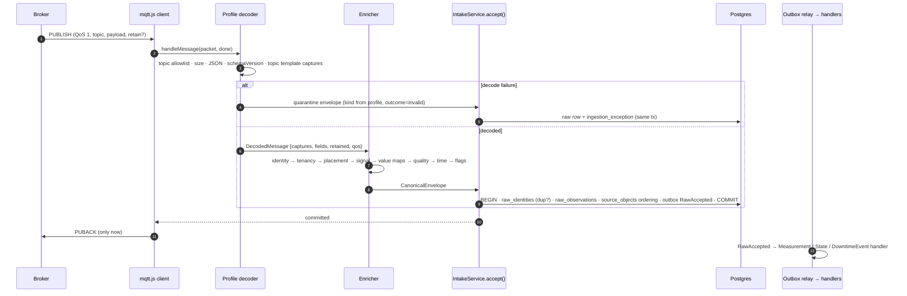
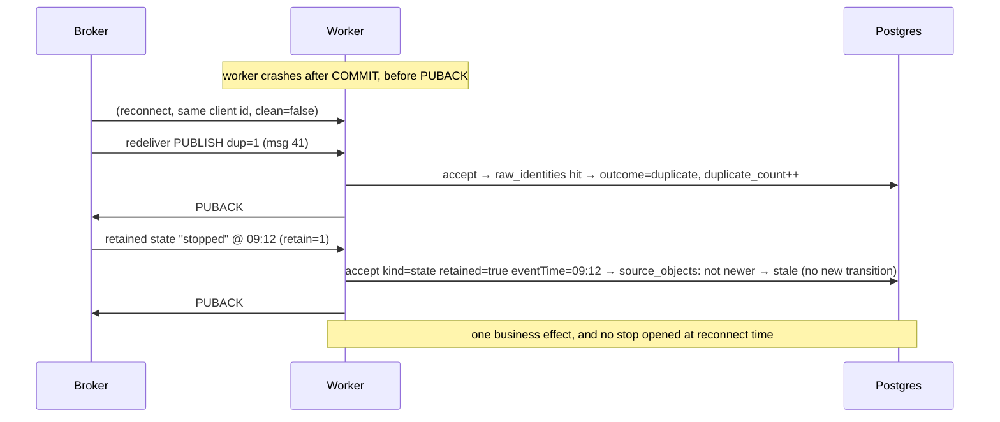
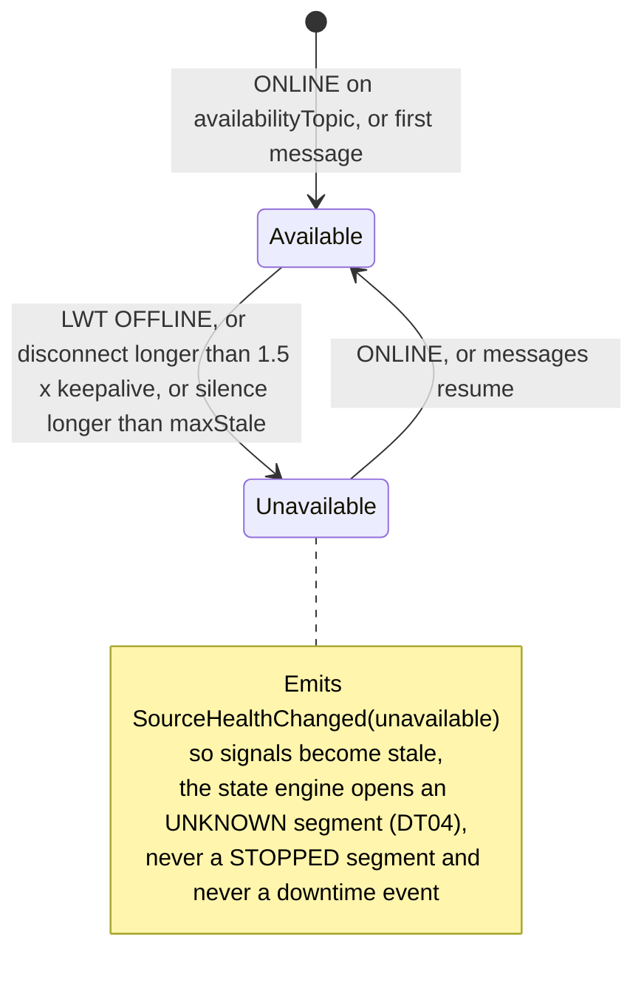
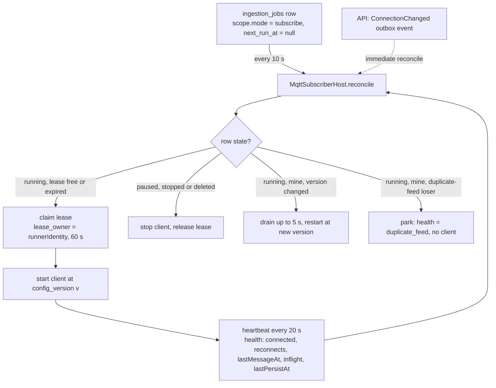

# MQTT intake for Pro-Act: design proposal (plan 1.8)

**Status:** proposal, 2026-10-11. Planning only; nothing here is built.
**Inputs:** `docs/reference/13-mqtt-ingestion-for-pla-downtime-monolith.md` (the AMS/CPA reference, "the reference" below), `plans/phase-1/1.8-mqtt-adapter.md`, `plans/phase-1/1.10-source-authority-and-state-engine.md`, and the intake code under `server/pro-act-backend/src/intake`, `signals`, `integration`.
**Decides:** how an MQTT message becomes a Pro-Act sample, machine state or downtime event, using the pipeline PI already uses. Open items the owner must answer are in §12.

---

## 0. Summary

1. **We do not build a second pipeline.** The reference app has one ingestion service with Kafka on the output side. Pro-Act already has the monolith equivalent the reference recommends in its §14: `IntakeService.accept()` → `raw_observations` + `raw_identities` (durable, idempotent) → outbox `RawAccepted` → `NormalizationService` → handlers → events/samples → `EventChanged` → periods, KPIs, RCA. The MQTT adapter is **one more `SourceAdapter`** that feeds that entry point, exactly as the PI adapter does.
2. **Persist before acknowledge.** The single most important lesson of the reference (§15.3, trap T4): the broker's PUBACK is sent only after the Postgres commit of the raw row. mqtt.js 5.14.0 (`server/pro-act-backend` dependency) supports this through the `handleMessage(packet, callback)` hook. A crash loses nothing; redelivery is absorbed by `raw_identities`. **Proven 2026-10-11** (`plans/evidence/mqtt-certification.md`): holds in MQTT 5 and 3.1.1; caveat: a held callback stalls the inbound socket, so persist time must stay well under 1.5 × keepalive and a Postgres outage must trigger a deliberate disconnect rather than a long hold.
3. **Three payload profiles, one envelope.** Topic + JSON are decoded per *profile* into the existing `CanonicalEnvelope` kinds: `measurement` (counters, rates, levels), `state` (machine running/stopped), and `interval_event` (explicit downtime start/end). Each profile is a small decoder module; a new payload shape is a new profile, never a transport change.
4. **Enrichment is lookup, not guessing.** Tenant comes from the connection, never the topic. Unit/asset come from `source_mappings` (topic pattern → placement). Signal comes from `signals.source_key = topic`. Reason/state tokens go through explicit per-connection value maps; an unmapped value is quarantined with a counter, never defaulted.
5. **The downtime decision stays where it belongs.** A `state` message does not create a downtime event by itself. The state engine (plan 1.10: debounce, micro-stop, staleness) turns state observations into `equipment_state_segments` and derived events. A broker outage or Last Will means *source unavailable → Unknown*, never *machine stopped* (T11).
6. **Operate it like PI.** A subscription is an `ingestion_jobs` row with a lease, heartbeat, health and transitions, visible in the 3.7 integration console. Quarantine (`ingestion_exceptions`) is the dead-letter queue and the "park unknown sources" list in one table. Alerts fire on silence per connection, not on log lines.

---

## 1. What the reference does, in one picture

```
Admin UI ──REST──► ingestion-service (.NET)
                      ├── data_source_configs (broker, encrypted password, profile_type, profile_config JSON)
                      ├── reconcile loop every 30 s: fingerprint rows ↔ running subscribers
                      └── per source: MQTT 5 client (QoS 1, persistent session, stable client id)
                             │  receive handler → bounded channel (10 000) → ONE consumer task
                             │  topic parse → payload parse → validate → map → dedupe
                             ▼ good                                      ▼ bad / unknown
                          Kafka samples topic                         Kafka DLQ + unknown_sources table
                             │
                          Flink · IoTDB writer · cplm-api
```

What we keep from it, and where it lands in Pro-Act:

| Reference concept | Pro-Act equivalent (existing unless marked **new**) |
|---|---|
| `data_source_configs` row | `integration_connections` (`source_type='mqtt'`, `endpoint_config`, `secret_ref`, `capabilities`, `config_version`) + `secrets` (AES-GCM `enc:v2`) |
| `profile_type` + `ProfileRegistry` (code-defined) | **new** `payloadProfile.kind` in `endpoint_config`, registry in `intake/adapters/mqtt/profiles/` |
| `profile_config.mqtt` block | `endpoint_config.mqtt` (topics, qos, clientId, session, keepalive, tls) |
| reconcile loop (30 s) + fingerprint | **new** `MqttSubscriberHost` in the worker, driven by `ingestion_jobs` leases and `config_version` (solves trap T1: no trigger-bumped version) |
| MQTTnet managed client | mqtt.js 5.x (already used by `connectivity/services/mqtt-client.service.ts`), reconnect + resubscribe built in |
| bounded channel + one consumer | **no channel**: the receive handler calls `accept()` and acks after commit; backpressure = stop acking (§4.3) |
| Kafka samples topic | outbox `RawAccepted` → `NormalizationService` (in-process relay, 1 s) |
| Kafka DLQ + `unknown_sources` | `ingestion_exceptions` (quarantine) with `occurrences` counter and `resolve` action |
| `loop_state` (restart durability) | not needed for discrete events; state engine persists `equipment_state_segments` (1.10) |
| registry pull every 60 s | in-process `SourceMappingService.loadResolver()` / `SignalService` with cache invalidated on change |
| `mode_value_map` + live classification UI | **new** `payloadProfile.valueMaps` (state tokens, reason tokens) + mapping panel in the 3.7 console |
| duplicate-feed 409 guard | **new** `validateConfig` rule in `MqttAdapter` (422 `DUPLICATE_FEED`) + runtime "oldest wins, others park" |
| `/stats`, `last_data_received` | `ingestion_jobs.health`, `last_observation_at`, `GET /v2/ingestion-jobs/:id`; 3.12 adds `/metrics` |
| credential cipher, test connection with throwaway id | `credential-encryption.service.ts`; `MqttAdapter.test()` with `test-<epochms>` id, clean start |

What we deliberately do **not** copy: the loop joiner (continuous-signal resampling; our rate/counter signals are stored as samples and summarised by the signals module), Kafka producer tuning, the self-heal DDL, ack-before-process, the trigger-bumped `version`, and `PUT` replacing the whole profile JSON (trap T2).

---

## 2. Target architecture

```mermaid
flowchart LR
    subgraph OT["Plant OT"]
        GW["OT gateway / PLC bridge"]
        BR[("MQTT broker<br/>plant mosquitto or ours")]
        GW -- "QoS 1, JSON per topic" --> BR
    end

    subgraph WORKER["Pro-Act worker (PROCESS_ROLE=worker or all)"]
        HOST["MqttSubscriberHost<br/>lease, reconcile, health"]
        CL["mqtt.js client per connection<br/>persistent session, stable client id"]
        DEC["Profile decoder<br/>topic template + payload rules"]
        ENR["Enricher<br/>identity, tenancy, placement, signal, value maps, quality, time"]
        ACC["IntakeService.accept<br/>raw_identities, raw_observations, source_objects, outbox"]
        HOST --> CL
        CL --> DEC
        DEC --> ENR
        ENR --> ACC
        ACC -- "commit, then PUBACK" --> CL
    end

    subgraph NORM["Normalization (outbox relay, in-process)"]
        MH["MeasurementHandler<br/>to measurement_samples"]
        SH["StateHandler (new)<br/>to state engine 1.10"]
        DH["DowntimeEventHandler (new)<br/>to production_events"]
        QX[("ingestion_exceptions<br/>quarantine, DLQ, parked")]
    end

    ACC -- "RawAccepted" --> MH
    ACC -- "RawAccepted" --> SH
    ACC -- "RawAccepted" --> DH
    DEC -. "TOPIC_SHAPE, NOT_JSON, TOO_LARGE" .-> QX
    ENR -. "unknown_signal, unknown_code, unknown_unit" .-> QX
    SEG[("equipment_state_segments")]
    DEV["Derived downtime and<br/>micro-stop events"]
    EV[("production_events<br/>event_revisions")]
    PER["Period recalculation<br/>loss ledgers, KPIs, RCA triggers"]
    SH --> SEG
    SEG --> DEV
    DEV --> EV
    DH --> EV
    EV -- "EventChanged" --> PER
    MH --> PER

    subgraph API["Pro-Act API"]
        CFG["v2 connections, jobs, exceptions endpoints"]
        UI["Integration console 3.7<br/>MQTT panel + value-map editor"]
        UI --> CFG
    end
    CFG -. "ConnectionChanged (outbox)" .-> HOST
    CL -- "subscribe / PUBACK" --> BR
```



**Process placement.** The API process owns configuration and reads. The worker owns the live clients. With `PROCESS_ROLE=all` (dev) both run in one process. Only one worker instance holds a given subscription at a time (lease), because MQTT delivers a persistent session to exactly one client id; shared subscriptions are not used, as in the reference.

---

## 3. Configuration model

A connection is one `integration_connections` row. No new table.

```jsonc
// integration_connections.endpoint_config  (secrets never here — assertNoSecrets)
{
  "mqtt": {
    "brokerUrl": "mqtts://192.168.190.91:8883",     // mqtt:// | mqtts:// ; egress allowlist applies
    "protocolVersion": 5,                            // 5 | 4 (3.1.1)
    "clientId": "proact-<connectionId>",             // stable, unique; blank → derived
    "username": "proact-ingest",                     // password lives in secrets via secret_ref
    "qos": 1,
    "cleanStart": false,
    "sessionExpirySeconds": 86400,
    "keepaliveSeconds": 60,
    "connectTimeoutSeconds": 30,
    "reconnect": { "minSeconds": 1, "maxSeconds": 60 },   // exponential, unlike the reference's fixed 5 s
    "tls": { "mode": "system" | "caPem" | "caRef" | "insecure", "caPem": "-----BEGIN CERTIFICATE-----…", "servername": "mosquitto" },
    "topics": ["ot/demo/+/+/state", "ot/demo/+/+/counters/#"],   // allowlist with wildcards; required
    "availabilityTopic": "ot/demo/gateway/availability",         // optional: retained ONLINE/OFFLINE + LWT
    "maxMessageBytes": 65536
  },
  "payloadProfile": {
    "kind": "state_json",                            // measurement_json | state_json | downtime_event_json | sparkplug_b (later)
    "schemaVersion": "1.0",
    "topicTemplate": "{ns}/{site}/{line}/{machine}/state",
    "fields": {                                      // dotted paths into the JSON object
      "eventTime": "ts", "sequence": "seq", "bootId": "boot_id", "eventId": "event_id",
      "value": "value", "unit": "unit", "quality": "quality", "machine": "machine"
    },
    "time": { "unit": "auto" | "ms" | "s" | "iso", "maxFutureSkewSeconds": 300, "maxPastSeconds": 604800 },
    "quality": { "protocol": "STRING_ENUM" | "OPC_DA" | "OPC_UA" | "SPARKPLUG" | "NONE" },
    "identityStrategy": "seq_boot" | "event_id" | "payload_hash",
    "valueMaps": {
      "state": { "1": "running", "2": "stopped", "3": "idle", "RUN": "running" },   // → DT01 states
      "reason": { "E101": "MECH-01", "E102": "ELEC-02" }                             // → code library keys
    }
  }
}
```

Rules carried over from the reference's validation table (§3.7), enforced by `MqttAdapter.validateConfig()` at create/update time (422 with `fieldErrors`):

- `brokerUrl` must match `^(mqtt|mqtts)://host(:port)?$`; one shared parser for validation and runtime (fixes trap T11); IPv6 allowed.
- At least one topic filter; `#` only as the whole last level, `+` only as a whole level.
- QoS ∈ {0,1,2} (1 recommended; QoS 0 is never queued by the broker); `sessionExpirySeconds ≥ 0`; `keepaliveSeconds > 0`; `clientId` matches `^[A-Za-z0-9_-]{1,64}$`.
- Exactly one TLS trust mode; PEM ≤ 64 KB, must contain `BEGIN CERTIFICATE`, must not contain `PRIVATE KEY`.
- The profile block is **required** and validated by its own schema (fixes trap T13); `topicTemplate` must capture `{machine}` (or the profile's required captures).
- **Duplicate-feed guard:** another active MQTT connection of the tenant with the same normalised endpoint and overlapping topic filters (level-by-level, `+`/`#` aware) or the same effective client id → 422 `DUPLICATE_FEED` naming the other connection. A duplicated downtime feed doubles every stop; this is stricter than the reference's loop-only rule, on purpose.
- `assertSecretFollowsTarget` (`intake/connections/connection-change.ts`): `brokerUrl`, `username`, `tls.*` are credential-binding (password must be re-sent); `topics`, `qos`, `keepaliveSeconds`, `sessionExpirySeconds`, `reconnect`, `maxMessageBytes`, `payloadProfile.*` must be added to `CREDENTIAL_NEUTRAL_KEYS`, otherwise every topic edit demands the password.
- **Partial updates:** `PATCH /v2/connections/:id` today replaces `endpointConfig` whole. For MQTT, add server-side JSON merge-patch for the `payloadProfile` sub-object so a value-map edit cannot wipe the topics (trap T2, incident CHG-012).

Every material change bumps `config_version` (API only). The host restarts that subscription when the version it is running differs from the row; a rename does not bump it.

---

## 4. The message path

### 4.1 Overview



### 4.2 Stage by stage

| # | Stage | What happens | Pro-Act component | On failure |
|---|---|---|---|---|
| 1 | **Connect** | Host claims the job lease, builds options from `endpoint_config` + revealed secret through one `MqttClientOptionsFactory` (shared with `test()`), checks `isEgressAllowed(brokerUrl)`, connects with `clean: false`, `properties.sessionExpiryInterval`, stable client id, subscribes to the topic allowlist at the configured QoS. Optionally subscribes to `availabilityTopic`. | **new** `intake/adapters/mqtt/mqtt-subscriber-host.ts`, `mqtt-client-options.ts` | Non-retryable (`BadUserNameOrPassword`, `NotAuthorized`, egress denied) → job `failed`, health `auth_failed`, the `config_version` it failed at kept in `health.configVersion`; the host restarts the job (`failed → running`, audited `config_changed`) once the connection is corrected (its `config_version` moved past the failed one — a job failed at the current version stays failed until an operator `start`s it, no retry storm); retryable → exponential backoff with jitter, counter `reconnects`, health `degraded` (fixes trap T9: start failures are retried) |
| 2 | **Pick** | `handleMessage` receives one packet. Checks in order: topic matches allowlist (defence in depth; the broker ACL is not trusted alone), size ≤ `maxMessageBytes`, payload is a JSON object, `schemaVersion` supported, topic matches `topicTemplate` (same number of levels, literal levels case-sensitive, captures non-empty). | **new** `profiles/<kind>.decoder.ts`, `topic-template.ts` (copy of the reference parser, it is small and strict) | `TOPIC_NOT_ALLOWED` (rejected, not accepted, per 1.8 tests), `TOO_LARGE`, `NOT_JSON`, `UNSUPPORTED_VERSION`, `TOPIC_SHAPE` → quarantine `schema_invalid` with the raw payload; still **acked** after the quarantine row commits, so a poison message cannot block the session |
| 3 | **Identify** | `messageId` per `identityStrategy`: `seq_boot` → `${machine}:${bootId}:${seq}`; `event_id` → producer id; `payload_hash` → `sha256(canonicalJson)`+`eventTime`. `sourceObjectId` = the thing the message is about (`<topic>` for samples/states, `<machine>:<eventId>` for explicit events). `sourceRevision` = `seq` or receive time. | `envelope-validator.ts` `payloadHash`, `source-object-ordering.ts` `decideOrdering` | — |
| 4 | **Tenancy** | `tenantId` and `connectionId` come from the connection row. A payload or topic `tenant`/`site` claim may be *checked* against the connection's expected values (identity mismatch → quarantine) but never *used* (MQ01). | connection row | `IDENTITY_MISMATCH` → quarantine `mapping_invalid_target` |
| 5 | **Place** | `location.sourcePath = topic`. Unit/asset resolved by `SourceMappingService.loadResolver()` (`source_mappings` exact path or pattern, `source_system='MQTT'`). Unmapped topic → parked. | `source-mapping/` | `unknown_template` (no mapping) → quarantine with `occurrences++`; **never auto-create** a unit or asset |
| 6 | **Signal** (measurement/state) | `signals` row for `(connection, source_key = topic)`; gives `signalRef`, `semanticType`, `canonicalUom`, `cadenceSeconds`, `is_authority`, `certified`. | `signals/` | `unknown_signal` → parked. Registering the signal later makes it flow on the next resolver refresh, no restart |
| 7 | **Map values** | `valueMaps.state`: raw token → DT01 state name; `valueMaps.reason`: raw token → code library key (then `MasterDataCodeResolverService`). Integral numbers are looked up as integer strings (`4.0` → `"4"`). Unit conversion to `canonicalUom`. | **new** `value-maps.ts`; `code-library/` | Unmapped token → quarantine `unknown_code` + counter + rate-limited warning. **No silent default** (incident CHG-003 inverted a map and blanked a fleet) |
| 8 | **Quality** | Decode per `quality.protocol` (STRING_ENUM, OPC_DA bit mask, OPC_UA severity, Sparkplug, NONE). Missing → `missing`; UNKNOWN is never GOOD. | **new** `quality-decoder.ts` (port of the reference table) | — |
| 9 | **Time** | `eventTime` from the payload: unit auto-detect (13 digits ms, 10 digits s, ISO string; no-offset string = UTC). Reject `> maxFutureSkewSeconds` in the future (`FUTURE_TIMESTAMP`) **and** `> maxPastSeconds` in the past (`STALE_TIMESTAMP`; the reference lacks this, trap T6). Missing event time → `observedAt = receivedAt`, `quality.degraded = true`; a **certified** signal rejects it to quarantine (MQ03). | — | quarantine `schema_invalid` |
| 10 | **Flags** | `retain=true` → `sourceControls.mqtt.retained=true`; state profile → `kind=state` with original event time (it is a *stored state*, not a new transition, MQ02). Also recorded: `qos`, `dup`, `packetId` (diagnostic only; packet ids are never identities, MQ05), `bootId`, `sequence`. | envelope `sourceControls.mqtt` | — |
| 11 | **Persist** | `IntakeService.accept(envelope)`: validate against `contracts/canonical-event.schema.json`; `registerIdentity` (`raw_identities` PK tenant+connection+messageId → repeat = `duplicate`, counter++); insert `raw_observations` (immutable, partitioned by `received_at`); `decideOrdering` against `source_objects` (`observedAt`, then numeric revision; regression → `stale`, equal time different hash → `conflict`); enqueue `RawAccepted`. One transaction. | `intake/intake.service.ts` | DB error → **do not ack**, mark health `degraded: persist_failed`, retry with backoff; the broker holds the session (§4.3) |
| 12 | **Ack** | Call the `handleMessage` callback → PUBACK. | mqtt.js | — |
| 13 | **Normalize** | Outbox relay (1 s) → `NormalizationService` → inbox key → handler by `(sourceType, kind)`. **Every accepted revision is normalised, in order:** intake requests normalisation only for provably newer versions and the relay publishes the `RawAccepted` rows of one source object in id order, so a burst `open → close → update → delete` (queue drained on resume) ends like the same messages spaced out — one event, one revision per message, retracted last. An older revision is never skipped as "superseded": the newest row may be a retraction, which carries no state. | `intake/normalization/` | `no_handler` / `processing_failed` → quarantine, raw row kept for replay |

### 4.3 Backpressure, outage and throughput

- **Broker up, Postgres down:** the handler does not call back, so no PUBACK is sent. mqtt.js stops delivering further QoS 1 messages once the in-flight window is full; the broker queues in the persistent session (24 h expiry). Health shows `degraded: persist_failed`; when Postgres returns, delivery resumes in order. This is the reference's §15.3 behaviour and replaces "Kafka down stalls intake".
- **Health must not lie (trap T8):** readiness for the subscription is `connected && (lastMessageAt is recent || no messages arriving) && lastPersistAt not older than N × cadence while messages arrive`. A client that receives but cannot persist is *down*, not *healthy*.
- **Ordering:** mqtt.js invokes `handleMessage` sequentially per client; we process one message at a time per connection, so broker order is preserved. Cross-connection parallelism is free.
- **Throughput:** one transaction per message is fine for events and state changes (tens per second). For high-rate counters, add `IntakeService.acceptBatch(envelopes[])` (one transaction, one PUBACK per message after commit, batch window 50 ms / 200 messages). Decide from the volume answer in §12; the reference peaks at shift change and plant trips.
- **Sizing the outage window (MQ04, §17.1):** the broker session is the spool. Document per connection: commissioned message rate × 24 h must fit the broker's per-client queue (`max_queued_messages` in mosquitto); alert at 70 % / 85 %. A local disk spool is **not** built unless the `handleMessage` spike (step 1) shows acks cannot be delayed in some mode.

### 4.4 Reconnect, redelivery and retained messages (T09)



- A redelivered message (`dup`) with the same identity is recorded once, counted as a duplicate; no second business effect.
- A retained message is a state re-send. It is accepted as `kind=state, retained=true` with its *original* event time. `decideOrdering` sees it is not newer than the stored object → `stale`; the state engine (1.10) may use it to seed current state subject to the staleness check, but never opens a stop "now".
- Same identity, different body → `conflict` (the reference's `INTEGRITY_CONFLICT`); the first body wins and the conflict is visible in quarantine. Never overwritten.

### 4.5 Source liveness, Last Will and silence (T11)



- The gateway should publish a retained `ONLINE` on connect and register an `OFFLINE` Last Will on `availabilityTopic` (the reference's health-plane pattern, §10). Pro-Act subscribes to it when configured.
- Without an availability topic, silence is detected per signal (`max_gap_seconds` / cadence × 3) and per connection (`lastMessageAt`).
- **Alert on silence per connection** is mandatory (reference §17: three days of data lost after a broker recreate went unnoticed). It is part of 3.12's alert rules; this design only supplies `lastMessageAt`, `connected`, `reconnects` in `ingestion_jobs.health`.

---

## 5. Payload profiles and what they become

A profile = decoder + envelope kind + handler. Profiles are code; per-connection overrides are the `payloadProfile` block.

| Profile | Message means | Envelope | Handler | Result |
|---|---|---|---|---|
| `measurement_json` | one sample of a counter / rate / level | `kind=measurement`, `values.sample{signalRef, value, unit, semanticType, sequence}` | `MeasurementHandler` (exists) | `measurement_samples` → signal summaries → actuals (1.7), `PeriodSweepJob` picks up periods with new samples |
| `state_json` | the machine's current state token | `kind=state`, `values.state{stateRef, value (mapped DT01 name), previousValue, sequence}`, `sourceControls.mqtt.retained` | **new** `StateHandler` → state engine (1.10) | `equipment_state_segments` (debounce 5 s, micro-stop 60 s, restart confirm 10 s, staleness) → derived downtime / micro-stop events with `source_kind=derived`, `rule_version`, observation refs |
| `downtime_event_json` | an explicit stop event from a system that already decided (START / END / one event with duration) | `kind=interval_event`, `startTime`, `endTime` (null while open), `values.attributes[]` (reason, comment, …), `operation=observe|correct|retract` | **new** `DowntimeEventHandler` reusing the PI frame path: typed attribute mapping → `MasterDataCodeResolverService` → placement → `ProductionEventService.create` / `EventRevisionService.applySourceRevision` | `production_events` with `source_kind=source`, revisions on END / corrections, `EventChanged` outbox → periods, RCA triggers |
| `sparkplug_b` | NBIRTH/DBIRTH/DDATA protobuf with alias map, `seq` rollover, NDEATH as LWT | decoded to the three kinds above per metric | same | optional, capability-flagged, not R1-blocking (1.8 step 6) |

### 5.1 Default JSON contracts (what we ask the OT side to publish)

```jsonc
// measurement_json   topic: {ns}/{site}/{line}/{machine}/counters/{metric}
{ "schema_version": "1.0", "ts": "2026-10-11T06:07:14.187Z", "seq": 1842, "boot_id": "gw-2026-10-11T05:00:00Z",
  "value": 1532.0, "unit": "t", "quality": "GOOD" }

// state_json         topic: {ns}/{site}/{line}/{machine}/state
{ "schema_version": "1.0", "ts": "2026-10-11T06:07:14.187Z", "seq": 1843, "boot_id": "gw-…",
  "value": "RUN", "previous": "STOP", "quality": "GOOD" }

// downtime_event_json  topic: {ns}/{site}/{line}/{machine}/downtime
{ "schema_version": "1.0", "event_id": "d1f0…", "event_type": "START" | "END" | "DURATION",
  "ts": "2026-10-11T06:07:14.187Z", "end_ts": null, "reason": "E101", "comment": "belt trip", "seq": 1844, "boot_id": "gw-…" }

// availability        topic: {ns}/{site}/gateway/availability   (retained; LWT = OFFLINE)
{ "state": "ONLINE", "ts": "…", "boot_id": "gw-…" }
```

Each profile ships a JSON Schema under `contracts/mqtt/<profile>.v1.schema.json` (`additionalProperties: false`, like the reference's health contract) and a default `fields` map; the owner's actual topics/payloads (§12 Q2–Q4) are expressed as per-connection `topicTemplate` + `fields` overrides, not code.

### 5.2 Downtime start/end pairing (`DowntimeEventHandler`)

Explicit events are stored raw first; pairing is a re-runnable derivation (reference §15.5), implemented on `source_objects` keyed `<machine>:<eventId>` (or `<machine>:<startTs>` when the producer has no id):

| Case | Rule |
|---|---|
| START | create event with `endTime=null` (open), `physical_type=downtime`, reason via value map + code resolver; unknown reason → event created **with** quarantine `unknown_code` linked (so the stop is not lost), coding state `uncoded` |
| END matching an open START (same machine, `end_ts ≥ start`) | `applySourceRevision` closes the interval; `EventChanged` with affected interval |
| END with no open START | quarantine `order_conflict`; keep raw; if a START arrives later (out of order), the retry closes it |
| second START while one is open | close the first at the second's start with revision quality `provisional` + review item; open the second |
| DURATION (single event with end) | create closed event directly |
| `operation=correct` (same event id, new body) | source revision; `retract` → `RetractionHandler` |
| out-of-order arrival | state is applied by `event_ts`, never arrival order (`decideOrdering`) |
| open stop across worker restart | nothing to recover: the open event is in `production_events`; the next END closes it |
| open stop longer than `maxOpenHours` | alert + review item, never auto-close |

### 5.3 Dual sources (PI event frame + MQTT state for the same machine)

Both reach `production_events`. The 1.10 `OccurrenceCorrelator` folds an explicit source event and a derived stop that overlap on the same unit into one `impact_occurrences` row (primary timing source by policy), and `source_authority_policies` picks one authority per measurement (T12). Accounting consumes occurrences, so a machine reported by both PI and MQTT is never double-counted. The MQTT adapter does nothing special here; it only tags `source_kind` and `connectionId` correctly.

---

## 6. Hosting the subscription in the worker

The existing runner (`JobRunnerService`, every 5 s) is pull-based: claim a due job → `adapter.read()` → commit page. A subscription is long-lived, so it gets its own host but reuses the job row for lease, audit and health.



- `scope.mode='subscribe'` with `next_run_at=null` keeps `JobRunnerService` from claiming it (it only claims due jobs). `MqttAdapter.read()` throws `AdapterError('NOT_PULLABLE')` as a guard.
- Lease semantics give failover: if the worker dies, the lease expires, another worker claims it and reconnects with the same client id; the broker's persistent session delivers the backlog.
- `pause` → disconnect (session kept, broker queues); `resume` → reconnect; `drain` → stop subscribing, finish in-flight, then stop; `stop` → disconnect with `sessionExpiryInterval=0` so the broker drops the queue. All go through `job-transitions.ts` and are audited.
- Shutdown uses `ShutdownCoordinator`: unsubscribe, wait for the in-flight message, disconnect cleanly (so the broker does not fire our LWT, if any).
- Reconcile every 10 s is the safety net; the API also emits `ConnectionChanged` on the outbox so a save takes effect at once (reference §4 "monolith" note).

---

## 7. Data model impact

No new core tables. The intake core was designed source-neutral in 1.5.

| Table | Change |
|---|---|
| `integration_connections` | none; `endpoint_config` gains the `mqtt` and `payloadProfile` blocks (jsonb) |
| `secrets` | none; `kind='mqtt_password'` |
| `ingestion_jobs` | none; `scope = {mode:'subscribe', topics[], profile}`; `health` gains `connected, reconnects, lastMessageAt, lastPersistAt, inflight, parkedReason` |
| `raw_observations` / `raw_identities` / `source_objects` | none; `sourceControls.mqtt` carried in the envelope payload; `kind='state'` already allowed |
| `ingestion_exceptions` | none; new error codes `topic_shape`, `not_json`, `too_large`, `unsupported_version`, `identity_mismatch`, `future_timestamp`, `stale_timestamp` (extend the enum by migration) |
| `signals` | none; `source_key = topic`, `source_binding.topic` already exists |
| `source_mappings` | none; `source_system='MQTT'` already accepted; pattern mappings on topic levels |
| **1.10 tables** (`state_rules`, `equipment_state_segments`, `impact_occurrences`, `source_authority_policies`, …) | required for the `state_json` profile to produce downtime; built in 1.10, not here |
| optional `mqtt_spool` | only if the manual-ack spike fails (MQ04) |

Retention follows the existing raw partition policy (`raw-partitions.service.ts`); nothing MQTT-specific.

---

## 8. Observability and operations

**Per connection (`ingestion_jobs.health`, shown on the 3.7 console MQTT panel):** `connected`, `connectionError`, `reconnects`, `lastMessageAt`, `lastPersistAt`, `inflight`, counters `received / accepted / duplicate / stale / conflict / quarantined{by code} / parked`, `sessionPresent` on last connect, `effectiveClientId`.

**Prometheus (3.12; label = connection display name, never machine id, to bound cardinality):** `mqtt_connected`, `mqtt_reconnects_total`, `mqtt_messages_received_total`, `mqtt_messages_acked_total`, `mqtt_inflight`, `mqtt_ack_latency_seconds` (receive → PUBACK), `mqtt_source_lag_seconds` (now − eventTime), `intake_outcomes_total{outcome}`, `ingestion_exceptions_open{code}`.

**Alerts (3.12 rules, each with a runbook link):**
1. silence: no message on a connection for > N minutes while the broker is connected (per-source, the §17 lesson);
2. disconnected > 5 min (health stays green by design, the alert does the shouting; trap T14);
3. persist failure while messages arrive (trap T8);
4. quarantine growth per code (unmapped machine / reason tokens);
5. open downtime event older than `maxOpenHours`;
6. broker session depth > 70 % / 85 % of the commissioned window (needs broker `$SYS` or mosquitto metrics; otherwise derive from `inflight` and reconnect gaps).

**Runbooks to write (3.12):** broker auth failure; broker recreated / our user missing (restart the publisher agent, verify the user, `mosquitto_sub -R` to prove live data without retained noise); reconnect storm; poison payload / schema change; unmapped machine flood (narrow the topic filters, do not rely on parking); clock skew on the gateway; replay from `raw_observations` via `replay_runs`.

**Proving a feed is alive:** from data (`lastMessageAt`, newest `raw_observations` row), never from logs. Plants run at log level Error.

---

## 9. Security

- **Tenancy** from the connection row and the RLS session binding (3.11); topic text is never trusted for tenant or site.
- **Secrets** in `secrets` (`enc:v2`, key ring, rotation script); `endpoint_config` is scanned by `assertNoSecrets`; the API returns `hasSecret`, never the value; the subscriber reveals it in memory only.
- **Egress** gated by `CONNECTOR_EGRESS_ALLOWLIST` (`isEgressAllowed(brokerUrl)`).
- **TLS** with exactly one trust mode; `insecure` is shown in red and logged on every connect; SNI override (`servername`) for brokers whose certificate does not list the host (the reference's most common TLS support case).
- **Broker side:** one broker user per Pro-Act connection with a read-only ACL on its topic filters; the dev `docker/mosquitto/mosquitto.conf` is anonymous and must never be used in production (it says so in the file).
- **Payload hygiene:** size limit, JSON object only, no payload text in logs (`common/logging/redact.ts`), raw payload in `raw_observations` is redacted in the exceptions API view.
- **Client id discipline:** the live client id is unique and documented; a debugging tool reusing it evicts the subscriber in a loop (reference incident).

---

## 10. Build plan (maps onto `plans/phase-1/1.8-mqtt-adapter.md` steps)

| Step | Deliverable | Tests |
|---|---|---|
| 1 | **Spike:** mqtt.js `handleMessage` delays PUBACK until callback, incl. during reconnect and with `protocolVersion 4`; recorded in `plans/evidence/mqtt-certification.md` (MQ04). Adapter skeleton: `validateConfig`, `test()` (throwaway id, clean start, CONNACK only, same options factory), `health()`, `close()`; `MqttClientOptionsFactory`; duplicate-feed guard; `CREDENTIAL_NEUTRAL_KEYS` extension | unit: config validation table (§3), topic-filter overlap, URL parser; integration: test() against the compose broker |
| 2 | Profiles `measurement_json`, `state_json`, `downtime_event_json`: topic template parser, field extraction, identity strategies, time rules, quality decoder, value maps, envelope builders; JSON Schemas under `contracts/mqtt/` | fixtures per profile (good / each failure code / unit auto-detect / retained / missing ts certified vs not) |
| 3 | `MqttSubscriberHost` in the worker: lease, reconcile, restart on `config_version`, pause/resume/drain/stop, health heartbeat, `ConnectionChanged` fast path; persist-before-ack wiring; `StateHandler` (hands `state` observations to 1.10; until 1.10 lands it quarantines `no_handler` **by design**); `DowntimeEventHandler` with pairing rules (§5.2) | integration with the compose broker: durable-before-ack crash tests (kill after commit / before commit), T09 replay, topic outside allowlist rejected, Postgres-down backpressure, duplicate-feed park |
| 4 | Compose: TLS listener + password file on the bundled `mqtt` service for tests; `scripts/mqtt/publish-sim.ts` test publisher (retained state, LWT, bursts) | MQTT 3.1.1 compatibility run |
| 5 | Availability topic / LWT → `SourceHealthChanged`; signal staleness; outage-window note per connection (24 h, 70/85 %) | T11 (with 1.10: `unknown` segment, no stop) |
| 6 | Sparkplug B decoder stub behind capability flag | decoder fixtures only |
| 7 | Console: MQTT panel (status, counters, effective client id, last test), profile editor with live value-map classification (the reference's `LoopIngestPanel`), quarantine list with resolve; merge-patch for `payloadProfile`; certification evidence | Playwright journey; OpenAPI snapshot updated |

Depends on 1.5 (done). The `state_json` profile only yields downtime once **1.10** exists; `downtime_event_json` and `measurement_json` are useful immediately. Recommended order: 1.8 steps 1–4 → 1.10 → 1.8 steps 5–7.

**Acceptance checks** (reference §18, monolith additions): kill the worker mid-burst → every QoS 1 message ends up exactly once in `raw_observations` with one business effect; stop Postgres → nothing acked, broker queues, drains in order after restart; redelivered and retained duplicates insert nothing new; same event id with a different body → `conflict` visible in quarantine; unmapped machine parked and listed, flows within one resolver refresh after mapping; a value-map edit restarts the subscription within 10 s and un-mapping a required state name is refused (400).

---

## 11. Things we intentionally do differently from the reference

| Reference | Pro-Act | Why |
|---|---|---|
| ack on enqueue to a 10 000-entry channel | ack after commit | no loss on crash (their trap T4) |
| fixed 5 s reconnect | exponential backoff 1–60 s with jitter | a plant trip reconnects thousands of clients at once |
| start failures not retried until config changes | retried with backoff, error on the card | their trap T9 |
| `version` bumped by trigger on every update | `config_version` bumped by the API only | their trap T1 |
| PUT replaces `profile_config` | merge-patch on `payloadProfile` | their trap T2 / CHG-012 |
| DLQ produce dropped after one attempt | quarantine row in the same transaction | their trap T7 |
| no past-timestamp check; numeric ts always ms | past limit + unit auto-detect / reject | their trap T6 |
| unknown sources in a separate table, API-only | `ingestion_exceptions` with `occurrences`, in the console | one list, already has UI and resolve |
| health green while persisting fails | readiness includes `lastPersistAt` | their trap T8 (6 h of silent loss) |
| in-memory dedupe LRU (50 000) | `raw_identities` in Postgres | survives restarts; no unbounded memory (trap T15) |
| duplicate-feed guard on loop profiles only | on every MQTT connection | a duplicated downtime feed doubles every stop |

---

## 12. Open questions for the owner (feeds D09)

> **Addendum 2026-10-11 — owner answers received.** Broker: plant broker in production, lab broker for testing. Topics: Pro-Act states its expectations (`docs/MQTT_OT_CONTRACT.md`), OT designs the namespace and provides samples and a schema. Identity: standards-based (`event_id` + `revision`, `boot_id` + `seq`). **Downtime arrives with start and end time**, so the primary profile is the interval event (PI event-frame shape with revisions), §5.2's START/END pairing becomes revision handling of one event, and the 1.10 state engine is off the MQTT critical path. Retained: yes (treated as re-sends). Clock: standard (RFC 3339, NTP). Mapping PI → MQTT → Pro-Act: to be studied field by field. Retention: broker releases a message only on ack-after-commit; raw rows kept only for the replay/quarantine window. The plan is `plans/phase-1/1.8-mqtt-integration-plan.md`; remaining decisions are D09-A/R/S/V there.

Answers go to `plans/DECISIONS.md` D09. The design works with defaults, but certification (T09/T11) needs the real feed.

1. **Broker:** the plant's broker or one we run (the Compose `mqtt` service)? Who creates our user/ACL, and who restarts the OT publisher after a broker event?
2. **Topics:** exact topic shapes per message type; is there a namespace prefix we can filter on tightly (parking should absorb noise, not 14 % of traffic)?
3. **Payloads:** one JSON object per message? field names for time, value, unit, quality, sequence, boot/session id; is there a `schema_version`? Can the OT side give us a JSON Schema or three real samples per type?
4. **Event identity:** does every message carry `seq` + a boot/session id, or an `event_id`? If neither, we fall back to payload hash + event time (weaker dedupe).
5. **Downtime model:** does the OT side send (a) raw machine state only, (b) explicit START/END events, (c) one event with duration, or a mix? This selects the profile and whether 1.10 is on the critical path.
6. **Retained and availability:** are state topics published retained? Is there a heartbeat/availability topic with a Last Will?
7. **Clock:** timestamp format and unit; measured gateway drift (the reference saw +132 s, hence a 300 s future skew limit).
8. **Volumes:** messages/s steady and at shift change / plant trip; number of machines; this sets batching and the broker queue sizing for the 24 h window.
9. **Codes and assets:** are machine ids and reason tokens shared with our asset model and code libraries (mappable), or free text? Who owns the value maps?
10. **Retention:** how long raw MQTT observations must be kept beyond the default raw partition policy.
11. **Authority:** where PI and MQTT both report the same machine, which is primary for state, for output (T12)?

---

## 13. Glossary

- **PUBACK** — the broker's QoS 1 acknowledgement; until we send it, the broker keeps the message in our session.
- **Persistent session** — `clean_start=false` + session expiry; the broker queues QoS ≥ 1 messages while we are disconnected.
- **Retained message** — the broker's stored "last value" for a topic, delivered on subscribe; a state, not a new event.
- **LWT (Last Will)** — a message the broker publishes on the client's behalf when it disappears without a clean disconnect.
- **Quarantine / parked** — a message we stored but could not apply (unknown machine, unmapped code, bad shape); it waits for an operator, it is never dropped and never auto-fixed.
- **Envelope** — `CanonicalEnvelope` (`contracts/canonical-event.schema.json`), the one shape every source hands to `IntakeService.accept()`.
