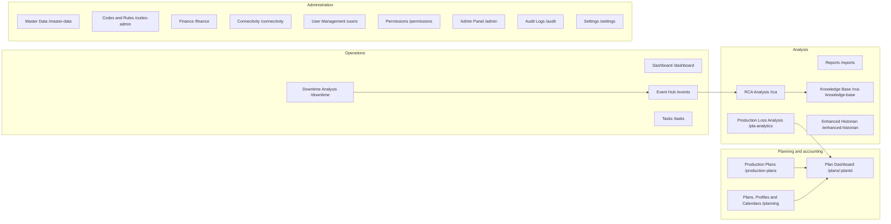
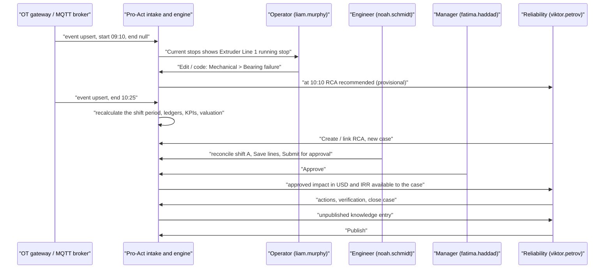
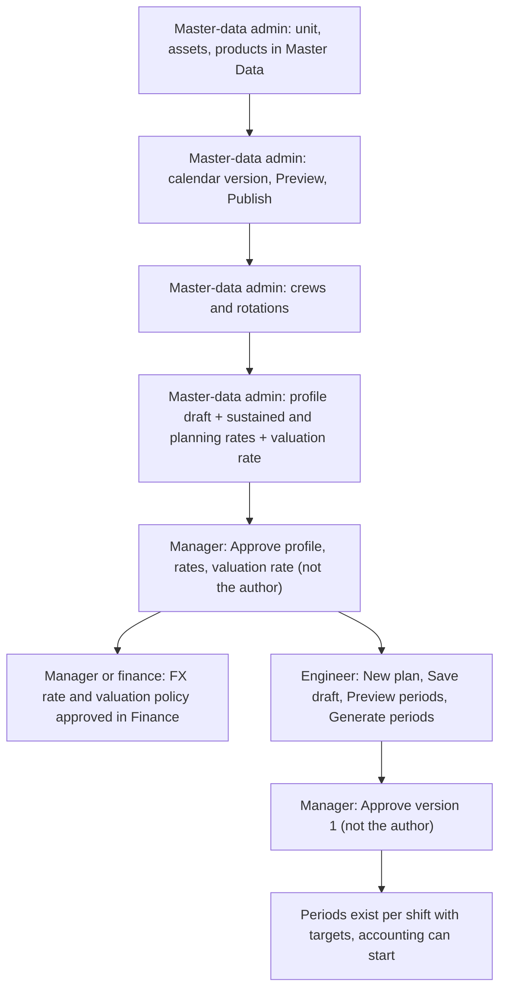
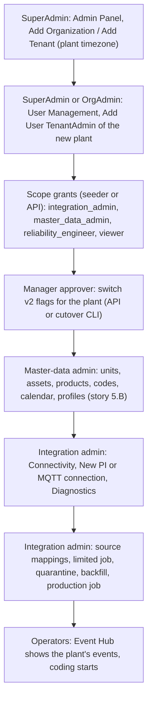
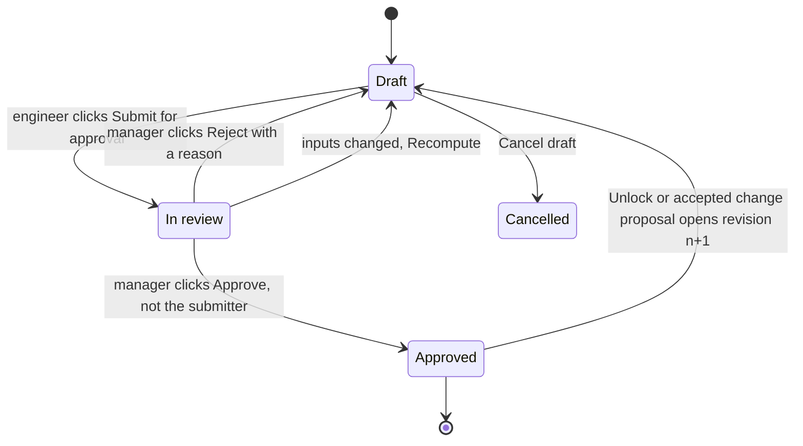

# Pro-Act persona user flows

**Who this is for:** the product owner. It assumes you know plants and production. It does not assume you know the code.

**What it gives you:** for every persona, which demo user to log in as, what the menu shows, and the order to visit pages in: "go here, click this, fill that, check this, then go there". It also covers what each persona hands over to someone else, and what they cannot do along with the message they will see.

**Companion document:** [APPLICATION_LOGIC_GUIDE.md](APPLICATION_LOGIC_GUIDE.md) explains *why* the screens behave as they do: formulas, state machines and rules.

**Sources:**
- The code as of 2026-10-12 (`src/App.tsx`, `src/features/**`, `server/pro-act-backend/src/**`).
- The persona end-to-end specs `e2e/personas/*.spec.ts`. These are executable versions of these flows; every button label quoted here comes from the source or from those specs.
- [DEMO_PERSONAS.md](DEMO_PERSONAS.md) and [PERSONA_TESTING_REPORT.md](PERSONA_TESTING_REPORT.md).

> **Intended end state described here.** Four changes were landing on 2026-10-12 while this document was written:
> 1. **Write buttons a user cannot use are hidden.** This is capability-based (`src/features/auth/capabilities.ts`, `server-role-sets.ts`). An approve button the author of an item cannot use is shown *disabled* with the hint "You authored this: another approver must approve it (separation of duties)."
> 2. **Separation of duties now also covers plan versions, profiles, rates, valuation rates and FX rates.** Before, it covered periods, adjustments, rules and valuation policies only.
> 3. **The RCA knowledge base is rebuilt on v2:** server-side search, one vote per user, publish / unpublish, and "similar past RCAs".
> 4. **A showcase demo dataset is being seeded** (`server/pro-act-backend/scripts/demo-showcase/`, described in [DEMO_SHOWCASE_DATA.md](DEMO_SHOWCASE_DATA.md)). In Demo Plant it is a polymer complex: **Extruder Line 1** (`DEMO-EXTRUDER1`, the unit the MQTT simulator feeds), Extruder Line 2, Underwater Pelletizer, Bagging and Palletizing.
>
> Where a screen does not hide a button yet, the server still refuses the click and the screen shows the refusal. §2.5 lists those messages.

---

## Contents

1. [Before you start: logins, plants, flags](#1-before-you-start-logins-plants-flags)
2. [Things every persona uses](#2-things-every-persona-uses)
3. [Application map: menu × persona](#3-application-map-menu--persona)
4. [Persona flows](#4-persona-flows)
   - 4.1 [SuperAdmin](#41-superadmin)
   - 4.2 [OrgAdmin](#42-orgadmin)
   - 4.3 [TenantAdmin](#43-tenantadmin)
   - 4.4 [Manager approver](#44-manager-approver)
   - 4.5 [Production engineer / Analyst](#45-production-engineer--analyst)
   - 4.6 [Operator](#46-operator)
   - 4.7 [Viewer](#47-viewer)
   - 4.8 [Reliability engineer](#48-reliability-engineer)
   - 4.9 [Integration admin](#49-integration-admin)
   - 4.10 [Master-data admin](#410-master-data-admin)
5. [Cross-persona stories](#5-cross-persona-stories)
   - 5.A [A stop on Extruder Line 1: from MQTT to the knowledge base](#5a-a-stop-on-extruder-line-1-from-mqtt-to-the-knowledge-base)
   - 5.B [Month setup: master data → calendars → profiles and rates → plan → approval](#5b-month-setup-master-data--calendars--profiles-and-rates--plan--approval)
   - 5.C [Onboarding a new plant, its users and a data source](#5c-onboarding-a-new-plant-its-users-and-a-data-source)
   - 5.D [Month-end close and export](#5d-month-end-close-and-export)
6. ["I want to … → go to …" quick lookup](#6-i-want-to---go-to--quick-lookup)
7. [Gaps you will notice today](#7-gaps-you-will-notice-today)

---

## 1. Before you start: logins, plants, flags

### 1.1 Start the stack

| What | Where |
|---|---|
| Application | http://localhost:8070 |
| API and Swagger | http://localhost:4004/api |
| Health | http://localhost:4004/api/health |

Seed the demo users with these commands, run in `server/pro-act-backend`:

- `npm run db:seed-demo-personas`: the 44 persona users, Demo Plant 2 and Partner Plant.
- `npm run db:seed-demo-mqtt -- --demo-plant`: the Extruder unit, MQTT connections and codes.
- `npm run db:seed-demo-valuation -- --demo-plant`: USD valuation rates.
- The showcase seeder: [DEMO_SHOWCASE_DATA.md](DEMO_SHOWCASE_DATA.md).

### 1.2 Who to log in as

Every persona user has the password **`Persona-2026!demo`**. E-mails are `<first>.<last>@demo.acme.com`.

| Persona | Log in as (examples) | Home plant | What they really are |
|---|---|---|---|
| SuperAdmin | `helena.fischer`, `marcus.lindqvist` | Demo Plant | IT / platform owner; sees every organisation and plant |
| OrgAdmin | `isabel.moreno`, `daniel.okafor` (Demo Org); `lucas.ferreira` (Partner Org) | Demo Plant / Partner Plant | Company-level administrator for all plants of one organisation |
| TenantAdmin | `anna.keller`, `benjamin.carter`, `mei.tanaka`, `oliver.hughes`; `chloe.dubois` (Demo Plant 2) | Demo Plant | Plant administrator who also approves (legacy `TenantAdmin` → `manager_approver`) |
| Manager approver | `jonas.weber`, `fatima.haddad`, `erik.johansson`, `laura.rossi` | Demo Plant | Production / operations manager: approves plans, periods, rules, finance |
| Production engineer / Analyst | `noah.schmidt`, `aisha.bello`, `mateo.alvarez` (Engineer); `hannah.novak`, `samuel.osei` (Analyst) | Demo Plant | Process / production engineer: plans and shift accounting |
| Operator | `liam.murphy`, `yuki.sato`, `carlos.mendes` (whole plant); `ingrid.hansen`, `amir.rahimi` (only `DEMO-LINE-1`) | Demo Plant | Control-room / line operator: records and codes stops |
| Viewer | `grace.whitfield`, `pedro.santos`, `nadia.petrova`, `kenji.nakamura` | Demo Plant 2 (an Operator there); **viewer** in Demo Plant | Auditor, visitor, head-office reader |
| Reliability engineer | `viktor.petrov`, `amara.diallo`, `sebastian.vogel`, `leila.farouk` | Demo Plant | Reliability / maintenance engineer: owns RCA |
| Integration admin | `elena.marchetti`, `omar.siddiqui`, `freya.nilsson`, `diego.herrera` (also in Demo Plant 2) | Demo Plant | OT/IT integration: PI, MQTT, mappings, quarantine |
| Master-data admin | `charlotte.evans`, `hiro.yamamoto`, `zara.qureshi`, `felix.brandt` | Demo Plant | Keeps codes, calendars, profiles, rates and FX drafts |

The older demo accounts still work (password `demo123`):
- `admin@acme.com`: SuperAdmin.
- `manager@acme.com`: TenantAdmin, which the app treats as a manager approver.
- `engineer@acme.com`: Engineer.
- `operator@acme.com`: Operator.

The login page lists them in its "Demo Accounts" box.

### 1.3 Plants and flags

| Organisation | Plant | Units you will see |
|---|---|---|
| Demo Org | **Demo Plant** | `DEMO-LINE-1`, `DEMO-LINE-2`, **Extruder Line 1** (`DEMO-EXTRUDER1`), and with the showcase Extruder Line 2, Underwater Pelletizer, Bagging and Palletizing |
| Demo Org | Demo Plant 2 | `DP2-LINE-1` "Line 1", `DP2-LINE-2` "Line 2"; showcase: Compounding Line 1, Packaging Line 1 |
| Partner Org | Partner Plant | `PP-LINE-1` "Partner Line 1" (used to prove one company cannot see another) |

**Feature flags.** Every screen rebuilt on the new "v2" engine sits behind a per-plant flag. There are eight `v2.*` flags.
- **Demo Plant and Demo Plant 2:** all eight flags are **on**. Everything below assumes that.
- **Partner Plant:** the flags are off, except `v2.eventHub`, which an earlier test switched on. It shows the older "v1" screens.

The logic guide §16 explains flags.

---

## 2. Things every persona uses

### 2.1 Login and landing

1. Open http://localhost:8070. The card "Welcome to Pro-Act" appears.
2. Fill **Email** and **Password**, then click **Sign In**.
3. A wrong password shows "Invalid email or password".

You land on the page you opened. Opening `/` takes you to **Dashboard** (`/dashboard`).

Your session lasts 15 minutes and renews itself silently. **Logout** is the door icon in the header user box.

### 2.2 Choose the plant (and unit)

The plant selector is the button next to the logo in the header. It reads "Select Plant & Unit" until you choose.

1. Click it. A tree opens: Organisation → Plant → Unit → assets.
2. Expand the organisation with its chevron and click the plant name. Optionally expand the plant and click a unit.
3. The button now shows `Org › Plant › Unit`. Every screen, menu and permission now refers to **this plant**.

Your choice is remembered per user in this browser.

**What you are offered:**
- **SuperAdmin:** every plant.
- **OrgAdmin:** the plants of their organisation.
- **Everyone else:** their home plant, plus every plant where they hold a scope grant.

**If a stored plant is no longer allowed:** the page is replaced by "You do not have access to this plant" with a button **Switch to my plant (…)**.

### 2.3 Display currency

The header has a two-button toggle: **$ USD** and **IRR**. USD is the default.

- It only chooses which server-computed amount you see. The browser never converts money.
- IRR is shown with 0 decimals, USD with 2.

### 2.4 Read-only badge

If every role you hold in the selected plant is `viewer`, the header shows an amber **Read-only** pill. Its tooltip reads "Every role you hold in the selected plant is read-only; changes are refused by the server".

### 2.5 Refusal messages you will meet

| Code from the server | Shown as | Means |
|---|---|---|
| `READ_ONLY_ROLE` (403) | "Your role in this plant is read-only" | You are a viewer here |
| `FORBIDDEN_ROLE` (403) | "Your role does not allow this", sometimes with "(master data administrator or manager approver needed)" / "(integration administrator …)". RCA and Event Hub dialogs show "Refused (FORBIDDEN_ROLE)" | Wrong role for this action |
| `SEPARATION_OF_DUTIES` (403) | "Separation of duties: someone other than the author must do this". Approve buttons are disabled with the SoD hint | You authored or submitted it, so someone else must approve |
| `TENANT_NOT_ALLOWED` (403) | "You do not have access to this plant" | The plant is outside your organisation or grants |
| `TENANT_SCOPE_REQUIRED` (403) | "A tenant-wide grant is required (your access is limited to some units)" | You are unit-limited, and this change affects the whole plant |
| `VERSION_OVERLAP` (409) | "Overlaps an approved version" plus a list | Tick **Supersede the approved predecessor**, or fix the dates |
| `STALE_REVISION` (412) | "Someone changed this event" / "Changed by someone else — reload and try again" | Someone saved first. Review and re-apply |
| `RESIDUAL_UNEXPLAINED`, `OVER_ACCOUNTED`, `MISSING_CODE` … (422) | "Cannot submit yet" plus the gate list | The period does not balance yet |
| `LEGACY_WRITES_FROZEN` (423) | v1 screen error | The plant is in a cutover window |

### 2.6 Page "not switched on"

If a flag is off for the plant, these pages show a notice ("… is not switched on for this plant") instead of the screen: `/downtime`, `/planning`, `/plans/:id`, `/codes-admin` and `/finance`. Other pages fall back to their v1 version.

---

## 3. Application map: menu × persona

The sidebar is one list. It starts collapsed (icons only); **Expand sidebar** shows the names.

An item appears when:
- your role in the **selected plant** grants the capability, and
- for flagged items, the plant's flag is on.

**Menu items per persona** (Demo Plant, all flags on). Key: ✓ = listed; · = not listed; † = listed, but the page itself says "You don't have permission…".

| Menu item (route) | SuperAdmin | OrgAdmin | TenantAdmin | Manager | Engineer / Analyst | Operator | Viewer | Reliability | Integration admin | Master-data admin |
|---|---|---|---|---|---|---|---|---|---|---|
| Dashboard (`/dashboard`) | ✓ | ✓ | ✓ | ✓ | ✓ | ✓ | ✓ | ✓ | ✓ | ✓ |
| Reports (`/reports`) | ✓ | ✓ | ✓ | ✓ | ✓ | · | ✓ | ✓ | ✓ | ✓ |
| Production Loss Analysis (`/pla-analytics`) | ✓ | ✓ | ✓ | ✓ | ✓ | ✓ | ✓ | ✓ | ✓ | ✓ |
| Production Plans (`/production-plans`) | ✓ | ✓ | ✓ | ✓ | ✓ | · | ✓ | ✓ | ✓ | ✓ |
| Plans, Profiles & Calendars (`/planning`) | ✓ | ✓ | ✓ | ✓ | ✓ | · | ✓ | ✓ | ✓ | ✓ |
| Event Hub (`/events`) | ✓ | ✓ | ✓ | ✓ | ✓ | ✓ | ✓ | ✓ | ✓ | ✓ |
| Downtime Analysis (`/downtime`) | ✓ | ✓ | ✓ | ✓ | ✓ | ✓ | ✓ | ✓ | ✓ | ✓ |
| RCA Analysis (`/rca`) | ✓ | ✓ | ✓ | ✓ | ✓ | · | ✓ | ✓ | ✓ | ✓ |
| Knowledge Base (`/rca-knowledge-base`) | ✓ | ✓ | ✓ | ✓ | ✓ | · | ✓ | ✓ | ✓ | ✓ |
| Master Data (`/master-data`) | ✓ | ✓ | ✓ | · | · | · | · | · | · | ✓ |
| Codes & Rules (`/codes-admin`) | ✓ | ✓ | ✓ | ✓ | ✓ | · | ✓ | ✓ | ✓ | ✓ |
| Finance (`/finance`) | ✓ | ✓ | ✓ | ✓ | ✓ | · | ✓ | ✓ | ✓ | ✓ |
| User Management (`/users`) | ✓ | ✓ | ✓ | · | · | · | · | · | · | · |
| Admin Panel (`/admin`) | ✓ | · | · (opens by URL) | · | · | · | · | · | · | · |
| Permissions (`/permissions`) | ✓ | ✓ | ✓ | · | · | · | · | · | · | · |
| Connectivity (`/connectivity`) | ✓ | ✓ | ✓ | · | · | · | · | · | ✓ | · |
| Enhanced Historian (`/enhanced-historian`) | ✓ | ✓ | ✓ | † | † | · | † | † | ✓ | † |
| Tasks (`/tasks`) | ✓ | ✓ | ✓ | ✓ | ✓ | ✓ | ✓ | ✓ | ✓ | ✓ |
| Audit Logs (`/audit`) | ✓ | ✓ | · | · | · | · | · | · | · | · |
| Settings (`/settings`, placeholder) | ✓ | ✓ | ✓ | · | · | · | · | · | · | · |

A menu item being visible does not mean you can change things there. Who may *write* what is in the logic guide §17, role × capability matrix.

---

## 4. Persona flows

Each persona follows the same layout:
- **Who**: their job in the plant.
- **Log in as**: which demo user.
- **Menu**: what the sidebar shows.
- **Day in the life**: the steps, in order.
- **Hand-overs**: what goes to whom.
- **Cannot**: what is refused, and the message shown.

Routes are in `code font`. Buttons are in **bold**. Field labels are in "quotes".

### 4.1 SuperAdmin

**Who:** the platform or IT owner. Creates organisations and plants, fixes access, and reads the audit trail across the whole installation.

**Log in as:** `helena.fischer@demo.acme.com`.

**Menu:** everything, including **Admin Panel** and **Audit Logs**.

**Day in the life**

1. **Check the plant tree.**
   - Click the plant selector. You see all three organisations: Demo Org with Demo Plant and Demo Plant 2, and Partner Org with Partner Plant.
   - Pick **Partner Plant**, then **Event Hub** (`/events`). Only "Partner Line 1" is listed. Each plant is isolated.
   - Switch back to Demo Plant.
2. **Create an organisation, plant, unit or asset.**
   - Go to **Admin Panel** (`/admin`), tab **Hierarchy Management**.
   - Click **Add Organization**, then **Add Tenant** (a tenant is a plant), then **Add Unit** and **Add Asset**.
   - Units, assets and products can also be created in **Master Data**, as in 4.10.
3. **Set branding.**
   - Admin Panel, tab **Branding**. Change "App subtitle" and click **Save Changes**. The message "Branding settings saved successfully" appears.
   - The header shows the new text after a reload.
   - Only a SuperAdmin may write application-wide settings. Anyone else gets `SETTING_NOT_WRITABLE`.
4. **Create users of any role.**
   - Go to **User Management** (`/users`) and click **Add User**.
   - Fill "Name", "Email" and "Password". Choose a "Role"; SuperAdmin can also pick "Organization Admin" and "Super Admin".
   - Click **Create**. The message "User created successfully" appears.
   - Scope roles (viewer, reliability engineer, integration admin, master-data admin) are granted through the persona seeder or the API. There is no UI for scope grants yet (§7).
5. **Read the audit trail.**
   - Go to **Audit Logs** (`/audit`) and type a user, action or entity in "Search user, action, entity...".
   - Click a row to open "Audit Entry Details".
   - **Export CSV** downloads what you filtered.
   - Only a SuperAdmin may edit or delete an audit row. An OrgAdmin gets `FORBIDDEN_ROLE`.
6. **Switch screens to v2 (feature flags).**
   - There is no flag screen. Flags are switched over the API (`PUT /api/v2/feature-flags/<key>`), or during cutover with the CLI. See story 5.C and logic guide §16.
7. **Everything else.** A SuperAdmin passes every role check, so they can also do any persona's flow below.
   - **Separation of duties still applies to SuperAdmin.** You cannot approve your own submitted period, your own plan or your own rule draft.

**Hand-overs:** creates plants and administrators, then hands the plant to an OrgAdmin or TenantAdmin (story 5.C).

**Cannot:** select a plant that does not exist (`TENANT_NOT_ALLOWED`), or approve their own work (`SEPARATION_OF_DUTIES`).

### 4.2 OrgAdmin

**Who:** the company-level administrator. Manages every plant of one organisation.

**Log in as:** `isabel.moreno@demo.acme.com` (Demo Org). Use `lucas.ferreira@demo.acme.com` to see the Partner Org view.

**Menu:** everything except **Admin Panel**. Audit Logs is included.

**Day in the life**

1. **Move between your plants.**
   - The plant selector shows Demo Org with Demo Plant and Demo Plant 2. Partner Org is not offered.
   - If an old browser still remembers a Partner plant, you see "You do not have access to this plant". Click **Switch to my plant (Demo Plant)**.
2. **Manage users of the organisation.**
   - Go to **User Management** (`/users`). The header reads "N users in your scope".
   - Click **Add User**. "Role" offers up to "Tenant Admin"; "Super Admin" is not offered.
   - Use the row's edit button to open "Edit User", change fields and click **Update**. The message "User updated successfully" appears.
   - Rule: you may only grant a role at or below your own rank. You cannot manage another OrgAdmin (peers) or anyone outside your organisation.
3. **Activate or deactivate users.**
   - Go to **Permissions** (`/permissions`) and pick a user. The panel shows "Managing permissions for …".
   - Use the activate / deactivate toggle.
   - The module matrix is read-only. It says "Per-user permission overrides are not stored yet" and links **Open User Management**.
4. **Create a plant inside your organisation.** Use the API (`POST /tenants`). The Admin Panel is SuperAdmin-only in the menu.
5. **Read the audit trail** in **Audit Logs**. You cannot edit or delete rows.
6. **Do any operational or approval flow** in your organisation's plants. OrgAdmin satisfies every role except SuperAdmin-only routes. Separation of duties still applies.

**Hand-overs:** gives plants to TenantAdmins and managers.

**Cannot:**
- Act on another organisation's plant (`TENANT_NOT_ALLOWED`).
- Open the Admin Panel: "You don't have permission to access the admin panel."
- Write branding (`SETTING_NOT_WRITABLE`).
- Edit audit rows (`FORBIDDEN_ROLE`).

### 4.3 TenantAdmin

**Who:** the plant administrator. The legacy role `TenantAdmin` maps to **manager approver** (decision D06), so a TenantAdmin is also an approver.

**Log in as:** `anna.keller@demo.acme.com`. For Demo Plant 2, use `chloe.dubois@demo.acme.com`.

**Menu:** the Manager menu (4.4) plus **Master Data**, **User Management**, **Permissions**, **Connectivity** and **Settings**.
- No Audit Logs.
- No Admin Panel in the menu, although `/admin` opens if typed.

**Day in the life:** everything in 4.4 (Manager approver), plus:

1. **Register plant users.**
   - Go to **User Management** and click **Add User**.
   - Fill "Name", "Email" (for example `new.operator@demo.acme.com`) and "Password". Set "Role" to **Operator**.
   - Click **Create**. The message "User created successfully" appears.
   - A duplicate e-mail shows an "already exists" error.
   - The new user logs in and sees only the operator menu.
2. **Master data:** units, assets, products. Same steps as 4.10, flow 1.
3. **Connections:** watch and pause the MQTT subscription. Same steps as 4.9, flow 5.
   - A TenantAdmin holds manager approver, which the server also accepts for integration writes.

**Cannot:**
- Grant "Super Admin" or "Organization Admin": `ROLE_GRANT_NOT_ALLOWED` "Cannot grant role X".
- Manage another TenantAdmin (a peer).
- Act on Demo Plant 2 or Partner Plant (`TENANT_NOT_ALLOWED`).
- See the audit log.

### 4.4 Manager approver

**Who:** the operations or production manager. The **second pair of eyes**: approves plans, period accounting, adjustments, rules, profiles, rates, FX and the valuation policy, and switches feature flags.

**Log in as:**
- Approver: `fatima.haddad@demo.acme.com` or `laura.rossi@demo.acme.com`.
- Author: `jonas.weber@demo.acme.com` or `erik.johansson@demo.acme.com`. Use a second manager to show separation of duties.

**Menu:** Dashboard, Reports, Production Loss Analysis, Production Plans, Plans Profiles & Calendars, Event Hub, Downtime Analysis, RCA Analysis, Knowledge Base, Codes & Rules, Finance, Enhanced Historian, Tasks.

**Day in the life**

1. **Morning check.**
   - Open **Dashboard** (`/dashboard`). Read:
     - the tiles "Operational OEE (ISO 22400)" and "Reconciled PLA OEE";
     - the "Downtime" card (Total downtime, Unplanned, Stops, Scheduled availability);
     - the "Reconciliation" card (counts per workflow state and "Overdue (> 48 h)").
   - Click **Details** to go to Production Loss Analysis → **Reconciliation**.
   - In "Overdue (n)", click **Open** on a row. You land on that period in the Plan Dashboard.
2. **Approve a submitted period.** This is the hand-over from an engineer.
   1. On `/plans/<plan>/periods/<period>` the badge reads "Revision n · In review".
   2. Read the "Reconciliation summary" (Target, Actual (good), Signed gap, Attributed, Residual) and the loss lines.
   3. Toggle "Ledger" between Plan and Capacity, then check that the waterfall shows **Closes to actual**.
   4. Open "Actuals provenance" to see where the output figure came from and its coverage.
   5. Click **Approve**. The badge becomes "Approved" and "Revision history" shows "approve".
   6. To send it back, type "Reason (reject / cancel)" and click **Reject**. The engineer sees "Returned by the reviewer: …".
   7. If you were the submitter, **Approve** is disabled with "You submitted this revision: another manager approver must review it (separation of duties)."
   8. If the inputs changed after submission: "Inputs changed after submission: recompute and resubmit. (STALE_SUBMISSION)". Send it back to the engineer.
3. **Export the approved period.**
   - In the same period, under "Export (approved content only)", click **Export approved loss lines (CSV)**.
   - Wait for "Job …: completed". Note the "sha256 …" and click **Download**.
4. **Approve a plan version.** The engineer has drafted the plan and generated its periods.
   1. Go to **Plans, Profiles & Calendars** (`/planning?tab=plans`), filter "Unit", and open the plan.
   2. Click **Preview periods**. The Σ badge must read "= header".
   3. Check "Periods generated …".
   4. Type "Reason (optional)" and click **Approve version n**.
   5. The version becomes "approved". Its periods are frozen, and **Create new version** appears.
   - Possible refusals:
     - `PERIODS_NOT_GENERATED`: ask the author to click **Generate periods**.
     - `PLAN_OVERLAP`: another approved plan already covers this unit, product and time.
     - `SEPARATION_OF_DUTIES`: you authored it.
5. **Approve profiles and rates.** The master-data admin drafted them.
   1. Go to `/planning?tab=profiles` and open the profile.
   2. In its version actions, click **Approve**.
   3. In "Rates", click **Approve** on each draft rate. Do the same in "Valuation rates".
   4. A newer rate for the same kind gives `VERSION_OVERLAP` "Overlaps an approved version: Version 1". Tick **Supersede the approved predecessor** and click **Approve** again. The old version gets an end date.
6. **Approve actuals adjustments.** For example, an engineer proposed "good −5 t, weighbridge correction".
   - Today this is done over the API: `POST /api/v2/actuals/adjustments/<id>/approve` or `/reject` with a reason.
   - The period's "Actuals provenance" then shows "good -5 … (approved)". See §7.
7. **Activate a declarative rule.**
   1. Go to **Codes & Rules** (`/codes-admin`), tab **Rules**, and select the rule. The header shows "draft pending".
   2. Open tab **Simulation**, choose a "Window" and "Unit", and click **Run simulation**. Read "x event(s) evaluated, y matched, z would change".
   3. Click **Activate draft**. It becomes "v1 in force".
   4. Later, tab **Versions** → **Roll back to this version** restores an older definition as a new version.
8. **Finance sign-off.**
   1. Go to **Finance** (`/finance`), tab **Valuation policy**.
   2. On a draft written by someone else, click **Approve…** and then **Approve vN**.
   3. Tab **FX rates**: on a draft such as "1 USD = 2,690,000 IRR", click **Approve**. If it overlaps the live rate, tick **Supersede the approved predecessor**.
   - The alert "Approving does not recalculate" means values change at the next period recalculation. Approved periods get a change proposal; they are never overwritten.
9. **Decide change proposals.**
   - A period that was already approved but whose inputs changed (a late PI correction, a new plan version) shows "Change proposals" with Before and After.
   - Click **Accept (new revision)** to reopen the period as revision n+1, or **Dismiss** with a reason.
10. **Reopen an approved period.** Click **Unlock (revise)** and give a reason. Revision n+1 is created as a draft for the engineer.
11. **Switch a feature flag** (no screen): `PUT /api/v2/feature-flags/v2.rca` with `{"enabled": true}`. This needs a plant-wide grant. The audit log records it.
12. **Analytics.** Use **Downtime Analysis**, **Production Loss Analysis** and **Reports** as in 4.5, flows 6–8.

**Hand-overs**
- **Receives:** plans and periods from engineers; codes, rules, profiles, rates and FX from master-data admins.
- **Returns:** rejected items with a reason.
- **Gives:** approved periods to finance, as exports.

**Cannot**
- Approve anything they authored or submitted: `SEPARATION_OF_DUTIES`. This applies to periods, adjustments, rules, the valuation policy, plans, profiles, rates and FX.
- A plain **Manager** has no User Management, Master Data, Connectivity or Settings. Those need TenantAdmin.

### 4.5 Production engineer / Analyst

**Who:** the process or production engineer who owns "where did the tonnes go". The legacy roles `Engineer` and `Analyst` map to `production_engineer`.

**Log in as:** `noah.schmidt@demo.acme.com` (Engineer) or `hannah.novak@demo.acme.com` (Analyst).

**Menu:** the same as Manager. Approve buttons are hidden.

**Day in the life**

1. **Draft a plan** for next month on Extruder Line 1.
   1. Go to **Plans, Profiles & Calendars** (`/planning?tab=plans`), set "Unit" to the line, and click **New plan**.
   2. Fill the dialog "New plan (draft version 1)":
      - "Name": "Extruder Line 1 November".
      - "Unit": Extruder Line 1. "Scenario": leave the default (the accounting baseline).
      - "Window start" and "Window end (exclusive)".
      - "Basis": **Quantity — header target distributed**, or **Time — schedule × planning rate**.
      - "Header target": for example 5,000 (t).
      - "Distribution": **Proportional to scheduled planning capacity**.
      - Add a row to "Product slices (sequential campaigns)": product "HDPE PE100 pipe grade (black)".
   3. Click **Save draft**.
      - Errors appear next to the fields, for example "validFrom is required", "validTo must be after validFrom" or "needs a header target".
   4. Click **Preview periods**. You see one row per shift with Target, Planning cap. and Sustained cap. The Σ badge must read "= header". Nothing is stored yet.
   5. Click **Generate periods**. The status moves to "Generation of version 1: completed · k periods stored".
   6. **Hand over** to a manager for **Approve version 1** (4.4, flow 4). Your own **Approve version** is hidden, or refused with `FORBIDDEN_ROLE`.
2. **Code yesterday's stops** (if the operators did not).
   1. Go to **Event Hub** (`/events`). Set "Units" to Extruder Line 1 and "Window" to **Last 7 days**. The default "Last 24 h" may hide yesterday.
   2. Click a row's start time to open the drawer, then click **Edit / code**.
   3. Set "Reason code" (for example Mechanical › Bearing failure) and "Schedule class" (unplanned), then click **Save**. The badge reads "Coding state: Coded".
   4. To code many at once: tick each row's box ("Select event starting …") until the toolbar reads "2 selected", then click **Bulk code**.
      - Fill "Reason code", "OEE component" and "Why (kept in the history)".
      - Click **Preview**. Nothing changes yet.
      - Click **Apply to 2**. The message "2 events coded." appears.
3. **Reconcile a shift.** This is the core accounting job.
   1. Go to **Production Plans** (`/production-plans`), open the plan, and you land on the **Plan Dashboard** (`/plans/<id>`), tab **Periods**.
   2. In the grid, find shifts whose "Residual" shows **Unaccounted** or **Over-accounted** in red. Click the row.
   3. In the period detail:
      - Read the summary: Target, Actual (good), Signed gap, Attributed, Residual.
      - Toggle "Ledger" Plan / Capacity.
      - Open "Actuals provenance": method, coverage and source segments.
   4. Under "Loss lines (plan ledger)" → "Automatic candidates", every stop and slowdown the engine found is a proposed line. For each one, choose a "Decision":
      - **accept**: keep the line as proposed.
      - **adjust**: give a new "Quantity" and a "Reason (required)".
      - **replace**: give a "Replacement kind" and a "Quantity".
      - **reject**: give a "Reason (required)".
   5. If something is still unexplained:
      1. Click **Add manual line**.
      2. Choose "Loss kind" (Availability / Performance / Quality / Bridge / Gain) and a "Quantity (t)".
      3. Either tick an evidence event under "Evidence events overlapping the period", or tick "No event (cause without an event)" and pick a "Reason code".
      4. Click **Add line**.
   6. Click **Save lines**. The server recomputes, and the grid row should read **Balanced**.
      - If someone recalculated meanwhile: "The calculation run changed (RUN_CHANGED)". Click **Rebase on the latest** and save again.
   7. Click **Submit for approval**. The badge reads "In review".
      - If the server refuses, "Cannot submit yet" lists the gates, for example `RESIDUAL_UNEXPLAINED`, `OVER_ACCOUNTED`, `MISSING_CODE`, `ACTUALS_INCOMPLETE` or `RECALCULATION_PENDING`.
   8. **Hand over** to a manager. Your own **Approve** is hidden. A submitter sees it disabled with the SoD hint.
4. **Propose an actuals adjustment** when the meter was wrong (for example, a weighbridge recount of −5 t of good).
   - Today this is done over the API: `POST /api/v2/actuals/adjustments` with slice, kind `good`, quantity −5, basis `measured`, reason and evidence.
   - The provenance shows it as "(proposed)" until a manager decides (§7).
5. **Recompute, cancel, resubmit.**
   - **Recompute** queues a recalculation, shown as "Recompute queued…" then "Recompute finished".
   - **Cancel draft** needs a reason.
   - If a manager clicked **Reject**, read "Returned by the reviewer: …", fix the lines and submit again.
6. **Investigate downtime.**
   1. Go to **Downtime Analysis** (`/downtime`). Choose "Units", "Window" (default Last 7 days), "Schedule class" and "Trend by".
   2. Read the tiles: Total downtime, Planned, Unplanned, Micro-stops, Unknown, Stops, Mean completed stop, Scheduled availability, Onstream factor.
   3. In "Downtime by reason", toggle **Duration** / **Frequency**. Click a bar to drill down (Mechanical → Bearing); clicking a leaf lists its events. Clicking an event opens the Event Hub drawer.
   4. Also look at "Asset bad actors", "Crew comparison", "Window comparison" and "Stop timeline".
7. **Production loss analysis.**
   1. Go to **Production Loss Analysis** (`/pla-analytics`). Set "Units", "Window", "Ledger" Plan | Capacity and "Approved only".
   2. Tabs:
      - **Waterfall**: it must read "Closes to actual".
      - **Loss tree**: Group by Reason / Impact / OEE component / Loss kind / Unit. Metric: Lost quantity / Contribution margin / Standard cost / Operational cost.
      - **Trends**, **Reconciliation**, **Quality coverage**, **Repeat causes**, **Top opportunities**, **OEE**.
8. **Reports and export.**
   1. Go to **Reports** (`/reports`). Pick "Units" and "Period dates from / to (inclusive)", and set "Revisions" to **Approved only**.
   2. Tab **Exports** → **Period summary (CSV)** or **Loss lines (CSV)**. The job completes and offers **Download**.
   - Export buttons are disabled until "Approved only" is ticked ("approved figures only").

**Hand-overs**
- **To managers:** plans to approve; periods to approve; adjustments to approve.
- **From operators:** coded events.
- **From master-data admins:** calendars, profiles and rates, which must be approved before plans can be generated.

**Cannot**
- Approve anything.
- Switch flags.
- Write codes or rules: "Your role does not allow this (master data administrator or manager approver needed)".
- Open an RCA case: "Refused (FORBIDDEN_ROLE)". That is the reliability engineer's job.
- Create connections: "…integration administrator…".
- Open Master Data: "You don't have permission to access master data management."
- Retire a rate: `FORBIDDEN_ROLE`.

### 4.6 Operator

**Who:** the control-room or line operator. Records and codes stops while the shift runs.

**Log in as:**
- `liam.murphy@demo.acme.com` (whole plant).
- `ingrid.hansen@demo.acme.com` (only `DEMO-LINE-1`). This shows unit-limited scope.

**Menu:** Dashboard, Production Loss Analysis, Event Hub, Downtime Analysis, Tasks.

**Day in the life**

1. **Start of shift.**
   - Go to **Event Hub** (`/events`) and set "Units" to your line.
   - The panel **Current stops (n)** lists what is down now, with the elapsed time and "as of" (refreshed every 30 s). "Nothing is running." means all lines run.
2. **Record a stop that has no automatic feed.**
   1. Click **New event**.
   2. Fill:
      - "Unit": preset to your line.
      - "Type": Downtime.
      - "Start": plant time.
      - "End (empty = still running)": leave it empty while the line is still down.
      - "Schedule class": leave "— default —"; the reason code decides.
      - "Reason code": if you already know it.
      - "Description": for example "Main motor tripped on overload".
   3. Click **Save**.
   - Validation messages: "Choose a unit", "Enter the start time"; an end before the start is refused; "or duration (minutes)" must agree with the end.
3. **Code a running stop.**
   1. On its card in "Current stops", click **Open**, then **Edit / code**.
   2. Pick the "Reason code" and click **Save**. The badge becomes "Coding state: Coded".
4. **Split a stop when the cause changed midway.** For example, it started as a motor trip and then became a die blockage.
   1. In the drawer, click **Split**.
   2. Move the slider "Split at …". The preview shows "Part 1 / Part 2".
   3. Fill "Why (kept in the history)" and click **Split**.
   4. Two events now exist; the original row disappears (it becomes *superseded*). Open the second part and recode it.
5. **Close the stop when the line restarts.**
   - Click **Close stop** on the card. In the dialog "Running since …. Closing is not approving.", fill "End (plant time, …)" and "Why", then click **Close stop**.
   - The card disappears and the row shows its duration.
6. **Merge two fragments of one stop.**
   - Tick both rows and click **Merge**. Fill "Largest gap to bridge (minutes, 0 = touching only)" and "Why", then click **Merge**.
7. **Interrupted edit.**
   - If you click **Keep draft and close**, or the browser loses its connection, the text is kept in this browser tab.
   - Reopen the event and you see "Unsaved changes restored from this tab."
8. **Someone else saved first.**
   - The dialog "Someone changed this event" shows Server now vs Mine. Click **Apply my changes to the latest** or **Discard my changes**.
9. **RCA hint.**
   - An unplanned stop running longer than 60 minutes shows "RCA recommended: Long unplanned stop · RCA policy v1 · provisional (event still open)".
   - The operator does nothing with it. The reliability engineer picks it up (4.8).
10. **Tasks.**
    - Go to **Tasks** (`/tasks`) and click **New Task**. Fill "Title", "Assignee" and "Due Date", then click **Create Task**.
    - Later click **Mark complete**.
11. **Look, do not change.**
    - **Downtime Analysis** and **Dashboard** are read-only views of your scope ("All units in your scope").

**Hand-overs:** coded events go to the engineer (accounting). Long unplanned stops go to the reliability engineer (RCA).

**Cannot**
- See Reports, Plans, RCA, Codes & Rules, Finance or Master Data. They are not in the menu.
- Create plans or codes. Opening `/codes-admin` and clicking **New code** gives "Your role does not allow this…" (`FORBIDDEN_ROLE`).
- **Unit-limited operators (Ingrid, Amir):** "Units" offers only Demo Line 1. Another line's event answers "not found" (404). Creating an event on another line is refused (`INVALID_REFERENCE`).

### 4.7 Viewer

**Who:** an auditor, visitor or head-office reader. Can read everything of a plant and change nothing.

**Log in as:** `grace.whitfield@demo.acme.com`.
- She is an **operator in Demo Plant 2** (her home plant) and a **viewer in Demo Plant**.
- One user therefore shows both behaviours.

**Menu:**
- In Demo Plant 2: the operator menu, with no badge.
- In Demo Plant: the full reading menu (as Manager) and the **Read-only** badge.

**Day in the life**

1. **At home (Demo Plant 2).** She records a stop on Line 1 exactly as in 4.6.
2. **Switch to Demo Plant.**
   - Plant selector → Demo Org → **Demo Plant**. The **Read-only** badge appears and the menu grows.
   - Every page now shows Demo Plant data only.
3. **Read.**
   - Dashboard, Production Loss Analysis, Downtime Analysis, Reports, Event Hub, Plans, Codes & Rules and Finance: all readable.
   - Write buttons are hidden. On screens that do not hide them yet, a click shows "Your role in this plant is read-only".
4. **Export approved figures.**
   - Go to **Reports** and tick "Approved only". Tab **Exports** → **Period summary (CSV)**, then **Download**.
   - Exports are allowed for viewers.

**Cannot:** any change in Demo Plant.
- **New event** → "Your role in this plant is read-only" (`READ_ONLY_ROLE`).
- **Close stop** → `READ_ONLY_ROLE`.
- **New Task** → "Save failed" (`READ_ONLY_ROLE`).
- New plan, code, policy or RCA case → refused.
- `/users`: no access. Only the assignee picker list `{id, name}` is readable.
- Partner Plant: not offered (`TENANT_NOT_ALLOWED`).

### 4.8 Reliability engineer

**Who:** the reliability or maintenance engineer. Owns root-cause analysis: cases, evidence, actions, verification and the knowledge base.

**Log in as:** `viktor.petrov@demo.acme.com`. Use `amara.diallo@demo.acme.com` as the second actor.

**Menu:** the same as Manager. Only the RCA write buttons work.

**Day in the life**

1. **Find stops that need RCA.**
   - Go to **Event Hub**, filter "RCA" = Required / None, and look for the badge **RCA recommended: Long unplanned stop · RCA policy vN**.
   - "provisional (event still open)" means it fired on elapsed time while the stop is still running.
   - Planned stops and stops under 60 minutes never get this badge.
   - The repeat trigger "RCA recommended: Repeated functional failure" means three failures of the same asset within 30 days.
2. **Open a case from the event.**
   1. In the event drawer, click **Create / link RCA**.
   2. Tab **Existing case**: tick "Same asset", "Same reason", "Within ±7 days" or use "Search case titles". If a matching case exists, select it and click **Link to case**.
   3. Otherwise, tab **New case**: "Title" (for example "Extruder 1 main drive bearing failures") and "Priority" (High).
   4. Fill "Why this link (optional)" and read the "Evidence package (preview)", which includes "Approved impact".
   5. Click **Create case and link**.
   - The drawer shows "Linked to …" and "RCA state: RCA linked". The recommendation disappears.
3. **Work the case.**
   1. Go to **RCA Analysis** (`/rca?case=<id>`), tab **Analysis**.
   2. Fill "Problem statement". Use **Add** for:
      - "Recommendations": title and description;
      - "Evidence": title and "Source (tag, document, photo)", for example `P101.VIB`;
      - "Logic tree": node and parent.
   3. Fill "Root cause (a person's finding; automation never sets it)" and click **Save case**. "Saved." appears.
4. **Link more evidence.**
   - Tab **Links**: choose a type (Event / Approved loss line / Work order / Occurrence) and an "Id or work order number", then click **Link**.
   - **Evidence** shows the frozen package: revisions, cause codes, trend window, recurrence over 90 days, approved impact.
5. **Plan actions with verification.**
   1. Tab **Actions**, form "New action (owner: you)". Fill:
      - "Action": "Realign coupling".
      - "Due".
      - "Verify from" / "Verify until".
      - "Baseline metric": Recurrences.
      - "Baseline days" and "Declared baseline" (leave empty to count from history).
      - "Claimed avoided loss" (1,000) and "Claim currency" (USD).
   2. Click **Add action**.
   3. Move its status: open → in progress → done.
6. **Verify.**
   - When the window has ended, the badge reads "Verification due". Click **Verify now**.
   - It shows "Realized: expected, observed, difference", for example "difference 3" (three fewer failures than the baseline predicts).
7. **Read the outcome.** Tab **Outcome** shows three numbers that are **never added together**:
   - "Approved historical loss": from approved periods.
   - "Claimed avoided loss": what action owners claim.
   - "Realized difference": measured after the action.
8. **Close the case.**
   - Tab **Analysis**: set "Status" to **Closed** and click **Save case**.
   - Every linked event becomes "RCA state: RCA completed".
   - One **unpublished knowledge-base entry** is created automatically.
9. **Publish to the knowledge base.**
   1. Go to **Knowledge Base** (`/rca-knowledge-base`) and search, for example "bearing".
   2. Open the entry and check its quality score (0–100, server-computed).
   3. Click **Publish**.
   - Any member who may write can vote **helpful / not helpful**. One vote per person; a second vote replaces the first.
   - Next time a stop hits the same asset or reason, "similar past RCAs" lists this entry first.

**Hand-overs**
- **From operators:** coded stops.
- **To action owners:** actions; to anyone, via **Tasks**.
- **To everyone:** published knowledge.
- A **manager approver** may also open and close cases.

**Cannot**
- Approve plans or periods.
- Write codes or rules ("Your role does not allow this…").
- Switch flags.
- Create units: master data is `FORBIDDEN_ROLE`.
- Open Master Data, User Management, Admin Panel or Settings.

### 4.9 Integration admin

**Who:** the OT/IT integration engineer. Connects PI and MQTT, maps sources to units, and empties quarantine.

**Log in as:** `elena.marchetti@demo.acme.com` or `omar.siddiqui@demo.acme.com`. `diego.herrera` also works in Demo Plant 2.

**Menu:** the Manager menu plus **Connectivity**. Enhanced Historian works.

**Day in the life**

1. **Open the console.**
   - Go to **Connectivity** (`/connectivity`). With `v2.integrationConsole` on, this is the **Integration console**.
   - Tabs: **Connections**, **Quarantine**, **Source mappings**.
2. **Connect a PI Web API (UX06 path).**
   1. Click **New** and choose **PI Web API**.
   2. Fill "Name", "PI Web API URL", "User name" and "Password". Leave "AF database path (optional)" empty if unknown.
   3. Click **Create connection**. The badge reads "Credential stored (write-only)"; the password is never shown again.
   4. Tab **Diagnostics** → **Run diagnostics**. DNS, TLS, Authentication, PI Web API version, Authorization and Read must all pass.
   5. Tab **Discovery and mapping**:
      1. **Discover AF databases**, then choose one; set "Template" to "Production Loss" and click **Sample records**.
      2. On a sample row, click **Map**. The mapping editor opens. Click **Preview sample**.
      3. If you see `DURATION_UNPARSEABLE`, set the Duration attribute's type to timespan. Click **Save … as a new version**.
      4. Click **Bind element**, choose the "Unit", run **Preview current resolution**, and click **Bind**.
   6. Tab **Jobs and replay**:
      1. Create a **Limited ingestion** job (120 minutes back) with **Create and start**. Check the events, then **Stop** it with a reason.
      2. Run a **Bounded backfill** (7 days).
      3. Run a **Production cadence** job (every 60 s). Its health should read "Healthy".
   7. Tab **Stages** shows the eight UX06 steps as done.
3. **Connect MQTT** (the lab broker or the plant broker).
   1. Click **New** and choose **MQTT**. The wizard has four steps:
      - **1. Profile:** "Interval events (downtime / loss with start and end)". "Topic template" `proact/v1/{site}/{area}/{line}/{unit}/events`. "Identity strategy" event_id + revision.
      - **2. Basics:** "Name", "Broker URL" (`mqtts://broker.plant.local:8883`), "Topic filters (one per line)", "Availability topic".
      - **3. Connection:** "Protocol version" MQTT 5, "User name", "Password". TLS "Trust mode": CA certificate pasted (PEM).
      - **4. Advanced:** QoS 1 (persist before ack), session expiry, keep-alive, timestamp rules.
   2. Click **Create connection**.
   3. **Diagnostics** → **Test connection** should give "Broker answered".
   - Typical errors:
     - "Broker refused connection: BadUserNameOrPassword". Click **Edit**, re-enter the password, then save.
     - "TLS handshake failed … provide its CA". Paste the CA PEM.
4. **Map topics to units.**
   - Source mappings are created from the quarantine **Bind source to a unit** action, or over the API: a pattern such as `proact/v1/HDPE/Polymer/Line1/*/events` → Extruder Line 1.
   - Tab **Source mappings** lists them read-only.
5. **Run the subscription.**
   - Connection → tab **Subscription**: status "Connected" and counters Received / Accepted / Duplicate / Stale / Conflict / Quarantined.
   - **Pause** with a reason: the broker keeps queuing for us. **Resume**: queued messages arrive, and "Session present on last connect" = yes.
   - **Stop** drops the session. Messages published while stopped are lost to Pro-Act.
6. **Payload profile.**
   - Tab **Payload profile**. Add "State value map" entries, for example `RUN` → running.
   - Test with "Try a raw token".
   - Click **Save profile (merge patch)**. "Saved; the subscription restarts at config vN within 10 s."
7. **Empty the quarantine.**
   1. Go to **Quarantine**, filter "State" Open, and open a row.
   2. Read the code and the suggestion, for example "Source not mapped to a unit — Bind the source element…, then replay."
   3. For `unknown_unit`: **Bind source to a unit**. Then fill "Reason (audited, required)", run **Dry-run replay**, and click **Replay and resolve**.
   4. For poison messages (`not_json`, `too_large`, `future_timestamp`, `schema_invalid`): fill the reason and click **Mark irrecoverable**. The message "Closed as irrecoverable." appears.
8. **Replay a window** after fixing a mapping.
   - Jobs and replay → "Backfill from retained data (replay)": choose "From" / "To", run **Dry run (counts only)**, then **Replay this window**.
9. **Import an external daily production report** (Maximo-style, API only): `POST /api/v2/external-production-reports`.

**Hand-overs**
- Events and samples flow automatically to operators (coding) and engineers (accounting).
- Unresolvable codes go to the master-data admin (new reason codes) and then back to replay.

**Cannot**
- Approve anything.
- Switch flags (`FORBIDDEN_ROLE`).
- Open RCA cases.
- Write codes.
- Act on Demo Plant 2. Only Diego has a grant there (`TENANT_NOT_ALLOWED`).

**Other personas in the console:** without integration rights, the raw payload is hidden ("shown to integration administrators and manager approvers only"), and every write is "…integration administrator or manager approver needed".

### 4.10 Master-data admin

**Who:** keeps the plant's reference data: units, assets, products, code libraries, mapping rules, declarative rule drafts, calendars, crews, profiles, rates and FX drafts.

**Log in as:** `charlotte.evans@demo.acme.com`, `hiro.yamamoto@demo.acme.com`, `zara.qureshi@demo.acme.com` or `felix.brandt@demo.acme.com`.

**Menu:** the Manager menu plus **Master Data**.

**Day in the life**

1. **Units, assets and products.**
   1. Go to **Master Data** (`/master-data`), tab **Units** ("Production Units"). Click **Add Unit**. In "Create Production Unit", fill "Name", "Code" (for example `EXT-LINE-3`), the plant and "Description", then click **Create**.
      - "Code must be unique" if it is taken. Otherwise "Unit created successfully".
   2. Tab **Assets** → **Add Asset**. Choose the unit and fill the fields, then click **Create**.
   3. Tab **Products** → **Add Product**. Fill "Name", "Code" and "UoM" (`t`). Products belong to the organisation, not to one plant.
2. **Reason codes.**
   1. Go to **Codes & Rules** (`/codes-admin`), tab **Reason codes**. Click **New code**, fill "Code" (`MECH-BRG`), "Name" (Bearing failure) and "Parent" (MECH-01 — Mechanical), then click **Create**.
   2. Select the code and open tab **Details**. Set "Default OEE component" (availability), "Default schedule class" (unplanned) and "Default impact code", then click **Save as version n+1**.
   3. To move a code, drag its grip onto another code, or use "Move under" + **Move**.
      - Moving a code under its own child is refused: `CODE_CYCLE`.
   4. **Retire…** shows "Active child codes", "Events coded with it" and "Mapping rule versions naming it".
      - With active children it is refused: `CODE_HAS_CHILDREN` "1 active child code(s)".
      - Retiring keeps all history.
   - The same applies to tabs **Impact codes**, **OEE codes**, **Failure code groups** (class → problem → cause → remedy) and **Loss categories**.
3. **Default mappings.**
   - Tab **Default mappings**. Choose a "Reason code" and a "Mapping" (Reason → schedule class / OEE component / impact code) and its "Default", then click **Save as next version**.
   - Tab **Mapping preview** on a code shows which events from the last 30 days would be classified differently.
4. **A declarative rule draft.**
   1. Tab **Rules** → **New rule**. Fill "Name", "Kind" (`coding_default`) and "Priority".
   2. Under "When all of these hold" add, for example: physicalType eq downtime; durationSeconds gte 3600; unitId eq Extruder Line 1.
   3. Under "Then", add set scheduleClass unplanned. Wait for "Valid: n of at most m conditions."
   4. Click **Create draft**.
   5. Tab **Simulation** → **Run simulation**.
   6. **Hand over** to a manager to click **Activate draft**. Your own activation is hidden or refused.
5. **Calendar and crews.**
   1. Go to **Plans, Profiles & Calendars**, tab **Calendars & crews**. Set "Calendar of" to Site (default) and click **New calendar version**.
   2. Fill:
      - "Timezone (IANA)": Asia/Tehran.
      - "Operational day start": 06:00.
      - "Effective from".
      - Shift templates: A 06:00–14:00, B 14:00–22:00, C 22:00–06:00 ("Crosses midnight").
      - Holidays: date, name, "excluded".
      - "Schedule exclusions": for example a turnaround.
   3. Click **Preview**, then **Run preview** for up to 62 days. Check "Scheduled time" and any DST warnings.
   4. Click **Save draft**, then **Publish**. "Published: n instances generated." The version is now immutable; use **New version from this** for changes.
   5. Crews: **Add crew**. Rotation "Cycle" `A,A,B,B,C,C,-,-` (`-` = day off), "Anchor date", "Effective from". Click **Add rotation**.
   - Publishing a calendar needs no second approver.
6. **Profile and rates.**
   1. Tab **Profiles & rates** → **New profile**. Fill "Unit", "Product", "Operating mode" (normal), "Quantity unit" `t`, "Rate timebase" `h`, "Capacity model" and "Effective from", then click **Save draft**.
      - A missing product is refused at "Product".
   2. In "Rates", use **Add rate version**: Kind **sustained** 32 t/h, then Kind **planning** 29.44 t/h. Click **Add draft rate** for each.
   3. In "Valuation rates", use **Add valuation rate**: Contribution margin, value per t, Currency USD. Click **Add draft valuation rate**.
   4. **Hand over** to a manager to approve the profile, the rates and the valuation rates.
7. **FX draft.**
   - Go to **Finance**, tab **FX rates** → **Add FX rate draft**. Fill "From" USD, "To" IRR, "Rate (TO per 1 FROM)" 2,690,000, "From …" and "Source", then click **Save draft**.
   - A rate of 0 is refused ("> 0").
   - **Hand over** to a manager for approval.
8. **v1 hierarchy mappings** (API only): `POST /hierarchy-mappings` for PI or MQTT element paths. They are mirrored into the v2 source mappings.

**Hand-overs**
- **To managers:** every draft (codes are live at once; rules, profiles, rates and FX need approval).
- **To engineers:** published calendars and approved profiles enable plan generation.

**Cannot**
- Activate, roll back or retire rules: `FORBIDDEN_ROLE`, plus `SEPARATION_OF_DUTIES` for your own draft.
- Approve profiles, rates or FX.
- Write valuation policies (manager only).
- Approve plans.
- Open RCA cases.
- Write connections ("…integration administrator…").
- See User Management or the audit log.

---

## 5. Cross-persona stories

### 5.A A stop on Extruder Line 1: from MQTT to the knowledge base

**The setting:** Demo Plant, Extruder Line 1, the main drive bearing fails at 09:10 and the line restarts at 10:25. That is 75 minutes, unplanned.

**Step by step**

1. **The source (automatic).**
   - The OT gateway publishes to `proact/v1/HDPE/Polymer/Line1/Extruder1/events` with `start_ts` 09:10, `end_ts` null and reason code `MECH-01`.
   - The connection "Demo: MQTT events (simulator)" stores the raw message *before* acknowledging it, maps the topic to Extruder Line 1 and creates an **open** downtime event with source MQTT.
   - In the lab: `npm run mqtt:sim -- open-close --seed demo`.
   - If the topic were unknown, the message would wait in **Quarantine** as `unknown_unit` for the integration admin (4.9, flow 7).
2. **Operator (liam.murphy), 09:15.**
   - **Event Hub** → "Current stops (1)", the Extruder Line 1 card shows "Running 0:05". Click **Open** → **Edit / code**.
   - Refine "Reason code" to Mechanical › **Bearing failure** (MECH-BRG). Its defaults are unplanned, availability, impact code IC001. Click **Save**.
   - Source fields such as times stay owned by MQTT. Coding is the user's own layer, and a later source update never resets it.
3. **System, 10:10.** The stop has run 60 minutes, so the RCA policy fires: "RCA recommended: Long unplanned stop · RCA policy v1 · provisional (event still open)".
4. **Source, 10:25.** The gateway sends the update with `end_ts` 10:25. The event closes at 75 minutes and the recommendation becomes confirmed (no duplicate). The worker recalculates shift A (06:00–14:00) of Extruder Line 1.
5. **Reliability (viktor.petrov).** Following 4.8, flows 2–3:
   - In the drawer, **Create / link RCA** → **New case** "Extruder 1 main drive bearing failure", priority High → **Create case and link**.
   - The event shows "RCA state: RCA linked".
6. **Engineer (noah.schmidt), next morning.**
   - Plan Dashboard → shift A of Extruder Line 1. The figures, explained in logic guide §10.6:
     - target 240 t, good 186 t, gap 54 t;
     - automatic candidates: availability 36.8 t, performance 8.72 t, quality 4 t;
     - residual 4.48 t **Unaccounted**.
   - He accepts the three candidates and adds a manual line: Performance 4.48 t, reason "Reduced throughput (rate cut)", evidence = the stop (slow restart).
   - **Save lines** → Balanced → **Submit for approval**.
7. **Manager (fatima.haddad).**
   - Opens the period, checks "Closes to actual" on both ledgers, clicks **Approve**, then **Export approved loss lines (CSV)**.
8. **Value.**
   - With an approved valuation policy, contribution margin 300 USD/t and FX 1 USD = 2,690,000 IRR, the "Loss value" tiles show **16,200.00 USD** or **43,578,000,000 IRR**, depending on the header toggle.
   - The availability line alone is 11,040.00 USD.
9. **Reliability again.**
   - The case's **Evidence** shows "Approved impact" from the approved period.
   - Add actions (4.8, flow 5) and verify after the window (flow 6).
   - Set Status **Closed** → the event becomes "RCA completed", and an unpublished knowledge entry appears.
   - Publish it (flow 9). The next bearing stop on Extruder 1 lists it under similar past RCAs.

### 5.B Month setup: master data → calendars → profiles and rates → plan → approval

Order matters:
- **No published calendar** → no shift instances → no periods.
- **No approved profile** → no periods are materialised for the unit.
- **No approved planning rate** → plan targets cannot be distributed (`NO_ELIGIBLE_TIME` / "missing_planning_rate").
- **No approved valuation policy or FX** → losses stay "unvalued (policy pending)" or "FX rate missing". They are never shown as 0.

**Steps**
1. Master-data admin, 4.10 flows 1, 5, 6 (and 7 for FX).
2. Manager, 4.4 flows 5 and 8.
3. Engineer, 4.5 flow 1.
4. Manager, 4.4 flow 4.

**Checks**
- `/planning?tab=plans` → the plan shows "approved", and **Preview periods** Σ = header.
- Plan Dashboard → one row per shift for the month, each with its Target.

### 5.C Onboarding a new plant, its users and a data source

1. **SuperAdmin:** Admin Panel → **Add Organization** (if new) → **Add Tenant**, with the plant's timezone. An OrgAdmin can also create a plant in its own organisation over the API.
2. **Users:** User Management → **Add User**, for example a TenantAdmin of the new plant.
   - The TenantAdmin then adds Operators, Engineers and Managers.
   - Scope roles are granted by the persona seeder or the API today. No screen exists (§7).
3. **Flags:** a manager approver with a plant-wide grant switches the eight `v2.*` flags with `PUT /api/v2/feature-flags/<key>`.
   - For a plant that has v1 history, use the cutover runbook ([CUTOVER_RUNBOOK.md](CUTOVER_RUNBOOK.md)): freeze v1 writes → remediate → `flags-on` in order → release.
4. **Reference data:** story 5.B.
5. **Data source:** 4.9 flows 2–7. Typical first-day quarantine items are `unknown_unit` (bind and replay) and `unknown_code` (the master-data admin adds the code, then replay).
6. **Check:** operators see events in **Event Hub**. **Downtime Analysis** shows the plant's units only.

### 5.D Month-end close and export

1. **Engineer, during the month:** each day, reconcile and submit the previous day's shifts (4.5, flow 3).
2. **Manager, during the month:** approve submitted periods (4.4, flow 2). Watch **Dashboard → Reconciliation "Overdue (> 48 h)"**.
3. **Month end (manager):**
   1. Go to **Production Loss Analysis**, set "Window" to the month, and tick "Approved only".
   2. Tab **Reconciliation**: everything should be Approved. Use "Overdue (n)" → **Open** to chase the rest.
   3. Tab **Waterfall** on both ledgers: "Closes to actual".
   4. Tab **OEE**: operational and reconciled OEE for the month. Tab **Top opportunities**: per currency.
4. **Late corrections:** if PI corrects a value after approval, a **Change proposal** appears on that period. The manager accepts it (new revision → engineer → approve again) or dismisses it with a reason.
5. **Export:**
   - Go to **Reports**, set "Period dates from / to (inclusive)" to the month and "Revisions" to **Approved only**.
   - Tab **Exports** → **Period summary (CSV)** and **Loss lines (CSV)**. Wait for "completed", then **Download**.
   - The files carry the approved snapshot and a sha256. They have two currency columns (IRR, USD).
   - Files expire after 7 days. Run the export again to get a fresh copy; the content is identical.
6. **Finance:** the Loss value report shows loss in USD and IRR. Losses without a valuation rate stay "not valued", never 0.

---

## 6. "I want to … → go to …" quick lookup

| I want to … | Who | Go to | Click |
|---|---|---|---|
| see what is down now | anyone | Event Hub `/events` | panel "Current stops" |
| record or code a stop | Operator and up (not viewer) | Event Hub | **New event** / **Edit / code** |
| split, merge, close a stop | Operator and up | Event Hub drawer | **Split** / **Merge** / **Close stop** |
| code many stops at once | Operator and up | Event Hub | tick rows → **Bulk code** → **Preview** → **Apply to n** |
| see downtime by reason, drill to events | anyone | Downtime Analysis `/downtime` | Pareto bar → leaf → events |
| plan next month | Engineer, Manager | Plans, Profiles & Calendars `/planning?tab=plans` | **New plan** → **Preview periods** → **Generate periods** |
| approve a plan | Manager (not author) | same | **Approve version n** |
| explain a shift's gap | Engineer, Manager | Plan Dashboard `/plans/:id` | period row → decisions → **Save lines** → **Submit for approval** |
| approve a shift | Manager (not submitter) | Plan Dashboard period | **Approve** / **Reject** |
| reopen an approved shift | Manager | Plan Dashboard period | **Unlock (revise)** |
| publish a calendar | Master-data admin, Manager | `/planning?tab=calendars` | **Save draft** → **Publish** |
| set rates | Master-data admin (draft), Manager (approve) | `/planning?tab=profiles` | **Add rate version** → **Approve** |
| enter USD→IRR | Master-data admin (draft), Manager (approve) | Finance `/finance` tab FX rates | **Add FX rate draft** → **Approve** |
| approve the valuation policy | Manager (not author) | Finance tab Valuation policy | **Approve…** |
| add a reason code | Master-data admin, Manager | Codes & Rules `/codes-admin` | **New code** |
| automate classification | Master-data admin (draft), Manager (activate) | Codes & Rules tab Rules | **New rule** → **Create draft** → **Activate draft** |
| open an RCA | Reliability engineer, Manager | Event Hub drawer | **Create / link RCA** |
| close an RCA | Reliability engineer, Manager | RCA `/rca` tab Analysis | Status Closed → **Save case** |
| learn from past RCAs | anyone (publish: RCA writers) | Knowledge Base `/rca-knowledge-base` | search → open → **Publish** / vote |
| connect PI or MQTT | Integration admin, Manager | Connectivity `/connectivity` | **New** |
| fix quarantined data | Integration admin, Manager | Connectivity tab Quarantine | **Bind** → **Dry-run replay** → **Replay and resolve** |
| export approved figures | anyone, viewers included | Reports `/reports` tab Exports | **Period summary (CSV)** |
| add a user | TenantAdmin and up | User Management `/users` | **Add User** |
| check who changed what | SuperAdmin, OrgAdmin | Audit Logs `/audit` | search |
| switch a screen to v2 | Manager approver (plant-wide) | API / cutover CLI | — |

---

## 7. Gaps you will notice today

These are real limits of the current build, not mistakes in this guide.

1. **No feature-flag screen.** Flags are switched over the API or with the cutover CLI.
2. **No screen for actuals adjustments.** Propose, approve and reject are API-only. The period shows them as "(proposed)" or "(approved)" in "Actuals provenance".
3. **No scope-grant screen.** Viewer, reliability engineer, integration admin and master-data admin grants come from the seeder or the API. User Management sets only the legacy role.
4. **Plans have no "Submit" button.** A plan goes draft → Preview → Generate → Approve.
5. **RCA cases close by setting Status "Closed" and saving.** There is no separate close button. Recommendations have no dismiss button in the UI.
6. **Enhanced Historian** is listed for analysis roles, but the page needs integration rights ("You don't have permission to access enhanced historian.").
7. **Admin Panel** is listed for SuperAdmin only, but a TenantAdmin can open `/admin` by URL.
8. **Event Hub defaults to "Last 24 h".** Widen "Window" before accounting a day further back.
9. **Event drafts survive only in the same browser tab.** They are not true offline storage.
10. **Settings** is a placeholder ("System configuration coming soon").
11. **Kafka is "Not available yet"** in the connection picker. MQTT "Run state" messages are quarantined as `no_handler` until the state engine (plan 1.10) exists.
12. **CSV exports round IRR to 2 decimals**, while the screens show 0 decimals.
