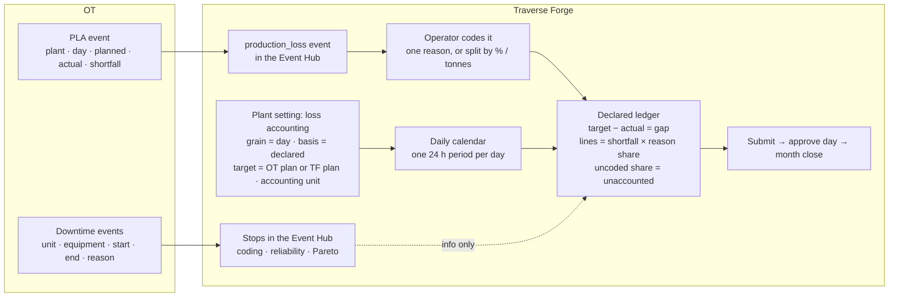

# Plan: daily, OT-declared production loss accounting ("declared mode")

**Status:** analysis and plan only. Nothing is changed. 26 Oct 2026.
**Companion docs:** `docs/PLA_END_TO_END_ANALYSIS.md` (how PLA works today), `docs/PLA_OT_DATA_REQUIREMENTS.md`, `docs/MQTT_FEEDS_PAYLOADS.md`.

---

## 1. What is asked

| # | Requirement | Today |
|---|---|---|
| R1 | OT sends exactly two kinds of message: a **PLA event** (one per plant per day: planned, actual, shortfall, status) and **downtime** events | Both topics exist. The PLA message is stored as an external daily report, not as an event |
| R2 | Production loss is accounted **per day**, and the grain (day / shift) is a **plant setting**; every page follows it | Periods are shift instances from the published calendar (HDPE: A/B/C from 06:00). A daily calendar is technically possible but is not a plant setting |
| R3 | The PLA event appears in the **Event Hub** and operators / engineers set its **reason codes** | Only stops, slowdowns, quality losses, output records, advisories and transitions are events. There is no "production loss" event kind |
| R4 | PLA is **independent of downtime**: the shortfall and its coding are the loss; stops do not drive the accounting | Loss = target − actual, explained by stops (time × planned rate). Stops *are* the accounting |

Example PLA message (OT draft):

```json
{ "event_type": "PRODUCTION_LOSS_DETECTED", "event_id": "MARUN-HDPE-20261025", "event_revision": 1,
  "plant": "MARUN_HDPE", "production_date": "2026-10-25",
  "period_start": "2026-10-25T00:00:00+03:30", "period_end": "2026-10-26T00:00:00+03:30",
  "plan": { "plan_id": "PLAN-20261025", "revision": 1, "approved": true, "planned_production_t": 240 },
  "production": { "actual_good_production_t": 208, "shortfall_t": 32, "measurement_quality": "GOOD" },
  "status": "DETECTED" }
```

## 2. Target design in one picture



**Core idea:** add a second *loss basis* to the accounting engine. Today's basis is **computed** (gap from measurements, stops priced by time × rate). The new basis is **declared**: the PLA event *is* the period's target, actual and shortfall; the operator's reason split *is* the attribution. Everything downstream (loss lines, reconciliation editor, submit / approve / certify / close, loss breakdown, valuation) keeps working because it only consumes loss lines and ledger totals.

## 3. Where today's model and the requirement collide

| Today | Requirement | Resolution |
|---|---|---|
| A loss is never stored on an event; events claim parts of a measured gap | The event carries the loss | New event kind `production_loss` whose declared shortfall is the gap, with reason shares as lines. Only in declared mode |
| Stop loss = time × planned rate | Stops must not drive the loss | In declared mode stops produce **no loss lines**; optional informational cross-check |
| Target from the approved Traverse Forge plan | OT sends its own planned figure | Setting `targetSource`: `declared` (OT plan) or `plan` (TF plan). Recommendation below |
| Actual chosen by source authority (PI / MQTT / external report) | Actual is in the event | Declared mode reads target / actual from the event; the actuals run is bypassed for that slice (coverage = 100 % when the event exists) |
| Periods = shift instances; day = roll-up of approved shifts | One period per day | A daily calendar version (one template, `startLocal = endLocal = dayStart`, which `ShiftTemplate` already defines as 24 h). The setting creates and publishes it |
| Reason split by percent or seconds | Split a tonnage | `ReasonWeightEntry` gains a `quantity` basis checked against the event quantity |
| Coding gate counts uncoded stops | Gate must count the uncoded loss event / uncoded share | Gate variant for declared mode |
| Event Hub has no quantity column, no quantity on downtime | Operators must see planned / actual / shortfall and code them | New columns and detail fields for `production_loss` events |

## 4. Design

### 4.1 Plant setting: "Loss accounting"

New accounting policy kind `loss_accounting` (versioned, effective-dated, approved like `source_authority`; `POLICY_KINDS` in `periods/entities/accounting-policy.entity.ts`, body validation in `periods/engine-policy-bodies.ts`). A policy rather than a column on `tenants` because it changes figures of record and must have an effective date and an approver.

```ts
interface LossAccountingPolicy {
  grain: 'shift' | 'day';                 // R2
  dayStart: string;                       // 'HH:mm' plant local, day grain only (OT: 00:00)
  lossBasis: 'computed' | 'declared';     // R4
  targetSource: 'plan' | 'declared';      // declared mode only
  accountingUnitId: string | null;        // the unit plant-level figures book to (declared mode)
  stopsCrossCheck: boolean;               // show stops' time × rate next to the declared shortfall (info)
  identityTolerance: number;              // |planned − actual − shortfall| allowed, in uom
}
```

Effects on approval (server side, one command):
1. `grain = day` → create and publish a calendar version for the site (or the accounting unit): timezone = plant, `operationalDayStart = dayStart`, one template `{ name: 'Day', startLocal: dayStart, endLocal: dayStart }`, `effectiveFrom` = the policy's effective date. The materializer then creates one period per unit per day (`periods/period-materializer.service.ts` already works from shift instances).
2. Periods already **approved** before the effective date are untouched; open periods from the effective date are re-materialized (existing re-publication path with `republish_reason`).
3. `lossBasis = declared` → the accounting unit must have an approved production profile (materializer precondition) — or the materializer gets a second source of units: the accounting unit of the policy.

Plant settings UI: new card "Loss accounting" in `src/features/settings/settings-page.tsx` (beside "Date and number display", "Reporting week", "Plant"), with the effective date and the approve step, and a plain-language preview: "From 1 Nov 2026 the plant accounts one period per day starting 00:00; the loss is OT's declared shortfall coded in the Event Hub; stops no longer price the loss."

### 4.2 The production loss event

- `physical_type` gains `production_loss` (`domain/events/event-classification.ts`; Postgres enum `production_event_physical_type`, migration with `ALTER TYPE … ADD VALUE`, which cannot run inside the same transaction as its first use — follow `src/database/MIGRATIONS.md`).
- `impact_mode = measured`, `schedule_class` from the reason, `oee_component = none` on the event (the lines get the reason's component).
- Quantity: `quantity = shortfall`, `quantity_uom = 't'`.
- New column `declared_figures jsonb`: `{ planned, actual, shortfall, uom, measurementQuality, plan: { source, planId, revision, approved }, piSource, sourceStatus }`. Source-owned (an OT re-send updates it through the existing source-revision path; user overrides raise review items as for any event).
- Interval: `period_start`–`period_end`. Always closed (no "Close stop").
- `event_revision` → source revision (already supported), same `event_id` = same event.
- Coding: `reason_code_id`, `investigation_pending`, `reason_weights` split by **percent or tonnes** (`domain/events/reason-weights.ts`: add basis `quantity`, total = event quantity ± tolerance).
- Manual `production_loss` events allowed (a day OT missed): quantity, planned, actual entered by a writer. Decision D7.
- Validity rules (server, `production-event/event-write-model.ts` and the write DTO): one `production_loss` event per unit per period window; window must equal a period window of the unit (else review item `grain_mismatch` and the period flag `declared_loss_window_mismatch`); `|planned − actual − shortfall| ≤ identityTolerance` else review item `declared_identity_mismatch` (the event is still stored; the gate blocks submission until resolved — D2).

### 4.3 Ingest (MQTT PLA feed → event)

- `intake/adapters/mqtt/profiles/feeds.decoder.ts` `plaParts`: emit an `interval_event` with template `Production Loss Declared` and attributes Planned, Actual, Shortfall, MeasurementQuality, Status, PlanId, PlanRevision, PlanApproved, instead of an `output_event`.
- `feeds/feed-templates.ts` `PLA_FIELDS`: add `planSource`, `planId`, `planRevision`, `planApproved`, `piActualTag`, `piEventFrameId` as optional paths (today only `planned`, `actual`, `shortfall`, `status`, `quality` are read).
- `handlers/mqtt-pla-feed.handler.ts`: create / revise the `production_loss` event on the feed's unit (default = policy `accountingUnitId`) through `ProductionEventService`, with source `MQTT`, `source_kind = source`. Keep the quarantine mapping (`UnprocessableEntity → mapping_invalid_target`, `Conflict → order_conflict`); add `schema_invalid` when the identity check fails beyond tolerance **and** the policy says reject (D2).
- Retire the external-production-report write for the PLA feed (the "PLA reports" tab becomes a link to the Event Hub filtered on production loss events), or keep it as an audit copy — D9. The `external_production_reports` path stays for other sources.
- `periods/period-recalc.consumer.ts` `RECALCULATING_TYPES`: add `production_loss`.
- Downtime feed: unchanged. `lost_production_t` may be dropped from the template (it is never used).

### 4.4 Engine: declared ledger

New `domain/accounting/declared-ledger.ts`, chosen by `computePeriodAccounting` (`domain/accounting/period-accounting.ts`) when the slice's policy has `lossBasis = declared`:

| Step | Rule |
|---|---|
| Inputs | The period's `production_loss` event (open / closed, not superseded or retracted) |
| Target | `targetSource = declared` → `declared_figures.planned`; `plan` → plan-period target as today |
| Actual | `declared_figures.actual` (good). No actuals run needed; coverage = 1 when the event exists |
| Gap | `target − actual`, signed, never clamped (unchanged identity) |
| Candidates | For each reason share: `quantity = shortfall × weight`, `basis = declared`, `kind` = the reason code's OEE component (availability / performance / quality; no component → `unaccounted_classified`), `cause_event_id` = the event, evidence `{ share, declaredShortfall }`. One reason → one line. Uncoded → **no lines** |
| Residual | `gap − attributed − tolerance`. Uncoded share shows as unaccounted. If `shortfall ≠ gap` (identity mismatch) the difference also sits in the residual and the slice is flagged `declared_identity_mismatch` |
| Capacity ledger | Not computable (no rate, no gross): no capacity totals; flag `capacity_not_applicable` |
| Stops | Produce **no** loss lines. With `stopsCrossCheck` the run records `flags.stopsAtPlannedRate = Σ stop time × planned rate` for display only |
| No event | Flag `declared_loss_missing`; residual = gap if a plan target exists, else nothing computable |

Gates (`domain/reconciliation/submission-gates.ts`, `coding-gate.ts`, `reconciliation/coding-gate.loader.ts`):
- `DECLARED_LOSS_MISSING` (blocks), `DECLARED_IDENTITY_MISMATCH` (blocks until the event is revised or an engineer accepts the difference as a tolerance line — D2), `LOSS_EVENT_UNCODED` (the declared-mode form of `STOPS_UNCODED`; coded ratio = coded share of the shortfall; `warn` / `block` as configured).
- `ACTUALS_INCOMPLETE`, source-conflict and open-review-item gates are satisfied by the event (no actuals run).
- Event conservation (`domain/reconciliation/event-conservation.ts`): manual lines citing the event ≤ its shortfall.

Slices: in declared mode one slice per period (the feed's product or none); product campaigns inside a day do not split the declared figure — D4.

### 4.5 Event Hub

| Area | Change |
|---|---|
| Labels / filters (`src/features/event-hub/model/event-filters.ts`, `ux-kit/labels/event-labels.ts`) | Type "Production loss"; "To code" quick filter includes uncoded production loss events; legacy `EVENT_TYPES` gains `ProductionLossDeclared` or is retired |
| Table (`components/event-columns.tsx`) | Columns "Planned", "Actual", "Lost" (t) shown when the plant is in declared mode; Duration shows the day |
| Quick stats | "Production loss to code: n days · x t" |
| Current stops panel | Unchanged (stops only) |
| Detail page (`event-detail-page.tsx`, `components/event-summary.tsx`) | Summary adds Planned, Actual, Shortfall, Measurement quality, OT status, OT plan id / revision; "From MQTT" markers; Attributed-losses card already shows the lines |
| Code dialog (`components/code-event-dialog.tsx`, `reason-split-section.tsx`) | Split by **percent or tonnes** for production loss events ("The tonnes must add up to the day's shortfall") |
| Actions (`components/event-detail-actions.tsx`) | Hide Close stop / Split / Merge for production loss events; keep Edit / code, Retract (manual only) |
| New / edit form (`components/event-form-fields.tsx`, `quality-fields.tsx`) | Type "Production loss" with Planned, Actual, Shortfall (manual events); server checks the identity |
| Verification panel | "Verify coding" applies; failure detail does not |
| Roles | Unchanged (`EVENT_WRITERS`) |

### 4.6 Periods, workflow and analytics

| Page | Change when `grain = day` / `lossBasis = declared` |
|---|---|
| Period grid (`plan-dashboard/components/period-grid-columns.tsx`) | "Period" shows the date only; "Inputs" shows "Declared (OT)"; Data quality shows the identity check |
| Period page reconciliation (`reconciliation-summary.tsx`, `editor/candidate-row.tsx`, `candidate-derivation.tsx`) | Candidates labelled "Declared · from production loss event"; derivation shows "shortfall × share" (no rate rows); the "Priced at the planned rate" flag text never appears |
| Coding gate panel (`coding/coding-gate-panel.tsx`) | "Production loss coding complete / incomplete"; button "Verify this day's loss coding" |
| Submit / approve | Unchanged mechanics; gate codes above |
| Certify day (`day/certify-day-button.tsx`) | One period per day: either keep the step (second signature) or auto-certify on approval — D5 |
| Month close | Unchanged |
| PLA analytics (`pla-analytics/**`) | Overview, Loss breakdown, Trends, Reconciliation, Loss valuation: work from lines and totals. **OEE** and **Capacity gap** and the waterfall's "Sustained capacity" step: hidden with the note "Not available: the plant accounts declared losses" |
| Loss events tab | Includes production loss events |
| Reports / exports | Event export gains the declared columns; period exports show basis |
| Integration console (`integration-console/mqtt/**`) | PLA feed editor: unit defaults to the accounting unit; field mapping gains the plan / PI paths; sample preview shows planned / actual / shortfall and the identity check result; "PLA reports" tab → "Production loss events" (D9) |

### 4.7 What "independent of downtime" means after the change

- A day with a shortfall and no stops is fully accountable (the operator codes the event).
- A day with stops and no PLA event has **no accounted loss**; the period is blocked (`DECLARED_LOSS_MISSING`) until OT sends it or a writer enters a manual production loss event.
- Stops keep all their other uses: Event Hub coding and verification, stop reliability (MTBF / MTTR), Pareto by duration and count, RCA triggers, repeat / duplicate detection, shift notes. They just do not price the loss.
- With `stopsCrossCheck` on, the period shows "Stops at planned rate: 28.5 t · declared shortfall: 32 t" for the engineer's judgement; it changes nothing.

### 4.8 What is given up in declared mode (say it plainly)

1. The loss is only as reliable as OT's shortfall and the operator's split; no measurement checks the reasons' tonnes.
2. Availability / performance / quality become **labels from the reason code**, not measured components. OEE is not computable.
3. No shift-level loss, comparison or approval (day grain).
4. Over-claiming is impossible by construction (shares add up to the shortfall), so the over-claim and conservation safeguards do less.
5. Changing the basis or grain restates nothing in the past; the plant lives with two regimes across the effective date.

## 5. Decisions needed before building (for `plans/DECISIONS.md`)

| # | Decision | Recommendation |
|---|---|---|
| D1 | Target source in declared mode | **`declared`** (OT plan) — the message states it approved, and R4 wants independence. Keep `plan` available for plants with a TF plan |
| D2 | `planned − actual ≠ shortfall` | Store the event, raise a review item, block submission until OT revises or an engineer books the difference as a tolerance line. Reject to quarantine only when the message has no shortfall at all |
| D3 | Two PLA events for one unit and day | Second `event_id` → review item `duplicate_declared_loss`; the engineer retracts one. Never sum |
| D4 | Product campaigns within a day | One slice per period in declared mode; product = the feed's product or none |
| D5 | Certify day with a single daily period | Keep the step (second pair of eyes, matches month-close prerequisites); auto-certify is a later option |
| D6 | Line kind from the reason code's OEE component | Yes; a reason without a component → `unaccounted_classified` so the breakdown still shows the reason |
| D7 | Manual production loss events | Allowed for `EVENT_WRITERS`, flagged "Manual"; a later OT event for the same window supersedes it after confirmation |
| D8 | OT status handling | `DETECTED` and `CONFIRMED` both create the event; the period cannot be **approved** until status is `CONFIRMED` (or a configurable released set, reusing Source status rules) |
| D9 | Keep the external daily report for the PLA feed | Retire it; the event is the record. Keeps one path and one tab |
| D10 | Accounting unit for HDPE | Reuse `Extruder1` for the pilot (the plant has one producing line) or create a unit `MARUN_HDPE` (plant) — ask the plant; stops stay on their equipment either way |
| D11 | `lost_production_t` on the downtime feed | Drop from the template; it is never used |
| D12 | Effective-date behaviour | New regime from the policy's effective date only; approved periods untouched; open periods re-materialized |

## 6. Change list by layer (files to touch)

**Backend — schema / migrations** (`src/database/migrations`, each with `down`)
1. `production_event_physical_type` + `production_loss`.
2. `production_events.declared_figures jsonb`, index on `(tenant_id, unit_id, physical_type, start_time)` where `physical_type = 'production_loss'`.
3. `accounting_policy_kind` + `loss_accounting`; seed default `{ grain: 'shift', lossBasis: 'computed' }` per tenant.
4. Optional: `event_review_items.kind` values `declared_identity_mismatch`, `grain_mismatch`, `duplicate_declared_loss` if the kind is an enum.

**Backend — domain**
5. `domain/events/event-classification.ts` (type), `domain/events/reason-weights.ts` (quantity basis), `production-event/event-write-model.ts` (defaults, validity), `production-event/production-event.entity.ts`, `production-event/revisions/event-facts.ts` (source-owned `declaredFigures`).
6. `periods/engine-policy-bodies.ts` (+ `LossAccountingPolicy` validation), `periods/entities/accounting-policy.entity.ts`, policy resolution into the engine inputs (`accounting/accounting-inputs.loader.ts`).
7. `domain/accounting/declared-ledger.ts` (new), `period-accounting.ts` (branch), `accounting.types.ts` (flags), `accounting/accounting-persistence.ts` (lines with basis `declared`).
8. `domain/reconciliation/coding-gate.ts`, `reconciliation/coding-gate.loader.ts`, `submission-gates.ts`, `event-conservation.ts`; approval precondition for D8.
9. `periods/period-recalc.consumer.ts`; `periods/period-materializer.service.ts` (accounting unit as a source of units).
10. Calendar: a command "publish daily calendar from policy" using existing `calendar` services (`calendar-version.entity.ts`, `domain/calendar/calendar.types.ts`).

**Backend — API** (contract changes → flag, `npm run openapi:v2:update`)
11. `v2/production-events/production-event-v2-write.dto.ts` (`physicalType` enum, `declaredFigures`, reason weights `quantity`), read views, list filters, export columns.
12. New policy kind in the policies v2 controller / DTOs; plant-settings read model exposes the effective loss-accounting policy.
13. `v2/intake/mqtt-preview-v2.service.ts`: preview of the declared event and identity check.

**Backend — intake**
14. `intake/adapters/mqtt/profiles/feeds.decoder.ts`, `feeds/feed-templates.ts`, `handlers/mqtt-pla-feed.handler.ts` (rewrite), `feeds/feeds.spec.ts`, `test/integration/mqtt-feeds.int-spec.ts`.

**Frontend**
15. Settings: `features/settings/settings-page.tsx` + new `loss-accounting-card.tsx`, API client for the policy.
16. Event Hub: files in §4.5.
17. Periods / analytics: files in §4.6; `ux-kit/labels/accounting-labels.ts` (basis "Declared" exists).
18. Integration console: `integration-console/mqtt/model/feed-templates.ts`, `feed-examples.ts`, `preview-figures.ts`, `pla-reports-tab.tsx` (→ events link), `mqtt-connection-panel.tsx`.
19. `src/api/v2/types/*`, `queries/*` for the new fields.

**Docs**
20. `docs/MQTT_FEEDS_PAYLOADS.md` (PLA = an event; drop `lost_production_t`), `plans/MQTT_FEEDS.md`, `docs/PROACT_APPLICATION_GUIDE.md` (§4 event kinds, §5 declared basis), `plans/DECISIONS.md` (D1–D12), `docs/GLOSSARY.md`.

## 7. Phases

| Phase | Content | Depends on | Size (rough) |
|---|---|---|---|
| 0 | Decisions D1–D12 recorded; OT confirms the payload and the `CONFIRMED` revision flow | — | — |
| 1 | `loss_accounting` policy (entity, validation, v2 API, settings card), daily-calendar command, materializer precondition. Plant can switch to day grain with today's computed basis | 0 | M (3–4 dev-days) |
| 2 | `production_loss` event: enum, columns, write model, reason split by tonnes, DTOs, Event Hub list / detail / code dialog / form | 0 | L (5–6) |
| 3 | PLA feed → event: decoder, handler, preview, quarantine, feeds tests; retire the report write (D9) | 2 | M (2–3) |
| 4 | Declared ledger, gates, recalculation, event conservation, approval precondition (D8); reconciliation editor labels and derivation | 1, 2 | L (5–7) |
| 5 | Period grid / page / certify-day texts, analytics hiding, exports, integration-console tab | 4 | M (3–4) |
| 6 | Fixture tests for the declared ledger (identity, uncoded, mismatch, split), integration tests on `proact-test-postgres`, Playwright journey (OT message → code in Event Hub → approve day), OpenAPI snapshot, docs, role check (admin, reza, omid, sara, leila, farid) | 3, 5 | M (3) |

Total ≈ 21–27 developer-days. Phases 1 and 2 can run in parallel.

## 8. Test plan

- **Unit (fixtures):** declared ledger — single reason; split by % and by tonnes; uncoded (all unaccounted); identity mismatch (+/−); no event; `targetSource` both ways; stops present but ignored; cross-check figure. Reason weights with `quantity` basis. Policy body validation. Event validity (window = period, one per unit per day).
- **Integration (`npm run test:int`, 127.0.0.1:5434 only):** PLA message → event → recalculation → ledger totals; revision 2 replaces figures and keeps coding; duplicate `event_id` for the same day → review item; daily calendar publication → one period per day; gates block / allow.
- **E2E (Playwright, one HDPE journey, after go-ahead):** switch plant to day / declared from a future date → publish PLA message → code it in the Event Hub (split) → period shows attributed = coded, unaccounted = rest → submit → approve → certify day. Check as admin, reza, omid, sara, leila, farid.

## 9. Risks

| Risk | Mitigation |
|---|---|
| Two regimes (shift / computed before the date, day / declared after) confuse reports | Effective-date banner on period pages and analytics; filters default to the current regime |
| OT's planned figure disagrees with the TF plan used for valuation / dashboards | D1 default `declared`; show the TF plan as a comparison figure, not a second target |
| Enum migration ordering (`ADD VALUE` outside a transaction) | Follow `MIGRATIONS.md`; separate migration for the enum value |
| Operators split a 32 t day across reasons with no measurement behind it | Coding verification by a supervisor stays required; cross-check figure available |
| Existing e2e and fixtures assume shifts | Keep `computed` + `shift` the default for every existing tenant; only HDPE (or a test tenant) switches |

## 10. Recommendation

Build declared mode as described, as an **additional basis** switched per plant from an effective date, rather than replacing the computed engine. HDPE can then run day / declared with OT's two messages, while the computed shift engine stays available for plants that have counters and want measured losses. Open D1–D12 with the plant and OT first; D1, D2, D8 and D10 change the data model and must be settled before Phase 2.
