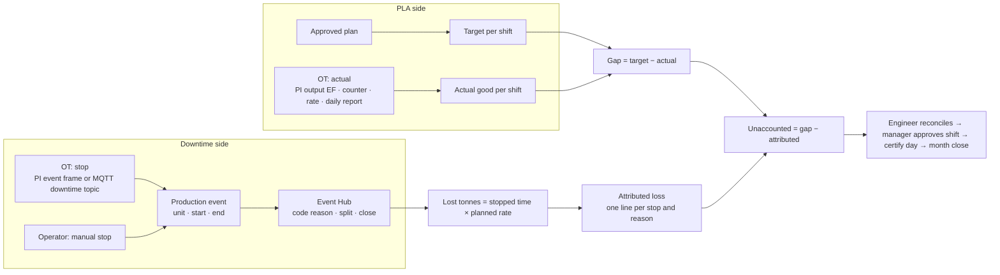
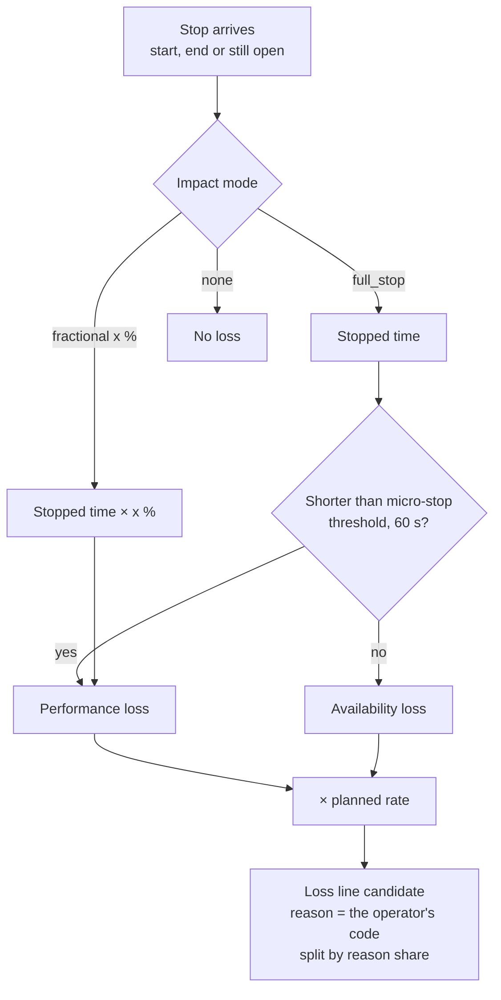
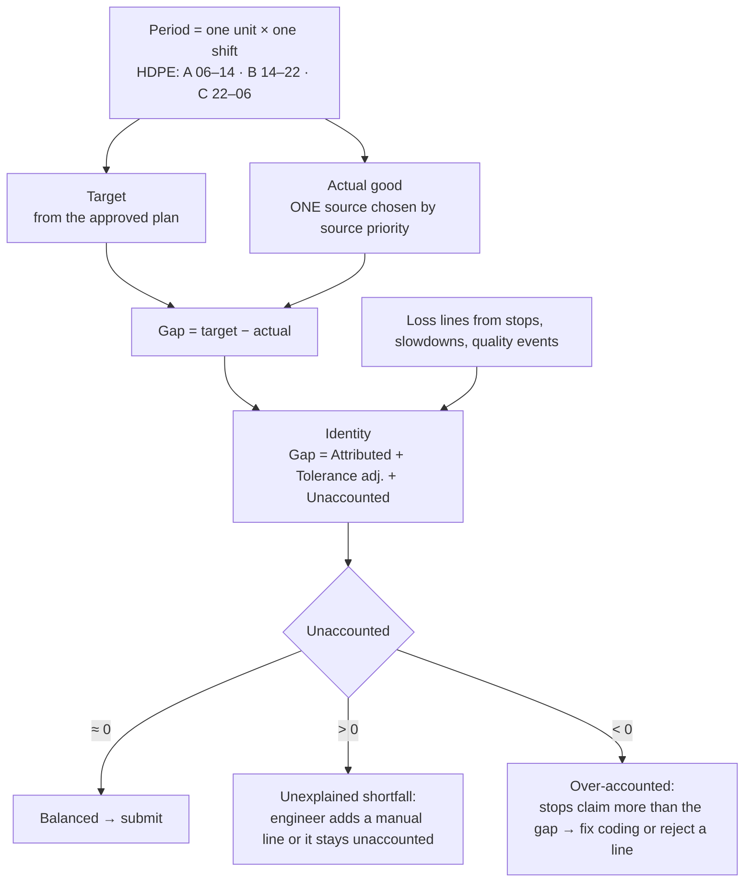
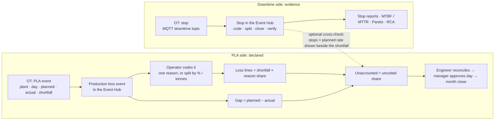
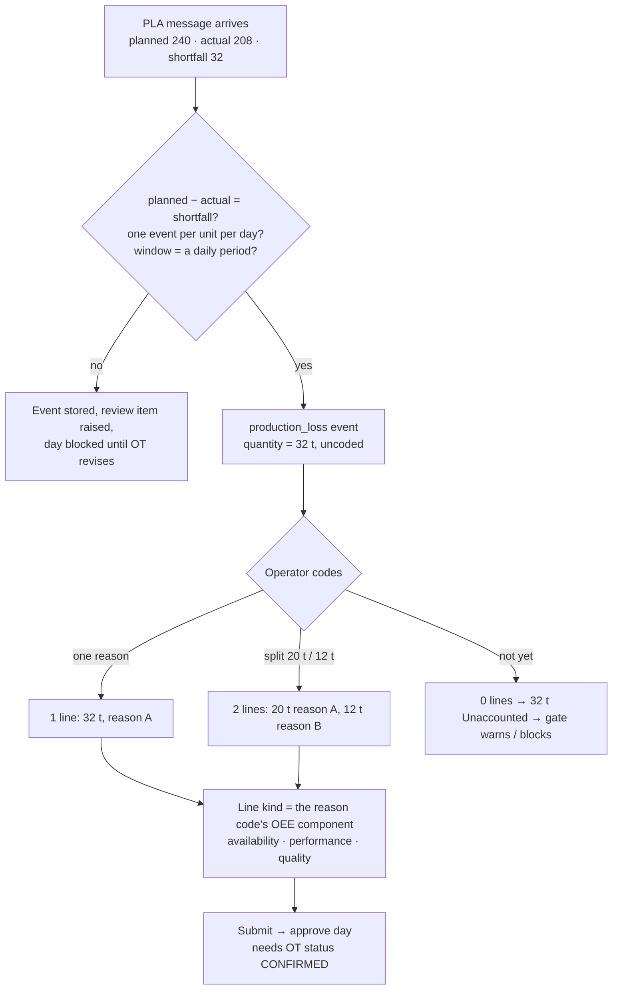

# Downtime and PLA today: how they are linked and calculated

**As implemented on 26 Oct 2026** (engine 2.8.0, HDPE plant). Simple view; details in `docs/PLA_END_TO_END_ANALYSIS.md`.

---

## 1. The one sentence

**PLA measures the shortfall; downtime explains it.**
PLA: `gap = target − actual good` per unit per shift. Downtime: each stop is turned into lost tonnes = `stopped time × planned rate` and subtracted from the gap. What is left is **Unaccounted**.

## 2. The two inputs and where they meet

## 3. Downtime: from stop to lost tonnes

Rules:
- **Planned rate** = shift target ÷ scheduled time. So "whole shift stopped" = "whole target lost".
- A stop that spans two shifts is **clipped** into each shift.
- Overlapping stops **share** the time (not added).
- The tonnes OT may send with a stop (`lost_production_t`, PI `Quantity`) are stored but **not used**.
- **Coding changes the reason, not the tonnes.** An uncoded stop still produces its loss line, with no reason; the coding gate flags it.
- Only `downtime` events do this. `slowdown (measured)` and `quality_loss` events use their **own declared quantity**, capped by the measured totals (capacity − gross, gross − good).

## 4. PLA: from plan and actual to Unaccounted

Rules:
- Actual comes from **one** source per shift (PI output frames, counter, rate, MQTT, manual, external report), never summed.
- An **external daily report** (the MQTT PLA message) counts as actual only if its window equals the period window, its status is "released" and `external_report` is in the source priority. On HDPE (8 h shifts, 24 h report) it is **display only**.
- Performance loss is attributed **only** when a measurement or a measured slowdown supports it; otherwise it stays Unaccounted.

## 5. Worked example (one shift, Extruder1, shift A)

| Item | Value | How |
|---|---|---|
| Target | 80 t | plan: 10 t/h × 8 h → planned rate 10 t/h |
| Actual good | 71.5 t | PI counter end − start |
| **Gap** | **8.5 t** | 80 − 71.5 |
| Stop 1: gearbox trip, 06:12–06:47 (35 min), coded MECH-GEARBOX | 5.83 t | 35/60 h × 10 t/h → availability |
| Stop 2: screen change, 09:30–09:42 (12 min), uncoded | 2.0 t | 12/60 × 10 → availability, reason empty |
| **Attributed** | **7.83 t** | 5.83 + 2.0 |
| **Unaccounted** | **0.67 t** | 8.5 − 7.83 (slow running or small losses nobody recorded) |
| Coding gate | 1 stop uncoded, 74 % of stop time coded (< 95 %) | warning on submit |

If the operator codes stop 2, the 2.0 t moves to its reason; the totals do not change. If OT had sent `lost_production_t: 7.3` with stop 1, it would be ignored; the line stays 5.83 t.

## 6. Who does what

| Step | Who | Where |
|---|---|---|
| Stop arrives / is logged, closed, coded, split | Operator, engineers | Event Hub |
| Coding verified | Shift supervisor (manager_approver, production_engineer) | Event Hub |
| Shift calculated, candidates proposed | Server (automatic, on every event change) | — |
| Candidates accepted / adjusted / rejected, manual lines | Production engineer | Period page |
| Shift submitted → approved | Engineer → manager / accountant (not the submitter) | Period page |
| Day certified | Manager | Day view |
| Month closed | Accountant / finance | Month close |

## 7. Where the two OT messages land today

| OT message | Becomes | Used in PLA? |
|---|---|---|
| Downtime topic / PI *Production Loss* frame | A stop in the Event Hub | **Yes**: stopped time × planned rate |
| PLA topic (plant · day · planned · actual · shortfall) | A daily external report on the "PLA reports" tab | **No** on HDPE (shift accounting). Planned / shortfall are comparison only |
| PI counter / rate / output frames | The shift actual | **Yes**: this is the actual |

**So today: downtime and PLA are two sides of one calculation. Downtime is not a separate PLA; it is the explanation of PLA's gap.**

---

# If we make them independent ("declared mode")

Same plant, same two OT messages, different wiring. Full plan: `docs/PLA_DECLARED_MODE_PLAN.md`.

## 8. The one sentence

**OT declares the shortfall; the operator codes it; stops are evidence only.**
PLA: one period per **day**; `gap = OT planned − OT actual`; the loss lines are the operator's reason split of OT's `shortfall_t`. Downtime keeps its own life (Event Hub, reliability KPIs) and no longer prices the loss.

## 9. The two inputs, no longer meeting

## 10. PLA event: from OT message to Unaccounted

Rules:
- **Target = OT planned** (or the Traverse Forge plan, by setting). **Actual = OT actual.** No source priority, no counters needed.
- **Stops produce no loss lines.** `lost_production_t` on the downtime feed is dropped.
- The tonnes per reason are what the operator enters; nothing measures them. Supervisor verification of the coding stays mandatory.
- Grain and basis are a **plant setting** with an effective date: `grain = day` publishes a daily calendar; approved shifts before that date are untouched.
- Not available in this mode: OEE, capacity gap, shift-level loss.

## 11. The same example, declared

| Item | Value | How |
|---|---|---|
| OT planned (target) | 240 t | from the PLA message |
| OT actual | 208 t | from the PLA message |
| **Gap** | **32 t** | 240 − 208 (must equal `shortfall_t`) |
| Operator split | 20 t MECH-GEARBOX · 12 t SCREEN-CHANGE | coded in the Event Hub by tonnes |
| **Attributed** | **32 t** | 20 + 12 |
| **Unaccounted** | **0 t** | by construction when fully coded |
| Stops that day (cross-check only) | 28.5 t at planned rate | shown beside the 32 t; changes nothing |
| Gate | OT status `DETECTED` → cannot approve until `CONFIRMED` | approval precondition |

If the operator codes only 20 t, Unaccounted = 12 t and the gate warns. OT's stop tonnes never enter the figure.

## 12. Side by side

| | Today (computed, shift) | Independent (declared, day) |
|---|---|---|
| Period | unit × shift (A / B / C) | unit × day |
| Target | Traverse Forge plan | OT planned (or TF plan) |
| Actual | one measured source (counter, PI frames…) | OT actual in the message |
| Loss lines | stops × planned rate; declared quality / measured slowdown | shortfall × operator's reason share |
| Downtime's role | **is** the attribution | evidence and reliability only |
| Unaccounted | gap − stop losses − claims | uncoded share of the shortfall |
| Evidence behind the tonnes | stopped time, rates, gross / good | operator judgement, supervisor verified |
| OEE / capacity gap | yes | no |
| OT must send | counter or rate per unit + stops | PLA message per day + stops |
| Build effort | built | ≈ 21–27 developer-days (`docs/PLA_DECLARED_MODE_PLAN.md`) |
