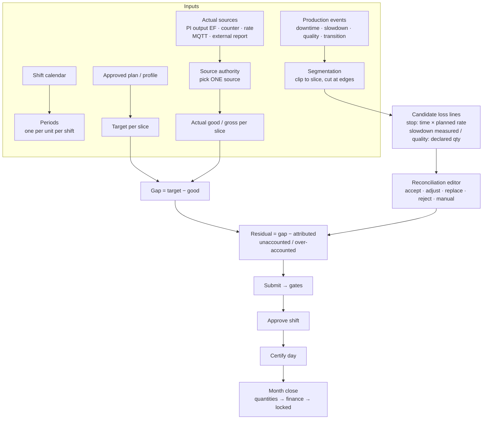

# Production Loss Accounting (PLA): end-to-end analysis

**Scope:** PLA only. How a loss is defined, computed, explained, approved and reported in Traverse Forge; how production events (stops) relate to it; and what an OT "production loss event" can and cannot do in this model.
**Basis:** backend code (engine `2.8.0`), frontend code, `plans/DECISIONS.md`, and the live HDPE plant on 26 Oct 2026 (1,690 downtime events, all `full_stop`; 29 PI output events; loss lines of kinds availability / performance / quality / residual).

---

## 1. The question, answered first

> *"PLA isn't independent from downtime? We will get a PLA event from OT; in the Event Hub the operator sets the reason code… why like this?"*

1. **PLA is not independent from downtime, on purpose.** PLA answers "we planned X and made Y, where did X − Y go?". Downtime events are the main *explanation* of that gap. Without stops (and slowdowns / quality events), the whole gap is "unaccounted". Without an actual (production quantity), there is no gap to explain. PLA needs both.

2. **A loss is never stored on an event.** The loss belongs to a **period** (one unit, one shift): `gap = target − actual good`. Events only *claim* parts of that gap. The claims are proposed by the server as **loss-line candidates**; an engineer accepts / adjusts / rejects them; what is left is **unaccounted**. This is the standard loss-accounting identity (OEE six big losses, ISO 22400): the shortfall is measured once, then distributed to causes — never the other way round.

3. **"OT sends a production loss event, the operator codes it in the Event Hub" is exactly what happens today — for stops.** A PI event frame of template *Production Loss* or a message on the MQTT **downtime** topic becomes a `downtime` event in the Event Hub. The operator sets the reason, splits it, closes it. The server then prices it: **loss = stopped time × planned rate**. The tonnes OT may send with it are stored but not used (see §6).

4. **The message we called the "PLA feed" is not an event, it is a measurement.** OT's sample (`PRODUCTION_LOSS_DETECTED`, plant, day, planned 240, actual 208, shortfall 32) describes a whole day's result, not one stoppage with a cause. A 32 t shortfall over 24 h has many causes; giving it one reason code in the Event Hub would not be loss accounting. So it is stored as an *external production report*: its actual can become the period actual (under conditions, §5), its planned / shortfall are shown for comparison. Explaining the 32 t is still the job of the stops on the downtime topic.

5. **If OT can only send a shortfall number and a reason, the place to book it is the period's reconciliation editor** (an `unaccounted_classified` line with a reason), not the Event Hub. That path exists today (§8).

## 2. Vocabulary

| Term | Meaning in Traverse Forge | Where it lives |
|---|---|---|
| **Period** | One unit × one shift instance (HDPE: A 06–14, B 14–22, C 22–06 Tehran). Never overlaps for a unit. | `production_periods` |
| **Slice** | A period cut at a product-campaign change; targets and actuals are per slice | `period_product_slices` |
| **Target** | Plan-period target × the slice's share of time (from the approved plan or profile) | plan / profile |
| **Actual** | Good production of the slice, from **one** selected source (never summed across sources) | actuals run |
| **Gap** | `target − actual`. Signed: negative = overproduction | `period_ledger_totals.gap_qty` |
| **Loss line** | One explained quantity: kind, basis, reason, cause event, evidence | `loss_lines` |
| **Attributed** | Σ active loss lines of the plan ledger | `attributed_qty` |
| **Unaccounted** (residual) | `gap − attributed − tolerance adjustment`. Signed, never clamped | `residual_qty` |
| **Ledger** | *Plan ledger*: against the plan target (what PLA pages show). *Capacity ledger*: against sustained capacity (OEE / capacity-gap views) | `loss_lines.ledger` |
| **Revision** | A reconciliation of a period: draft → in_review → approved | `accounting_revisions` |

## 3. The flow

## 4. Periods and targets

- **Materialization** (`periods/period-materializer.service.ts`): one period per shift instance for every unit with an approved production profile; idempotent; a GiST exclusion stops overlaps. Then product slices are resolved from campaigns.
- **Target** (`domain/accounting/slice-target.ts`, decision LA-07): the plan period's target × the slice's share of that plan period's time. The planning rate = target ÷ eligible scheduled time; stops are priced at this rate so that "all time stopped" = "all target lost".
- No planning rate (no plan, no profile) → flag `plan_allocation_required`, residual = gap, nothing attributed.

**Design consequence:** the target is Traverse Forge's. OT's `planned_production_t` never changes it (`plans/DECISIONS.md` 2026-10-26: "Target and gap stay Traverse Forge's approved plan").

## 5. The actual: one source per slice

`domain/actuals/period/authority.ts` ranks the sources named in the plant's **source authority policy**: `pi_output_ef`, `pi_counter`, `pi_rate`, `mqtt`, `kafka`, `manual`, `external_report`.

- One authority per slice. A lower rank is used only when the primary is **missing, stale or bad quality**. A *conflict* (two sources disagree beyond tolerance) is flagged, never auto-switched.
- Only the selected quantity is used: outputs are never summed or averaged.
- **External report** (the MQTT PLA feed lands here): used only when (a) state `current` and `certified_eligible` (its source status is marked *released* in Source status rules), (b) its UTC window equals the period window exactly (else `external_report_grain_mismatch`), (c) `external_report` is in the policy and wins the ranking. HDPE today: no source status mapping, policy without `external_report`, periods are 8 h shifts vs a 24 h report → the daily report contributes nothing to accounting. It is displayed on the "PLA reports" tab only.

## 6. Events: how they explain the gap

### 6.1 Classification axes (`domain/events/event-classification.ts`)

| Axis | Values |
|---|---|
| `physical_type` | downtime · slowdown · quality_loss · production_output · advisory · grade_transition |
| `impact_mode` | none · full_stop · fractional · measured |
| `schedule_class` | planned · unplanned · external · unknown |
| `oee_component` | availability · performance · quality · idle · none |
| `physical_state` | open · closed · superseded · retracted |
| `coding_state` | uncoded · coded · reviewed |

A PI frame or MQTT downtime message of template *Production Loss* is classified `downtime / unknown / availability / full_stop` (`event-write-model.ts`, decision 2026-10-08 §1.1). Reason-code defaults may fill schedule class, OEE component and impact code — never the physical type or impact mode.

### 6.2 What each event contributes (`domain/accounting/segmentation.ts`, `time-lines.ts`, `claims.ts`)

| Event | Basis | Quantity used | Bucket |
|---|---|---|---|
| downtime, `full_stop`, ≥ micro-stop threshold | **time × rate** | planned rate (plan ledger) / sustained rate (capacity ledger) | availability |
| downtime, `full_stop`, < threshold | time × rate | same | performance (micro-stop) |
| downtime or slowdown, `fractional` | time × rate × fraction | same | performance (or availability per policy) |
| slowdown, `measured` | **event quantity** (declared), pro-rated by time inside the slice | event's own tonnes | performance, capped by (capacity − gross) |
| quality_loss | **event quantity** (declared), pro-rated | event's own tonnes | quality, capped by (gross − good) |
| grade_transition | time × rate vs allowance | — | transition allowance / excess |
| downtime, `none`; advisory; IOW / SOL / APM / WO | — | — | **no loss** (T42: never automatic loss) |

Rules that follow:

- **A stop's tonnes are always derived from its stopped time.** `production_events.quantity` is stored for a downtime event (PI `Quantity` attribute, MQTT `lost_production_t`) but is not read by the engine for downtime. The reasons: (1) one consistent price for stopped time across all stops; (2) the sum of stop losses can never exceed the time lost; (3) OT's per-event tonnage estimate and the measured shortfall would otherwise never tie.
- **Overlapping stops share the time**, they are not added (`first_out` or `equal_share` policy; "rate × non-overlapping stopped time").
- **An event spanning two shifts is clipped** into each period; declared quantities are pro-rated by time. Evidence rows record `clippedStart / clippedEnd / share`.
- **Declared quantities are claims, not the gap.** If quality claims exceed (gross − good), or measured slowdown claims exceed (capacity − gross), the slice is flagged `claim_exceeds_component` and submission is refused (`CLAIM_EXCEEDS_MEASUREMENT`) until the engineer adjusts or rejects a claim.
- **Uncoded stops still produce loss lines** (reason = null). Coding never changes *how much* a stop cost, only *which cause* gets it. Uncoded stops are surfaced by the coding gate instead (§8).
- **Recalculation** (`periods/period-recalc.consumer.ts`): any change to a downtime / slowdown / quality_loss / production_output event re-queues the touched periods (and downstream units for downtime). Verification-only changes do not.

### 6.3 Performance without a measurement

The plan ledger attributes performance **only from claims** (measured slowdowns, fractional derates, micro-stops). "The shortfall no claim explains is not attributed — it stays in the residual as unaccounted" (decision 2026-10-09 §2.5; guide §5.3: *"not reported as slow running unless a rate measurement supports it"*). This is why gross output matters: with good only, slow running and quality can never be separated from "unaccounted".

## 7. The Event Hub's role in PLA

The Event Hub is the **coding** surface, not the accounting surface.

| Operator / engineer action | Effect on PLA |
|---|---|
| **Code** (reason, or "investigation pending", or split by % / minutes) | Chooses the cause of a stop's loss. Changes which reason the candidate line carries; the quantity stays time × rate. Clears the `STOPS_UNCODED` gate item. |
| **Close stop** (end time + why) | Ends the open interval → stopped time becomes final. Until then the open stop is measured up to "as of". |
| **Split / Merge** | Changes the time segments; losses follow the new intervals. The original becomes superseded. |
| **Impact** (stops unit / reduces output % / no impact) | `full_stop` → availability; `fractional` → performance by %; `none` → no loss. |
| **Quantity** (only on quality_loss, slowdown, production_output) | Declared claim (quality / measured performance). **A downtime event has no quantity input** in the form. |
| **Verify coding** (shift supervisor), **Validate failure detail** (reliability) | Workflow labels only; no effect on quantities. |
| **Attributed losses card** on the event page | Read-only: the loss lines of each period the event touched, approved else draft, per kind — this is the only place the event's "cost" is shown. |

Roles: `operator`, `production_engineer`, `reliability_engineer`, `manager_approver` write events; the production accountant reads coding only (owner decision 2026-10-19). Operators see no money.

## 8. Reconciliation, approval, certification, close

1. **Calculation run** per period (`computePeriodAccounting`): segments → capacity ledger → plan ledger → conservation checks → `period_ledger_totals` + candidate `loss_lines` (immutable per run).
2. **Reconciliation editor** (period page): the engineer decides each candidate — *accept / adjust / replace / reject* (a reason is required unless accepting) — and adds **manual lines**: availability, performance, quality, bridge, gain, **`unaccounted_classified`** (give the unexplained remainder a reason), reversal. **Event conservation:** manual lines citing an event cannot exceed what the run computed for that event. Identity shown on screen: *Target − Actual (good) = Gap = Attributed + Tolerance adj. + Unaccounted*.
3. **Submit** (`reconciliation/submission.service.ts`): run unchanged → environment gates (actuals coverage, no source conflict, no open review items) → **coding gate** (`STOPS_UNCODED`, `CODING_COVERAGE_LOW`; mode `warn` at 95 % by default, `block` optional) → tolerance lines (zero / absolute / percent) → content gates: `ACTUALS_INCOMPLETE`, `OVERPRODUCTION_CONFLICT`, `RESIDUAL_UNEXPLAINED`, `OVER_ACCOUNTED`, `BASELINE_CHANGED`, `MISSING_CODE`, `UNACCOUNTED_NOT_ALLOWED`, `CLAIM_EXCEEDS_MEASUREMENT`.
4. **Approve** (manager_approver / production_accountant, not the submitter; hash must match; revision not stale) → the figures of record.
5. **Certify day** (manager_approver): every shift approved; certifier submitted none of them; daily coding gate (pilot 99 %).
6. **Month close**: `open → quantities_closed → finance_signed_off → locked`; all periods approved, no open change proposals; materiality routing on Σ(unaccounted + bridge + tolerance).

## 9. What the OT "production loss" messages do in this model

| OT message | Today's path | Becomes | Operator codes it? | Drives accounting? |
|---|---|---|---|---|
| PI event frame, template *Production Loss* (unit, start, end, ReasonCode, Quantity) | `pi-frame-ingest.service.ts` | `downtime / full_stop` event in Event Hub | **Yes** (reason, split, close) | **Yes**: time × planned rate. `Quantity` stored, ignored |
| MQTT **downtime** topic (unit, equipment, start, end/duration, reason, lost_production_t) | `feeds.decoder.ts` → same handler path | same as above | **Yes** | **Yes**, same way |
| MQTT **PLA** topic (plant, day, planned, actual, shortfall, status) | `feeds.decoder.ts` → external production report | A daily report row (PLA reports tab) | **No** — it has no single cause to code | Only its **actual**, and only when §5 conditions hold. Planned / shortfall: display only |
| PI output event frames / counter / rate tags | actuals sources | per-slice actual | — | **Yes**: this is the preferred actual |

So OT's event *is* coded in the Event Hub, when it is a stop. The daily shortfall is not an event and goes elsewhere. This is the only mismatch with the expectation in the question, and it comes from the shape of the sample payload (one row per day per plant), not from a design gap.

## 10. If the intent is different — options

| Intent | Fits today? | What it takes |
|---|---|---|
| **A. OT sends each stoppage; operators code it; loss = time × rate** | **Yes** — built (PI frames and MQTT downtime topic) | Nothing. OT may drop `lost_production_t`. |
| **B. OT sends per-shift actual (and gross / reject) per unit; stops explain the gap** | Yes after configuration | Source status "released" for MQTT; `external_report` in source priority. Small code: read unit / gross / reject from the message. See `docs/PLA_OT_DATA_REQUIREMENTS.md` §5. |
| **C. OT's tonnes on a stop should be the stop's loss** | **No** — contradicts the identity | Would need a new basis `declared` for downtime, plus a cap and over-claim handling, and a decision on how stop tonnes and the measured gap reconcile. Not recommended: two prices for the same stopped time. |
| **D. OT sends a shortfall with one reason (no stop intervals)** | Partly | Book it as an `unaccounted_classified` manual line on the period (reconciliation editor), or let the engineer do it from the displayed OT shortfall. Automating it = code change + business decision (DECISIONS 2026-10-26 says OT shortfall is never used in accounting). |
| **E. Plant-level daily PLA only (no shifts)** | No | Daily calendar, day-boundary alignment, plant-level unit aggregation (code). Loses shift accounting. See `docs/PLA_OT_DATA_REQUIREMENTS.md` §4. |

**Recommendation:** A + B. Keep OT's stop events as the explanation (already coded in the Event Hub), get the actual per unit at shift grain (counter tag, or per-shift message), and keep OT's daily planned / shortfall as a cross-check figure. Nothing in the shift workflow changes.

## 11. Findings noted on the way (not changed)

| # | Finding | Where |
|---|---|---|
| 1 | Nothing on screen tells the operator a stop's loss is time × planned rate and that an OT-supplied tonnage on a stop is ignored. The downtime feed's "Lost quantity" help says only "Lost tonnes." | `feed-templates.ts` (frontend) :44; event detail page |
| 2 | PLA dashboard tiles use "Shortfall" / "Unexplained", which `docs/GLOSSARY.md` lists as words to avoid (agreed word: "Unaccounted") | `pla-analytics/dashboard/plan-tile-model.ts:28-38` |
| 3 | Editing a `grade_transition` event does not trigger a period recalculation (`RECALCULATING_TYPES` omits it) | `periods/period-recalc.consumer.ts:21-27` |
| 4 | Guide still says the event detail is a "drawer"; it is a page | `docs/PROACT_APPLICATION_GUIDE.md:158` |
| 5 | The typed PI mapping catalog has no `Equipment` rule; the MQTT downtime feed places by equipment through `controls`, not a field | `attribute-mapping/event-field-catalog.ts` |

## 12. Key references

| Topic | File |
|---|---|
| Engine entry | `server/pro-act-backend/src/domain/accounting/period-accounting.ts` |
| Stop pricing | `domain/accounting/time-lines.ts`, `segmentation.ts` |
| Declared claims | `domain/accounting/claims.ts`, `component-lines.ts` |
| Plan identity | `domain/accounting/plan-ledger.ts`, `plan-totals.ts` |
| Source choice | `domain/actuals/period/authority.ts`, `external-line-candidate.ts` |
| Reconciliation | `domain/reconciliation/reconcile.ts`, `submission-gates.ts`, `coding-gate.ts`, `event-conservation.ts` |
| Close | `domain/close/day-certification.ts`, `month-close-machine.ts` |
| Event classification | `domain/events/event-classification.ts`, `production-event/event-write-model.ts` |
| OT ingest | `integration/pi-frame-ingest.service.ts`, `intake/adapters/mqtt/profiles/feeds.decoder.ts` |
| Event Hub | `src/features/event-hub/**` |
| Period pages | `src/features/plan-dashboard/**`, `src/features/pla-analytics/**` |
| Decisions | `plans/DECISIONS.md` 2026-10-08 §1.1, 2026-10-09 §2.5 / §2.8, 2026-10-13 LA-02, 2026-10-26 MQTT feeds |
| OT data needs | `docs/PLA_OT_DATA_REQUIREMENTS.md` |
