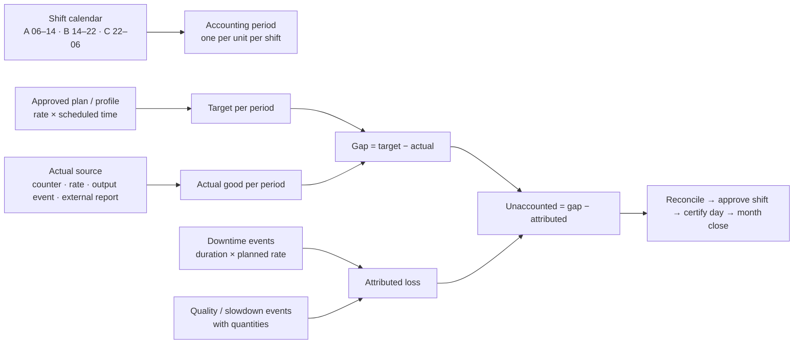

# Production loss accounting (PLA): what we need from OT

**Scope:** production loss only. Checked against the code and the live HDPE plant on 26 Oct 2026.
**Question:** what must OT send so that Traverse Forge can account production loss, what is built today, and what changes if OT sends plant-level or shift-level figures.

---

## 1. Short answer

1. **Traverse Forge computes the production loss itself.** It needs two things:
   - the **target**: from the approved plan in Traverse Forge, not from OT;
   - the **actual good production per unit, per shift**.

   Then **loss = target − actual**. Explaining that loss (stops, slow running, quality) comes from downtime and quality events.
2. **The key item from OT is the actual production quantity at shift grain.** The best form is a production **counter** (totalizer) tag per unit, sent continuously; Traverse Forge cuts it into shifts itself. Second best is one actual per unit per shift.
3. **OT's own "planned" and "shortfall" figures are not needed** for the calculation. Traverse Forge keeps them only to compare with its own figures.
4. **A plant-level daily figure, as in the current sample payload, cannot drive shift accounting.** Today it is stored and shown for comparison only.

## 2. How PLA works today



| Part | What is built | Where the data comes from |
|---|---|---|
| **Period** | One accounting period **per unit per shift** (HDPE: A 06–14, B 14–22, C 22–06 Tehran). Day and month are roll-ups of approved shifts. | Traverse Forge calendar |
| **Target** | Approved plan or profile: planning rate × scheduled time, or a planned quantity split over the shifts | Traverse Forge plans (not OT) |
| **Actual** | One source per period, chosen by the plant's **source priority**: <br>• PI output event frames<br>• PI or MQTT **counter** (end − start of the shift)<br>• PI or MQTT **rate** (t/h integrated over the shift)<br>• **external report** (only when its start/end equal the period exactly, it is marked released, and it is named in the source priority)<br><br>Values from two sources are never summed. | OT (PI / MQTT) |
| **Gap** | target − actual good. Overproduction and "unaccounted" are flagged. | computed |
| **Availability loss** | Each stop's **duration × planned rate**. The tonnes OT may send with a stop are stored but **not** used. | Downtime events (MQTT downtime feed, PI event frames, or derived from machine state) |
| **Performance loss** | Running capacity − **gross** production, explained by slowdowns and micro-stops | Needs **gross** |
| **Quality loss** | **Gross − good**, explained by quality events with quantities | Needs **gross and good** |
| **Unaccounted** | Gap − attributed. Reviewed and explained by people. | computed |
| **Workflow** | Calculation run per shift → reconcile → approve shift → certify day → month close | Traverse Forge |

**Integration built so far** (MQTT feeds, 26 Oct; see `docs/MQTT_FEEDS_PAYLOADS.md`):

| Feed | Status |
|---|---|
| **PLA feed** | Takes OT's daily message. It is stored as a **daily external report** booked to one unit and product, with OT's planned / actual / shortfall shown on the "PLA reports" tab. **It does not change shift actuals today**, because HDPE accounts by shift. |
| **Downtime feed** | Creates stops on Extruder1 in the Event Hub. These **are** used for availability loss. |
| **MQTT measurements** (existing contract-v1 profile) | A counter or rate signal per unit becomes shift actuals directly. This was proven in the Marun end-to-end test. |

## 3. What we need from OT

### Recommended for the current PLA (shift accounting)

| # | Data | Grain | Why | How to send |
|---|---|---|---|---|
| 1 | **Good production counter** (totalizer, t), or a rate (t/h) | per unit, every 1–5 min | Actual per shift; Traverse Forge cuts it at 06:00 / 14:00 / 22:00 itself | MQTT measurement topic (contract v1) or PI tag |
| 2 | **Downtime events**: start, end, unit, equipment, reason | per stop | Availability loss and Pareto | MQTT downtime feed (built) |
| 3 | **Gross and reject (or off-spec) quantity** | per unit per shift, or counters | Performance and quality loss. Without gross, those losses stay "unaccounted". | Second counter, or per-shift report |
| 4 | Optional: **OT's per-shift planned / actual / shortfall** | per unit per shift | Comparison and cross-check only | PLA feed, one message per shift (see §5) |

Things we do **not** need from OT: targets or plans (kept in Traverse Forge), the loss calculation, and the shift split (Traverse Forge does it).

**Questions for OT / data engineering:**
1. Is there a production **totalizer tag** per extruder in PI? Is it good or gross, and in t or kg?
2. Is there a reject / off-spec quantity tag or report per shift?
3. Is their "production day" 00:00–24:00 or 06:00–06:00? Traverse Forge's day starts with shift A at 06:00. A daily figure only lines up with our day when the boundaries match.
4. Are their planned figures from the same plan as Traverse Forge's? If not, which one is authoritative for loss?
5. Is the PLA message per plant, per unit, or per line? Does a plant have one unit (HDPE: Extruder1) or several?

## 4. Option A: plant-level daily PLA only (the current sample payload)

**What it gives today:** the day's actual, planned and shortfall shown on the PLA reports tab. Shift accounting is unchanged and gets no actual from it.

**What would be needed to account from it:**

| Change | Effort | Effect |
|---|---|---|
| Switch the plant (or that unit) to **daily accounting**: one 24 h "shift" in its calendar, starting at the same time as OT's `period_start` | Configuration (calendar + plan) | One period per day instead of three. Shift-level loss, shift comparison and shift verification are lost. |
| Align the day boundary (OT 00:00 vs Traverse Forge 06:00) | OT or configuration | A report only counts when its start/end equal the period exactly |
| Add "external report" to the plant's **source priority** | Configuration (Source priority page, maker-checker) | The daily report becomes the actual |
| Mark OT's status (e.g. `DETECTED` / `CONFIRMED`) as **released** for source system `MQTT` | Configuration (Source status rules, maker-checker) | Unreleased reports are never used |
| A real **plant-level unit**, or summing several units' reports into a plant | **Code change** | Today "plant" is just the one unit picked on the feed. There is no plant aggregation. |
| Using OT's shortfall as the loss instead of target − actual | **Code change, and a business decision** | Today OT's planned and shortfall are comparison only |

**Limits even after these changes:**
- Only good is known, so performance and quality loss stay "unaccounted". Only stops are attributed.
- Stops still land on Extruder1. If the plant figure is booked to another unit, the stops do not explain its loss.

**Affected in the product:** shift periods, shift approval, shift verification of stops, day certification (it becomes a single period), shift reports and comparisons, the operator / shift lead workflow, and month close (it becomes simpler).

## 5. Option B: shift-wise PLA from OT (per unit, per shift)

**What works already, with no code change:**
- Each message with `period_start` / `period_end` equal to a shift (06:00–14:00, 14:00–22:00, 22:00–06:00 Tehran) matches that shift period exactly. It can become the shift actual once:
  - "external report" is in the source priority, and
  - OT's status is marked released for `MQTT`.
- Use one PLA feed per unit, or one message per unit per shift on the same topic. Today a PLA feed books to one unit and product, so several units need several feeds (up to 8 per connection).
- `event_id` should identify the unit and shift, e.g. `MARUN-HDPE-EXT1-20261025-A`. A correction is the same id with a higher `event_revision`.

**Example per-shift message:**

```json
{
  "event_id": "MARUN-HDPE-EXT1-20261025-A",
  "event_revision": 1,
  "plant": "MARUN_HDPE",
  "unit": "Extruder1",
  "production_date": "2026-10-25",
  "shift": "A",
  "period_start": "2026-10-25T06:00:00+03:30",
  "period_end": "2026-10-25T14:00:00+03:30",
  "plan": { "planned_production_t": 80 },
  "production": { "actual_good_production_t": 71.5, "gross_production_t": 73.0, "reject_t": 1.5, "shortfall_t": 8.5, "measurement_quality": "GOOD" },
  "status": "CONFIRMED"
}
```

**What would need a small code change:**

| Change | Why |
|---|---|
| Read `unit` (and `product`) from the payload instead of one fixed unit per feed | One topic for all units |
| Read **gross** and **reject** in the PLA feed (today it stores good only) | Performance and quality loss |
| Guard against a daily and a shift report for the same unit overlapping | The first one found by start time is used; mixing grains on one unit should be refused |
| A product campaign change inside a shift splits the period, so a shift-wide report no longer matches | Send per product slice, or accept the report for the whole shift (decision) |

**What it affects:** nothing in the shift structure. Shift periods, approval, day certification and month close work as today. The actual comes from OT's shift figure instead of a counter. OT's shortfall stays comparison-only unless decided otherwise.

## 6. Comparison

| | Counter / rate per unit (recommended) | Shift-wise PLA message | Plant daily PLA message |
|---|---|---|---|
| Works with today's shift accounting | **Yes**, built and tested | **Yes** after configuration (source priority + released status); small code change for several units and gross | **No**. Needs daily accounting plus code for plant-level units |
| OT effort | Publish 1–2 tags per unit | Compute and send 3 messages per unit per day | Compute and send 1 message per day |
| Shift-level loss and comparison | Yes | Yes | No |
| Performance / quality loss | Yes, with a gross counter | Yes, with gross and reject in the message | No (good only) |
| Late corrections | Automatic (recalculation from samples) | Higher `event_revision` | Higher `event_revision` |

**Recommendation:**
1. Keep **shift accounting**.
2. Ask OT for a **production counter tag per unit** (good, and gross if available) plus the **downtime topic**.
3. Keep the plant daily PLA message as a **cross-check**: OT's planned / actual / shortfall next to ours on the PLA reports tab.

If OT can only send computed figures, ask for them **per unit per shift**. A plant-level daily figure should not become the accounting basis.
