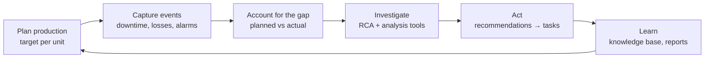
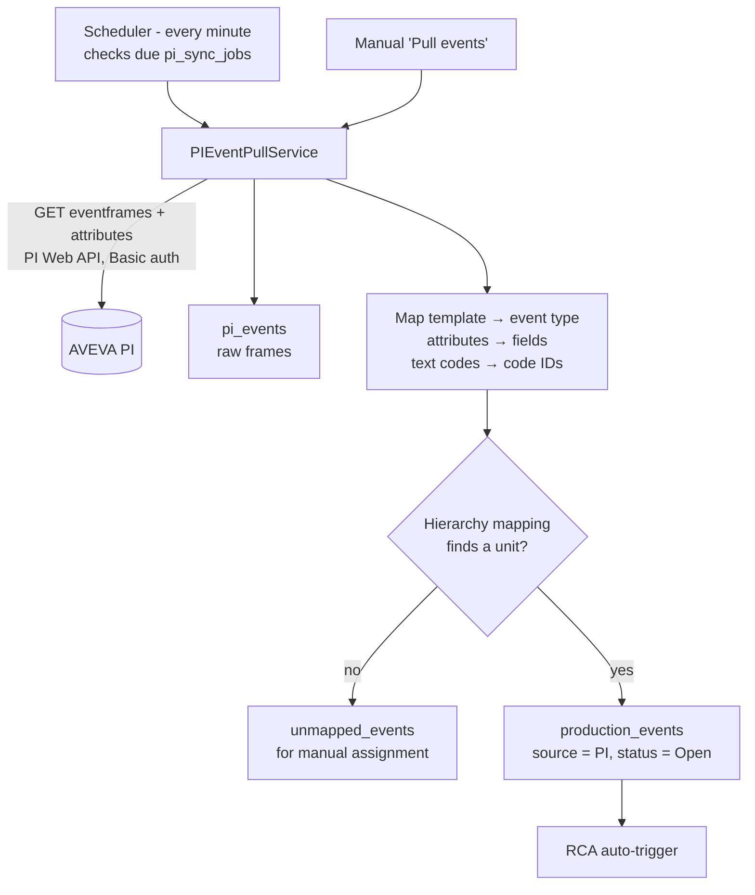

# ProAct — Application Guide

What the application does, how each business process works, the actual logic behind the numbers, and how the system is built. It is written from the code as of October 2026, not from the original requirements, and it calls out where the code differs from what the screens suggest.

---

## 1. What ProAct is

ProAct is a **production loss accounting and Root Cause Analysis (RCA)** platform for process plants (cement, oil & gas, etc.). The core loop is:



1. **Plan:** define how much each unit should produce in a period.
2. **Capture:** record what went wrong (downtime, rate loss, quality loss, limit breaches, equipment alerts), either typed in by hand or pulled automatically from AVEVA PI.
3. **Account:** compare actual with plan and split the shortfall into categorised losses. Whatever can't be explained is "unaccounted loss".
4. **Investigate:** significant events open an RCA case, either automatically by rule or by hand. The team works through 5-Why, Fishbone, FMEA and the other tools.
5. **Act:** RCA recommendations become tracked tasks (and in future, CMMS work orders).
6. **Learn:** closed RCAs feed a knowledge base that suggests similar past cases. Reports show OEE, losses, RCA and task status.

### Who uses it

| Role | Typical job |
|---|---|
| SuperAdmin | Everything, across all organisations |
| OrgAdmin / TenantAdmin | Manage a company or a single plant: users, master data, settings |
| Manager | Approves RCAs (but see §9: the menu currently hides RCA from Managers) |
| Analyst / Engineer | Production plans, loss reconciliation, RCA investigations |
| Operator | Data entry: logging events |

---

## 2. Core concepts

### 2.1 Plant hierarchy

```
Organization (company)
 └─ Tenant  (= a plant / site; has a timezone)
     └─ Unit   (production unit, e.g. Kiln 1; has capacity, UoM, ideal cycle time)
         └─ Asset (equipment, e.g. ID Fan; has criticality, status, maintenance dates)
```

Almost every record carries `tenantId` and `organizationId`.

**Plant selection.** The header has a plant selector (org → plant → unit). The choice is saved per user in `app-settings` under the key `plantSelection`. Pages scope their data with:

```ts
const tenantId = plantSelection?.tenant?.id || session?.tenant?.id;
```

Many screens show nothing until a plant is selected.

> **Note:** scoping is done by the client. The backend only filters by tenant when the caller passes `?tenantId=`. A `TenantGuard` exists but is not used on any controller. Unit filtering is mostly done in the browser.

### 2.2 Master data (the code libraries)

| Library | Purpose | Key fields |
|---|---|---|
| **Products** | What a unit makes | code, name, UoM, `standardCost` (cost per unit) |
| **Impact codes** | What kind of loss this is, and what it costs | `category` = Availability / Performance / Quality, `costBasis` (perUnit / perHour), `costPerUnit`, `costPerHour`, severity |
| **OEE codes** | Classifies events into OEE buckets | `impactType` = Availability / Performance / Quality |
| **Reason codes** | Why it happened (operator-facing) | code, name, category (no hierarchy saved; see §9) |
| **RCA cause codes** | Root-cause taxonomy | code, name, category |
| **Verification status codes** | Status of evidence/actions | code, name |
| **Plan templates** | Reusable plan settings | unit, products, schedule, plan basis |
| **RCA templates** | Starting logic-tree structure for RCAs | name, type, template data |

**Impact codes matter most.** Their `category` decides which OEE component an event hits, and their cost settings drive the money values.

---

## 3. Production planning

### 3.1 What a plan is

A **production plan** says "Unit X should produce N units of Product P between date A and date B".

| Field | Meaning |
|---|---|
| `unitId`, `productId` | Where and what (one product per plan) |
| `startDate`, `endDate` | Plan window |
| `plannedQuantity` | Target output |
| `actualQuantity` | Achieved output (typed in, or synced from output events) |
| `planBasis` | Time-based / Quantity-based / Demand-based |
| `recurrence` | Daily, Weekly, Monthly, Quarterly, Yearly |
| `usefulProductionTime` | Working hours by weekday, e.g. `{Monday: {start: "06:00", end: "14:00"}}` |
| `dataEntryFrequency` | Hourly, Daily, Weekly, Monthly |
| shift, crew, notes, comments | Context |

### 3.2 Two status tracks

- **Operational status:** `Planned → Active → Completed` (or `Cancelled`). Changed by hand in a dropdown. Nothing changes it automatically.
- **Approval workflow:** `Draft → Pending Review → Pending Approval → Approved` (or `Rejected` with a reason). Each step records who did it and when. Only SuperAdmin, OrgAdmin, TenantAdmin, Analyst and Engineer may act, and that check is enforced in the UI only.

### 3.3 Templates

A plan template stores unit, products, schedule, plan basis and working hours. Creating a plan from a template pre-fills the plan form. The default planned quantity is a placeholder rate:

```
plannedQuantity = Σ (weekly working hours) × 100      ← "assume 100 units/hour"
```

### 3.4 Actual output

On the Plan Dashboard:

```
autoActual = Σ quantity of events where eventType = 'ProductionOutput' AND planId = plan.id
```

This is written into `plan.actualQuantity` only when the user clicks **Sync**. Otherwise `actualQuantity` is typed in.

---

## 4. Events and downtime (Event Hub)

### 4.1 Event types

Everything that happens on the plant is a **production event**. There is no separate "downtime" table: downtime is an event with a start and end time.

| Event type | Meaning | Extra fields |
|---|---|---|
| **ProductionLoss** | Lost production (stoppage, slowdown, off-spec) | quantity, cost, lossCategory, defectiveQuantity |
| **ProductionOutput** | A production count | quantity, planId |
| **IOW** | Integrity Operating Window breach (a process variable out of limits) | parameter, value, limit, limitType (High/Low), breachDuration |
| **SOL** | Safe / Operating Limit violation | solType (Safety / Operational) |
| **APM** | Asset Performance Management alert (equipment health) | apmType, recommendedAction |
| **FailureWO** | Equipment failure work order | workOrderId, failureMode |

Common fields: `unitId` (required), `assetId`, `startTime`, `endTime`, `duration`, `severity` (Low / Medium / High / Critical), `impactCodeId`, `oeeCodeId`, `reasonCodeId`, `source` (Manual / PI / Simulated PI / CMMS), `operatorName`, `shift`, `crew`, `rcaId`, plus an `auditTrail` of field changes.

### 4.2 Where events come from

1. **Manual entry** in the Event Hub. New events are always created with status `Open`.
2. **AVEVA PI event frames**, pulled on a schedule or on demand (see §7).
3. **Simulate Events** button: 10 random events for demos. These use fake code IDs.

### 4.3 Event status lifecycle

```
Open ──(endTime filled)──► Coded ──(RCA linked)──► RCA Required ──► Investigating / In Progress ──► Completed / Closed
                                                                                             (Cancelled at any point)
```

Status rules run in the frontend when an event is edited. The defaults can be overridden and are stored in browser localStorage:

- An event that has an `endTime` → **Coded**
- An event that has an `rcaId` → **RCA Required**
- APM with a `recommendedAction` → **Completed**
- FailureWO with a `failureMode` and `endTime` → **Completed**
- Closed, Completed and Cancelled events are never changed by the rules.

There is no "acknowledge" step.

### 4.4 Event cost (auto-filled in the form, can be overridden)

1. ProductionLoss or Output linked to a plan: `cost = quantity × product.standardCost`
2. Otherwise, impact code with `costBasis = perUnit`: `cost = quantity × costPerUnit`
3. Impact code with `costBasis = perHour`: `cost = duration × costPerHour`

### 4.5 What the backend does when an event is created

1. Saves it.
2. Broadcasts `productionEventCreated` over the websocket, so the Event Hub refreshes live.
3. Runs the **RCA auto-trigger** (§6.2), which may open an RCA case and set the event to `RCA Required`.

> **Known inconsistency:** the units of `duration` differ between screens. Some treat it as minutes, others as hours. Agree on one unit before relying on duration KPIs.

---

## 5. Production loss accounting

This answers the question **"We planned 10,000 t and made 8,700 t — where did the 1,300 t go?"**

### 5.1 The loss record

`ProductionLoss` is one row per plan per period:

| Field | Meaning |
|---|---|
| `shortRangePlan` | Planned amount for the period |
| `actual` | Produced amount |
| `losses` | `max(0, planned − actual)` |
| `unaccountedLoss` | The part of the loss not yet explained |
| `action` | `Reconcile` / `RCA Required` / `Closed` |

### 5.2 Reconciliation

The user opens a loss and splits it into **loss categories**. Each category has an amount and is tagged with an impact code and an OEE code, for example "Kiln refractory failure — 600 t — Availability".

```
rule:        Σ category amounts ≤ total loss
unaccounted = total loss − Σ category amounts
action      = unaccounted > 0 ? 'Reconcile' : 'Closed'
```

Reconciliation is done when every tonne of loss has an explanation.

### 5.3 How the first "unaccounted" estimate is made

> **Simulated:** before reconciliation, the initial unaccounted value is a **hard-coded percentage estimate**, not a measurement:
> `unaccounted = losses × pct`. The pct is 25% for Time-based, 35% for Quantity-based and 40% for Demand-based plans (30% default), then ×0.8 for Hourly data entry and ×1.2 for Monthly. The "calculate from production data" action uses a built-in fake event list.

### 5.4 Money values (Plan Dashboard)

```
Total loss value   = Σ losses × lossValuePerUnit           (default $100, set in dashboard config)
Unaccounted value  = Σ unaccountedLoss × lossValuePerUnit
Event costs        = Σ event.cost
Cost per unit      = Σ losses × lossValuePerUnit / actualQuantity

Bottleneck risk    = 0.4 × (Σ losses / planned)
                   + 0.3 × (Σ eventCost / 50,000)
                   + 0.3 × (1 − OEE)                        → thresholds 0.3 / 0.6 / 0.8
```

### 5.5 Loss visualisations

- **Plan Waterfall:** Planned → minus each loss category → Actual. Any remaining gap is shown as "Unaccounted Loss".
- **Loss Pareto:** events grouped by impact code and ranked by duration. The Reports module has a proper Pareto with a cumulative-% line.
- **Loss Trend:** duration by day, week or shift.

---

## 6. Root Cause Analysis (RCA)

### 6.1 The RCA case

An RCA case is linked to the event that triggered it (`eventId`) and holds:

- **Header:** title, description, priority, team lead, team members, target and actual close dates, root cause
- **Team charter, event diagram and phase timeline:** stored as JSON
- **Evidence:** photos, documents, time-series, notes. Each item has category, location, the logic-tree nodes it supports, and verified/severity/tags.
- **Logic tree:** Root → Why/How → Cause nodes, each with question, answer, verified flag and linked evidence
- **Recommendations:** title, priority, assignee, due date, status, estimated and actual cost
- **Effectiveness metrics:** failure rate before and after, cost per incident, implementation cost, ROI, downtime reduction

### 6.2 How an RCA gets opened

**Automatically**, when a production event is **created**, not when one is updated. The checks run in this order:

1. The event has a tenant, has no RCA yet, and no RCA already exists for it.
2. The tenant's trigger config has `autoCreateRca = true`.
3. **Global gates:** cost ≥ `minCostThresholdGlobal` and duration ≥ `minDurationThresholdGlobal` (if set).
4. **Rules:** enabled rules for this event type (or `All`), highest priority first. The **first matching rule wins**. All conditions inside a rule must be true:
   - severity is in `severities`, status is in `statuses`
   - cost ≥ `minCost`, duration ≥ `minDuration`
   - type-specific lists: IOW `qualityResults`, APM `apmTypes`, SOL `solTypes`
   - `requiresImpactCode` / `requiresOEECode`

When a rule matches, the backend creates an RCA with status `Draft`. The title is the event description, priority follows severity (Critical→Critical, High→High, otherwise Medium), and the event is set to `RCA Required`.

**Manually**, from the "Create RCA" button in the Event Hub. The same rules decide whether the button is shown, but more leniently.

Rules are configured in **RCA Settings → Triggers**.

### 6.3 The six investigation phases (UI)

```
Definition → Data Collection → Analysis → Recommendations → Approval → Closure
```

| Phase | "Complete" when |
|---|---|
| Definition | title, description, team charter, at least 1 team member |
| Data Collection | at least 1 evidence item |
| Analysis | a logic tree exists |
| Recommendations | at least 1 recommendation |
| Approval | approved by SuperAdmin, OrgAdmin or Manager |
| Closure | closed (only possible after approval) |

The phase can only move forward. The completion checks drive a "review and advance" banner but don't block anything, and **none of this is enforced by the backend**.

### 6.4 Analysis tools

Each tool stores one record per RCA (`/api/rca-analysis/*`). Which tools are enabled, and their settings, is configured per tenant.

| Tool | What you capture | Logic |
|---|---|---|
| **5-Why** | Problem; why levels (question, answer, justification, evidence); root cause | Must reach the minimum depth (default 5) |
| **Fishbone (Ishikawa)** | Effect; causes under 6M categories (Man, Machine, Material, Method, Measurement, Environment) with likelihood H/M/L | Data entry and visualisation |
| **FMEA** | Failure mode; effects (severity 1–10, detection 1–10); causes (occurrence 1–10) | `RPN = max(severity) × occurrence × max(detection)`; flagged when RPN ≥ 100 (configurable) |
| **Fault Tree** | Top event; AND/OR gates, basic events, probabilities | Probabilities typed in by hand; no automatic calculation |
| **Barrier Analysis** | Hazard; barriers (Prevention, Detection, Mitigation, Recovery) with effectiveness Strong / Moderate / Weak / Failed | Data entry |
| **Change Analysis** | What changed (People, Equipment, Process, Materials, Environment, Management), when, and whether related | Data entry |

### 6.5 From recommendation to task

The **Create Task** button on a recommendation creates a task with `entityType = 'RCARecommendation'` that copies the assignee, priority and due date. Duplicates are detected by looking up tasks already linked to that recommendation. **Push to CMMS** is simulated: it only sets the recommendation to In Progress.

### 6.6 Knowledge base: learning from past RCAs

Each knowledge-base entry is a summary of a past RCA: problem, symptoms, equipment category, root cause, contributing factors, recommendations, effectiveness, cost saved, keywords.

When a new RCA is opened, **similar past cases** are suggested. The score is out of 100 and computed in the browser:

| Match | Points |
|---|---|
| Same asset (or else same equipment category) | 30 (15) |
| Shared title words (≥ 2) | up to 15 |
| Same event type | 15 |
| Same root-cause category | 15 |
| Same unit | 10 |
| Symptoms / impact codes / keywords | up to 20 / 15 / 20 |

Results scoring below 40 (configurable) are dropped, and the top 5 are shown. Each entry also has a quality score based on recurrence, how often it was referenced, helpful votes and completeness.

> **Gap:** closing an RCA does not yet create a knowledge-base entry. Entries currently come only from the demo data seeders.

---

## 7. AVEVA PI integration (automatic event capture)

PI event frames (e.g. "Production Loss", "IOW Deviation") become ProAct events without anyone typing them in.



1. **Connection:** PI Web API URL, credentials (encrypted at rest with AES-256-GCM) and the AF database or element to scan.
2. **Pull window:** from the last watermark (or a lookback window, default 60 min) to now. Up to 500 frames per run. There is no paging, so anything over 500 is skipped.
3. **Template → event type:** Production Loss → ProductionLoss, IOW Deviation → IOW, SOL Violation → SOL, APM Alert → APM, Failure WO → FailureWO, Production Output → ProductionOutput. Frames with no template become ProductionLoss. Each tenant can override this.
4. **Attribute → field:** for example ReasonCode → `reasonCodeId`, Cost → `cost`, Duration → `duration`. Text codes are resolved against master data by exact code/name, then by substring.
5. **Which unit?** Hierarchy mappings are tried in priority order: exact PI element ID, then wildcard pattern, then path containment, then connection default. If none match, the older `af_bindings` table is tried.
6. **No unit found** → the frame goes to **unmapped events**, to be assigned by hand.
7. **Unit found** → the production event is upserted using the PI WebId as `eventId`, so re-pulling updates it rather than duplicating it.

> **Caveats:** re-pulled events are updates, so they don't trigger RCAs, and the update resets status to `Open`.

---

## 8. OEE and reporting

### 8.1 OEE

**OEE = Availability × Performance × Quality.** It is computed in three different places, which can disagree:

| Where | Formula | Trust level |
|---|---|---|
| **Plan Dashboard** (per plan) | **A** = (planned time − downtime of Availability-class events) / planned time; **P** = actual output / planned quantity; **Q** = (actual − defective qty of Quality-class events) / actual. Each capped at 1. OEE = A^wA × P^wP × Q^wQ (weights default to 1). | Real arithmetic. Opening the dashboard saves the result into `oee_summaries`. |
| **Reports** | Averages of the saved `oee_summaries` rows | As good as the Plan Dashboard values |
| **Main Dashboard / PLA Dashboard** | Heuristic: A = 95 − downtime penalty, etc. Fixed 95/94/98 when there is no data. | Placeholder, not real OEE |

An event is classed as Availability, Performance or Quality by its impact code's `category`, falling back to the OEE code's `impactType`.

> The Performance formula here is output vs plan, not the textbook ideal-cycle-time formula. `unit.idealCycleTime` isn't used yet.

### 8.2 Reports (`/reports`)

These are server-side calculations: OEE summary and trend; production losses by category, severity and unit; top 10 events by cost; daily trend; Pareto with cumulative %; RCA counts by status and priority; tasks including overdue; audit activity; and a combined KPI dashboard. All can be filtered by tenant, date range and unit.

### 8.3 Tasks and audit

- **Tasks:** title, assignee, priority, status (Open / In Progress / Completed / Cancelled), due date. A task can be linked to any record (`entityType` + `entityId`), e.g. an RCA recommendation.
- **Audit log:** every POST/PUT/PATCH/DELETE is logged automatically by a backend interceptor. Some pages also log manually, so some actions appear twice.

---

## 9. Real, simulated and known issues

| Area | State |
|---|---|
| Hierarchy, master data, plans, events, tasks, reports | Working, backend-persisted |
| Loss reconciliation | Working. The initial unaccounted estimate is a heuristic. |
| Plan Dashboard OEE | Working (computed in the browser) |
| Main/PLA Dashboard OEE | **Heuristic placeholder** |
| RCA auto-trigger | Working (backend) |
| **RCA save from the UI** | **Broken.** The frontend sends `teamMembers`, `tenantId`, `organizationId`, `targetCompletionDate` …; the backend expects `teamMemberIds`, `targetCloseDate` … and rejects unknown fields with HTTP 400. Evidence, recommendations, logic tree and approval/closure are never sent. **Verified on 2026-10-07.** |
| RCA analysis tools | Working (backend CRUD) |
| Knowledge base | Suggestions work; entries are only created by seeders |
| PI integration | Real (PI Web API) |
| OPC UA / Modbus / MQTT | Real client libraries exist, but most screens use simulated results |
| BACnet, DNP3, EtherNet/IP, PROFINET, SCADA, CMMS | **Simulated / stub** |
| Streaming engine | Runs in the browser; most sinks and aggregate steps are stubs |

**Security gaps** (fine for development, must be fixed before production):

- JWT is checked per controller. Several controllers have no guard: unmapped events, RCA recommendations, dashboard configuration, evidence upload, connectivity realtime.
- There is no tenant isolation on the server.
- `POST /auth/register` is public and accepts any role, including SuperAdmin.
- The realtime socket has no authentication and broadcasts every change to every client, across tenants.
- `/pi-proxy/request` forwards requests to any URL the caller gives it.

**Data/logic issues:**

- Duration units are inconsistent (minutes vs hours).
- The reason-code hierarchy isn't saved.
- The backend ignores the unit filter when a tenant filter is also sent.
- Manual ProductionLoss events aren't linked to a plan.
- Reconcile forms never leave Draft.
- Plan approval, RCA approval and event status rules are enforced in the UI only.

---

## 10. Architecture

```mermaid
flowchart TB
    subgraph Browser["Browser — React SPA (Vite, :8070)"]
        Pages[Pages: Dashboard, Production Plans, Event Hub,<br/>RCA, Knowledge Base, Reports, Connectivity, Admin]
        Ctx[AuthContext · PlantSelectionContext]
        MDS[MasterDataService facade<br/>+ client-side calculations: OEE, cost, status rules, KB similarity]
        API[services/api/* → httpClient<br/>Bearer JWT from localStorage]
        WS[Socket.IO client]
        IDB[(IndexedDB — legacy,<br/>seeders only)]
        Pages --> Ctx --> MDS --> API
        Pages --> WS
    end

    subgraph Backend["NestJS monolith (:4004, prefix /api)"]
        Auth[Auth: JWT access 24h + refresh 7d]
        Mods[~60 feature modules<br/>controller → service → TypeORM repository]
        Audit[Global audit interceptor]
        RT[RealtimeGateway + ConnectivityGateway]
        Cron[@nestjs/schedule: PI sync jobs every minute]
        Rules[RCA trigger evaluator · PI event pull · reporting]
    end

    DB[(PostgreSQL 15<br/>DB 'proact' in docker instrumental-postgres)]
    PI[(AVEVA PI Web API)]
    PLC[(OPC UA / Modbus / MQTT …)]

    API -- REST --> Mods
    WS -- websocket --> RT
    Mods --> DB
    Rules --> PI
    Mods -.mostly simulated.-> PLC
```

### 10.1 Frontend (`src/`)

- React 18, TypeScript, Vite, Tailwind, shadcn/ui, Recharts, React Flow (logic trees and diagrams).
- `pages/` holds the routes. `components/` holds feature UIs (production-plans, rca, rca-analysis, historian, …).
- `services/MasterDataService.ts` is the facade most pages call. `services/api/*Api.ts` are thin REST clients over `httpClient.ts`.
- **A lot of business logic lives here:** OEE, cost auto-fill, loss estimates, event status rules, plan/RCA approvals, knowledge-base similarity.

### 10.2 Backend (`server/pro-act-backend/src/`)

- NestJS 11, TypeORM 0.3, class-validator. Swagger is at `/api`.
- Each module is a folder: `entity` + `dto` + `service` + `controller`. Most are plain CRUD.
- The real server-side logic is in `rca/rca-auto-create.service.ts` + `rca-trigger-evaluator.ts`, `integration/pi-event-pull.service.ts`, `hierarchy-mapping`, `pi-sync-job/pi-sync-scheduler.service.ts`, `reporting`, and `audit-log/audit-auto-log.interceptor.ts`.
- The global `ValidationPipe` rejects unknown fields (`forbidNonWhitelisted`). This is why mismatched field names between frontend and backend cause 400 errors.

### 10.3 Database

- **PostgreSQL 15**, database `proact` on the shared `instrumental-postgres` container (host port 5432). It was migrated from MS SQL Server in October 2026.
- The schema is generated from the TypeORM entities (`DB_SYNCHRONIZE=true`): about 80 tables.
- The `.sql` scripts in `server/pro-act-backend/legacy/` (formerly `migrations/` and `database-setup/`) are the old SQL Server versions and are no longer used.

---

## 11. Running it locally

```bash
docker start instrumental-postgres          # Postgres on :5432 (DB: proact)

cd server/pro-act-backend && npm run start:dev   # API on :4004 (PORT in .env)
cd <repo root> && npm run dev                    # UI on http://localhost:8070
```

| URL | What |
|---|---|
| http://localhost:8070 | Application |
| http://localhost:4004/api | Swagger API docs |
| http://localhost:4004/api/health | Health + DB check |

**Login accounts.** All belong to org "Demo Org" and plant "Demo Plant" (unit "Kiln 1"). Recreate or reset them with `npm run db:seed-demo-users` in `server/pro-act-backend`.

| Email | Password | Role |
|---|---|---|
| admin@acme.com | demo123 | SuperAdmin |
| test@example.com | Test123!@# | SuperAdmin (used by the E2E tests) |
| manager@acme.com | demo123 | TenantAdmin |
| engineer@acme.com | demo123 | Engineer |
| operator@acme.com | demo123 | Operator |
| admin@proact.local | Admin123!@# | SuperAdmin |

**How login works:**
- `POST /api/auth/login` looks the user up by email (case-insensitive) and checks the bcrypt password hash. Inactive accounts are refused.
- It returns a 24h access token carrying `{sub, email, role, tenantId, organizationId}` and a 7-day refresh token. The frontend stores both in `localStorage['proact_auth_state']`.
- The frontend then loads the user's organization and plant to build the session, and refreshes the access token via `POST /api/auth/refresh` before it expires.
- Roles only control which menu items appear (§9).

Select the plant in the header after logging in. More realistic demo data can be loaded from the **Data Seeding** page.
