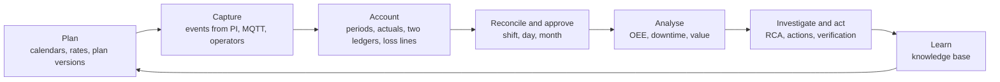
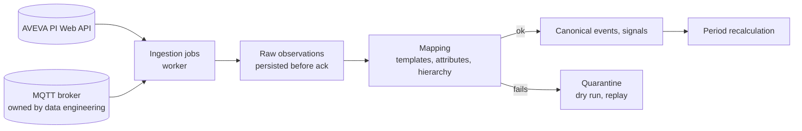
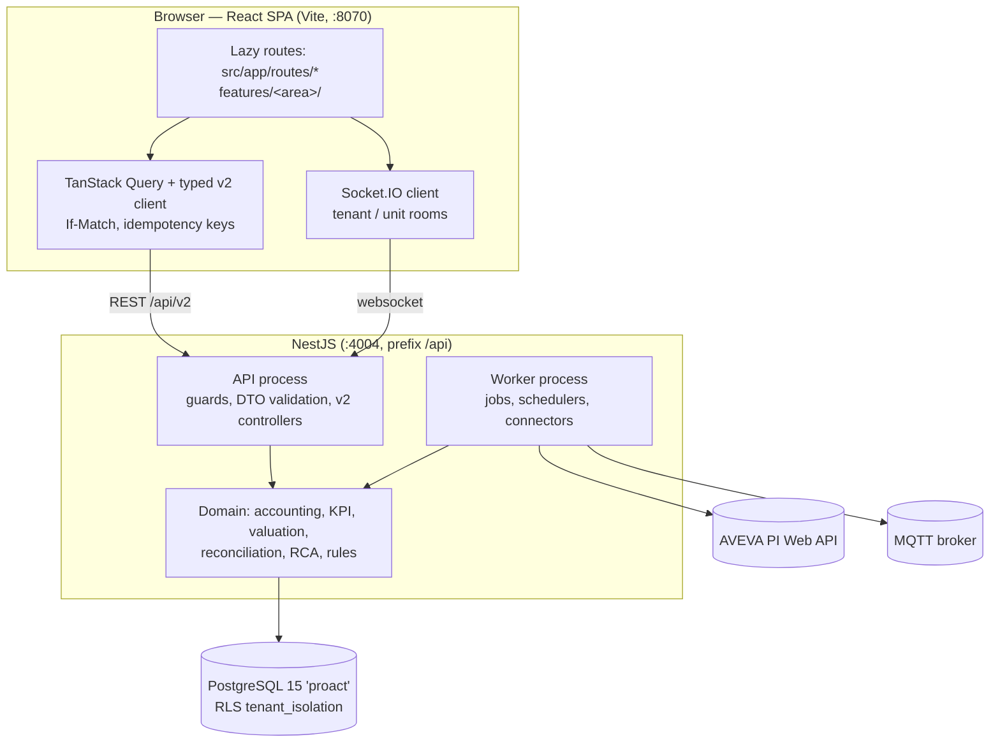

# Traverse Forge — Application Guide

What the application does, how each business process works, where the numbers come from, and how the system is built. It describes the v2 application as of 15 October 2026.

**Name.** The product is called **Traverse Forge**. It was formerly called ProAct / Pro-Act. Code identifiers, packages, the database (`proact`) and service names still use the old name (owner decision, 14 Oct 2026).

Sources of truth behind this guide: `plans/README.md` (phase status), `plans/DECISIONS.md` (dated decisions), `plans/EXPERT_REVIEW.md` (SME findings and answers), `plans/SPEC_ANALYSIS.md`.

## 1. What Traverse Forge is

Traverse Forge is a **production loss accounting, downtime analytics and Root Cause Analysis (RCA)** platform for process plants. The pilot is an HDPE plant in Iran (units `unit100`–`unit500`, time zone Asia/Tehran).



Per shift period, the server computes what was planned, what the unit could have made, what it made, and which losses explain the gap. People review and approve those results; reports, KPIs and RCA triggers read the approved results.

**Every business number is computed on the server.** The browser only displays results and never derives KPIs, money or losses.

### Who uses it

Users have a legacy role on their account and may hold **scope roles** on a plant or unit. A legacy role maps to a scope role (D06): TenantAdmin and Manager → `manager_approver`, Analyst and Engineer → `production_engineer`, Operator → `operator`.

| Role | Typical job |
|---|---|
| SuperAdmin, OrgAdmin | Everything; hold every scope role |
| TenantAdmin / `manager_approver` | Plant management: approve periods, certify days, close months (quantities), approve RCA closure |
| `production_accountant` | Prepare reconciliations, bridge lines, source status mappings, change proposals |
| `production_engineer` | Plans, profiles, loss review, RCA investigation |
| `reliability_engineer` | Reliability data, RCA |
| `quality_approver` | Decide product dispositions (off-grade, scrap, rework) |
| `finance_maintainer` / `finance_approver` | Author / approve valuation policies, valuation rates, FX rates; sign off and lock the month |
| `integration_admin` | Connections, mappings, ingestion jobs, quarantine |
| `master_data_admin` | Code libraries, units, assets, products |
| `operator` | Log and code events |
| `viewer` | Read only |

**Separation of duties:** nobody approves their own work. Authors of loss lines, the submitter and the revise initiator cannot approve a period. This also applies to SuperAdmin and to users with two roles.

## 2. Core concepts

### 2.1 Plant hierarchy

```
Organization (company)
 └─ Plant (= tenant; time zone, calendar system, digits, week start)
     └─ Unit (production unit, e.g. unit100; profiles, rates, calendar)
         └─ Asset (equipment; criticality, standby, failure data)
```

The header has a plant selector (organization → plant → unit). The frontend resolves the plant as `plantSelection?.tenant?.id || session?.tenant?.id`. Changing plant clears the query cache.

### 2.2 Security and scope

Scope comes from the caller's identity, never from a query parameter.

- **Global guards** run on every route: throttling → `JwtAuthGuard` → `RolesGuard` → `ScopeGuard` → `WriteAccessGuard` → tenant binding. A route is protected unless marked `@Public()` and listed in the route-guard allowlist test.
- **Public routes:** login, token refresh, logout, token validation, health and the app root. There is **no public self-registration**: `POST /auth/register` needs an admin role, a caller cannot grant a role above its own, and it is public only when `AUTH_ALLOW_PUBLIC_REGISTRATION=true` (local dev and e2e). The first SuperAdmin of an empty database comes from `npm run db:bootstrap-admin`.
- **Request context:** the server builds a `RequestContext` (tenant, units, roles) from the token and the user's scopes. v2 queries start from `scopedQuery()`, so they only see the caller's plant and units.
- **Row-level security:** Postgres policies `tenant_isolation` on every tenant table. Each request runs as `proact_rls_user` bound to its tenant, so a query bug cannot read another plant's rows.
- **Tokens and channels:** 15-minute access token; 7-day refresh token, single-use and rotated, with reuse detection. The Socket.IO channel needs a JWT and sends to tenant and unit rooms only. Upload downloads need a token.
- **Audit:** a global interceptor logs every mutating request. Audit records are kept 30 days.

### 2.3 Plant settings (`/settings`)

| Setting | Values | Notes |
|---|---|---|
| Time zone | IANA zone, e.g. Asia/Tehran | Shown with its source. Shift calendars are in this zone. |
| Calendar system | Gregorian / Persian (Jalali) | Display only |
| Digits | Latin / Persian | Every displayed number follows it; the percent sign stays `%` |
| Reporting week | Monday (ISO) / Saturday | **Saturday is the default for Iranian plants** (Asia/Tehran or Persian calendar) |

A change applies on every screen at once. Server buckets, API values, CSV exports and identifiers stay ISO, Gregorian, UTC and Latin. Which days are worked (the Thursday–Friday weekend) belongs to the shift calendar.

**Display currency:** money is shown in **USD by default**. Each user can switch to IRR. The browser only picks between currency values the server already computed; it never converts.

### 2.4 Master data and code libraries

| Library | Purpose |
|---|---|
| Units, assets, products | Hierarchy and what each unit makes (`/master-data`) |
| Reason codes | Why a stop happened: a tree; operators pick a leaf with a searchable picker |
| Impact codes, OEE codes | Which kind of loss and which OEE component |
| Loss categories, failure code groups | Loss tree and failure grouping |
| Failure dictionary | ISO 14224-style fields: equipment class, maintainable item, failure mode, mechanism, cause, detection |
| RCA causes, templates, verification checklists | RCA taxonomy and starting structures |

Codes are versioned and tenant-wide (`/codes-admin`). A retired code keeps its name and shows "(retired)". Default code mappings and declarative rules (for example `coding_default` on event create) are built and test-run against past data, then activated by a second person, with version diff and rollback.

## 3. Planning

### 3.1 Calendars and shifts

A calendar version defines the plant day start, shifts (including across midnight), holidays and exclusions in the plant's IANA zone. A preview shows DST warnings. Publishing makes the version immutable and materialises shift instances (90 days ahead). Crews are attached to shifts.

### 3.2 Production profiles and rates

A profile holds effective-dated rates per unit and product:
- **sustained (capacity) rate:** the approved sustainable capability, used by the capacity ledger.
- **planning rate:** used by the plan ledger.
- **valuation rates:** price per unit, in IRR or USD.

Rates are approved, superseded at a boundary and retired. Approved versions cannot overlap. Budget, forecast and MPC imports arrive as corrections. A back-dated rate or calendar change recomputes open periods and raises a change proposal for approved ones.

### 3.3 Plans, versions and periods

- A plan belongs to a **scenario**; one scenario is the accounting baseline.
- A plan has **versions** with sequential product slices (campaigns). Concurrent products are behind a flag and off (D14).
- Period generation splits the target exactly over shift instances × approved rates. The remainder lands on the last eligible period. A plan with no eligible time is refused (422 `NO_ELIGIBLE_TIME`).
- Approval is server-gated. Superseded periods are frozen.
- There is no default rate anywhere; a missing profile is reported as `no_profile`.

The planning screens are at `/planning` (plans, profiles, calendars).

## 4. Events

### 4.1 The event model

Every stop, slowdown, quality loss, grade transition, output record and advisory is a **production event** on a unit (optionally an asset).

- Times are UTC `timestamptz`, **half-open** `[start, end)`. An open event has no end; the server reports its elapsed time.
- `durationSeconds` is derived by the database, in seconds. There are no other duration units.
- Future start or end times are refused (422 `IN_FUTURE`, allowing 120 s clock skew).

### 4.2 Classification axes

Each event is classified on independent axes:

| Axis | Values |
|---|---|
| Physical type | downtime, slowdown, quality_loss, production_output, advisory, grade_transition |
| Schedule class | planned, unplanned, external, unknown |
| OEE component | availability, performance, quality, idle, none |
| Impact mode | full_stop, fractional, measured, none |

Only a `full_stop` counts as stopped time. A `fractional` stop is a rate loss and is also reported as **equivalent downtime**. `none` is an equipment event without production loss (for example a standby took over).

States are separate too: physical state (open, closed, superseded, retracted), coding state (uncoded, coded, reviewed) and RCA state (none, required, linked, completed). An event can carry an origin unit / asset (for starved or blocked stops), a planned end (maintenance overrun) and failure severity.

### 4.3 Sources, source layer and user layer

Events come from PI event frames, MQTT, imports or manual entry. Each event keeps two layers:
- the **source layer:** facts as the source sent them, with every revision;
- the **user layer:** coding and corrections by people.

The effective value is the source overlaid by the current coding. A re-sync from PI keeps user work. When the source changes a field that a user overrode, a review item is raised and the override stays. Events are retracted, never hard-deleted.

### 4.4 Event Hub (`/events`)

Server filters with keyset paging and a virtualised list; current stops with elapsed time; a detail drawer with source vs effective values, revisions, review items and impacted periods. Operations: create, edit (end or duration), **split, merge, bulk code** (preview, then a job) and **close** ("Code and close"). Quick filters include "To code", "Possible duplicate stops" and repeat stops within 2 minutes. Edits use optimistic concurrency: a conflict (412) shows a review and keeps the draft.

## 5. Loss accounting

This answers **"We planned 10,000 t and made 8,700 t — where did the 1,300 t go?"** The engine runs on the server with exact decimals.

### 5.1 Production periods and actuals

A production period is one shift instance of one unit. Actuals are computed per period from the authoritative source (D05): PI output event frames first, then counters and rates, then certified daily external records. An output record that spans periods is split by counter readings, then rate integration, then running-time proration (stops excluded); the method is shown. Missing data stays null, never zero. Adjustments need an independent approver.

**Product dispositions** keep first-pass good, wide-spec, downgrade, transition off-grade, scrap and rework apart. Accepted rework is not good output. Dispositions are decided by `quality_approver`.

### 5.2 Calculation runs

Each recalculation creates an immutable **calculation run** with an input fingerprint and content hash. A run is created only when the inputs change. If validation fails, the previous run stays current. Recalculation is a background job (202).

### 5.3 The two ledgers

| Ledger | Baseline | Question it answers |
|---|---|---|
| **Plan ledger** | The plan target, priced at the planned rate of each plan interval | Why did we miss the plan? |
| **Capacity ledger** | Approved sustained rate over scheduled time | How much could the unit have made, and what took it away? |

The two ledgers are two views of one event and are never added together. Each is segmented at schedule, stop and rate boundaries.

- Losses stay gross. Recovery above the planned rate is a separate **gain** line.
- Residuals are signed and never clamped. Overproduction, over-accounted and conflict cases are flagged.
- Loss without a cause stays **unaccounted** (plan ledger) or **unexplained** (capacity ledger). It is not reported as slow running unless a rate measurement supports it.
- Stops inside the schedule, planned or external, reduce availability. Only time outside the approved schedule is excluded.
- Overlapping causes are allocated once by a policy rule (`first_out` default, or equal share).
- Grade transitions use an approved transition matrix; only the overrun over the allowance is a loss.
- A claim larger than the measurements support is flagged `claim_exceeds_component`. The run still completes, but approval is blocked until it is fixed.

### 5.4 Loss lines

Each run produces **loss line candidates** with kind (exclusion, availability, performance, quality, bridge, unaccounted), quantity, reason, evidence and a deterministic key. The reconciliation editor accepts, adjusts, replaces or rejects them and adds manual lines (§6).

### 5.5 Valuation

Valuation runs inside the calculation run from a frozen, hashed context:
- the approved `valuation_basis` policy (contribution margin default; standard cost and operational cost as separate views, never summed; an economic view for scrap, downgrade and rework);
- approved valuation rates (IRR or USD);
- approved, dated FX rates.

Every valued loss is reported in **IRR and USD**. Without an approved FX rate the other currency is null with reason `fx_rate_missing`; it is never estimated. A finance-authorised **provisional FX rate** can fill dates until the final rate arrives; those values are flagged everywhere. The final rate revalues open periods and proposes changes for approved ones. A missing price gives an unvalued quantity, never zero. Nothing is valued before finance approves the policy. Demand-constrained lost sales are supported. Finance screens are at `/finance`.

## 6. Reconciliation and approval

### 6.1 Period workflow

```
draft ──submit──► in_review ──approve──► approved ──revise / change proposal──► new draft revision
                     └──reject (reason, failed lines, new due time)──► draft
```

Each period has numbered **accounting revisions**. At most one is open (draft or in review); a draft can also be cancelled. An in-review revision whose inputs changed is marked **stale**.

- The period page (`/plans/:planId/periods/:periodId`) shows the plan and capacity ledgers, actuals provenance and the loss-line editor. Saves are atomic, with If-Match; a newer run shows a diff to rebase on.
- Manual lines need a reason and evidence of the right type (event, work order, rate or totaliser evidence, lot disposition, inventory movement). A bridge line is only for `production_accountant`, needs a category (inventory, timing, measurement) and cannot be negative. One event's allocations never exceed its loss.
- Tolerance is configurable; the default is zero.
- Approval writes an approval snapshot and content hash. Approved revisions are immutable.
- **SLA:** submit within 12 h and approve within 24 h after the production day ends; escalate at 48 h to production accounting and 72 h to plant management (in-app notifications). "Waiting for data" holds (lab, source, other) pause the clocks. The third rejection of a period escalates.
- **My queue** (`/my-queue`) lists each user's due and overdue work.

### 6.2 Day certification

A `manager_approver` who did not submit any of its shifts certifies each **production day** of a unit. Certification rolls up the approved shift revisions; each quantity stays on its shift. Revising a shift reopens the day.

### 6.3 Month close (`/month-close`)

One close per plant and financial month: **open → quantities closed → finance signed off → locked**.
- Plant management (`manager_approver`) closes quantities, by working day 3.
- Finance (`finance_approver`) signs off and locks, by working day 5. It is never the same person.
- Working days come from the site calendar's holidays and the plant weekend. Iranian plants use Solar Hijri months.
- Prerequisites: every period approved, every production day certified, no open change proposal.
- A locked month refuses direct revision (409 `MONTH_LOCKED`).

### 6.4 Change proposals and restatement

Late data, a back-dated rate or a correction to an approved period creates a **change proposal**. It can also be raised by hand for a closing or locked month by production accounting or plant management, with reason and evidence; the proposer never decides it. An accepted proposal produces a new revision. The restatement view shows old vs new totals. The operational date stays the period date; finance sets the financial posting date and treatment.

Per-source status mappings (`/connectivity/source-status`) say which source statuses count as released. The source owner approves them.

## 7. KPIs

KPIs are computed inside the calculation run and stored in `kpi_results` with explicit numerator and denominator. A missing value is null with a reason and is shown as "Not available: <reason>". Multi-period values sum the stored terms, so A × P × Q = OEE across periods.

### 7.1 OEE

| View | Definition | Label |
|---|---|---|
| **Operational OEE** (ISO 22400-style) | A, P, Q with ideal-time weighting; good at the sustained rate as time ÷ scheduled time | Shown with its policy label and denominator |
| **Reconciled PLA OEE** | Capacity-ledger good ÷ capacity | Labelled separately; never mixed with operational OEE |

Quality is first-pass conforming output.

### 7.2 Downtime and availability

| KPI | Meaning |
|---|---|
| `downtime_total`, `_planned`, `_unplanned` | Stopped time by schedule class (calendar window) |
| `downtime_in_schedule` | Stopped time inside scheduled time; reconciles with scheduled availability |
| `downtime_external` | Stops classed external (feed, utilities, blocked) |
| `downtime_equivalent` | Lost quantity ÷ reference rate for fractional stops |
| `downtime_maintenance_overrun` | Time beyond a planned maintenance end |
| `coded_downtime_ratio` | Share of stopped time with a reason |
| `stop_count`, `mean_stop_duration`, `microstop_time` | Occurrences; micro-stop thresholds per asset class |
| `scheduled_availability` | Headline availability; external stops count against it (SME D15) |
| `controllable_availability` | Supplemental view with stops classed external excluded, under its own name (SME D15). Shown by the "Show controllable view" switch on the Downtime summary and dashboard. |
| `coverage`, `state_coverage`, availability bounds | How much of the time the data explains |

### 7.3 Reliability

MTBF counts confirmed functional failures inside the equipment boundary; with zero failures the exposure is shown, not an infinite MTBF. Without repair evidence, the measure is labelled **mean downtime to restore**. MTTR (mean active repair time) needs CMMS repair timestamps. Standby equipment has its own demand, failed-start and test counts. A monthly **bad-actor report** is at `/reliability/bad-actors`.

## 8. Root Cause Analysis

### 8.1 The case

An RCA case (`/rca`) links to events, approved loss lines, work orders and occurrences. Each link stores an **evidence package** (event facts, revisions, signal trend window, codes, recurrence, approved impact). A case holds its team, evidence, logic tree, analysis tools and actions.

### 8.2 Workflow

```
Draft ⇄ In Progress ⇄ Analysis ──investigation accepted──► Monitoring ──closure request──► Closure Review ──► Closed
                                                               ▲                              │
                                                               └────── rejected (note) ───────┘
```

All transitions are enforced by the server (422 `INVALID_TRANSITION` otherwise).
- **Analysis → Monitoring** needs the root cause, the required method, a 5-Why with evidence per level, and complete FMEA scores.
- From Monitoring the team is locked.
- **Monitoring → Closure Review** needs every action done with evidence or cancelled, effectiveness verified, and residual risk written.
- **Closure Review → Closed** needs an **independent approver**: a `manager_approver` who was never an investigator on the case. A closed case can be reopened with a note.

### 8.3 Analysis tools

5-Why, Fishbone (6M), FMEA (detection per cause, RPN and policy action priority; a missing score is incomplete), Fault Tree (top-event probability from AND/OR gates), Barrier Analysis, Change Analysis, plus the logic tree. Rules are checked on the server.

### 8.4 Actions and effectiveness

Each action has an owner, due date, evidence and a **verification window**. The server computes the baseline and counts unplanned, same-mode recurrences normalised by run time. The verdict is **effective**, **not effective** or **insufficient evidence**. Approved, claimed and realised benefits are kept apart.

### 8.5 Triggers (SME D17)

The `rca_policy` uses any-of triggers. Pilot values: stop ≥ 2 h, OR ≥ 1 % of daily planned tonnes, OR 3 same-mode incidents in 30 days, OR a bad-actor or cost limit. Limits are halved for critical assets, and safety markers override. A repeat does not fire again while a case is open on that asset and mode. By default a trigger **recommends** a case; the policy can switch to create. A provisional FX value never fires the money limit. Triggers are configured at `/events/rca-triggers`.

### 8.6 Knowledge base (`/rca-knowledge-base`)

Closing a case creates a knowledge entry. Similar past cases are suggested by the server on failure mode and text. The quality score rewards actions verified effective. Lessons are shared across the organisation.

## 9. Integration

Traverse Forge reads plant data; it does not write to PI or publish to MQTT.



- **PI:** event frames and actuals (signals, counters, rates, output frames) through the PI Web API. Connections have a write-only secret, staged diagnostics, discovery, a mapping preview and audited job control (start, pause, resume, drain, stop). Re-pulling a frame updates the same event. Built and tested against a PI Web API simulator.
- **MQTT:** the data engineering team owns the feed (PI → MQTT). Traverse Forge only subscribes. Messages are persisted before acknowledgement and decoded by contract.
- **Quarantine:** records that fail mapping wait in an inbox; a dry run shows the result before replay, or they are marked irrecoverable. Replay and backfill are bounded.
- **Unit state:** a state mapping per unit (running, internal stop, planned maintenance, starved, blocked, standby, not scheduled) gives coverage and availability bounds.

The integration console is at `/connectivity`.

## 10. Screens

| Screen | Route | What it shows |
|---|---|---|
| Dashboard | `/dashboard` | Tiles: operational and reconciled OEE with labels; downtime (with the controllable view switch); periods by reconciliation state; RCA counts (open cases, overdue actions, effectiveness pending); latest events |
| Event Hub | `/events` | §4.4 |
| Downtime Analysis | `/downtime` | §10.1 |
| PLA Analytics | `/pla-analytics` | Window waterfall on both ledgers, loss tree (reason, impact, OEE, kind, unit × quantity or value view), trends, unaccounted / over-accounted trend, reconciliation status and age, actuals quality, repeat causes, top valued opportunities, OEE; site filter |
| Reports | `/reports` | §10.2 |
| Planning | `/planning` | Plans, profiles, calendars |
| Plan dashboard | `/plans/:planId` | Period grid with server figures, residual and workflow state; waterfall; value tiles |
| Month close, My queue | `/month-close`, `/my-queue` | §6 |
| RCA, Knowledge base, Bad actors | `/rca`, `/rca-knowledge-base`, `/reliability/bad-actors` | §8, §7.3 |
| Codes, Finance, Master data | `/codes-admin`, `/finance`, `/master-data` | §2.4, §5.5 |
| Integration console | `/connectivity` | §9 |
| Users, Permissions, Audit, Tasks, Admin | `/users`, `/permissions`, `/audit`, `/tasks`, `/admin` | Administration |
| Plant settings | `/settings` | §2.3 |

### 10.1 Downtime Analysis filters

Filters live in the URL so a view can be shared:
- **Units** and **window** (last 24 h, 7, 30 or 90 days, or a custom range);
- **Schedule class** (all, planned, unplanned, external, unknown);
- **Products, shifts and crews** (applied by the server to the periods);
- micro-stops on or off; approved only; metric (duration or count); trend grouping (shift, day, week, month).

The page shows the KPI summary, reliability per unit, a reason Pareto with drill-down to child codes and events, lost production by stop reason (quantity or value), trends stacked by schedule class, asset bad actors, crew and window comparisons and a stop timeline.

### 10.2 Reports and exports

The Reports page defaults to **approved** content; provisional content is an explicit option. Exports are asynchronous jobs (`POST /v2/exports` → job → download):

| Format | Content |
|---|---|
| **CSV** | Every column, ISO UTC times, both currencies; injection-safe cells; RFC 4180, UTF-8 BOM |
| **PDF** | Rendered on the server; plant clock, calendar and digits; money in the chosen display currency (USD default, or IRR); up to 500 period revisions |

Both contain **approved content only**: the latest approved revision of each period in the window, or named approved revisions. Draft or in-review content is never exported. Revisions are pinned when the export is requested, so re-rendering gives the same sha256. Downloads are re-authorised and unit-scoped. Report types: `period_summary` and `loss_lines`.

## 11. Known limits

- **PDF fonts:** Persian names and digits need a TrueType font with Persian glyphs set in `EXPORT_PDF_FONT` (and optionally `EXPORT_PDF_FONT_BOLD`). Without it the PDF uses Helvetica: Persian digits fall back to Latin and other Persian characters print as `?`.
- **Plant values still to supply** (EXPERT_REVIEW): grade-specific planned and sustained rates, calendars, the grade transition matrix, measurement boundaries, source hierarchy per unit, reconciliation tolerances, the role matrix and materiality bands, the close calendar, lab turnaround, micro-stop thresholds, state mapping and heartbeat semantics, standby logs, CMMS timestamps, the failure dictionary, critical assets and the RCA money limit, FX sources. Demo values are seeded where noted.
- **Real PI certification** waits for the PI administrator's details (D02); tests run against a simulator.
- **Not built:** Kafka source adapter (1.9); e-mail and SMS notifications (in-app only); webhook and CMMS delivery (D12); concurrent products (off, D14); cross-unit origin / consolidation model (SME Q13).
- **Out of scope for now:** OPC UA, Modbus and other field protocols, REST/file/DB imports, CMMS enrichment, Weibull studies (Phase R2).
- **Calendar display:** month buckets on Persian plants are labelled as date ranges, not Jalali month names; there is no right-to-left layout.

## 12. Architecture



### 12.1 Frontend (repo root, `src/`)

- React 18, TypeScript, Vite, Tailwind, shadcn/ui, TanStack Query, Recharts.
- Routes in `src/app/routes/*.tsx`; features in `src/features/<area>/`. Routes and heavy components are lazy-loaded; long lists are virtualised.
- A typed v2 client generated from the OpenAPI snapshot. The browser holds no business logic.
- All date, time and number rendering goes through the plant preference helpers (time zone, calendar, digits, week start, display currency).

### 12.2 Backend (`server/pro-act-backend/src/`)

- NestJS 11, TypeORM 0.3, class-validator; Swagger at `/api`.
- One process image, two roles: `PROCESS_ROLE=api|worker|all` (default `all` outside Compose). The worker runs jobs, schedulers and connectors and has health probes on `:4005`.
- Layering: controller → service → repository. Pure domain modules in `src/domain/` (accounting, actuals, KPI, valuation, reconciliation, RCA, events).
- v2 API under `src/v2/`. The UI calls v2 only; `/api/auth/*` stays unversioned. Unused v1 endpoints are being retired.
- The global `ValidationPipe` uses `whitelist + forbidNonWhitelisted`: an undeclared field returns 400.
- Slow work runs as a job and returns 202. Domain events go through an outbox (`PeriodSubmitted`, `PeriodApproved`, `PeriodRestated`).

### 12.3 Database

- PostgreSQL 15, database `proact`. Schema from migrations in `src/database/migrations` (each with `down`); `synchronize` is off; the API applies pending migrations on boot.
- UTC `timestamptz`, durations in seconds, money and quantities in `numeric`. Row-level security on every tenant table.
- Retention: raw source observations 1 year, signal samples 90 days, audit 30 days; approved ledgers are never deleted.

## 13. Running it locally

**Docker** (see `docs/DOCKER.md`):

```bash
cp .env.example .env          # set POSTGRES_PASSWORD, JWT_SECRET and JWT_REFRESH_SECRET
docker compose up -d --build
docker compose exec backend node dist/scripts/seed-demo-users.js
```

**Dev servers:**

```bash
cd server/pro-act-backend && npm ci --legacy-peer-deps && npm run start:dev   # API + worker on :4004 (PORT=4004 in .env)
npm ci --legacy-peer-deps && npm run dev                                       # UI on http://localhost:8070 (repo root)
```

`npm run start:worker:dev` runs the worker alone. `npm run ci` runs lint, typecheck, unit and integration tests (add `-- --e2e` for the e2e smoke run). The app is at http://localhost:8070, Swagger at http://localhost:4004/api, health at http://localhost:4004/api/health.

**Demo accounts** (org "Demo Org", plant "Demo Plant"; reset with `npm run db:seed-demo-users` in `server/pro-act-backend`):

| Email | Password | Role |
|---|---|---|
| admin@acme.com | demo123 | SuperAdmin |
| test@example.com | Test123!@# | SuperAdmin (used by the e2e tests) |
| manager@acme.com | demo123 | TenantAdmin (`manager_approver`) |
| engineer@acme.com | demo123 | Engineer (`production_engineer`) |
| operator@acme.com | demo123 | Operator |

Select the plant in the header after logging in. Demo data comes only from isolated seeders, never from product code.
