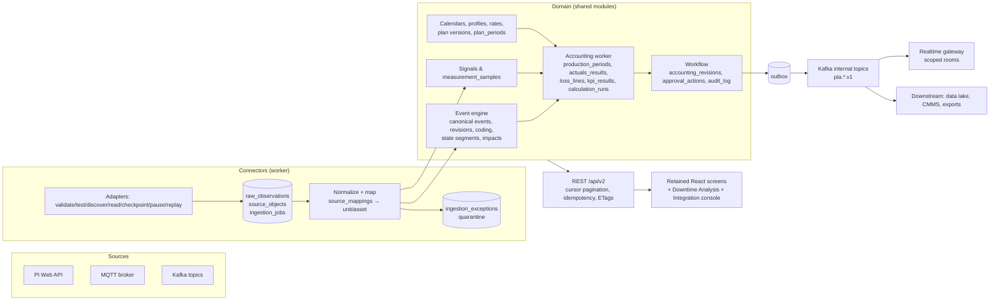

# PLA Next-Generation Specification — Application Analysis

**Source:** `PLA_Next_Generation_Development_Specification.docx` v1.0, 7 Oct 2026 (22 sections, ~17k words).
**Purpose of this file:** explain what the specification asks the *application* to become, how far the current ProAct code is from it, and the design consequences that drive the phase plan in this folder.
**Related:** [DOWNTIME_AND_LOSS_ACCOUNTING_GAP_ANALYSIS.md](../docs/DOWNTIME_AND_LOSS_ACCOUNTING_GAP_ANALYSIS.md) is the spec's source **S1**; its bug IDs B1–B18 and ingestion gaps I1–I16 are referenced throughout the spec and the plans.

---

## 1. What the specification is

- A **target contract**, not a description of the current app. Every SHALL is a requirement; percentages in S1 are explicitly *not* completion measures (§1).
- **Frontend reuse, backend rebuild.** Keep the React navigation, screens and components; move *all* authoritative calculation, validation, ingestion, tenancy and approval to the server (§1, §16). "A screen with fabricated data or browser-only arithmetic is a prototype capability" (§1).
- **Release R1** (§1.2) is large: tenant isolation, PI event frames *and* actuals, MQTT and Kafka durable intake, canonical events, plant calendars, production profiles and plans, downtime engine, PLA reconciliation, operational OEE, approvals, audit, reports, migration, monitoring and recovery. **All three connectors are R1**, PI piloted first.
- **R2** adds OPC UA via edge adapter, REST/file/DB imports, richer CMMS/Maximo, reliability studies (Weibull), causality assistance.
- **Out of scope:** inventory, sales settlement, GL posting, plant control, replacing Maximo/Cordant.
- **Phase 0 is mandatory verification** (§2, §18.1): record commit, routes, schema, tests, and a demonstration per credited capability. Nothing is "done" because a table or screen exists.
- **Definition of done for R1** (§21.1): three certified ingestion paths; loss/duplicate recovery; period accounting reconciles under approved policy; approved revisions reproducible; tenant isolation on all interfaces; retained screens use real APIs; users complete journeys without spreadsheets.

### What was *not* delivered with the docx
§22.3 lists a handoff package (backlog CSV, traceability file, canonical event JSON Schema, source envelopes, numerical fixtures). **Only the .docx is in the repo.** The plans therefore include authoring these artifacts ourselves from §5.1 (envelope), §14.2 (entities), §15.2 (endpoints) and §19 (fixtures T01–T46).

---

## 2. The paradigm shifts versus the current application

| Dimension | Current ProAct (verified Oct 2026) | Specification target | Spec refs |
|---|---|---|---|
| **Where logic runs** | Browser: OEE, cost auto-fill, unaccounted %, status rules, KB similarity; Plan Dashboard writes OEE on render | Server only. API reads are side-effect free (KPI03). Browser never loads a tenant's events to compute KPIs (UX02) | §1, §12, §16 |
| **Event record** | One mutable `production_events` row; PI re-sync overwrites it (status reset to Open) | Layered: immutable **raw observation** → **canonical event** with **revisions** (source facts vs effective facts) → **user coding** layer with provenance → **accounting revisions**. Source updates can never reset workflow/user fields (ING06) | §4.1, §5.3, §14.2 |
| **Event classification** | `eventType` (ProductionLoss/IOW/SOL/APM/FailureWO/Output) + optional impact/OEE/reason ids; `lossCategory` free text | **Four independent axes**: physical type (downtime/slowdown/quality/output/advisory), schedule class (planned/unplanned/external/unknown), OEE component (A/P/Q/idle/none), cause code. Plus separate **failure code groups** (class/problem/cause/remedy). IOW/SOL/APM/WO stay **advisory** until linked | §3.2 |
| **Time** | Mixed duration units; `duration` not derived; PI open frames stored with 9999-12-31; UTC buckets; browser-local display | UTC `timestamptz`, **half-open** intervals, **durationSeconds derived** at full precision, open event = `endTime null` + `elapsedAsOf`; IANA site timezone; plant-local rendering; DST handled explicitly | §3.3, §9 |
| **Quantities/money** | `decimal(10,2)`, "MT" hard-coded, flat `$100/unit`, floats in reconcile | `numeric(24,8)` with explicit unit, rate timebase, currency; raw + canonical; no float money; missing price → null not zero | §3.3, §11.4 |
| **Period model** | `production_losses.period` free text; one plan target per date range | **Shift leaf periods** (daily if site chooses), day/month aggregates; **product slices**; campaigns; generated UTC boundaries stored | §3.1, §9 |
| **Capacity vs plan** | Single "planned quantity"; unaccounted = fabricated % | **Two ledgers**: capacity (sustained rate) and plan-variance (approved target), each with signed residual; waterfall identities must close exactly; over-accounting and overproduction surfaced | §11.1 |
| **Loss derivation** | Manual categories; "Calculate from Events" uses fake data | Segment at all boundaries; availability loss = rate × non-overlapping stopped time; performance = ideal − gross; quality = gross − good; compute once then allocate; conservation per segment; deterministic auto-line keys | §11.2 |
| **Master data** | Globally unique codes; reason tree not persisted; `idealCycleTime`/`standardCost` unused | Tenant-scoped, **effective-dated versions**: production profiles, unit-product rates (sustained/planning), valuation rates, calendars, reason tree with parent/path, loss category defs; retire not delete | §9, §14 |
| **Workflow** | Status strings set by client; reconcile forms stuck in Draft; plan approval UI-only | **Draft → InReview → Approved** (immutable) with Reject and **Revise** (new linked draft); content hash; separation of duties; late corrections → change proposal | §13 |
| **Ingestion** | PI EF pull only; no paging (>500 skipped); watermark always advances; in-memory lock; no raw store; other sources stubbed | **Durable intake**: raw retained before ack (FND01); at-least-once + idempotent (inbox/outbox, FND02); leased jobs with checkpoints; quarantine + replay; **PI + MQTT + Kafka** adapters sharing one envelope | §4.3, §5, §6, §7 |
| **Downtime engine** | None — downtime is whatever event the user/PI created | **State engine**: Running/Stopped/ReducedRate/Idle/Changeover/Unknown segments from signals, debounce, micro-stop threshold, staleness → Unknown; union overlap (T03); unit impact rules; primary-cause/weighted allocation | §8 |
| **Tenancy & API** | `tenantId` from query string; one filter at a time; no pagination; 6 unguarded controllers; realtime broadcasts to everyone | Tenant from identity (WF05); **/api/v2** with AND-combined filters, cursor pagination, Idempotency-Key, If-Match/ETag, 422/409/412 semantics; scoped realtime rooms with sequence | §13.2, §15 |
| **Analytics** | Heuristic OEE constants; Pareto without cumulative; unwired selectors | Operational OEE (KPI01) + separately labelled GE-reconciled OEE (KPI04); MTBF/MTTR with evidence rules; aggregations from summed numerators/denominators; every bar drills to the same server filter + calculation run | §12 |

---

## 3. Target architecture (application view)

The spec does **not** require microservices (§20). It asks for one NestJS domain codebase deployed as **API** and **worker** processes, PostgreSQL as source of truth, Kafka as durable internal transport (also an external input), and a transactional outbox.

**Consequences for the code base**
- Introduce a `worker` entrypoint (same Nest modules, different bootstrap) for connectors, state engine and accounting runs. Keep `main.ts` for the API.
- Replace `TableInitService`/`DB_SYNCHRONIZE` with **TypeORM migrations** (expand-and-contract, MIG02).
- Kafka: a dev cluster already exists on this machine (`instrumental-kafka-1..3`, cp-kafka 7.5, stopped) and a Mosquitto broker is running (1883/8883). The Docker Compose added this week packages frontend/backend/Postgres; it will need Kafka and a worker service.

---

## 4. Module-by-module impact on the current code

| Area | Keep | Extend | Replace / retire |
|---|---|---|---|
| **Auth** (`auth/`) | JWT login/refresh, roles list | Tenant + scope resolution from token; `RolesGuard`/`TenantGuard` as global guards; role table per §13.2; SSO (OIDC) later | Public `register` accepting any role; `tenantId` from query |
| **production-event** | Entity as "stable module concept"; module name | Add `physical_state/coding_state/rca_state`, `downtime_class`, `impact_mode`, `duration_seconds` (derived), `is_open`, `current_revision_id`, `canonical` vs `source` identity; `event_revisions`, `event_coding`, `event_relations`, `event_impacts`; split/merge/bulk/close commands; compound query | One-filter controller; Mongo date range; client-set `status`; `duration` with unknown unit (kept as legacy column) |
| **production-plan / template** | Header entity, forms, wizard | `plan_versions`, `plan_periods`, scenario, product slices, generate-periods preview, approve command | 100 units/h default; single `plannedQuantity` as accounting target |
| **production-loss, reconcile-form, loss-category, oee-summary** | Read-only compatibility views during migration | — | Replaced by `production_periods`, `period_product_slices`, `accounting_revisions`, `loss_lines`, `loss_line_evidence`, `kpi_results` (§14.3). No public write to OEE summaries |
| **Codes** (impact/oee/reason) | Libraries stay distinct | Tenant-scoped uniqueness, `parent_id/path/version` on reason codes, default mappings, effective intervals, `failure_code_groups`, `loss_category_defs` | Global unique `code`; hard-coded loss category list |
| **unit / asset / product / tenant** | Entities | `production_profiles`, `unit_product_rates`, `valuation_rates`, effective-dated asset relations, `calendar_versions`, `shift_instances`, site level, `tenants.timezone` actually used | Unused `idealCycleTime`/`capacity`; ambiguous `standard_rate` (split into rate vs cost after D08) |
| **integration/pi-*** | Adapter structure, AF browsing, code resolver, mapping UI shell | Paging, open-frame tracking, overlap scans, deletes confirmation, batch attribute reads, typed mappings (field-by-field merge), signals/actuals (counters, rates, output EFs) | Watermark-only cursor; status reset on update; enumeration `String(obj)`; `pi-proxy` open proxy (allowlist instead) |
| **connectivity** (OPC UA/Modbus/MQTT clients) | `mqtt-client.service.ts` as library wrapper | MQTT adapter implementing the envelope with durable append before ack | Simulated services (`Math.random`), broadcast-only data path (R1 keeps OPC UA out of scope) |
| **streaming / data-source / historian-tag** | `historian_tags` as tag catalog seed for `signals` | — | Browser-side `EventStreamProcessor` as an accounting path |
| **realtime gateway** | Socket.IO | Tenant/site/unit rooms, auth on connect, per-scope sequence, emit from outbox | Global broadcast, duplicate emits |
| **reporting** | Route shape | Read models bound to `calculation_runs`; downtime/reliability/waterfall/loss-tree/OEE/reconciliation/data-quality reports; exports as jobs | `createdAt` filtering; UUID labels; sums of ambiguous `duration` |
| **rca** | Module, trigger config, auto-create | Idempotent `rca-link`, evidence package, versioned trigger rules on confirmed thresholds, action tracking (RCA03) | Duplicate case creation on replay |
| **Frontend** | Navigation, Event Hub, Plans, Plan Dashboard, PLA Analytics, Reports, Codes, Integrations, RCA | Typed v2 client + TanStack Query; Downtime Analysis page; integration console (PI/MQTT/Kafka, jobs, quarantine); declarative rule builder | All browser calculations; heuristic OEE; random fallbacks; `localStorage` rules with `new Function`; render-time writes; IndexedDB `StorageService` |

---

## 5. The mathematics the application must implement (with the fixtures that prove them)

| Rule | Formula / behaviour | Fixture |
|---|---|---|
| Duration | `end − start` in seconds; display converts | T01 (06:00–07:30 → 5400 s) |
| Open event | `end = null`, `elapsedAsOf` from server; never duration to 9999 | T02 |
| Unit downtime overlap | union of eligible intervals; asset totals not additive | T03 (10–11 + 10:30–11:30 → 5400 s) |
| Clipping | split at shift/day/campaign/rate/schedule boundaries; one occurrence | T29 (05:50–06:20 across 06:00 → 600 + 1200 s) |
| Plan ledger | `gap = target − actual`; `attributed = Σ active plan lines`; `residual = gap − attributed` (signed, never clamped) | T15 (1000/850/90+40+10 → residual 10, submit fails at zero tolerance); T16 (over-accounted −10); T17 (overproduction 50, conflict flagged) |
| Capacity ledger | `capacity = exclusion + A-loss + P-loss + Q-loss + good + residual − gains` | T28 (800 = 100 + 100 + 30 + 20 + 550) |
| Rate change | capacity loss uses each rate version's segment | T30 (30 min @100 + 30 min @120 → 110 t) |
| Rate integration | step/linear; timebase → seconds | T25 (120 t/h × 30 min → 60 t) |
| Counter rollover | `M − a + b` if implied rate credible | T26 (995→5, M=1000 → 10) |
| Counter reset unknown | quantity *incomplete*, never guessed | T27 |
| Operational OEE | `A = R/S`, `P = U/R`, `Q = V/U`, `OEE = V/S` with ideal-time weighting | T20 (S 480, stop 60, rate 2/min, gross 756, good 718.2 → 87.5/90/95/74.8125 %) |
| GE reconciled OEE | `A = (G+LP+LQ)/(G+LA+LP+LQ)`, `P = (G+LQ)/(G+LP+LQ)`, `Q = G/(G+LQ)` | T21 (850/100/30/20 → 90/96.67/97.70/85 %) |
| Aggregation | sum numerators and denominators, never mean of % | T31 (90/100 + 450/900 → 54 %) |
| Tolerance | residual always stored; explicit labelled adjustment closes ledger | T32 |
| Missing price | quantity kept, cost **null** | T38 |
| No data OEE | **null with reason**, never 87 % or 100 % quality | T41 |
| Valuation | duration cost = `seconds/3600 × cost_per_hour`; quantity cost = qty × margin/std cost; never add both for the same loss | VAL02 |

---

## 6. Requirement families → where they land in the plan

| Spec family | IDs | Phase / sub-phase |
|---|---|---|
| Processing contract | FND01–04 | 1.5 durable intake, 2.5 calculation runs |
| Ingestion envelope, mapping, ownership, adapters | ING01–07 | 1.5, 1.3, 1.2 |
| PI | PI01–09 | 1.6, 1.7 |
| MQTT / Kafka / authority | MQ01–05, KF01–05, SRC01–02 | 1.8, 1.9, 1.10 |
| Downtime engine | DT01–11 | 1.1, 1.4, 1.10 |
| Calendars & planning | CAL01–02, PLAN01–06 | 2.1, 2.2, 2.3 |
| Actuals | ACT01–08 | 1.7, 2.4 |
| Accounting & valuation | ACC01–10, VAL01–03 | 2.5, 2.6, 2.8 |
| KPIs & views | KPI01–08, AN01–04 | 2.7, 3.3, 3.6 |
| Workflow, roles, RCA | WF01–05, RCA01–03 | 2.8, 0.4, 3.9 |
| Database | DB01–03 + entity dictionary | 0.3, each sub-phase's schema section |
| API | API01–05 | 0.4, 2.9, 3.1 |
| Frontend | UX01–07 | 3.1–3.8 |
| NFR | NFR01–07 | 3.11, 3.12 |
| Migration | MIG01–06 | 0.1, 3.10 |
| Decisions | D01–D15 | 0.2 (tracked in master README) |

S1 gap groups (§2.3): G01 data integrity → 1.1; G02 source preservation → 1.2, 1.3; G03 reliable intake → 1.5–1.9; G04 secure queries → 0.4; G05 reconciliation → 2.8; G06 master data → 1.3, 2.1, 2.2; G07 true analytics → 2.7, 3.3, 3.6; G08 client & realtime → 3.1, 3.8.

---

## 7. Risks, dependencies and how the plan handles them

1. **Scope of R1 vs team size.** R1 is 12 epics. The spec itself says to start with a **vertical slice** (§20): one PI observation → event → period loss → approved revision → export. The plan marks that slice (Phase 0 + 1.1/1.2/1.5/1.6 + 2.1–2.5 + 2.8 minimal) as milestone **M1** before broadening.
2. **Business decisions block design.** D03 (calendars), D04 (baseline/OEE policy), D05 (actuals authority), D06 (approval roles/tolerance), D08 (margin vs cost) decide schema details. Phase 0.2 collects them with proposed defaults so work is not blocked; defaults are configuration, not omissions (§21).
3. **PI access.** Certification (§6.4) needs a PI Web API with >500 frames, open frames, digital states. The dev proxy points at `87.107.103.198:7443`; D02 must confirm credentials, AF templates and the open-end sentinel.
4. **Infrastructure.** Kafka + Zookeeper containers exist locally (stopped); Mosquitto is up. Phase 0.3 adds them to Compose with a worker service. Production sizing (§17.1) is a Phase 3 design input, not an R1 blocker.
5. **Migration of existing data.** The DB currently holds demo data only, but MIG01 forbids assuming that. Phase 0.1 inventories row counts; 3.10 applies the remediation table (§18.2) regardless.
6. **Missing handoff artifacts.** Fixtures T01–T46 and the envelope JSON Schema are authored in 0.1/1.5 and become the test oracle.
7. **Frontend churn.** Screens are retained but every data binding changes to v2. 3.1 introduces the typed client first; screens migrate one at a time behind feature flags (MIG02).

---

## 8. Reading guide for the plan folder

- `README.md` — master checklist and status (the only place status is summarised).
- `phase-0/` — verification, decisions, environment, API foundation. Nothing else starts before 0.3 and 0.4.
- `phase-1/` — events, intake, three connectors, state engine.
- `phase-2/` — calendars, profiles, plans, actuals, accounting, KPIs, workflow, exports.
- `phase-3/` — frontend rebind, analytics pages, RCA, migration, security, operations, pilot.
- `phase-R2/` — placeholder for the extended ecosystem.

Each sub-phase file has the same sections: Goal · Spec requirements · Current implementation · Target design · Steps (checklist) · Tests · Definition of done · Decisions/risks. A sub-phase is **Done** only when every step is checked, its mapped T-tests pass in CI, and the result is demonstrated end to end (UI or API) — matching §20 "complete only when its mapped acceptance tests pass".
