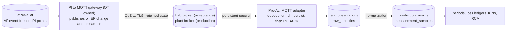

# 1.8 MQTT integration plan: PI → MQTT → Pro-Act

**Status:** 🔄 planning, 2026-10-11 · **Builds on:** `docs/MQTT_INTAKE_DESIGN.md` (design), `docs/MQTT_OT_CONTRACT.md` (what OT must publish), `plans/phase-1/1.8-mqtt-adapter.md` (build steps, T09/T11) · **Decision:** D09 (`plans/DECISIONS.md`, owner answers 2026-10-11)

## Owner answers that shape this plan

| # | Question | Answer (2026-10-11) | Consequence |
|---|---|---|---|
| 1 | Broker | Plant broker in production; **lab broker** for testing | Acceptance runs on the lab broker; the Compose `mqtt` service stays for automated tests only |
| 2 | Topics | **Pro-Act states what it expects; OT designs the topic data model** | `docs/MQTT_OT_CONTRACT.md` is that statement (§2 topics, §3 payloads). OT returns the concrete namespace; we encode it as per-connection `topicTemplate` + `fields`, not code |
| 3 | Payload samples / schema | OT will provide | Gate G1 below: no decoder is finalised before real samples arrive |
| 4 | Event identity | Yes, following standards | `event_id` + `revision` for events (PI EF id + LastModified), `boot_id` + `seq` for delivery; UUID RFC 9562 where OT mints ids |
| 5 | Downtime model | **OT sends start and end time** | Downtime arrives as **interval events**, the same shape as PI event frames. The `state_json` profile and the 1.10 state engine are **not on the MQTT critical path**. Pairing START/END messages (design §5.2) is replaced by revisions of one event (`end_ts` filled in later) |
| 6 | Retained | Yes, messages are retained | Retained = re-send, never a new event; idempotency by `event_id` + `revision`; open events re-published on gateway restart (contract §3.1, §4) |
| 7 | Clock / timestamps | Standard | RFC 3339 with offset, source time, NTP; future skew 300 s, past window configurable |
| 8 | Mapping | **Must be checked: AVEVA PI → MQTT → Pro-Act** | Split 2026-10-11: PI → MQTT is the **data engineering team's** domain; Pro-Act **only picks from MQTT**. WP2 covers the MQTT → Pro-Act half; the PI → MQTT half is theirs, driven by the contract |
| 9 | Retention | **After insertion into the DB the message should be erased** | Read as: (a) the broker releases a message only on Pro-Act's acknowledgement, which is sent after the DB commit (no copies in flight); (b) Pro-Act keeps no spool or file buffer outside the DB; (c) raw payload rows are kept only as long as replay and quarantine review need, then dropped by partition. Confirmed 2026-10-11 "as per current design": raw window **30 days** (D09-R closed) |
| — | Volumes (design Q8) | not answered | Needed from OT (contract §5 item 5) before load sizing (WP4) |

## Data path

## Work packages

### WP1 — OT contract agreed (owner + OT) · gate **G1**
- [ ] 1. Send `docs/MQTT_OT_CONTRACT.md` to the OT team; review meeting; record their topic namespace, ids and attribute dictionary.
- [ ] 2. Receive three real samples per message family from the actual gateway, plus lab broker access (host, TLS CA, user, ACL, session limits).
- [ ] 3. Freeze contract v1.0: JSON Schemas under `server/pro-act-backend/contracts/mqtt/*.v1.schema.json` (draft 2020-12, `additionalProperties:false`), generated from the agreed samples.
- **Exit G1:** schemas validate every sample; topic templates and required captures written down; D09 rows updated.

### WP2 — Mapping study: MQTT → Pro-Act (us); PI → MQTT is owned by the data engineering team
Field-by-field, so nothing is guessed at build time. Output: `plans/evidence/mqtt-mapping-study.md`. The left column is what the data engineering team must source from PI (their work, stated in the contract); Pro-Act verifies only that each MQTT field lands on the right target.

| PI (today, via PI Web API adapter) | MQTT message (contract) | Pro-Act target (existing) |
|---|---|---|
| EF `WebId` / ID | `event_id` | `source_objects.source_object_id`; `messageId = event_id:revision` |
| EF `LastModified` | `revision` | `sourceRevision` (ordering via `decideOrdering`) |
| EF `TemplateName` | `template` | `values.templateName` → attribute-mapping rule set per template |
| EF primary referenced element AF path | `element_path` | `location.sourcePath` → `source_mappings` (exact/pattern, `source_system='MQTT'`) → unit/asset. **Check:** reuse the PI mappings when paths are identical |
| EF `StartTime` / `EndTime` (9999 = open) | `start_ts` / `end_ts: null` | `startTime` / `endTime` (half-open interval) |
| EF attributes (Reason Code, Impact Code, OEE Code, Description, Quantity, …) | `attributes{}` by name | `FieldRule` set (`attribute-mapping/event-field-catalog.ts`) → `MasterDataCodeResolverService` → `production_events` |
| EF deleted | `operation: delete` | `RetractionHandler` |
| PI point value (`Timestamp`, `Value`, `UnitsAbbreviation`, `Good/Questionable/Substituted`) | measurement `signal`, `ts`, `value`, `uom`, `quality` | `signals.source_key = signal`, `MeasurementHandler` → `measurement_samples` |
| PI digital state | `{name, value}` | `values.sample.digital` / value maps |

- [ ] 1. Inventory the EF templates and attributes Pro-Act consumes today (from `attribute_mapping_versions` and the PI connection in Demo Plant) and the signals in use.
- [ ] 2. For each, the data engineering team confirms their gateway emits it (how it reads PI and detects EF updates and deletes is their design; we only need the answer).
- [ ] 3. Decide identity when a PI id is missing (contract: OT mints a UUID; fallback: payload hash + `start_ts`).
- [ ] 4. Decide the quality mapping table and the digital-state vocabulary.
- [ ] 5. ~~Dual source decision~~ **D09-A closed 2026-10-11:** PI → MQTT is not Pro-Act's domain; for MQTT-fed units MQTT is the source Pro-Act consumes. Pro-Act runs no PI pull for those units; if both ever feed the same unit, the 1.10 authority policy applies, but that is not planned.
- **Exit:** every row of the table above has a confirmed source field or an explicit "not available" with a workaround.

### WP3 — Build (maps to `1.8-mqtt-adapter.md` steps 1–4, in this order)
- [x] 1. Spike + skeleton: mqtt.js `handleMessage` persist-before-ack proven on the Compose broker (MQTT 5 and 3.1.1; **lab broker still to run** once access exists, same spec with `MQTT_TEST_URL`), recorded in `plans/evidence/mqtt-certification.md`; `MqttAdapter` (`validateConfig`, `test`, `discover`, `health`, `close`), options factory shared by test and runtime, duplicate-feed guard, `CREDENTIAL_NEUTRAL_KEYS` extension, egress allowlist check. Done 11 Oct 2026 (`src/intake/adapters/mqtt/`; verification in `plans/evidence/phase0-verification.md`).
- [ ] 2. Profiles: `interval_event_json` (events with start/end, revisions, delete), `measurement_json`, `availability`; `state_json` only as decoder + quarantine `no_handler` until 1.10. Topic template parser, identity strategies, RFC 3339 parsing with skew limits, PI quality decoder, value maps with "no silent default".
- [ ] 3. `MqttSubscriberHost` in the worker: lease, reconcile, restart on `config_version`, pause/resume/drain/stop, health heartbeat, `ConnectionChanged` fast path; `IntervalEventHandler` reusing the PI frame path (`PiFrameIngestService`-equivalent for MQTT: attribute mapping → code resolution → placement → create / `applySourceRevision` / retract).
- [ ] 4. Compose: TLS listener + password file on the bundled `mqtt` service; `scripts/mqtt/publish-sim.ts` that replays PI event frames and samples as contract messages (retained state, Last Will, bursts, duplicates, out-of-order revisions).
- [ ] 5. Console (3.7 MQTT panel): status, counters, effective client id, last test, profile editor with live value-map classification, quarantine list; merge-patch for `payloadProfile`; OpenAPI snapshot.
- [ ] 6. Raw retention: partition drop for `raw_observations` rows of MQTT connections after the D09-R window, with the existing "never drop rows referenced by an approval input" rule (3.12 retention job).

### WP4 — Reliability and standards verification · gate **G2**
Run on the lab broker with the simulator and with the real gateway. Each check has a pass criterion and an evidence line in `plans/evidence/mqtt-certification.md`.

| # | Check | Pass criterion | Standard / trap |
|---|---|---|---|
| R1 | Durable before ack | kill the worker after commit / before commit during a 1 000-message burst → each message exactly once in `raw_observations`, one business effect | MQ04, reference T4 |
| R2 | Redelivery (T09) | disconnect subscriber, publish 100 at QoS 1, reconnect → all delivered, duplicates (`dup=1`) counted, no second effect | MQTT 5 §4.3.2 |
| R3 | Retained state and retained event on subscribe | no new event, no new transition; raw rows flagged `retained` | MQ02 |
| R4 | Event revisions | open event, later `end_ts`, later attribute change, out-of-order older revision, delete → one event with correct final state; older revision ignored; delete → retraction | SRC rules, PI EF semantics |
| R5 | Postgres down 10 min while publishing | nothing acked, broker queue grows, drains in order on recovery; health shows `persist_failed` during the outage | reference T8 |
| R6 | Broker restart / plant-broker rebuild drill | subscriber reconnects with backoff; after a rebuild with our user missing, alert fires within N minutes (silence + disconnected) | reference §17 incidents |
| R7 | Gateway Last Will | OFFLINE retained → source unavailable → signals stale; **no** stop created (T11) | MQ04 |
| R8 | Duplicate feed | second connection with overlapping filters → 422; runtime loser parked | reference CHG-062 |
| R9 | Schema violations | wrong `schema_version`, missing `event_id`, local-time `ts`, 9999 `end_ts`, 70 KB payload → quarantined with the right code, session not blocked | RFC 3339, contract |
| R10 | Clock skew | `ts` 10 min in the future → rejected; 8 days old → flagged per configured window | reference T6 |
| R11 | Unmapped machine / code | parked and listed with counter; mapping added → flows without restart | "park, never auto-create" |
| R12 | Load | sustained rate and peak from OT (contract §5 item 5) for 1 h: ack latency p95 < 1 s, no backlog growth, worker memory flat | NFR performance |
| R13 | 24 h outage window | computed from the measured rate vs broker queue limits; documented per connection; alert thresholds 70 % / 85 % | §17.1 |
| R14 | Security | TLS 1.2+ enforced, insecure mode refused outside dev, read-only ACL verified by attempting a publish, secrets never in responses or logs, egress allowlist denies an unlisted broker | IEC 62443, 3.11 |
| R15 | Erase after insertion (owner #9) | broker queue depth for our client returns to 0 after each drain; no Pro-Act file spool exists; raw rows older than the D09-R window are dropped by the retention job and nothing referenced by an approval is lost | D09-R |
| R16 | MQTT 3.1.1 mode | R1–R3 repeated with `protocolVersion: 4` | MQ01 |

- **Exit G2:** R1–R16 green on the lab broker; evidence file complete; D09 rows closed.

### WP5 — Pilot on the plant broker
- [ ] 1. Production connection created with the plant broker, TLS CA, dedicated user; `CONNECTOR_EGRESS_ALLOWLIST` includes the broker host.
- [ ] 2. Two weeks of live intake on the pilot units; daily check of event counts and durations against the data engineering team's own PI view (they own the PI side); quarantine reviewed daily.
- [ ] 3. Runbooks (3.12) exercised once: broker rebuild, gateway restart, silence alert.
- [ ] 4. Owner acceptance; MQTT becomes a certified source (M2 progress).

## Schedule and dependencies

| Order | Item | Needs |
|---|---|---|
| 1 | WP1 contract review | OT availability |
| 2 | WP2 mapping study | WP1 samples; OT answers on the gateway |
| 3 | WP3 steps 1–2 | nothing (can start on the Compose broker while WP1 runs; decoders are finalised after G1) |
| 4 | WP3 steps 3–6 | G1 |
| 5 | WP4 on lab broker | WP3, lab access |
| 6 | 1.10 state engine | only if OT also sends run state (D09-S) |
| 7 | WP5 pilot | G2, plant broker user |

## Decisions to record (D09)

- ~~D09-A~~ **closed:** PI → MQTT belongs to the data engineering team; Pro-Act only consumes MQTT.
- ~~D09-R~~ **closed:** current design; raw rows kept 30 days, broker releases on ack-after-commit.
- **D09-S** Run state over MQTT (contract §3.3): wanted now, later, or never? Decides whether 1.10 joins this track.
- **D09-V** Volumes (steady and peak) once OT measures them.

## Definition of done
Contract v1.0 agreed and schemas committed; mapping study complete with no unresolved row; R1–R16 green on the lab broker with evidence; pilot on the plant broker accepted by the owner; `plans/README.md` 1.8 row 🧪 and D09 closed.
